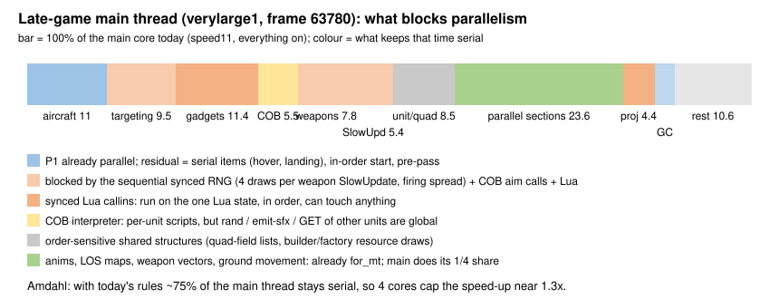
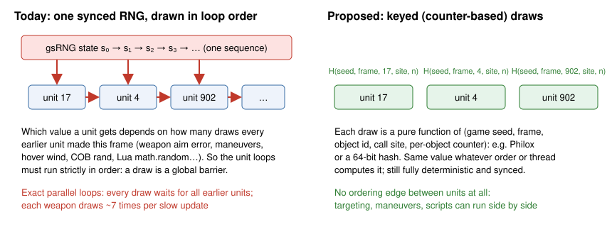
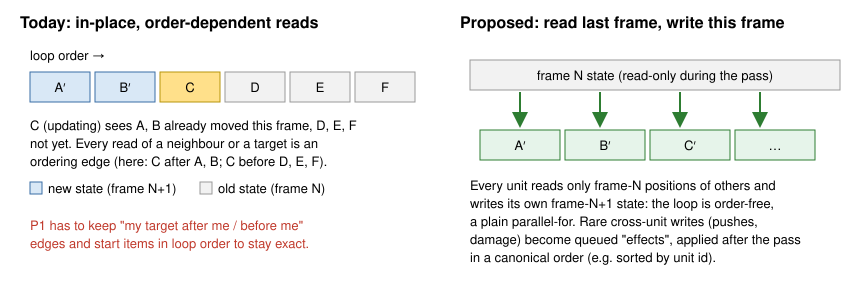

# Engine changes that would make BAR's simulation much faster

*Written 2026-10-17, during the verylarge1 speed work
([worklog-engine-speed.md](worklog-engine-speed.md)). Everything here changes
the simulation's exact results, so a replay recorded on today's engine would not
re-simulate byte-identically on an engine with these changes. That is fine:
every demo pins its engine version, and all players of a new game run the same
new engine, so the game stays deterministic and in sync. What these changes must
NOT do is change how the game plays. Each proposal below says why it would not,
and what it would unlock.*

## Where the time goes, and why it is stuck on one core

verylarge1 is a 16-player Supreme Isthmus game with ~10,000 units and ~5,700
aircraft in its late game. On the dev laptop (4 cores, i7-4980HQ) the late
game's frames take ~30 ms, nearly all of it on the simulation's main thread.
After a day of exact optimizations (PGO+LTO, the sync checker compiled out,
aircraft movement made parallel without changing a single result, ...), the main
thread's time breaks down like this:

About 75% of the main thread is still serial. The reasons are not the
algorithms but four engine-wide rules, each of which turns "update unit A, then
unit B" into a hard ordering, even when A and B are on opposite sides of the map:

| rule | what it forces | where it costs (late game, % of the main core) |
|---|---|---|
| **one synced RNG, drawn in sequence** | every draw depends on how many draws came before it in the frame | weapon SlowUpdate draws 4 per weapon (aim error); firing spread; aircraft maneuvers; hover-aircraft wind every frame; COB `rand`; Lua `math.random` — weapon targeting 9.5%, weapon update/beam lasers 7.8%, unit SlowUpdate 5.4% |
| **in-place, order-dependent reads** | unit k sees units < k already moved this frame and units > k not yet | any unit reading another unit (targets, collisions, transports) |
| **synced Lua called from inside the unit loops** | a gadget may read or write any state at that point | `AllowWeaponTarget` ~3,100 calls/frame, `UnitPreDamaged`, `UnitIdle`, `AllowCommand`, Lua unit scripts — gadgets 11.4% plus their effect of pinning everything around them |
| **order-sensitive shared structures** | insertion order is part of the state | quad-field cell lists, projectile ids, team resource draws by builders/factories — ~8.5% |

Exact parallelization had to work around every one of them. P1 runs 5,231
aircraft per frame side by side, but it still starts them strictly in loop
order. It also keeps an ordering edge between each aircraft and its target,
makes every RNG draw wait for all earlier aircraft, and runs ~425 aircraft a
frame alone as barriers. That is the price of exactness under these rules, and
it is why 4 cores give ~1.3x at most.

## Proposals

Ranked by what they unlock. "Gain" is the estimated late-game main-thread
reduction on a 4-core host, given the measurements above.

### 1. Keyed (counter-based) random numbers instead of one sequential stream

**Change.** Replace `gsRNG.NextFloat()` and its relatives at each call site with a
pure function of `(game seed, frame, object id, call site, per-object counter)`,
for example Philox-4x32 or a 64-bit mixing hash. Each object (unit, weapon,
projectile, script thread) keeps its own small counter. The synced Lua
`math.random` and COB `rand` would draw from the calling object's (or gadget's)
stream.

**Why gameplay does not change.** The numbers are as random as today's
(counter-based generators pass BigCrush), still synced, and still reproduced
exactly from the demo. Only *which* random number lands where changes, which no
player can perceive. A unit's aim error is drawn from its own stream instead of
the 4,117th slot of the frame's stream.

**What it unlocks.** The RNG is the single most common reason for a hard global
barrier. With keyed draws, weapon SlowUpdates (auto-targeting, aim error),
weapon firing spread, aircraft maneuvers, hover-aircraft wind, and most COB
script ticks no longer have any ordering edge between units.

**Gain.** Prerequisite for most of #2 and #4. On its own it lets weapon targeting
(9.5%) and the aircraft loop's serial residue run in parallel: ~10-14%.

**Effort.** Mechanical: ~60 call sites in `rts/Sim`, plus the Lua and COB
bindings. A save game stores the per-object counters instead of one RNG state.

### 2. Units read the previous frame's state of other units

**Change.** During a unit pass, reads of *another* unit's position, speed,
health or flags go to a frame-start snapshot (or a double-buffered copy of the
hot fields), and each unit writes only its own next state. The rare writes to
other units (collision pushes, crush, transport, damage) are queued as effects
and applied after the pass in a canonical order, such as sorted by
(target id, source id).

**Why gameplay does not change.** Today half of every pass already sees the
other units one frame stale, namely all units later in the loop. The proposal
makes it consistently one frame stale: 1/30 s, about 0.5 elmo for a fast
fighter. No player could tell.

**What it unlocks.** Every per-unit pass becomes an order-free parallel loop with
no dependency analysis at all: move types (ground and air), `CUnit::Update`,
weapon updates, SlowUpdates, LOS states, and quad-field updates (batched per
cell, sorted by id). P1's in-order start, target edges and replanning all
disappear.

**Gain.** With #1 and #3 together, the unit passes (~59% of the main thread
today) become ~90% parallel: ~35-40% of the main thread, realistically 25-30%
after sync points.

**Effort.** Large: it touches every move type and the weapon code. It can be
done pass by pass, starting with aircraft (whose cross-unit reads are only the
target) and weapons.

### 3. Synced Lua callins out of the unit loops: queued events and declarative hooks

**Change.** Callins that today run *inside* a unit's update are queued with a
sort key and dispatched in one batch at a fixed point of the frame. This covers
`UnitPreDamaged`/`UnitDamaged` from collisions, `UnitIdle`, `UnitCmdDone`,
`AllowCommand` from command AIs, and `UnitMoved`. Callins whose answer the
engine needs immediately get declarative replacements:

- `AllowWeaponTarget`: BAR's only handler ("AA Targeting Priority") multiplies
  the priority by a constant per target unit def and always allows. That is a
  table, and the engine could take it once, for example as
  `Script.SetWeaponTargetPriority(weaponDefID, targetDefID, mult)`. N1
  (an exact native fast path, after verifying the gadget's source) shows the
  equivalence. It also removes ~3,100 Lua calls per frame.
- `UnitPreDamaged` for crashing aircraft (`unit_crashing_aircraft`, the biggest
  piece of that callin): a unit-def flag "crash instead of dying".
- `ShieldPreDamaged` (`unit_shield_behaviour`): engine-side shield rules.

**Why gameplay does not change.** Gadgets see the same events, a few
microseconds later within the same frame, in a defined order. Gadgets that react
to an event by changing other units would see end-of-pass state instead of
mid-pass state. That is a behaviour change only in degenerate cases, and BAR's
gadgets do not depend on mid-loop timing in any way the profiles show.

**What it unlocks.** Without Lua inside them, the unit passes need no global
barrier at all (with #1 and #2). Batched dispatch also cuts the gadget
handler's per-callin overhead (~1% of the main thread in `gadgets.lua`
dispatch).

**Gain.** Direct: ~3-4% (N1-style tables, batching). Indirect: it removes the
barrier that would otherwise cap #2.

### 4. COB scripts: per-unit streams, queued global side effects

**Change.** COB `rand` uses the unit's keyed stream (#1). `emit-sfx`, `explode`,
`play-sound`, `call-script` into other units, and `GET`/`SET` of other units
become queued effects, applied in canonical order. Animation opcodes (`turn`,
`move`, `spin`, `wait-for-*`) already touch only the unit's own pieces.

**Why gameplay does not change.** The same scripts with the same results, applied
within the same frame.

**What it unlocks.** `CCobEngine::Tick` (5.5%) becomes a parallel loop over units'
script threads, in the same way the anim ticking (`TickAllAnims`) already is.

**Gain.** ~4%.

### 5. Order-free bookkeeping: quad field, projectile ids, resource draws

**Change.**

- Quad-field cells hold units sorted by id, instead of in insertion order. Moves
  are batched per cell after a pass.
- Projectile ids come from (owner id, weapon number, per-weapon counter).
- Builders' and factories' resource requests are collected and granted in
  sorted order at the end of the pass, instead of first-come-first-served
  inside it.

**Why gameplay does not change.** Same queries, same projectiles, same economy
rules. Only the arbitrary tie order is pinned to something that does not depend
on thread timing.

**What it unlocks.** `CQuadField::MovedUnit` (2.5%), weapon firing and builder or
factory updates (2.8%) parallel.

### 6. Stop doing work nothing consumes

Some of these are already done in this repo's patched engine; upstream would
benefit from all of them.

| item | cost | status |
|---|---|---|
| per-write sync hashing (`SyncedFloat3`, `SyncedPrimitive`) + `SYNC_HISTORY` ring | **7.9%** of the late window | done here (`SYNCCHECK=OFF`). Upstream could checksum a frame-end digest of the state instead of every write, which is O(units) once instead of O(writes). |
| per-anim checksum in `TickAllAnims` | ~0.3% of a core | done (H72, it only fed the sync checker) |
| eager piece-transform walk when nothing draws | ~2-3% of all threads | done (H73). The old `#ifdef HEADLESS` version never compiled in `rts/Sim`. |
| unsynced particles (crash smoke, nano spray, CEGs) created in headless runs | part of projectiles' 4.4% | not done: a missile keeps a raw pointer to its smoke trail, so they cannot simply be dropped. A null trail object would make it safe. |
| BAR's default LuaUI widget suite in replays | 6.2% | done (seeded widget config) |
| our own capture widget sampling ~10k units in Lua | ~2% | engine-side recorder planned |
| idle worker threads spinning between parallel sections | energy, see below | engine default |

### 7. Thread pool energy policy

The laptop can only sustain ~2.8-3.3 GHz on one core while the others work. The
measurements:

- **7 threads, same clock:** the late window is 6.2% faster with every core
  capped at 2.6 GHz.
- **7 threads, whole game, uncapped:** slower. The main thread drops from
  2.78 GHz to 2.36 GHz, because six busy workers take the package's power.

Workers that spin while waiting are pure loss on any power- or thermally-limited
host, which is most laptops and many servers under load. The pool should park
idle workers quickly and give them larger, fewer tasks, so the main thread keeps
its turbo.

## What it would add up to

| step | main-thread serial share (late game) | speed-up of the late game on 4 cores |
|---|---|---|
| today, exact (P1, P2, N1, H72, H73) | ~75% | 1.0x (baseline here; already 1.2x faster than stock + earlier patches) |
| + #1 keyed RNG | ~60% | ~1.2x |
| + #2 snapshot reads | ~35% | ~1.6x |
| + #3 Lua out of the loops, #4 COB, #5 bookkeeping | ~20-25% (gadget `GameFrame` logic, GC, frame glue) | ~2-2.3x |

The last row is what the 10-minute verylarge1 goal needs (~1.9x on the whole
game, whose late game is 77% of its time). It also needs a host that can feed
four busy cores at a reasonable clock: on this laptop, energy per frame matters
as much as the critical path.

## Order of work that would pay off soonest

1. **#1 keyed RNG.** Self-contained, mechanical, and it unblocks everything else.
2. **Declarative `AllowWeaponTarget` (part of #3).** Small engine API plus a
   ten-line gadget change. The exact version is already running here (N1).
3. **#2 for aircraft and weapons first.** Aircraft only read their target, and
   weapons read targets and terrain, so these passes are the largest and the
   easiest.
4. **Queued damage/kill effects and Lua event batching (rest of #3), then #4/#5.**
