# Making BAR re-simulation faster: what was done and what it measured

## Context

barreplay ([replay.fogofwar.dev](https://replay.fogofwar.dev)) re-simulates
finished BAR games so a viewer can show every unit of every player. It plays
the game's demo file in `spring-headless` with a read-only widget that records
the units once a second. The demo holds only player inputs, so the engine
computes the whole game again.

Every change described here keeps the result **byte-identical**. The
recorded file of the whole benchmark game hashes to the same value on the
stock engine and on every build below, and a second, smaller game is used as a
quick gate. The demo also carries every player's sync checksum every 60
frames, so a change to any simulated value would show within two seconds of
game time.

The benchmark, "verylarge1" (game `6a37d06acbb455b1d19179d8ec965f10`), is a
16-player Supreme Isthmus game of 51 minutes on the 2026.07.04 engine. At
frame 63,780 it has 10,496 units, 5,711 of them aircraft (mostly fighters).
The host is a 4-core / 8-thread laptop (i7-4980HQ, 15 GB, no GPU).

Terms used below:

- **Exact**: a change that leaves every simulated value unchanged.
- **Serial loop**: a loop over units that has to visit them one at a time, in
  a fixed order, on the main thread.
- **Slow-update loop**: `CUnitHandler::SlowUpdateUnits`. Each frame it runs
  `CUnit::SlowUpdate` and the weapons' `SlowUpdate` for a slice of the units,
  so each unit gets one about twice a second. That is where resource upkeep,
  auto-heal and the weapons' search for a new target live.
- **Fork-join section**: a loop the engine already runs on its thread pool
  (`for_mt`), where the main thread takes a share and then waits for the
  slowest worker.
- **Script tick**: the part of the frame that runs the units' COB script
  threads and their animations.
- **Drain**: in a pipelined loop (P4, P8 and P10 below), the main thread
  waiting for the work running on other threads before it makes a write that
  work might read.
- **Late windows**: 450 frames (15 s of game time) after frame 63,780 and
  after frame 82,000, each timed from a saved checkpoint (see below). Gains
  are given as "63,780 / 82,000" where both were measured.

## Result

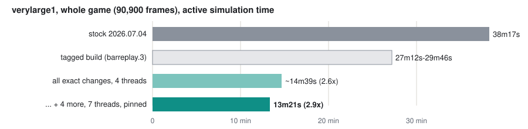

| verylarge1, whole game (90,900 frames) | stock 2026.07.04 | revision 3 | revision 5 |
|---|---|---|---|
| active simulation time | 38m17s | 27m12s-29m46s | **9m56.0s** |
| speed-up | | ~1.3-1.4x | **3.85x** |
| recorded file | | identical | identical |

Revision 5 is tagged `patched-engine/2026.7.4-barreplay.5` (Linux, and
`-windows-amd64` for Windows). It is what re-sim hosts download now. It holds
every change below, with each switch defaulting to the measured setting, and
is built for generic x86-64 like the stock release. On the smaller gate replay
it simulates in 1m11s against stock's 1m52s.

The goal set for this phase, verylarge1 in under ten minutes, was first met
by a build for Haswell CPUs (9m59.3s). The published generic build is 3.3 s
faster still, because its profile (PGO) was retrained on the final code.

"Active" leaves out the pauses the benchmark takes to let the laptop cool (see
"How it is measured").

The stock engine's recording differs from the others only in its hit,
projectile and blast records. BAR's widget sandbox hides attackers and
explosions from a user widget, so a stock run
records hits without attackers and infers explosions. The patched engine logs
them itself and the widget reads that log. Unit positions, health, events and
economy are identical.

## How it is measured

On a big game almost all of the time is the late game:

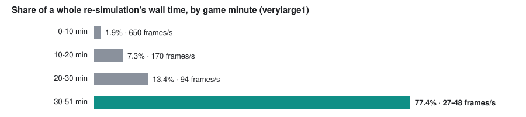

Whole games turned out to be a poor yardstick. A small game is fast on every
build, and a whole big game takes 10-40 minutes on a laptop whose clock speed
depends on its temperature: the same code took 19m14s on a cool day and 23m21s
heat-soaked. So decisions are made on short windows:

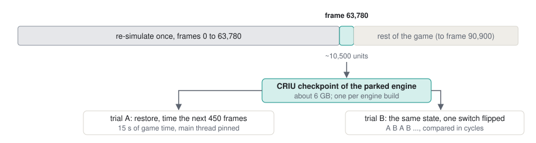

- The engine is re-simulated once to frame 63,780 (or 82,000) and parked
  there. The process is then saved with CRIU (a Linux checkpoint/restore tool)
  and restored for every trial, so each trial starts from exactly the same
  state.
- Trials alternate (A B A B ...), the main thread is pinned to its own core,
  and results are read in main-thread **cycles** as well as wall time, since
  cycles do not depend on the clock.
- A checkpoint restores only into the binary that made it, so each build is
  dumped once. Nearly every change sits behind a bit of one of three switch
  words (environment variables), which lets one checkpoint compare many of
  them.
- Whole games are run for byte identity and the overall trend, with a
  governor that pauses the engine at 88 °C and resumes it at 55 °C.

What the measuring itself taught along the way:

- **Short trials and whole games can disagree.** Early on, seven threads won
  6% in a short trial but lost over a whole game, because a hotter chip slows
  the main thread more than extra workers help.
- **A late window hides an early cost.** Five changes that each won the late
  window together made the early game 6.7% slower; see "What pays late can
  cost early" below. Since then every A/B runs five windows (frames 15,000,
  35,000, 63,780, 72,000 and 82,000).
- **Read medians, not means.** A restore keeps the process's memory on 4 KiB
  pages until the engine's huge-page thread (section 3) folds it again, and a
  trial started at once ran ~19% slow. The harness now waits until huge pages
  cover what a fresh run has, but one slow trial in three still turned a
  -2% mean into +3.4%.
- **Compare builds only on their own profiles.** The builds are PGO + LTO
  builds. A build carrying two new patches on the previous build's profile
  ran its whole game 2.6% slower than the build before, because the rewritten
  functions were compiled without profile data; retrained, it was level.
- **The main core's clock depends on the others.** It runs at 3.69 GHz with
  every core busy and 3.95 GHz alone, so a change that keeps workers busy
  pays part of its gain back in clock.

## Where the time goes

**The main thread waits for memory.**

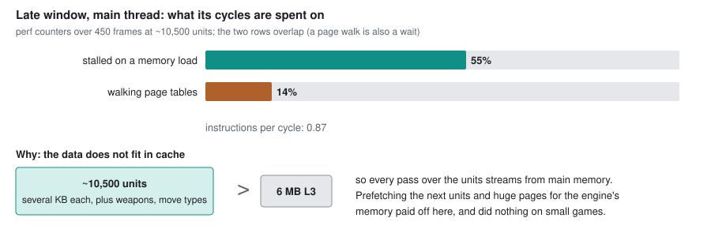

**The main thread is the bottleneck.** Workers run at about a third of a core
each: they mostly wait for the main thread's serial loops. The main thread's
late-window profile midway through this phase, with P1, P2 and N1 of section 2
in place but not yet P4 or anything after it:

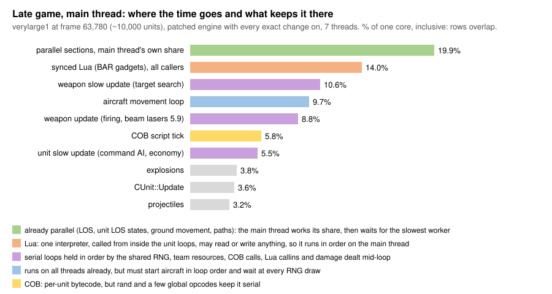

Nothing in it is bigger than about 10%, so the work became many small wins,
plus running more of the serial loops in parallel without changing their
result. The second is most of what follows. What is left after all of it is
under "What is left" at the end; running the rest in parallel needs engine
rules to change, which is what
[proposed-engine-breaking-changes.md](proposed-engine-breaking-changes.md) is about.

## The changes

Every change belongs to one of five kinds, and each kind has its own section
below. Each change's "where" column says where it is:

- **rev 3**: in revision 3 of the patched engine,
  `patched-engine/2026.7.4-barreplay.3`, the older tag;
- **rev 5**: new in revision 5, `patched-engine/2026.7.4-barreplay.5`, the tag
  re-sim hosts download now;
- **main**: in barreplay's main branch, outside the engine: the engine config
  barreplay writes, and the capture widget (1.13.1) and the widget config it
  seeds.

Gains are on the late windows unless stated otherwise, each measured alone
against the build before it, so they do not add up. The chart shows the
biggest late-window gains; the rev 3 changes are older and were measured on
other games, so they are only in the tables.

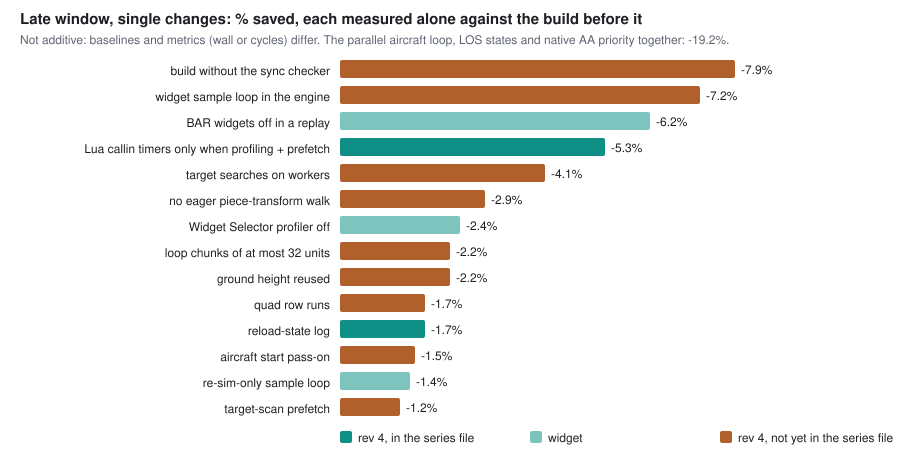

Here are the five categories of changes implemented:

### 1. Removing work nothing reads

| change | where | gain |
|---|---|---|
| demo playback not paced by the client-CPU governor: in demo playback the local `CGameServer` holds the client's sim at 60% of the CPU (`LagProtection`); a replay has nothing to protect | rev 3 | -15% wall |
| no save of the previous frame's transforms (draw interpolation state) in headless runs | rev 3 | -3.7% instructions |
| no `.smt` map tile decode in headless runs | rev 3 | -25% load time |
| Lua callin timers run only while the profiler is on (they wrapped every callin) | rev 5 | -5.3% together with the loop prefetch (section 3) |
| the Widget Selector's profiler column off (it wrapped every widget callin in a timer) | main | -2.4% wall |
| BAR's ~320 game widgets set to off in the seeded widget config, names read from the game package; BAR's 2026.10.13 sandbox took away the widget's old runtime way of doing this | main | -6.2% |
| build with `SYNCCHECK=OFF`: the sync checker hashes every synced write, and only multiplayer desync detection reads the hash (needed four small compile fixes) | rev 5 | -7.9% |
| the per-animation checksum in `TickAllAnims` computed only with the sync checker | rev 5 | in the above |
| skip the eager piece-transform walk in headless demo playback; the transforms only feed drawing (the old `#ifdef HEADLESS` versions of such patches never compiled in `rts/Sim`) | rev 5 | -2.9% wall |
| a headless demo queues no unsynced height-map updates (their rectangle queue once grew to 4 GiB from garbage rectangles) | rev 5 | robustness, speed-neutral |
| in a demo replay the unsynced halves of LuaRules and LuaGaia receive no events and no `SendToUnsynced` messages (the arguments are still checked) | rev 5 | -2.2% / -2.4% |
| the unit, feature and projectile drawers take no events in a headless run (adding and removing ~10k entries in their lists by linear search) | rev 5 | -0.2% / -1.7% |
| builders' nano particles skipped after the piece query (which runs the unit's script, so it stays); explosion generators answer without spawning effects | rev 5 | -0.3% / -0.5% |
| no smoke trails behind missiles, starbursts and debris; the one synced value a trail fed (`useAirLos`, read by `InLos`) computed without it | rev 5 | -0.9% / -1.9% |

One of these changed the recording once, though not the simulation. With the
unsynced Lua halves muted, BAR's unsynced "Widget Events" gadget no longer
forwarded `UnitGiven` to LuaUI, and the capture widget, which also hears the
engine's own call, recorded each transfer differently. `UnitGiven` and
`UnitTaken` are now still delivered.

### 2. Running serial work in parallel, exactly

Each change here runs work on several threads while proving that no unit can
see a difference; that proof is most of the work. All of them are in rev 5.
The intricate ones are described under the table, with a diagram each.

| change | where | gain |
|---|---|---|
| P1: the aircraft move-type loop on all threads | rev 5 | -8.3% main-thread cycles (first version) |
| P1: crashing aircraft that cannot reach the ground this frame in parallel | rev 5 | -19.2% together with P2, N1 and the piece-transform skip (section 1) |
| P1: hovering, stunned and unfinished aircraft in parallel | rev 5 | not measured alone |
| P1: an item passes the in-order start on before waiting for its target | rev 5 | -1.5% |
| P1: landed and taking-off aircraft, aircraft standing still in the air, and items claimed in batches | rev 5 | each loses alone, together -1.4% to -3.3% |
| P2: unit LOS states computed in parallel, applied in order | rev 5 | in the -19.2% |
| N1: BAR's AA-priority `AllowWeaponTarget` done in C++ | rev 5 | in the -19.2% |
| P4: the slow-update loop's target searches on worker threads | rev 5 | -4.1% wall, -4.4% main-thread cycles |
| P4 v2: a moving enemy waits only for the searches that can see it | rev 5 | halves P4's waits; -1.3% / +0.6% |
| P5: the COB script tick on the workers, with the sequential result | rev 5 | -1.2% wall, -6.3% instructions |
| P7: the LOS update's per-unit work during the script tick | rev 5 | -1.5%; v4 another -1.2% / -0.8% |
| P8: the weapon vectors computed ahead of the weapon loop | rev 5 | -2.7% / -2.9% |
| P10: fighters' enemy-aircraft searches started early, on a guess | rev 5 | -2.2% / -0.7% |
| P11: the animation tick's parallel part and its in-order pass as one pipeline | rev 5 | -0.3% / -0.5%; v2 -1.9% / -0.7% |
| P12: projectile collision detections first on all threads; projectiles that can act on nothing skipped | rev 5 | v2 -1.9% / -0.4% |
| the LOS types' height-map updates (each type scanned all its instances per crater) on all threads | rev 5 | -1.8% |
| the per-frame Lua garbage-collection step on its own thread during the LOS update, which runs no Lua | rev 5 | -1.9% / -3.5% |
| the ground move system's two single-threaded loops on all threads (serial while a Lua script listens) | rev 5 | -1.4% / -2.6% |
| the LOS map work as one set of tasks across sensor types and ally teams | rev 5 | +0.3% / -0.2% |
| the capture widget's bulk sample call computes its per-unit half on all threads | rev 5 | -0.0% / -0.5% |

**P1: the aircraft move-type loop on all threads.** BAR sets `collide = false`
on every aircraft except four flying fortresses, so a flying fighter's update
reads only itself and its target.

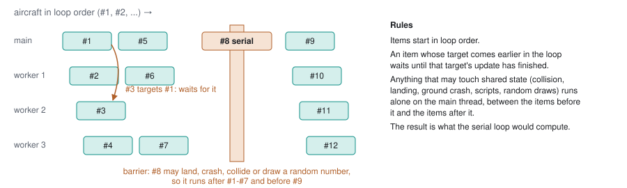

Later versions moved more cases into the parallel part: crashing aircraft that
cannot reach the ground this frame (their smoke trails deferred to loop
order), hovering, stunned and unfinished aircraft, landed aircraft and
aircraft taking off, and aircraft standing still in the air. The last three
each lost alone and won together: each removes a different kind of serial
aircraft, and only all three shorten the chain of in-order starts that the
parallel items wait on. Two hangs were found and fixed on the way: a
parallel loop started from inside a serial item (now runs inline), and a race
on the "how far have we got" counter, caused by x86 store buffering (now a
sequentially consistent store and fence, plus a periodic rescan).

**P2: unit LOS states** (`CUnit::UpdateLosStatus` for every ally team)
computed in parallel, then applied and evented in loop order. They are a pure
function of the unit and the LOS maps, so only the application has to be
ordered.

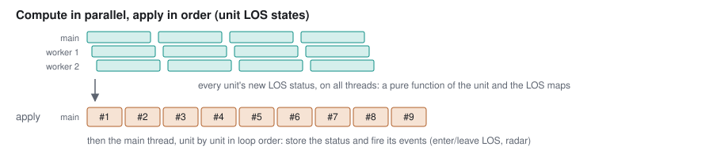

**N1: BAR's "AA Targeting Priority" `AllowWeaponTarget` done in C++.** It is a
per-unit-def multiplier, called about 3,100 times a frame in the late game. The
native version is used only after the gadget files hash to the known content
and the installed closure checks out, does the same single-precision multiply,
and falls back to Lua on any mismatch.

**P4: the slow-update loop's target searches on worker threads.** Each weapon's
`AutoTarget` search (`GenerateWeaponTargets` plus the `TryTarget` walk over
candidates) runs on a worker while the main thread goes on with the next
units' slow updates. Results are applied in launch order. Everything else stays
on the main thread where it was: the random draws (`NextVector` plus
`NextFloat`, about 7 per weapon), COB queries and Lua. The main thread waits
for running searches only before a write a search might read: an enemy moving
or dying inside a running search's circle, damage, quad changes, and Lua
functions that write sim state or read a weapon's target. A check mode compared
210,486 searches against the serial result with no mismatch.

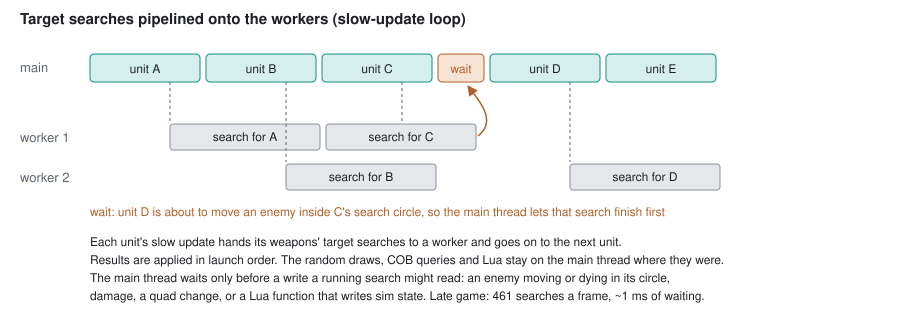

P4 v2 narrows the enemy rule: a moving enemy waits only for the searches whose
scan would read it, not for one whose ally team neither sees it nor has it on
radar, nor for one it is out of range of (the scan's own test on the same
inputs). That halved the waits. One finding from P4: more search workers made
the main thread wait longer. A search the main thread runs itself is fast
because its caches are warm from the unit's own slow update; a worker's are
cold.

**The race P4 had, and how it was found.** P4 was exact in every check, and
still the whole game came out different in about half the runs. The first
difference was always the same: at frame 66,706 a kill was credited to the
wrong unit.

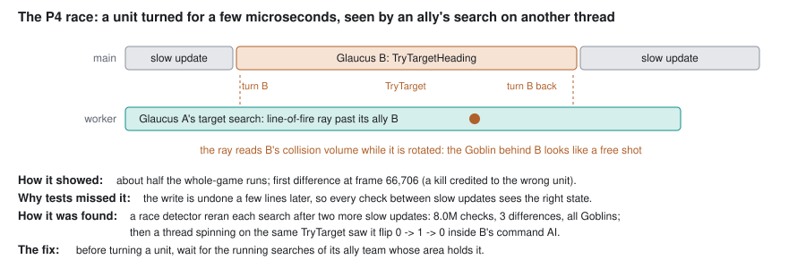

The cause was a write that undoes itself. `CMobileCAI` (attack orders,
hold-position checks) asks "could this weapon hit after turning?" through
`CWeapon::TryTargetHeading`/`TryTargetRotate`. Those write the owner's
`heading`, `frontdir` and `rightdir` directly, call `TryTarget`, and write
them back. For those few microseconds the unit's collision volume is rotated.
A search by one of its allies running on a worker casts line-of-fire rays
(`TraceRay`, `TestCone`), which read the searcher's own side's units, and a
ray could slip past the turned ally.

Every rule P4 had was about writes that stay (positions, deaths, quad lists),
and every check ran between slow updates, where the turned state never exists.
Only a reader running during the window could see it. Two tools found it:
- a race detector that ran each search a second time after two more slow
  updates, which found 3 differences in 8.0 million checks, all with Legion
  Goblins as the candidate;
- a thread evaluating one `TryTarget` over and over, which saw it flip from 0
  to 1 and back inside one allied Glaucus's command AI.

The fix: before turning a unit, `TryTargetHeading` waits for the running
searches of the unit's ally team whose area holds it. After it, every whole
game came out identical.

**What pays late can cost early.** P4, P5, P7, N2 and a parallel LOS height-map
update had each been measured on the late window only, where each won. Run
together at three points of the game, they told a different story:

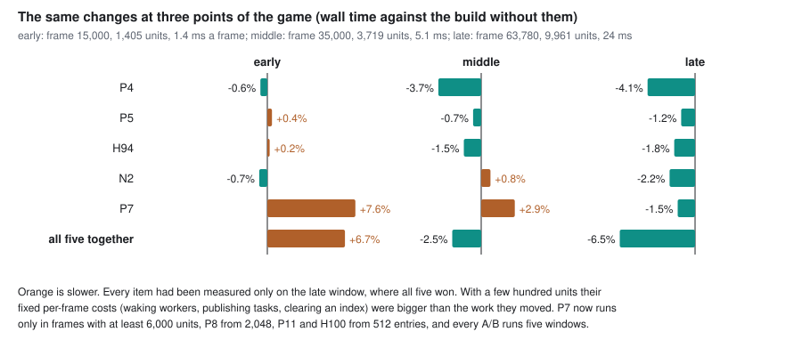

With a few hundred units, the fixed costs of a parallel section (waking
workers, publishing tasks, spinning on the result) are larger than the work it
moves. P7 was most of it, partly because it cleared a 32,000-entry index every
frame. So the parallel items now switch themselves on by the size of the
frame's work: P7 from 6,000 active units, P8 from 2,048, P11 and the ground
system's loops from 512 entries. Each is exact either way, so the threshold
changes only the speed. That gating alone took the whole game from 13m08s to
12m41s.

**P5: the COB tick on the workers, with the sequential result.** Most of the
script tick is script threads that animate their own unit and sleep: walk
cycles, turret idles.

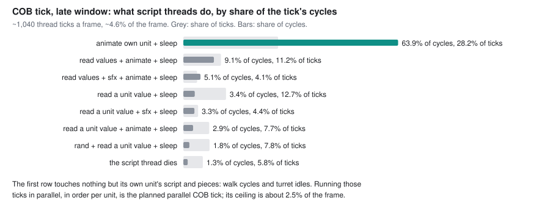

Each COB function is classified once, from its bytecode: it is "own-unit" if it
uses only script state, its unit's pieces and animations, sleep and wait,
signals, two of its own flags, and reads of unit values from a fixed list. A
thread whose every function on the stack is own-unit is ticked on a worker; a
thread of the same unit always follows the one before it. `RAND` and starting
a new script thread (`START`) are serial points that wait for every earlier
tick. The global bookkeeping (sleep queue pushes, thread ends, the animation
list, visual effects) is buffered and applied in tick order at each segment's
end. Two facts made it worthwhile:
- sleep pushes commute, because the sleep queue orders by (wake time, id);
- visual `EMIT_SFX` calls are safe to defer, because the wakes they spawn draw
  from the unsynced random generator. Before that, every hover unit's wake was
  a barrier, and only half the late game's ticks qualified.

With that, 10,399 of BAR's 12,173 COB functions qualify.

**P7: the LOS update's per-unit work during the script tick.** Running the
LOS update in the background after its usual point bought nothing, because BAR
reads LOS at the top of every Lua `GameFrame`, right after it. The window
before it is the free one: nothing in the script tick reads LOS.

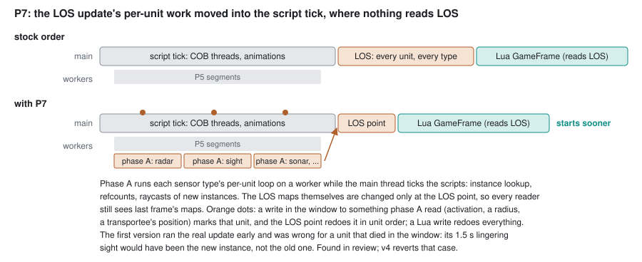

The first version ran the real per-unit update early and was wrong, caught in
review before any build: a unit that crossed an LOS square and then died in
the window would have kept its new instance as its 1.5 s lingering sight
instead of the old one. The kept design:
- **Phase A** runs on the workers during the script tick. In v2 it only tested
  which units the update would act on. In v4 it runs each sensor type's
  per-unit loop itself, one task per type.
- **Every write in the window to something phase A read** marks its unit:
  activation, a sensor radius set from COB, a transportee moved after the
  animations, a stun or team change. A Lua write marks everything.
- **The LOS point** redoes the marked units in unit order, reverts phase A's
  work for a unit that died in the window, and only then changes the LOS
  maps. So every reader before it sees last frame's maps, and the LOS
  bookkeeping comes out in the stock order.

**P8: the weapon vectors computed ahead of the weapon loop.** Each frame the
engine computes every weapon's aim and muzzle position (`UpdateWeaponVectors`)
in a fork-join section, and then the serial weapon loop updates the weapons.
The main thread did a third of the section and then waited for the rest. P8
turns the two into a pipeline:

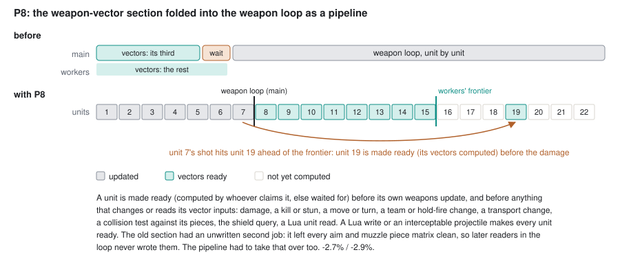

The vectors read only the unit's position, direction vectors, piece matrices,
weapon-use flags and the height map, and the height map is fixed during the
loop (map damage is applied in its own phase). So a unit's vectors are right
as long as they are computed before anything in the loop changes those. The
hard part was finding everything that does, and everything that reads another
unit's vectors: a beam's collision test against a unit's pieces, the shield
query, Lua's unit reads, P4's search tasks. An audit of everything the weapon
loop reads of units other than the one updating doubled the first list. It
also showed that the old section had a side effect nobody had written down: it
left every unit's aim and muzzle piece chains with clean matrices, so later
readers in the loop never wrote them. With P8, a reader could otherwise race a
worker computing the same unit, so the collision code makes the unit ready
first. With P8 in, an older change that kept a weapon's vectors while all its
inputs were bitwise unchanged also started to pay (-1.4% / -0.7%): the beam
laser's own update repeats a computation from earlier in the same frame, and
its misses now cost the workers rather than the main thread.

**P10: fighters' enemy-aircraft searches started early, on a guess.** A
fighter on a fight order or auto-targeting looks for enemy aircraft in its
slow update (`CAirCAI`). At the start of each slow-update slice, P10 predicts
those searches' arguments for the fighters in the slice and starts them on
P4's workers.

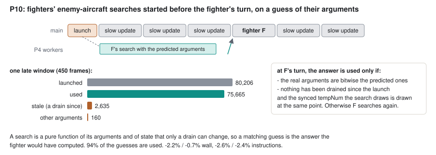

The search is a pure function of its arguments and of state that only a drain
can change. So when the fighter's turn comes, the answer is used only if the
real arguments are bitwise the predicted ones and nothing has been drained
since the launch. The synced temporary counter (`tempNum`) the search would
have drawn is drawn at the same point either way. A fighter entering the
crash state counts as a drain. A check mode compares every used answer with a
fresh search: 0 mismatches.

**P11: the animation pipeline.** The animation tick had a parallel section
and then an in-order pass that applies the results. P11 lets the in-order
pass start on the first results while the workers are still on the rest; v2
has the workers take chunks from the back, so the in-order pass stops waiting
inside the chunk it needs next. A Lua unit script's `AnimFinished` callback
first waits for every script to be ticked.

**P12: projectile collisions, skipped when nothing can have changed.** The
synced projectile collision pass checks every projectile in order, and most
check, find nothing and do nothing.

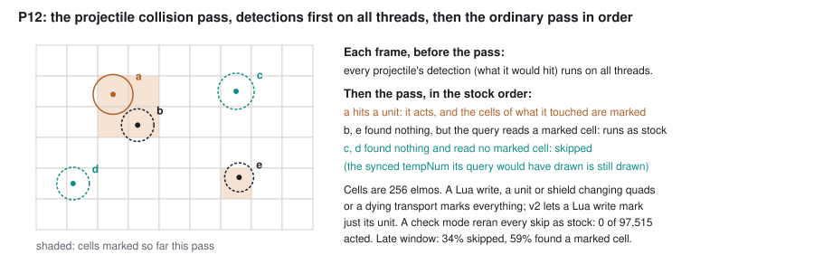

Detections run on all threads before the pass. In the pass, a projectile
whose detection found nothing is skipped, provided nothing it read can have
changed since the detection: its own position, speed and radius are bitwise
the same and no cell of its query has been marked. Everything the pass does
marks the cells of what it touches (a damaged or killed unit and its shields,
an added or removed feature, a shield taking a projectile). A Lua write marks
just its unit, and a unit or shield changing quads, or a dying transport,
marks everything. A check mode ran every skip the ordinary way and counted the
ones that acted: 0 of 97,515.

### 3. Cheaper memory access

The main thread mostly waits for memory (see "Where the time goes"), so these
make the same work cheaper rather than removing it.

| change | where | gain |
|---|---|---|
| `StaticMemPool` pages zeroed when handed out, not all at startup (the loader already zeroed them) | rev 3 | -1.05 GiB memory |
| `TextureMemPoolSize = 0` in the engine config, so no 512 MB bitmap arena is zeroed at startup | main | -0.5 GB memory |
| prefetch the unit 8 ahead (its move type and first weapon 4 ahead) in the four per-unit loops | rev 5 | in the -5.3% of section 1 |
| a low-priority thread folds every large private anonymous mapping into huge pages every 2 s (no root, no host setting) | rev 5 | -19% main-thread user cycles on a fresh run |
| `GenerateWeaponTargets` prefetches the candidate 6 ahead | rev 5 | -1.2% |
| `MovedUnit` copies the quad list instead of taking a pooled buffer (a malloc and free per move) | rev 5 | not measured alone |
| the unit loop prefetches the quad bookkeeping of the units whose collision-map update runs this frame | rev 5 | -0.5% / -0.3% |
| the unit loop's collision-map bookkeeping: lines prefetched 16 ahead, the rate of 3 as a constant divisor; plus the two changes in section 4 that it measured with | rev 5 | -3.3% / -2.9% for the three |
| prefetches in the weapon loop's setup, `QueueDeleteUnits`, `GetUnitsExact` and the builders' repair search | rev 5 | -0.9% / -1.3% for the four |
| the weapon loop prefetches the lines `CWeapon::Update` reads, which older prefetches at raw offsets had stopped hitting after members were added | rev 5 | -0.5% / -0.8% |

### 4. Less work per call

| change | where | gain |
|---|---|---|
| a coarse grid of "exit-only" yardmap squares, so footprint checks skip blocks that have none ([upstream PR #3254](https://github.com/beyond-all-reason/RecoilEngine/pull/3254), open) | rev 3 | -16% instructions |
| PGO + LTO build | rev 3 | -10% |
| smaller cuts: a cached collision lookup, COB jump-table dispatch, animation ticks, thread-pool batching, path-grid relinking | rev 3 | -0.3% to -1.1% each |
| unit loops hand out chunks of at most 32 units (the main thread used to wait for the slowest worker's quarter) | rev 5 | -2.2% |
| quad lookups (`GetQuads`) find each row's run of quads from its two ends | rev 5 | -1.7% |
| `FindAnim` searches on one packed 64-bit key; on a list out of order it binary-searches the sorted prefix and scans the tail | rev 5 | noise level; the second with the -3.3% of section 3 |
| `UpdatePhysicalState` reuses the ground height while the unit's x/z and the height map are unchanged; the ground move type hands it the height it just read | rev 5 | -2.2%; -0.9% / -0.7% |
| the Lua VM's table get and set do their first step inline; synced `next` calls `lua_next` directly | rev 5 | in the 7-thread result; -0.7% |
| `UpdateUnits` does `UpdateCollisionMap`'s rate test itself, so two units in three never touch their move type | rev 5 | in the 7-thread result |
| N2: BAR's gadget-handler wrapper and loop for four damage and explosion callins done in C, for verified bytecode only | rev 5 | -2.2% |
| a weapon keeps its vectors while every input is bitwise unchanged, compared inline | rev 5 | -1.4% / -0.7% with P8, -0.9% / -0.9% inline |
| a ground height bound per 32x32-square block (raised by every synced write that raises the ground, never lowered): a unit or a ray above it skips the height lookup | rev 5 | in the -3.3% of section 3 |
| a frame's crater LOS updates in one pass per sensor type, rejecting instances out of every crater's reach at once (each crater used to scan every instance) | rev 5 | -1.9% / -2.8% for six changes together |
| Lua's number and pointer hash takes its remainder by a precomputed reciprocal instead of a 32-bit division (every key lands where it did, so `pairs` order is unchanged; tested on 41.6e9 numerators) | rev 5 | noise level |
| `CBuilder::Update` reads the live front command instead of a copy (a temporary forced one per builder per frame) | rev 5 | -2.0% / -1.5% |
| the COB thread map is rebuilt once its deleted entries pile up (every new thread id scanned the whole probe length) | rev 5 | -1.4% / -1.1% |
| calls that change no weapon-vector input (`SpawnCEG`, two weapon reads) skip P8's "make every unit ready" and P12's "mark everything" | rev 5 | -0.5% / -0.2% |
| `TraceRay` skips a unit or feature its segment cannot reach (a sphere test) before building and inverting its transform | rev 5 | -0.8% / -1.0% |

**N2: BAR's gadget callin loops in C, for verified bytecode only.** For
`UnitPreDamaged`, `UnitDamaged`, `Explosion` and `ProjectileDestroyed` the
engine calls a BAR wrapper that opens a profiler zone and loops over every
gadget that registered for the callin. The loop is the same for every game,
and it ran as Lua on every hit.

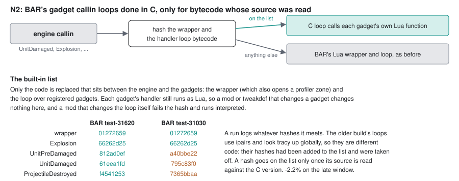

Each gadget's own handler still runs as Lua; only the wrapper and the loop
between the engine and the gadgets are replaced, and only when their bytecode
hashes are on a list built into the engine. The lesson was about that list.
On the gate replay's BAR build three of the five hashes were different, and
they had been added from a run's log. Reading that build's `gadgets.lua`
showed different code (it loops with `ipairs` and looks the profiler up
globally), so the C version would not have done the same thing. They were
removed: a hash a run logs only says what the code is, and a hash goes on the
list only after its source has been read against the C version. The same
extension for `UnitCreated`, `UnitDestroyed` and `UnitCommand` (N3) is
written but switched off: on verylarge1's build two of those callins have two
handlers each whose source has not been read yet.

### 5. The capture widget's work moved into the engine

The widget samples every unit once a second; these let it do so with fewer
calls into the engine.

| change | where | gain |
|---|---|---|
| `Spring.GetUnitSampleData`: the widget's per-second sample in one engine call instead of ~8 per unit | rev 5 | not measured alone |
| the engine logs every write of a weapon's reload state, so the widget reads that log instead of polling every launcher every frame | rev 5 | -1.7% |
| a re-sim-only sample loop in the widget, without branches a full-view re-sim cannot take | main | -1.4% |
| `Spring.GetUnitSampleDelta`: the widget's whole sample loop done in the engine | rev 5 | -7.2% with its widget side |
| the widget's damage records packed by the engine (`Spring.DrainLoggedDamageColumns`) instead of in Lua | rev 5 | -0.6% |

Each of these engine calls answers only a full-view (spectator) Lua state, so a
playing client cannot read enemy units through them, and the widget uses them
only when the engine offers them.

### A bug fix worth taking upstream

`CRectangleOverlapHandler::StageSplitTooLarge`
wrote through a reference into a vector across `push_back`. That is a
use-after-free and corrupted the heap, seen as an RmlUi crash at frame 78 of
verylarge1 in some builds
([issue #3548](https://github.com/beyond-all-reason/RecoilEngine/issues/3548)).

## Measured and ruled out

| idea | finding |
|---|---|
| approximate simulation | the demo carries every player's sync checksum every 60 frames; any changed value fails within 2 game seconds |
| run-ahead prefetch on the main thread's hyperthread sibling | +11.6% (slower) |
| LOS update running in the background, joined before every LOS read | noise: BAR's `api_teamstats` reads LOS at the top of every `GameFrame`, so only the frame's tail overlaps (P7 uses the window before the LOS point instead) |
| P7's phase A started later in the script tick | +2.8% / +5.9%: it needs the whole tick |
| targeting scans precomputed on all threads and replayed in order | 85% of scans replayed, but +1.8%: the precompute visited more than the scan |
| the collision-map decision computed on all threads before the unit loop | +0.9% / -0.1%: most units return at the first position comparison anyway |
| `CUnit::Update` on all threads in runs between serial points | +1.5% / +0.5% at best: 752 busy builders a frame (nano turrets assisting factories) keep the runs short |
| pool workers spinning after their last task instead of sleeping | +7.0% / +28.2%: the main thread polled the queue against the spinners, and the package hit its power limit |
| each unit's slot in its quad lists kept, so leaving a quad needs no search | +1.0%: the time is three dependent cache misses, not the search; prefetching them paid instead |
| more workers for P4's searches | nothing (see P4) |
| LOS update: a parallel pre-pass marking which units need work | noise: the pre-pass reads the same fields the loops did, so the cache misses moved to it |
| reordering `CSolidObject`/`CUnit` fields by the hottest cache lines | +1.1% |
| more prefetching (height map, command queues, quads, death flags) | -0.5% to +0.7%, noise |
| x86-64-v3 (AVX2) build | 1.2% fewer instructions, 0.9% more cycles (the AVX clock) |
| Haswell target with 128-bit vectors and no FMA | -1% / -1.3%, but it crashes on older CPUs, so the published build is generic x86-64 |
| BOLT after PGO | nothing: PGO already lays the code out, and BOLT needs a linker that alone was ~4.6% slower |
| mimalloc large pages | only 61 MB became huge pages; replaced by the background collapse thread |
| transparent huge pages set to `always` on the host | much slower |
| Lua GC pacing at its minimum | +0.7%, noise; the cost is the garbage BAR's gadgets make |
| capping worker cores' clock to leave the main thread more headroom | no help: the cores share one clock domain |
| expiring unsynced projectiles early | crashed at frame 6597: a missile keeps updating its smoke trail |

## What is left

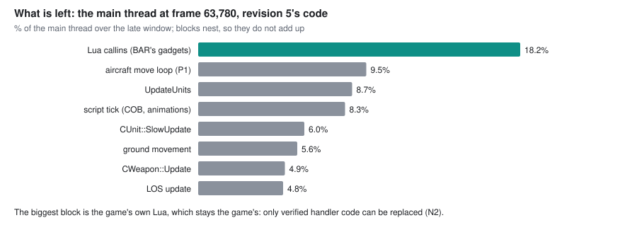

The largest block is BAR's own Lua, which stays the game's: games' gadgets,
widgets and tweakdefs run as written, and only verified handler code (N2) is
replaced. The next steps, ranked by expected gain per effort, are in
[engine-speed-plan.md](engine-speed-plan.md): finishing N3, an audit of every
prefetch by member address, starting P4's searches earlier so its in-order
commit waits less, the widget's projectile frame in the engine, an index of
damaged allies for the builders' repair search, and a retrained profile after
every batch of code changes.

## Where each change lives

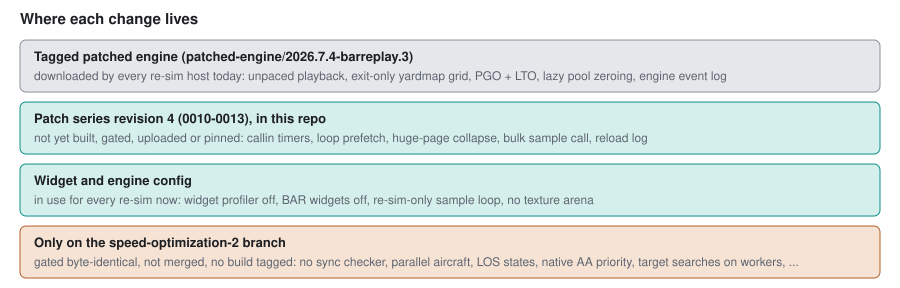

- **Revision 3** (`patched-engine/2026.7.4-barreplay.3`: the series in
  `patches/engine-2026.07.04/series` up to 0009, plus the PGO+LTO recipe).
  It also carries the engine-side event log (0004) that lets the widget record
  hits and explosions under BAR's sandbox.
- **Revision 5** (`patched-engine/2026.7.4-barreplay.5`, Linux and
  `-windows-amd64`). It adds every patch under
  `patches/engine-2026.07.04/speed/` from 0014 to 0160 in number order, then
  0161, which makes the three switch words default to the final setting; the
  environment still overrides each, so a regression can be bisected by
  switching bits off. Rejected patches that later ones were written on top of
  are included and switched off.
  - It is built with `SYNCCHECK=OFF`, so a re-sim on it always reports 0
    desyncs; the byte-identity gate every publish runs is what remains.
  - It targets generic x86-64, with a profile retrained on its own code.
  - Re-sim hosts download it through the pin in barreplay's main branch.
  - Revision 4 was never tagged: its patches went into revision 5.
- **Main**: `TextureMemPoolSize = 0` in the engine config barreplay writes,
  the capture widget (1.13.1) and its seeded widget config. The engine calls the
  widget uses switch on only on an engine that has them.

## Appendix: this repo's names for the changes

The work log, the patch files and `patches/engine-2026.07.04/speed/README.md`
use short IDs. The toggle is the bit in `BARREPLAY_TOGGLES` (t),
`BARREPLAY_TOGGLES2` (t2) or `BARREPLAY_TOGGLES3` (t3), in hex; "always" means
the change has no switch. Revision 5's defaults are `t=d4d87abf`,
`t2=9bae383f`, `t3=6ffffff`, with 7 worker threads.

| ID | patch | toggle | change |
|---|---|---|---|
| 0001 | 0001 | always | unpaced demo playback |
| H30 | `experiments/H30-…` | always | exit-only yardmap grid (upstream PR #3254) |
| H1 | `experiments/H1-…` | always | no previous-frame transform save headless |
| H49 | `experiments/H49-…` | always | no `.smt` decode headless |
| 0003 | 0003 | always | lazy `StaticMemPool` zeroing |
| H65, H66 | 0010, 0011 | always | callin timers only while profiling; loop prefetch |
| H71 | 0012 | always (`BARREPLAY_NO_THP_COLLAPSE` turns it off) | huge-page collapse thread |
| W2, W3 | 0013 + widget | always | `GetUnitSampleData`; reload-state log |
| W1, W4, W5 | widget, config | always | widget profiler off; BAR widgets off; re-sim sample loop |
| SYNCCHECK=OFF | 0014-0017 | build option | no sync checker |
| H72 | 0021 | always | anim checksum only with the sync checker |
| H73 | 0024-0025 | t `0x10` | no eager piece-transform walk headless |
| W6, W7 | 0032 + widget | always | `GetUnitSampleDelta` |
| — | 0033 | always | clamp unsynced height-map rectangles |
| — | 0039 | always | `StageSplitTooLarge` use-after-free fix (issue #3548) |
| P1 | 0018, 0020-0023, 0026 | t `0x1` | parallel aircraft loop |
| P1 v3, v5, v6, v7, v8, v9 | 0021, 0027, 0034-0035, 0042, 0081, 0087 | t `0x8`, `0x20`, `0x80`, `0x2000`, `0x80000000`; t2 `0x20` | crashing / hovering / landed aircraft; early start pass-on; standing still; batches |
| P2 | 0019 | t `0x2` | parallel unit LOS states |
| N1 | 0019 | t `0x4` | native AA-priority `AllowWeaponTarget` |
| H75, H77 | 0036, 0038 | t `0x100`, `0x400` | weapon-loop and target-scan prefetch |
| H76 | 0037 | t `0x200` | chunks of at most 32 |
| H78 | 0040 | t `0x800` | `MovedUnit` copies the quad list |
| H79 | 0041 | t `0x1000` | row runs in `GetQuads` |
| H80 | 0043 | t `0x4000` | packed `FindAnim` key |
| H87 | 0063 | t `0x80000` | no unsynced height-map queue headless |
| H89 | 0064-0065 | always | inline Lua table get/set |
| H88 | 0066 | t `0x100000` | ground height reused |
| H91 | 0067 | t `0x400000` | collision-map rate test in `UpdateUnits` |
| P4 | 0069-0070 | t `0x800000` | target searches on workers |
| P5 | 0073-0078 | t `0x10000000` | COB tick on the workers |
| H92 | 0071 | t `0x4000000` | weapon vectors kept while inputs are unchanged |
| H94 | 0080 | t `0x40000000` | LOS height-map updates in parallel |
| N2 | 0082-0083, 0086, 0088 | t2 `0x1` | native gadget callin loops |
| P7, P7 v4 | 0084-0085, 0091, 0108-0109 | t2 `0x10`, `0x80000` | LOS per-unit work during the script tick |
| — | 0090 | always | P4 fix: wait before `TryTargetHeading` turns a unit |
| H98 | 0095 | t2 `0x800` | quad bookkeeping prefetch |
| H99 | 0098, 0101 | t2 `0x1000` | Lua GC step beside the LOS update |
| H100 | 0099 | t2 `0x2000` | ground system loops in parallel |
| H103 | 0104 | t2 `0x20000` | direct `lua_next` |
| H104 | 0106-0107, 0109 | t2 `0x40000` | unsynced Lua halves muted in demos |
| P8 | 0112, 0116-0118 | t2 `0x200000`, `0x800000` | weapon vectors pipelined |
| P10 | 0119-0120, 0123 | t2 `0x1000000` | speculative fighter searches |
| P4 v2 | 0122 | t2 `0x2000000` | narrower enemy waits |
| H92b | 0125 | t2 `0x8000000` | H92 compared inline |
| H106 | 0127, 0130 | t2 `0x10000000` | block height bounds |
| P11, P11 v2 | 0129, 0139 | t2 `0x80000000`; t3 `0x80` | animation pipeline |
| H108, H127 | 0131, 0156 | t3 `0x1`, `0x800000` | crater LOS updates batched |
| P12, v2, v3 | 0133-0134, 0148, 0151 | t3 `0x2`, `0x10000`, `0x100000` | projectile collisions skipped |
| H109 | 0135 | t3 `0x4` (environment only) | drawers take no events headless |
| H110, H113 | 0135, 0138 | t3 `0x8`, `0x40` | no nano particles; no explosion-generator spawns |
| H111 | 0136 | t3 `0x10` | Lua hash remainder by reciprocal |
| H112, H114, H115, H118, H121 | 0137, 0140-0141, 0144, 0147 | t3 `0x20`, `0x100`, `0x200`, `0x1000`, `0x8000` | unit-loop and weapon-loop prefetches |
| H116 | 0142 | t3 `0x400` | builder reads its live command |
| H117 | 0143 | t3 `0x800` | COB thread map rebuilt |
| H119 | 0145 | t3 `0x2000` | `FindAnim` on a perturbed list |
| H120 | 0146 | t3 `0x4000` | rays above the block bounds |
| H122 | 0149 | t3 `0x20000` | ground move type hands over its height |
| H123 | 0150 | t3 `0x40000` | bulk sample call on all threads |
| H124 | 0151 | t3 `0x80000` | calls that change no vector input skip "make ready" |
| H125 | 0153 | t3 `0x200000` | no smoke trails |
| H126 | 0154-0155 | t3 `0x400000` | LOS map work across types and ally teams |
| W8 | 0152 + widget | always | damage records packed by the engine |
| N3 | 0157 | t3 `0x1000000`, off | N2 for `UnitCreated`, `UnitDestroyed`, `UnitCommand` |
| H128 | 0158 | t3 `0x2000000` | `TraceRay` sphere test |
| H129 | 0159-0160 | t3 `0x4000000` | weapon-loop prefetches by member |
| — | 0161 | — | switch words default to the final setting |

The builds named in the work log: `speed24` (first exact batch, 14m39s),
`speed32` (7 threads, 13m21s), `speed43` (P4 fix), `speed44` (P7 gated, P1
trio, 12m18s), `speed54` (11m39s), `speed58` (P8, P10, 11m04s), `speed60`
(10m41s), `speed65` (goal met, 9m59s), `speed70` (final setting, 10m02s),
then revision 5 (9m56s).
