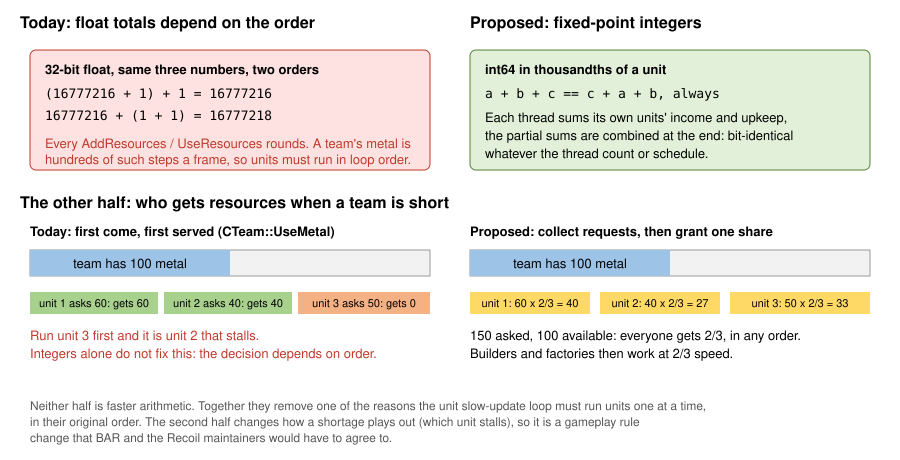
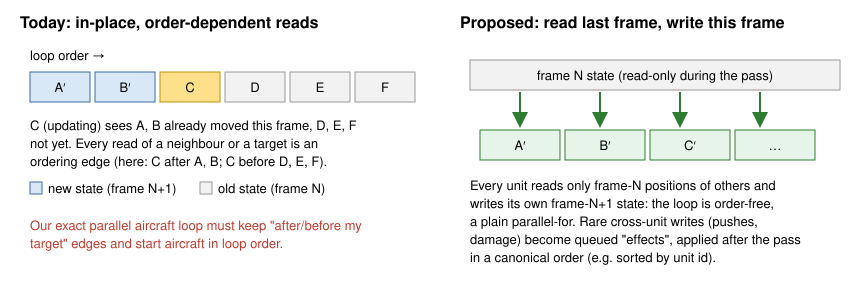
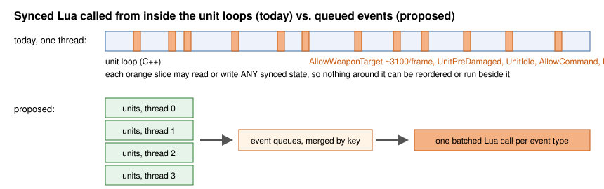

# Engine changes that would make BAR's simulation much faster

## Context

barreplay ([replay.fogofwar.dev](https://replay.fogofwar.dev)) re-simulates finished BAR games: it plays the game's demo file in
`spring-headless` with a read-only widget that records every unit. The demo
holds only player inputs, so the engine has to compute the whole game again,
and the result must match the original game bit for bit. (The demo carries
every player's sync checksum every 60 frames; anything that changes a single
simulated value is caught within two seconds of game time.)

Big games are slow to re-simulate. The benchmark used throughout,
"verylarge1" (game `6a37d06acbb455b1d19179d8ec965f10`), is a 16-player
Supreme Isthmus game of 51 minutes. At frame 63,780 it has about 10,000 units,
5,700 of them fighters. On the stock 2026.07.04 engine it takes **38 minutes**
to re-simulate on a 4-core laptop. More than three quarters of that time is
spent in the last 20 minutes of the game, where each frame takes 20-35 ms.

Terms used below:

- **Exact**: a change that leaves every simulated value unchanged, so old
  replays still re-simulate correctly.
- **Serial loop**: a loop over units that must visit them one at a time, in a
  fixed order, on the main thread.
- **Slow-update loop**: `CUnitHandler::SlowUpdateUnits`. Each frame it runs
  `CUnit::SlowUpdate` and then the unit's weapons' `SlowUpdate` for a slice of
  the units, so every unit gets one about twice a second. Periodic work lives
  there: resource upkeep and income, auto-heal, and the weapons' search for a
  new target.

## What exact changes have achieved, and where they stop

The improvements brought verylarge1 from 38m17s on the stock engine to 13m21s
(2.9x), with the output still byte-identical. The main ones, in plain terms:

| change | gain |
|---|---|
| demo playback not paced by the client-CPU governor (the local server held the sim at 60% of the CPU) | -15% wall |
| a coarse grid of "exit-only" yardmap squares, so footprint checks skip blocks that have none ([upstream PR #3254](https://github.com/beyond-all-reason/RecoilEngine/pull/3254)) | -16% instructions |
| no previous-frame transform save (draw interpolation state) in headless runs | -3.7% instructions |
| no `.smt` map tile decode in headless runs | -25% load time |
| `StaticMemPool` pages zeroed lazily instead of all at startup | -1.05 GiB memory |
| PGO + LTO build | -10% on the late game |
| build without the per-write sync checker (it hashes every synced write, and only multiplayer desync detection reads the hash) | -7.9% |
| aircraft movement loop run on all threads, with every result and every side effect still in the original order | -8.3% |
| units' LOS statuses computed in parallel, applied in order | part of ~-7% |
| BAR's "AA Targeting Priority" `AllowWeaponTarget` done in C++ once the gadget's code is verified unchanged (it is a per-unit-def multiplier) | part of ~-7% |
| weapon target searches of the slow-update loop moved to worker threads, applied in order | -4.1% |
| prefetching in the per-unit loops, huge pages for the engine's memory | -5% / up to -19% of cycles |
| not loading BAR's own LuaUI widget suite in a replay | -6.2% |

They are exact because each one either removes work nothing reads, or runs
work in parallel while proving that no unit can observe the difference. That
proof is the expensive part. The parallel aircraft loop, for example, must
still start aircraft in loop order, make each one wait for its target if the
target comes earlier in the loop, stop every thread at each random-number draw,
and run ~250 aircraft a frame alone (landing, taking off, about to hit the
ground). On 4 cores that gets about 1.3x on the loop, not 4x.

This is where the main thread's time goes now in the late game, with all the
improvements included:

Each of the remaining exact candidates is worth 1-5%. Reaching the goal of
verylarge1 in 10 minutes needs about -30% more, and that needs the serial
loops to run in parallel. Four engine-wide rules prevent it.

## Why the unit loops are serial

| rule | what it forces | examples |
|---|---|---|
| **one shared synced random stream** (`gsRNG`) | each value depends on how many draws every earlier unit made this frame, so units must run in loop order | weapon slow update (~7 draws per weapon), unit position error, aircraft manoeuvres, hover-aircraft wind, COB `rand`, Lua `math.random`, and the insertion position of every new unit in `activeUnits` |
| **float team resources, granted first come, first served** | a team's metal and energy are float sums, and float rounding makes the total depend on the order of additions; a unit whose request fails also depends on who asked first | upkeep, extraction and conditional use in nearly every `CUnit::SlowUpdate`; builders, factories, weapons with a cost |
| **units read each other in place** | the unit being updated sees earlier units already moved this frame and later ones not yet | targets, collisions, transports, lead prediction |
| **synced Lua called from inside the loops** | a gadget can read or write anything at that point | `AllowWeaponTarget`, `UnitPreDamaged`, `UnitIdle`, `AllowCommand`, Lua unit scripts; 14% of the main thread |

A measurement build counted what each unit's step in the slow-update loop
touches. About half of the items draw random numbers, run COB queries and use
team resources. Another fifth touch only team resources: these are units
without weapons, whose only shared state is their upkeep. Only 8% of the
loop's time is in items that touch nothing shared.

## Proposals

Each proposal changes simulation results, so a replay recorded on today's
engine would not re-simulate on an engine that has it. That is acceptable for
new games: every demo pins its engine version, and all players of a game run
the same engine. What a proposal must not do is change how the game plays in general.
They are ranked by what they unlock.

### 1. Keyed random generator streams instead of one shared sequence

**Change.** Today `gsRNG` is one global sequence, so each value depends on how
many draws came before it. Instead, a draw would be a pure function of its
context: a hash of (game seed, frame, object id, purpose, draw index). A
counter-based generator (Philox- or SplitMix-style) is a few dozen lines. The
RNG class and its distributions stay the same; only the source of the state
changes. Each call site needs a key, which is mostly mechanical: weapons use
(unit id, weapon index), units their id, COB (unit id, script thread id),
aircraft their unit id.

**Why it unlocks the most.** The shared stream is the most common thing
forcing the serial loops to keep strict order. The call sites, in the
2026.07.04 source:

- **Weapon slow update** (`Weapon.cpp` l.783-784): every weapon draws
  `NextVector()` (rejection sampling, 3 floats a try, ~5.7 draws on average)
  plus one `NextFloat()` on every slow update, so ~7 draws, and a varying
  number.
- **Unit position error** (`CUnit::UpdatePosErrorParams`, `Unit.cpp` l.595).
- **Aircraft movement**: the parallel aircraft loop's stops exist mainly for
  random draws (loop-backs, hover wind, circling).
- **COB**: `rand` is common in unit scripts (idle animations, effect timing),
  and is one of the main ordering problems for a parallel COB tick.
- **Unit order itself**: `CUnitHandler` inserts every new unit into
  `activeUnits` at a position drawn from `gsRNG` (`UnitHandler.cpp` l.197), so
  the iteration order of every unit loop depends on the stream too.

With keyed streams, a unit's draws no longer depend on which units ran before
it, and large parts of these loops become order-independent with no ordering
machinery for randomness.

One thing this work found makes the weapon case smaller than it first looked:
the weapon slow update's draw count depends only on the stream, not on the
simulation, so today's engine can keep those draws in order on the main thread
cheaply while the target search runs elsewhere (that is how the parallel target
search above stays exact). The keyed stream matters most for the cases that
cannot be precomputed: COB scripts, aircraft, Lua, and the unit order.

**Why gameplay does not change.** The numbers are as random as today's
(counter-based generators pass BigCrush), still synced and still reproduced
from the demo. Only which random number lands where changes.

**What it does not solve.** Team resources (proposal 2), Lua callins
(proposal 4), and damage, kills and projectile creation, which are cross-unit
effects that would need to be queued and applied in a fixed order (proposal 3).

**Gain.** Not measurable without that engine. It is the prerequisite for most
of what follows; on its own it would mainly remove the aircraft loop's stops
and the unit-order dependence.

### 2. Integer team resources, granted in proportion

**The problem is rounding, not speed.** Each float addition rounds its result,
so the total depends on the order of the additions. In 32-bit floats,
(16777216 + 1) + 1 is 16777216, but 16777216 + (1 + 1) is 16777218. A team's
metal is the sum of hundreds of small amounts each frame: extractor income,
upkeep, build costs. `CTeam::AddEnergy` also clamps at storage and books the
excess, which depends on the order too. Since the simulation must reproduce
the demo bit for bit, every unit's `AddResources` and `UseResources` has to run
in the original order. `CUnit::SlowUpdate` makes those calls for nearly every
unit (`Unit.cpp` l.1066-1087), and that alone forces the slow-update loop to
run serially, or to record every call and replay it in order.

**Change, first half: fixed-point integers.** Store metal and energy as
integers, say in thousandths of a unit. Integer addition is exact, so any order
gives the same total. Threads can each sum their own units' contributions and
combine them at the end, or add atomically, and the result is still
bit-identical. The arithmetic costs the same. What changes is that the loop is
allowed to run in parallel.

**Change, second half: proportional grants.** Integers alone are not enough.
`UseResources` is also a decision: it takes the resources only if the team has
enough at that moment, and the unit only works if it got them. When a team is
short, whoever asks first wins, so order still matters, integers or not. To
remove that, collect every unit's request for the frame, then grant each the
same fraction: 150 metal asked with 100 available gives every unit two thirds.

**Why gameplay changes only slightly.** Totals over a second are the same.
What changes is which unit stalls during a shortage: today it is whichever
unit came later in an order players cannot see; with proportional grants
everything slows down evenly. That is a rule change, so BAR has to agree to
it, but it is arguably the rule players already assume.

**What it unlocks.** Together with proposal 1, it removes one of the two main
reasons the slow-update loop stays serial. Units without weapons (a fifth of
the loop's items) would then touch no shared state at all.

**Effort.** The type change touches the team, the unit's resource calls, Lua's
`GetTeamResources`/`AddTeamResource` bindings and the economy stats. The
proportional grant is a small new phase at the end of the slow update, plus
the builder and factory code, which today asks per frame and needs to wait one
step for its grant.

### 3. Units read the previous frame's state of other units

**Change.** During a unit pass, reads of another unit's position, speed,
health or flags go to a copy taken at the start of the frame, and each unit
writes only its own new state. The rare writes to other units (collision
pushes, crushing, transport, damage) are queued and applied after the pass in
a fixed order, for example sorted by (target id, source id).

**Why gameplay does not change.** Today the units later in the loop already
see each other one frame stale. This makes it consistently one frame (1/30 s,
about half an elmo for a fast fighter) for everyone.

**What it unlocks.** With proposals 1 and 4, every per-unit pass becomes a
plain parallel loop with no dependency tracking: move types, `CUnit::Update`,
weapon updates, slow updates and quad-field updates (batched per cell, sorted
by id). Everything the exact parallel aircraft loop does to stay in order
(in-order start, waiting for targets, re-checking its plan) disappears.

**Effort.** Large. It can be done pass by pass, starting with aircraft (whose
only cross-unit read is their target) and weapons.

### 4. Synced Lua out of the unit loops

**Change.** Callins that run inside a unit's update today are queued with a
sort key and dispatched in one batch at a fixed point of the frame:
`UnitPreDamaged`/`UnitDamaged` from collisions, `UnitIdle`, `UnitCmdDone`,
`AllowCommand` from command AIs, `UnitMoved`. Callins whose answer the engine
needs at once get declarative replacements:

- `AllowWeaponTarget`: BAR's only handler multiplies the target priority by a
  constant per target unit def and always allows. The engine could take that
  table once, for example `Script.SetWeaponTargetPriority(weaponDefID,
  targetDefID, mult)`. This repo's exact C++ version of it shows the result is
  the same, and it removes ~3,100 Lua calls a frame.
- `UnitPreDamaged` for crashing aircraft (`unit_crashing_aircraft`): a unit-def
  flag "crash instead of dying".
- `ShieldPreDamaged` (`unit_shield_behaviour`): engine-side shield rules.

**Why gameplay does not change.** Gadgets see the same events, later in the
same frame, in a defined order. A gadget that reacts to an event by changing
other units would see end-of-pass state instead of mid-pass state.

**What it unlocks.** Without Lua inside them, the unit passes need no global
stop at all (with proposals 1-3). It also removes most of the waiting in this
repo's parallel target search, which stops for Lua functions that write state.

### 5. COB scripts: per-unit randomness and queued global effects

**Change.** COB `rand` uses the unit's keyed stream (proposal 1). `emit-sfx`,
`explode`, `play-sound`, calls into other units' scripts, and `GET`/`SET` of
other units become queued effects, applied in a fixed order. Animation opcodes
(`turn`, `move`, `spin`, `wait-for-*`) already touch only the unit's own
pieces.

**What it unlocks.** The COB tick (5.8% of the main thread) becomes a parallel
loop over units, like the animation tick already is. COB is an integer-only
stack machine, so compiling its bytecode ahead of time would also be exact.

### 6. Order-free bookkeeping

- Quad-field cells hold units sorted by id instead of in insertion order, and
  moves are applied per cell after a pass.
- Projectile ids come from (owner id, weapon number, per-weapon counter)
  instead of a global counter.

Same queries and same projectiles; only the tie order is pinned to something
that does not depend on thread timing. It lets `CQuadField::MovedUnit` and
weapon firing run in parallel.

### 7. Stop doing work nothing uses

Some of these are already done in this repo's patched engine; upstream would
benefit from all of them.

| item | cost in the late game | status here |
|---|---|---|
| per-write sync hashing (`SyncedFloat3`, `SyncedPrimitive`) and the sync-history ring | 7.9% | built with `SYNCCHECK=OFF`. Upstream could checksum a digest of the state once per frame instead of hashing every write. |
| per-animation checksum in `TickAllAnims` | ~0.3% | removed (it only fed the sync checker) |
| eager piece-transform walk when nothing draws | ~2-3% of all threads | skipped in headless builds. Note that `#ifdef HEADLESS` never compiles in `rts/Sim`, which builds once for all targets; a run-time test is needed. |
| unsynced particles (crash smoke, nano spray, CEGs) in headless runs | under 1.5% | kept: a missile holds a raw pointer to its smoke trail, so they cannot simply be dropped |
| Lua callin timers outside profiling | ~1% | only while profiling |

Fixed along the way: a use-after-free in
`CRectangleOverlapHandler::StageSplitTooLarge` (a reference into a vector kept
across `push_back`), seen as heap corruption on verylarge1
([issue #3548](https://github.com/beyond-all-reason/RecoilEngine/issues/3548)).

### 8. Thread pool: idle workers should sleep, not spin

The simulation is mostly one main thread; the `ThreadPool` workers help only in
short parallel sections, and between them they
spin-wait for the next task. On a laptop or any power-limited host, a spinning
core takes clock speed from the main thread, which is the one that sets the
pace. On verylarge1, 7 threads were 2.5-6% faster than 4 at a fixed clock, but
slower over a whole real game, because the main thread dropped from 2.78 to
2.36 GHz. Parking idle workers quickly, and handing out fewer, larger tasks,
would let extra threads help instead of hurt.

## What it would add up to

These are estimates from the profiles, not measurements.

| step | main-thread time that stays serial (late game) | late-game speed-up on 4 cores |
|---|---|---|
| today, every exact change | ~70% | 1.0x (already ~2.9x faster than stock over the whole game) |
| + 1 keyed random streams, 2 integer resources | ~55% | ~1.2x |
| + 3 previous-frame reads | ~35% | ~1.6x |
| + 4 Lua out of the loops, 5 COB, 6 bookkeeping | ~20-25% (gadget `GameFrame` work, GC, frame glue) | ~2x |

The last row is roughly what verylarge1 in 10 minutes needs. It also needs a
host that can keep four busy cores at a reasonable clock.

## Appendix: this repo's names for the exact changes

The work log and the patch files use short identifiers. Some of these changes
are not merged yet and exist only on the `speed-optimization-2` branch. Patches are under
[`patches/engine-2026.07.04/`](../patches/engine-2026.07.04/) (0001-0013, the
patch series; 0001-0009 are tagged as `patched-engine/2026.7.4-barreplay.3`) and
[`patches/engine-2026.07.04/speed/`](../patches/engine-2026.07.04/speed/README.md)
(0014 on, with toggle bits and measurements).

| name | what | patches |
|---|---|---|
| P1 (v2-v7) | the aircraft movement loop on all threads, ordered exactly | 0018, 0020-0023, 0026, 0027, 0034-0035, 0042 |
| P2 | units' LOS statuses in parallel, applied in order | 0019 |
| P3 | target scans precomputed in parallel (rejected: slower) | rejected/0058, 0061-0062 |
| P4 | weapon target searches of the slow-update loop on workers | 0069-0070 |
| N1 | BAR's `AllowWeaponTarget` priority done natively after verifying the gadget | 0019 |
| `SYNCCHECK=OFF` | build without the sync checker | 0014-0017 |
| H65, H66 | callin timers only while profiling; prefetch in the unit loops | 0010, 0011 |
| H71 | background thread collapsing the engine's memory into huge pages | 0012 |
| H72 | per-animation checksum only with the sync checker | 0021 |
| H73 | skip the eager piece-transform walk headless | 0024-0025 |
| H74-H91 | smaller items: prefetches, chunk sizes, quad lookups, height caching | see speed/README.md |
| W1-W7 | barreplay's widget and widget config (BAR's widgets off, bulk sampling in the engine) | 0013, 0032, `assets/lua/replay_uploader.lua` |
