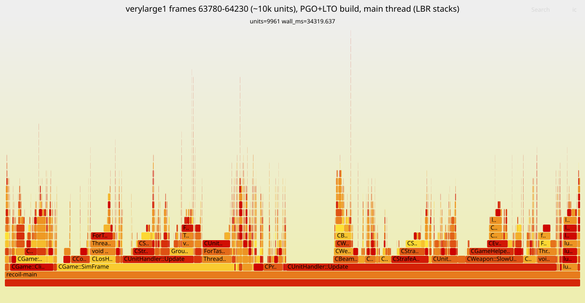
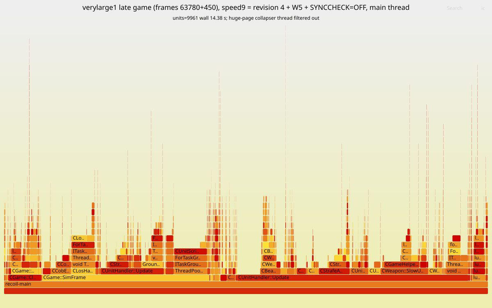
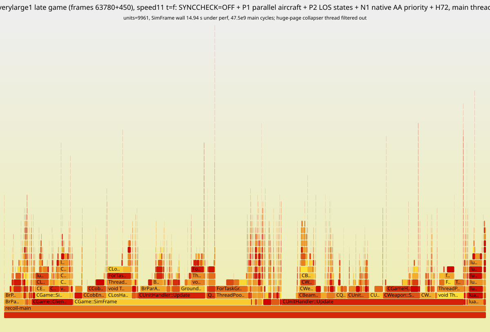
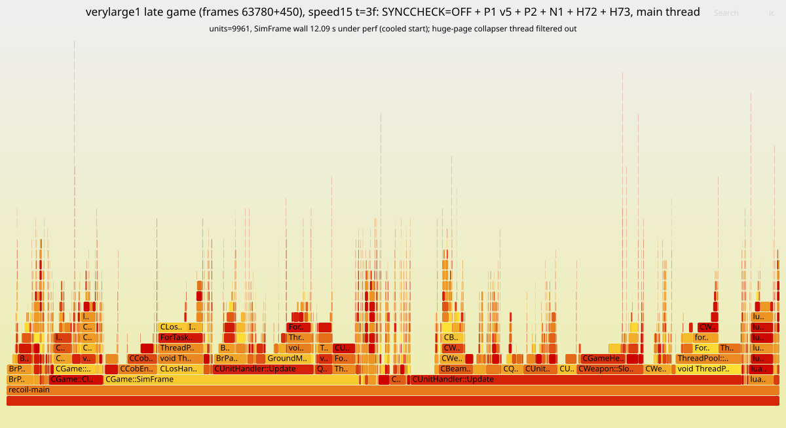
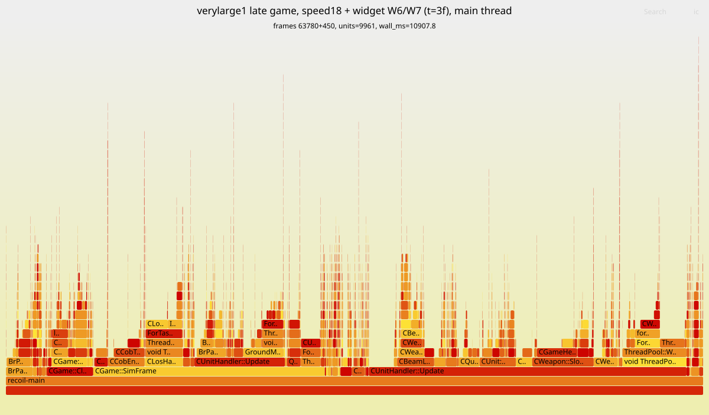
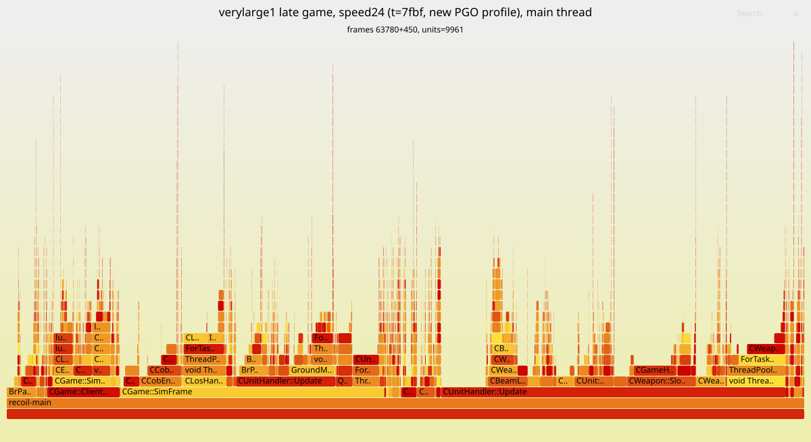

# Work log: re-simulation speed (round 3)

Branch `speed-optimization` (Recoil side: branch `speed3` in
`~/dev/barreplay-engine-build/recoil`). Newest entries at the bottom; every
entry from 2026-10-15 09:26 on carries the time (UTC). Round 1/2 history:
`patches/engine-2026.07.04/RESULTS.md` and `experiments/LOG.md` — read the
measurement rules there (interleaved pairs, never a sub-10% wall delta from
single runs on one box).

Host for this round: i7-4980HQ (4 cores / 8 threads), 15 GB RAM, no GPU;
/tmp is a 7.6 GB tmpfs (builds, captures and checkpoints live under ~/dev).

## Benchmarks

| name | gameId | what | how |
|---|---|---|---|
| **verylarge1** | `6a37d06acbb455b1d19179d8ec965f10` | late game, ~10k units, 19.5 fps | CRIU checkpoint at frame **63780**, windows of 450 / 900 frames (`tools/bench-ckpt/bench-ckpt.sh`) |
| medium | `4936896a8b258d038cbd28f55eb15ed2` | 16p 13:25, ~280 fps — TOO SMALL to judge speed by (the user's call); still the byte-identity gate | full runs |
| isthmus | `6122896ac3328104d12093d975c61214` | 8v8 27:31, ~210 fps | full runs (held-out identity check) |

## Results summary

Speed is judged on **verylarge1** from now on; the medium/isthmus numbers
below predate the checkpoint harness. "Identical" = the .brp is byte-identical
to the stock/rev-2 capture.

| candidate | identical | medium (full / bench window) | verylarge1 | verdict |
|---|---|---|---|---|
| BAR widget suite left on (sandbox) | yes | ±0 | — | no cost; dropped |
| `-worker-threads 7` | yes | ±0 | — | dropped |
| H60 FindAnim + COB DIV shift, H61 COB threaded dispatch, H62 Lua threaded dispatch | yes | instr -1.1%, wall ±0 | wall +0.8%, instr -0.2% (noise) | no late-game value |
| PGO (on H60-H62) | yes (medium, isthmus) | wall -3.8% (3/3), instr -3.3%; isthmus -4% | wall -1.9% / -3.7% (two sessions), instr -1.7..-3.3% | small |
| H63 GenerateWeaponTargets: TestTarget after LOS/range | yes (medium) | — | 23.34 s -> 23.37 s, ±0 | no value; kept (exact, harmless) |
| H64 prefetch in GenerateWeaponTargets | — | — | 23.32 s -> 23.36 s, ±0 | reverted |
| THP `always` (host setting) | — | — | 20.9 s -> 26.9-31.1 s (much WORSE) | dropped |
| PGO retrained on verylarge1's late game (`pgolto2`) | yes (medium) | — | 20.91 s -> 20.88 s, ±0 vs first PGO+LTO | no extra gain |
| CPU pinning: one hyperthread per core / main thread alone on a core | — | — | -1.1% (2/3) / -0.7% (3/3) | host setting, small; noted only |
| **PGO + LTO** (on H60-H63) = **revision 3, published** | yes (medium, isthmus, verylarge1 full 90,900 frames) | full run 1m25s -> **1m16s (-11%)** | wall **-10.2%** (3/3), instr **-15.3%** | **keep** |

Whole game against the stock engine (2026-10-18 00:55):

| verylarge1, whole game (90,900 frames), governed | stock 2026.07.04 | `speed24` `t=7fbf` (0014-0043) | ratio |
|---|---|---|---|
| active sim | 38m17s | ~14m39s | 2.61x |
| sim including thermal pauses | 1h0m38s | 38m19s | |
| main-thread cycles | 8.44e12 | 3.27e12 | 2.58x |
| main-thread average clock | 3.66 GHz | 3.68 GHz | |
| worker cycles (3 workers) | 6.07e12 | 2.97e12 | 2.04x |
| peak memory | 6.48 GiB | — | |

## Log

(Entries before 09:26 carry only the date; their commits landed at 07:16,
07:33, 08:07, 08:41, 08:52 and 09:08.)

- 2026-10-15: BAR decides which widgets load from the saved order list
  (`LuaUI/Config/BYAR.lua`, `barwidgets.lua` ~l.1362): a name with order <= 0
  never loads, sandbox or not. barreplay already seeds that file
  (`engine.EnableWidget`), with only its own widget, because it cannot name
  BAR's. The names ARE readable from the installed rapid package
  (`packages/<md5>.sdp` -> `pool/xx/yyy.gz`): 320 of test-31630's 326
  `luaui/widgets/*.lua` declare `name = "..."` in GetInfo (242 enabled).
- 2026-10-15: MEASURED, and dropped. The gate replay `4936896a…` on the
  patched build (rev 2), two interleaved pairs, BAR's suite disabled (the old
  default) vs enabled (what the sandbox now forces):
  sim 1m26s / 1m26s disabled, 1m24s / 1m27s enabled — no difference, and the
  captures are byte-identical. The patched engine already starves the draw
  side (0001 + throttle-draw), so the suite's per-frame callins are noise.
  Not worth harvesting widget names from the archive. Back to the engine.
- 2026-10-15: `perf_event_paranoid` was 4 (Ubuntu default), which blocks perf;
  set to 1 through a privileged container (sudo docker). RESTORE to 4 when done:
  `sudo docker run --rm --privileged  sh -c 'echo 4 > /proc/sys/kernel/perf_event_paranoid'`.
- 2026-10-15: fresh profile, medium mid-game, rev-2 build (`~/dev/perf3/profile.sh`,
  samples the engine by argv[0]; `--call-graph dwarf` works with the
  UNSTRIPPED binary). Threads: main 52%, workers 20/14/13% — still
  main-thread-bound. Main thread: SimFrame 95% of it; inside, COB VM ~24%
  (ExecuteLoop -> TickThread -> CCobThread::Tick 7% self of ALL samples), synced
  Lua callins ~22%, WaitForFinished on for_mt sections ~26% (TickAllAnims 4.4,
  QTPFS 3.9, GroundMove 2.2, ...). Annotating Tick: ~35% is per-opcode
  fetch/dispatch, and 12% sits on ONE `idiv` (the DIV opcode).
- Host: i7-4980HQ, 4 cores / 8 threads; the engine picks 4 threads (3 workers).
- 2026-10-15: `-worker-threads 7` (use the hyper-threads): 1m25s/1m26s vs
  1m26s/1m26s default — nothing. Dropped.
- 2026-10-15: main-thread shares by area (flat profile): synced Lua 21%
  (GC only 1.6%), COB + unit-script 20%, movement 10.6%, transforms 7%,
  LOS 4.2%, map height 3.9%, QTPFS 3.7%. Branch misses (main thread): the two
  interpreters lead (luaV_execute 6.5%, CCobThread::Tick 5.4%), then
  `CUnitScript::FindAnim` 3.3% — a linear find_if over a 3-field key.
- 2026-10-15: H60 (Recoil branch `speed3` in `~/dev/barreplay-engine-build/recoil`):
  - `FindAnim`: binary search while <anims> is known sorted (animsDirty
    false), else a scan with one branch per element; same element either way
    (the key is unique).
  - COB `DIV` by a power of two as a biased shift (exact truncation).
  - first A/B (medium, 2 pairs; builds ran alongside, so timing is rough):
    1m26s/1m25s vs 1m27s/1m26s, byte-identical.
- 2026-10-15: H61 COB THREADED DISPATCH: every top-level handler ends in its
  own fetch + `goto *table[(op>>12)-0x10000]` (COB_NEXT), the switch kept as
  the entry and fallback. GCC folded the copies back into one (3 indirect
  jumps) until `#pragma GCC optimize ("no-crossjumping", "no-gcse")` around
  Tick: now 67. Measuring (bench harness: instructions + SimFrame CPU + wall
  over frames 600-24000, 3 interleaved pairs).
- 2026-10-15: RESULT H60+H61 (medium, bench harness over frames 600-24000,
  3 interleaved pairs): main-thread instructions 265.96e9 -> 262.96e9
  (-1.1%), SimFrame wall 51.35 s -> 51.13 s (-0.4%, inside the box's ±3%).
  NOTE the bench harness `_exit(0)`s after its window, so a bench run's
  capture is TRUNCATED (md5 `834d4722…` for every build) — identity is checked
  on separate full runs (`~/dev/perf3/ab.sh`, BENCH=1 for timing only).
- 2026-10-15: H62 Lua VM threaded dispatch (`lvm.cpp`, same pattern: 38
  opcodes, per-handler fetch + hook check + `goto *disptab[op]`, the switch
  kept; 40 indirect jumps after the same pragma). Byte-identical (2 full
  runs), wall 1m25s/1m26s vs 1m24s/1m26s — no visible gain. Both interpreter
  results agree with the known caveat: Haswell's indirect predictor already
  learns a shared switch jump well. Kept for now (exact), will be re-judged
  inside the final stack.
- 2026-10-15: next: PGO (-fprofile-generate -> train on replays ->
  -fprofile-use -fprofile-partial-training), `~/dev/barreplay-engine-build/pgo.sh`.
  Same official image and flags otherwise; FP semantics unchanged (no FMA,
  -frounding-math), and the gate checks byte-identity regardless.
- 2026-10-15: PGO instrumented build done (`build-pgogen`, 1296 steps, ~50
  min at -j7). Training: medium gate replay (instrumented: sim 5m31s, 73 fps,
  ~4x slower than normal) + `c04fd06a…` (BAR test-31620, 5m54s). The engine's
  quitforce exit runs the gcov dump: 1073 .gcda files, 15 MB, in
  `~/dev/barreplay-engine-build/prof`. Building with -fprofile-use now.
- 2026-10-15: RESULT PGO (on top of H60-H62), medium:
  - full runs: byte-identical to the reference (md5 `0558d354…`), sim
    1m26s/1m25s -> 1m23s/1m22s;
  - bench harness, 3 interleaved pairs: SimFrame wall 50.29 s -> 48.38 s
    (-3.8%, PGO wins 3/3), main-thread instructions -3.3%.
  Medium was a TRAINING input; held-out check on isthmus (8v8, 27:31) running.
- 2026-10-15: held-out check of PGO on isthmus (8v8 27:31, not a training
  input): byte-identical to rev 2 (md5 `acba997c…`), sim 4m02s -> 3m52s (-4%).
- 2026-10-15: USER: medium is far too small (1m40s of sim, few units); the
  slow part of a re-sim is the late game of big ones (10k units, up to 20x
  slower per frame). Asked for a harness that re-sims to a late frame ONCE,
  snapshots the state, and restarts from it. Benchmark game: "verylarge1" =
  `6a37d06acbb455b1d19179d8ec965f10` from frame 63780, windows of 15 s or 30 s
  (450 / 900 frames).
- 2026-10-15: DECISION: CRIU (process checkpoint/restore), not the engine's
  savegame and not a VM. Savegame would have to round-trip BAR's whole gadget
  Lua state, and a loaded save cannot go on reading the demo's packet stream,
  so the window after it would not be the real game. A VM snapshot is exact
  but adds virtualization overhead to every timing. CRIU restores a NATIVE
  process with exact state (all threads, the demo server included). Its one
  limit — an image restores only into the binary that made it — is handled by
  dumping each build once: builds that pass the byte-identity gate reach the
  same state at the frame.
  Making CRIU work here: root through a privileged container entering pid 1's
  namespaces (`nsenter -t 1 -m -u -i -n -p`), `--manage-cgroups=ignore`, and
  the restore inside `systemd-run --scope` (otherwise the container's exit
  kills the restored tree).
- 2026-10-15: engine side, in the bench harness (NetCommands.cpp,
  BARREPLAY_PARK=<prefix>): at the window's first frame it points
  stdout/stderr at <prefix>.stdout (no pipe to the launcher left in the
  image), writes <prefix>.ready, and sleeps (clearing the watchdog) until
  <prefix>.go exists; the go file carries "<frames> <output>" because the
  environment is frozen into the image. Perf counters open after the wake
  (CRIU cannot carry perf fds). The bench line now also reports start= and
  units=.
- 2026-10-15: `tools/bench-ckpt/bench-ckpt.sh` (dump / trial / ab): dump runs
  barreplay to the frame, copies every regular file the engine has open
  (CRIU reopens them by path; each trial puts the copies back), then
  `criu dump`; trial restores and times the window. First dump of verylarge1
  at 63780 running.
- 2026-10-15: FIRST CHECKPOINT TRIAL WORKS: verylarge1 dumped at 63780
  (12m19s of re-sim at 89 fps to get there; image 5.7 GB). Restore + a
  450-frame window: units=9961, 23.1 s of SimFrame wall = 19.5 fps (medium
  runs at ~280), 78.9e9 main-thread instructions; the whole trial, restore
  included, took 33 s.
- 2026-10-15: (event-log branch) merged origin/main (#127, widget 1.11.2
  inferred ends) into it, opened and squash-merged PR #129 (`fbedbae`), tagged
  `patched-engine/2026.7.4-barreplay.2`.

### 2026-10-15 09:28 — checkpoint harness in use; builds under test

USER: timestamps with hour/minute, tables for results, keep optimizing.

`speed-optimization` was rebased onto `main` after #129 (only the log and
`tools/bench-ckpt` were on it). Builds checkpointed at verylarge1/63780:

| build | source | checkpoint |
|---|---|---|
| `spring-headless-base` | rev 2 (`72aeecb`) + the two park commits | done (5.7 GB) |
| `spring-headless-park` | `speed3`: H60-H62 + park | done (5.7 GB) |
| `spring-headless-pgopark` | `speed3` with -fprofile-use (profile from the medium + c04fd06a runs) | dumping |

`bench-ckpt.sh` gained `PERF="<perf record args>"`: a trial then also
profiles exactly its window (attaches to the restored pid before the go).

### 2026-10-15 09:55 — first verylarge1 results: the late game is somewhere else

verylarge1 from 63780, 450-frame windows, 3 rounds with the build order
rotated (raw: `~/dev/perf3/vl1-3way.txt`). Every trial starts at 9961 units.

| build | SimFrame wall, mean (3 runs) | vs base | main-thread instructions, mean | vs base |
|---|---|---|---|---|
| base (rev 2 + park) | 23.07 s (23.21 / 23.09 / 22.93) | — | 78.66e9 | — |
| speed3 (H60-H62) | 23.27 s (23.11 / 23.16 / 23.53) | +0.8% | 78.50e9 | -0.2% |
| speed3 + PGO | 22.64 s (22.54 / 22.75 / 22.62) | **-1.9%** | 76.03e9 | -3.3% |

At 19.5 fps the late game is ~14x slower per frame than medium's average,
and what helped there (the interpreters) is noise here. Run-to-run spread on
one checkpoint is ~1.5% of wall, ~1% of instructions. Next: profile this
window (bench-ckpt `PERF=`).

### 2026-10-15 10:12 — late-game profile (verylarge1, base build)

`PERF="-F 999 -e cycles"` over the 450-frame window. Threads: main 63.8%,
workers 12.3 / 11.8 / 11.8% — MORE main-bound than medium (52%). Main-thread
self time, as a share of the MAIN thread:

| function | share | note |
|---|---|---|
| luaH_get | 7.4% | BAR gadget table lookups |
| luaV_execute | 6.9% | |
| **CSyncChecker::Sync** | **4.7%** | one out-of-line call + XXH3 per synced write |
| GeneralMoveSystem::Update | 4.6% | |
| CLosHandler::Update lambda | 4.2% | |
| CGameHelper::GenerateWeaponTargets | 3.8% | |
| CUnit::UpdateWeapons | 3.7% | |
| CStrafeAirMoveType::Update + UpdateAirPhysics | 6.1% | aircraft |
| CGround::GetHeightReal + GetHeightAboveWater | 5.4% | |
| AMoveType::UpdateCollisionMap | 2.8% | |
| luaD_precall | 2.7% | |
| spring::VectorErase<CUnit*> | 1.0% | linear erase over a unit list |

DWARF call graphs (`--call-graph dwarf`) did not unwind on the CRIU-restored
process and `perf script` over the 800 MB debug info is too slow; working from
self time + source.

`CSyncChecker::Sync(const void*, unsigned)` is in SyncChecker.cpp, so every
synced primitive write is a call with a RUNTIME size into XXH3's length
dispatch, to hash 4 bytes. Inlining it with the size known computes the same
value; that is a header change that recompiles everything, i.e. the same cost
as LTO, which does it (and every other cross-file hot call) automatically. So
the next build is PGO + LTO (`pgo.sh ltouse`, -flto=4, no -g), building now.

### 2026-10-15 10:30 — what the late-game hot spots are made of

| hot spot | finding | action |
|---|---|---|
| `luaH_get` (7.4%) | annotated: ~50% of its samples on chain-walk loads (`cmpl $type,0x18(node)` after `mov 0x20(node)`), ~20% loading the key string's hash, the number path's `div` (hashmod) only ~3.5% | memory latency on BAR's tables; an exact fastmod would buy ~0.2% — not worth a patch |
| `spring::VectorErase<CUnit*>` (1.0%) | QuadField::MovedUnit swap-erases then re-inserts a moving unit in EVERY cell, even unchanged ones; the resulting order of units in a cell feeds unit queries (targeting) | cannot be shortcut without changing sim order — left alone |
| `CSyncChecker::Sync` (4.7%) | out-of-line call per synced write, runtime size into XXH3 | LTO (building) |

Plan: (1) PGO+LTO (building); (2) RE-TRAIN the PGO profile on verylarge1's
late game — the current profile is from medium + c04fd06a, small games that
never exercise mass air/targeting/LOS. The instrumented run must stop after a
late window, but the bench harness leaves by `_exit`, which skips gcov's
dump: add a weak `__gcov_dump()` call before it (a no-op in normal builds).

### 2026-10-15 10:45 — flame graphs; LTO link fix

USER: include flame graphs in the log now and then.

DWARF unwinding failed on the CRIU-restored engine, but Haswell's **LBR call
stacks** (`perf record --call-graph lbr`) need neither frame pointers nor
debug info and work there (~16 frames deep — enough to see who calls the hot
leaves). New subcommand: `bench-ckpt.sh flame <bin> <replay> <frame> <frames>
<out.svg>` (FlameGraph scripts in ~/dev/FlameGraph). Flame graphs go to
`docs/flamegraphs/`; the first clean one comes after the LTO build (a test
run made during the build already put weapon auto-targeting —
SlowUpdateWeapons → AutoTarget → GenerateWeaponTargets — and the LOS update
at the top).

PGO+LTO's first link failed: "undefined reference to mi_new /
SpringVersion::GetMajor" — the static libraries were archived by plain `ar`,
which writes no LTO symbol index. Reconfigured with gcc-ar-13 / gcc-ranlib-13
(only 31 steps: re-archive + link).

### 2026-10-15 11:00 — PGO + LTO: -10% on the late game

`spring-headless-pgolto` (speed3 + park, -O3 -flto=4 -fprofile-use, no -g;
101 MB unstripped). Medium full run: byte-identical (md5 `0558d354…`), sim
1m16s vs ~1m25s for the same source without them.

verylarge1 from 63780, 450 frames, 3 rounds, order rotated (raw:
`~/dev/perf3/vl1-lto.txt`):

| build | wall per round (ms) | mean | vs base | instructions, mean | vs base |
|---|---|---|---|---|---|
| base | 23310 / 23064 / 23117 | 23163 | — | 78.18e9 | — |
| PGO | 22276 / 22247 / 22377 | 22300 | -3.7% | 76.82e9 | -1.7% |
| **PGO + LTO** | 20933 / 20717 / 20759 | **20803** | **-10.2%** | **66.25e9** | **-15.3%** |

LTO is most of it: cross-file inlining — `CSyncChecker::Sync` (4.7% of the
main thread) is one obvious beneficiary.

Next: retrain PGO on verylarge1's LATE game. The bench harness now calls a
weak `__gcov_dump()` before `_exit`, so an instrumented run stops right after
a late window with its profile written: running to 63780+1800 now (~1 h at
~4x instrumented slowdown).

Lesson (now enforced by bench-ckpt `alone`): a trial during that training run
failed — the restored engine wants its UDP game-server port back ("Address
already in use") — and its file restore had copied the checkpoint's infolog
and widget stream over the training run's own (same game, same data dir).
Harmless for training (only the .gcda files matter), but no engine may run
beside a dump or a trial.

### 2026-10-15 10:50 — where the late-game main thread goes (by caller)

From an LBR sample of the verylarge1 window (recorded during a build, so
shares only), stacks summed by their two outermost frames:

| caller path | share of main-thread samples |
|---|---|
| CUnitHandler::SlowUpdateUnits -> CUnit::SlowUpdateWeapons (auto-targeting) | 11.1% |
| CUnitHandler::UpdateUnitWeapons -> CUnit::UpdateWeapons | 6.6% |
| CUnitScriptEngine::Tick -> ThreadPool::WaitForFinished (parallel anims) | 5.9% |
| UpdateUnitMoveTypes -> GeneralMoveSystem::Update (StrafeAir 3.2%) | 4.7% |
| CGame::SimFrame -> CLosHandler::Update (for_mt over ~7 LOS types; the main thread waits for the slowest) | 4.5% |
| luaD_precall -> luaB_pcall (gadgets) | 3.1% |
| CUnitHandler::Update -> CUnit::UpdateLosStatus | 2.8% |

**H63** (built as `spring-headless-h63`, speed3 + H63, no PGO; to be
A/B'd against `spring-headless-park` once the training run frees the host):
`CGameHelper::GenerateWeaponTargets` called the virtual, const
`weapon->TestTarget()` — a dozen reads of each candidate CUnit — BEFORE the
cheap LOS-state and 2D-range rejections that most of the thousands of
candidates in the scanned quads fail. Moved after them. Exact: every check is
a pure function of state the loop does not change before AllowWeaponTarget,
and TestTarget's own LOS test is a subset of the loop's; the same units pass
in the same order with the same priorities.

### 2026-10-15 11:50 — late-game PGO training wrote nothing; fixed

The verylarge1 training run (63780+1800 frames, 251 s of instrumented
SimFrame) completed but left every .gcda at its 10:42 timestamp: in the
instrumented binary `__gcov_dump` was a weak UNDEFINED symbol (`nm`: `w`) — a
linker does not pull an archive member in to satisfy a weak reference, so the
call resolved to null and was skipped. Fixed at link time only: the
instrumented build links with `-Wl,-u,__gcov_dump` (now `T __gcov_dump`), the
code keeps its weak reference (a no-op in normal builds). Rerunning the
training after the H63 checkpoint.

### 2026-10-15 12:15 — H63 measured: nothing

verylarge1 from 63780, 450 frames, 3 interleaved pairs (`bench-ckpt.sh ab`):

| pair | speed3 (`park`) wall ms | speed3 + H63 wall ms |
|---|---|---|
| 1 | 23587 | 23561 |
| 2 | 23206 | 23149 |
| 3 | 23217 | 23394 |
| mean | 23337 | 23368 (+0.1%) |

Byte-identical on medium (`0558d354…`). TestTarget was not the cost of
auto-targeting: the loop's time is walking thousands of candidate CUnits (a
cache miss each on `tempNum`/`losStatus`), which no reordering inside the loop
avoids. Late-game PGO training rerunning now (fixed gcov dump).

`bench-ckpt` `alone` fix: it matched its own caller's command line (a `strip`
of an engine binary in the same shell command); now anchored to processes
whose argv[0] is an engine binary.

### 2026-10-15 12:55 — late-game profile collected; H64 prefetch; rebuilding PGO+LTO

The rerun wrote its profile (gcda timestamps 12:50): instrumented
verylarge1 63780+1800 frames, 250.7 s of SimFrame. The profile dir now holds
medium + c04fd06a + verylarge1's whole game up to frame 65580 (counters
accumulate). PGO+LTO rebuilding from it (full recompile: every object's
profile changed).

**H64** (`spring-headless-h64`): the auto-targeting walk is a cache miss per
candidate unit, so `GenerateWeaponTargets` now prefetches the `tempNum` and
`losStatus[allyteam]` lines of the candidate 4 entries ahead
(`__builtin_prefetch`; changes no value). If it pays, the same applies to the
per-unit loops over the 10k active units (UpdateUnits, UpdateUnitWeapons,
LOS status). Checkpoint dumping alongside the build; trials once the host is
quiet.

### 2026-10-15 13:10 — H64 measured: nothing (reverted); the PGO rebuild had not rebuilt

| pair | H63 wall ms | H63 + H64 wall ms |
|---|---|---|
| 1 | 23281 | 23407 |
| 2 | 23474 | 23035 |
| 3 | 23194 | 23628 |
| mean | 23316 | 23357 |

Prefetching the candidates did nothing: either the out-of-order core
already overlaps those misses or the time is elsewhere in the loop. Reverted,
which also puts the source back exactly where the instrumented build was, so
the late-game profile matches every function.

The "PGO+LTO from the new profile" build finished in 10 minutes having
recompiled 3 files: the .gcda files are not ninja dependencies, so a changed
profile alone rebuilds nothing — and under LTO the profile is applied when
each object is compiled, so a relink does not pick it up either. `ninja -t
clean` and rebuilding (~1 h). Lesson for pgo.sh: a new profile needs a clean
build dir.

### 2026-10-15 13:15 — flame graph: verylarge1 late game, PGO+LTO build



([open the SVG](flamegraphs/2026-10-15-verylarge1-pgolto.svg) for the
interactive version — hover and click to zoom.) Main thread of the
450-frame window from 63780 (9961 units), LBR call stacks (≤16 frames, so
deep stacks start part-way up). Recorded while a build was running, so its
own wall time (34 s) is not comparable; the shape is what matters.

| caller > callee | share of main-thread samples |
|---|---|
| CGame::SimFrame > CUnitHandler::Update | 12.4% |
| CUnitHandler::Update > CWeapon::SlowUpdate (auto-targeting) | 10.0% |
| CUnitHandler::Update > CStrafeAirMoveType::Update (aircraft) | 6.5% |
| CGame::SimFrame > ThreadPool::WaitForFinished | 5.2% |
| CUnitHandler::Update > CUnit::SlowUpdate | 4.5% |
| CGame::SimFrame > CLosHandler::Update | 4.4% |
| CUnitHandler::Update > **CBeamLaser::Update** | 4.3% |
| CUnitHandler::Update > WaitForFinished (UpdateWeaponVectors for_mt) | 3.3% |
| CGame::SimFrame > CCobThread::Tick | 3.3% |

| leaf (self) | share |
|---|---|
| CUnitHandler::Update (LTO inlined unit/weapon/move code into it) | 9.9% |
| luaV_execute / luaV_gettable / luaD_precall | 5.5 / 4.7 / 2.6% |
| CUnitScript::TickAllAnims | 3.8% |
| CGameHelper::GenerateWeaponTargets | 3.5% |
| CStrafeAirMoveType::UpdateAirPhysics / UpdateFlying | 2.8 / 1.9% |
| CWeapon::UpdateWeaponVectors | 2.7% |

New candidates from it: **CBeamLaser::Update (4.3%)** — beam weapons — and
the aircraft move type (6.5%).

### 2026-10-15 13:25 — next: huge pages

`CBeamLaser::Update` recomputes its weapon vectors on the main thread right
after `UpdateUnitWeapons` computed every unit's in parallel — but not
removable: an earlier weapon of the same unit can fire in between and its
script may `turn ... now` a piece, so the second computation can differ.

The late game is memory-latency-bound (luaH_get, the targeting walk), with a
~5 GB working set — TLB-miss territory. The host's THP mode is `madvise`
(`AnonHugePages: 0 kB`): nothing in the engine asks for huge pages (not
mimalloc's heap, not the big .bss StaticMemPools). Huge pages cannot change
a simulated value. Experiment planned: CRIU restores memory into fresh
anonymous mappings, so toggling `/sys/kernel/mm/transparent_hugepage/enabled`
between `always` and `madvise` across trials of ONE checkpoint measures the
potential without a new dump. If it pays, the engine can `madvise` its own
pools and set mimalloc's large-page option, which works under the `madvise`
default every host has.

### 2026-10-15 13:40 — huge pages: much worse

PGO+LTO checkpoint, THP mode toggled between trials (3 pairs):

| pair | THP madvise (default) wall ms | THP always wall ms |
|---|---|---|
| 1 | 21081 | 31149 |
| 2 | 20795 | 26903 |
| 3 | 20918 | 27852 |

`always` costs 30-50%: on this 15 GB host, mostly page cache, building huge
pages for the restored 5 GB means compaction stalls inside the window.
Dropped (and it would have been a per-host setting anyway). THP back to
`madvise`.

Next: the PGO+LTO build retrained on the late game (`spring-headless-pgolto2`,
clean build) — identity on medium, then its checkpoint.

### 2026-10-15 14:15 — late-game PGO profile: no extra gain; CPU pinning: ~1%

`spring-headless-pgolto2` = PGO+LTO from a CLEAN build with the profile now
also covering verylarge1 up to frame 65580. Byte-identical on medium
(`0558d354…`, sim 1m16s). Its checkpoint dump is a useful whole-run number:
reaching frame 63780 took **10m12s at 104 fps vs 12m00s at 89 fps** for the
base build (-15% over the first 35 minutes of a big game).

verylarge1 450 frames, `pgolto` (first profile) vs `pgolto2`, 3 pairs:
20579/21109/21028 (mean 20905) vs 20884/21050/20705 (mean 20880) — the same.
The small-game profile already put the code in the right shape.

CPU placement (`bench-ckpt` `CPUSET=` / `MAINCPU= OTHERCPUS=`, new options;
host: CPUs 0-3 one thread per core, 4-7 their siblings), `pgolto2`, 3 pairs:

| placement | mean wall ms | vs unpinned |
|---|---|---|
| unpinned (all 8) | 20771 / 20732 | — |
| all threads on 0-3 (no hyperthread siblings) | 20548 | -1.1% (2/3 wins) |
| main thread alone on 0, the rest on 1-3,5-7 | 20586 | -0.7% (3/3 wins) |

A worker spinning on the main thread's sibling costs little here. It is a
per-host setting anyway (bringest could set it) — recorded, not pursued.

**Where this leaves round 3:** PGO+LTO is the one large win (-10% on the late
game, -11% medium, -15% over a big game's first 35 min, byte-identical).
Everything targeted since — interpreter dispatch, targeting reorder,
prefetching, huge pages, retraining, pinning — measured at noise or worse.

### 2026-10-15 14:00 — preparing revision 3 (PGO + LTO); identity gate on verylarge1 running

The flat profile of `pgolto2` on verylarge1: main thread 63.9%, workers
~12% each; `CSyncChecker::Sync` fell from 4.7% to **0.84%** of the main
thread (LTO inlined most calls); the top is now `CUnitHandler::Update` with
the unit code LTO folded into it (12.8%), `luaV_gettable` 5.0%,
`TickAllAnims` 4.4%, `luaV_execute` 3.9%, the LOS update 3.4%,
`GenerateWeaponTargets` 3.3%. A thin spread again.

PGO+LTO is the gain worth shipping, so it gets a stronger identity gate than
medium: full re-sims of verylarge1 (~10k units, the whole late game) on the
base build and on `pgolto2`, .brp md5 compared. Running.

Revision 3 of `patches/engine-2026.07.04/` (prepared, NOT pinned until that
gate passes):

| patch | content |
|---|---|
| 0005-bench-harness-park-and-gcov-dump | PARK point + go file + weak `__gcov_dump` before `_exit` (one patch from three commits) |
| 0006-findanim-and-cob-div-shift | H60 |
| 0007-cob-threaded-dispatch | H61 |
| 0008-lua-threaded-dispatch | H62 |
| 0009-weapon-targets-testtarget-last | H63 |
| `pgo/profile.tar.xz` | the training profile (16 MB of .gcda, 1.1 MB xz; deterministic tar) |
| `pgo/build.sh` | the PGO+LTO build (and the instrumented `gen` build) in the official image |

H60-H63 measured at noise on the late game but are kept: they are exact,
and the profile was trained on that source (dropping them would orphan
those functions' profile). `git am` of the series onto a clean 2026.07.04
checkout reproduces the trained/built tree exactly (0 diff lines in `rts/`).

`SeriesDigest` now also hashes every file under `pgo/` (sorted), so a new
profile or new flags is a new revision like a changed patch; revisions 1 and 2
(no pgo/) keep their digests. Test: `TestSeriesDigestTracksThePGODir`.

### 2026-10-15 14:20 — revision 3 builds from the series

`pgo/build.sh` built `spring-headless` from a fresh clone of the series
(`2026.07.04-22-gc9fac20`, 101.9 MB unstripped) in ~15 min. Two fixes on
the way, both now in the script and its header:

| problem | fix |
|---|---|
| "Failed to fetch git-describe" | the source must be a real clone with the tag — a git WORKTREE's `.git` points outside the mounted tree |
| root-owned leftovers of a failed build blocked `rm` | the container cleans `/build/out` itself (also guarantees the clean build a new profile needs) and `chown`s the output and profile back to the caller |

The verylarge1 full-run identity gate is still running (base build at frame
68400 after 22 min; slowed by the build).

### 2026-10-15 15:05 — gate passed on the whole big game; revision 3 published

verylarge1 re-simulated end to end (90,900 frames) on the base build and on
`pgolto2`:

| build | sim | fps | .brp md5 |
|---|---|---|---|
| base (rev 2 + park) | 37m54s | 40 | `a26e920d594a346884b93c3389053a1f` |
| PGO + LTO (`pgolto2`) | 27m12s | 56 | `a26e920d594a346884b93c3389053a1f` |

**Byte-identical over the whole game.** The wall times are NOT a fair
comparison: the revision-3 builds ran during part of the base run. A clean
rerun of base is queued for the headline number.

Pinned and published:

| item | value |
|---|---|
| series digest (revision 3) | `8b5780d6c6eddca16aebc59143854857f7ea133f34a9ce1c932089914f332ea4` |
| build | `pgo/build.sh` from a fresh clone of the series (`2026.07.04-22-gc9fac20`) |
| publish-engine gate (medium, stock vs stripped rev 3) | identical (capture sha256 `1facff5b…`) |
| published | `engines/2026.07.04/spring-headless-patched-2026.7.4-barreplay.3.gz`, 36 MB (13 MB gz) |
| sha256 (pinned in `patchedBuilds`, rev 1 and 2 superseded) | `2ea1aecf0528606631625c636fe3eb31905cab145371800ca1a42d8cdb4e9d74` — the public download hashes to it |

Docs: `docs/building-recoil.md` ("PGO + LTO"), RESULTS.md (round-3 pointer),
CLAUDE.md ("Benchmarking the late game"). Hosts pick it up once this branch is
merged (the pin is what they trust); after the merge:
`git tag -a patched-engine/2026.7.4-barreplay.3 … origin/main`.

### 2026-10-15 15:45 — the whole big game, measured cleanly: -12.4%

verylarge1, all 90,900 frames, each run alone on the host:

| build | sim | fps | .brp md5 |
|---|---|---|---|
| base (rev 2 + park), clean rerun | 31m03s | 49 | `a26e920d594a346884b93c3389053a1f` |
| PGO + LTO (`pgolto2`, = revision 3's code) | 27m12s | 56 | `a26e920d594a346884b93c3389053a1f` |
| | **-12.4%** | | identical |

(The earlier 37m54s base run had builds beside it; this replaces it.)

### 2026-10-16 01:02 — where the main thread's time goes (verylarge1 late window)

USER: report the main thread as % of ONE core (rows sum to 100%), workers
separately; only the late window matters, and only the main thread needs
optimizing. Published build (`pgolto2`), frames 63780+450, 9961 units.

**Threads** (task-clock sampling, 999 Hz):

| thread | CPU over the window | % of one core |
|---|---|---|
| main | 21.2 s (SimFrame thread-CPU 21,217 ms of 21,219 ms wall) | **~100%** — never sleeps |
| worker 1 / 2 / 3 | 4.4 / 4.2 / 4.2 s | ~20% each |

Workers run only the parallel sections (TickAllAnims, UpdateWeaponVectors,
LOS, projectile/weapon for_mt chunks, QTPFS node layers). The main thread
is CPU-bound; it does its share of each parallel section itself
(`WaitForFinished` self time 0.3%), so it is not waiting idle.

**Main thread, % of one core** (LBR call stacks, cycles at 1999 Hz; each
stack goes to the first phase found in it — 0.3% could not be placed;
script: phases.py, kept with the perf data):

| phase | % of core | of which Lua |
|---|---|---|
| **units** (`CUnitHandler::Update`) | **62.5%** | 6.9% |
| ├ LTO-inlined unit/weapon code (no debug info to split) | 12.5% | |
| ├ aircraft: `CStrafeAirMoveType::Update` | 11.4% | 0.9% |
| ├ weapon auto-targeting: `CWeapon::SlowUpdate` | 9.3% | 2.8% |
| ├ ground movement: `GroundMoveSystem::Update` | 5.3% | |
| ├ weapon vectors (parallel section) | 4.6% | |
| ├ `CUnit::SlowUpdate` | 4.3% | 0.6% |
| ├ `CBeamLaser::Update` | 3.6% | 1.1% |
| ├ `CWeapon::Update` | 2.4% | |
| ├ `CQuadField::MovedUnit` | 2.1% | |
| └ factories, builders, physics, LOS status, hover air, ... | 7.0% | |
| BAR gadget callins outside units (GameFrame etc.) | 11.7% | 11.7% |
| projectiles + collisions | 5.6% | 1.3% |
| unit-script anims (parallel section) | 5.4% | |
| LOS update (parallel section) | 4.2% | |
| COB scripts | 3.5% | |
| Lua GC | 2.1% | 2.1% |
| map damage, pathfinding, features, draw, net, other | 5.0% | |
| **total** | **100%** | **~22%** |

Serial work is ~85% of the main thread (parallel sections ~14%). Caveat:
LBR keeps the 16 innermost frames, so a gadget callin made from deep in a
unit update can land under "outside units" when its stack was cut.

## Round 4 (branch `speed-optimization-2`)

Everything below is measured on the verylarge1 late window only (frames
63780+450) and reported as the MAIN thread's time, % of one core, rows
summing to 100% — the main thread is the whole bottleneck (see 01:02).

### 2026-10-16 01:35 — plan, and two measurement tools under way

| step | what | status |
|---|---|---|
| 1 | revision 3 rebuilt WITH debug info (`-g`: GCC emits the same code), own checkpoint — splits the 12.5% LTO-merged `CUnitHandler::Update` blob and gives per-line annotation | building (`~/dev/perf3/build-pgolto-g.sh`) |
| 2 | aircraft movement (11.4%): exact-result speedups | profiled, waiting on step 1's lines |
| 3 | weapon auto-targeting (9.3%) | queued |
| 4 | BAR's Lua (~22%) by gadget: a sampling profiler in the bench harness | written (Recoil branch `luaprof`); build queued after step 1 |

Aircraft's 11.4%, from the 01:02 stacks:

| part of `CStrafeAirMoveType::Update` | % of core |
|---|---|
| `UpdateFlying` → `UpdateAirPhysics` | 4.7% |
| `Update` itself (inlined helpers) | 2.3% |
| `UpdateFlying` itself | 1.5% |
| `GetControlSurfaceAngles` | 1.1% |
| crash deaths → `ForcedKillUnit` → Lua `UnitDestroyed` | 0.9% |
| other (`UpdateAirPhysics` direct, `Move`, heading, sync checks) | 0.9% |
| **total** | **11.4%** |

THE LUA PROFILER (measurement builds only, never published): every
`luaV_execute` records which `lua_State` the thread is running (a
thread-local set/restored by an RAII guard, so exceptions unwind it); a
`CLOCK_THREAD_CPUTIME_ID` timer sends the main thread SIGPROF every 1 ms of
ITS CPU time, and the handler walks that state's CallInfo array — reading
only, no allocation, no Lua API — interning each frame (Lua: source file +
line defined; C: function pointer, symbolized later against `nm`). Samples
outside Lua are counted too, so the gadget table is a share of the same one
core. `bench-ckpt.sh trial` with `LUAPROF=1` asks for it (third token of
the go file); the folded stacks land in `<ckpt>/result.luaprof`.

### 2026-10-16 02:30 — the 12.5% blob is four loops waiting on memory; H65, H66

Debug-info build (`spring-headless-pgolto2g`, own checkpoint): same layout
as revision 3 (every function at the same address and size; constants moved
by the debug info, so not bit-identical) and the same table within 0.3 points
per row (21.06 s window). The 12.5% LTO folded into `CUnitHandler::Update`,
by the call it inlined, as % of the main core:

| loop over all ~10k units | % of core | where it stalls |
|---|---|---|
| `UpdateUnits` (`CUnit::Update`, `UpdateCollisionMap`) | 3.3% | first read of each unit (`frameNum + owner->id`) |
| `UpdateUnitMoveTypes` (general move types) | 3.1% | unit → `moveType` → vtable, before the virtual `Update()` |
| `UpdateUnitWeapons` (the serial `UpdateWeapons` loop) | 2.9% | weapon-use flags, then each weapon's vtable |
| `UpdateUnitLosStates` | 2.5% | `losStatus[at]`, first read of each unit |
| `SlowUpdateUnits`, `QueueDeleteUnits` | 0.6% | |
| **total** | **12.5%** | |

Annotated, the hot instructions are the ones right after a pointer load
(`mov 0x4f8(%rbp),%rdi; mov (%rdi),%rax` = 9.6% of the blob, `mov
0xc0(%rax)` 9.1%, `call *0x40(%rax)` 9.0%): cache misses on scattered unit
objects, not computation.

Candidates (Recoil branch `speed4` = revision 3 + these; building):

| id | change | why it is exact |
|---|---|---|
| H65 | Lua callin timers (`Lua::Callins::*`, 4 clock reads + 2 profile-map updates per callin, ~1.0% of the core, half in `AllowWeaponTarget`) run only while the profiler is on (`/debug`, barreplay `-profile`) | timings are never sim input |
| H66 | software prefetch 8 units ahead (and the move type / first weapon 4 ahead) in those four loops | a prefetch changes no value and no order; the general-move-system loop first collects its units in the view's own order (a read-only pass) |

Lua profiler build done; its checkpoint is being dumped.

### 2026-10-16 03:05 — the Lua profile: our own widget is the biggest Lua cost

Lua sampler build (`spring-headless-luaprof` = revision 3 + the sampler; its
window ran 20.75 s, so the sampler costs nothing visible). 21,203 samples of
main-thread CPU, 3,690 of them inside a Lua VM = **17.4% of the main core**
(perf's ~22% also counts callin entry/exit and GC, which run outside the VM).
Each sample goes to the innermost gadget/widget FILE on its Lua stack (handler
plumbing skipped); `~/dev/perf3/luaprof.py` makes the table.

| owner | % of main core | where |
|---|---|---|
| **LuaUI (widgets)** | **7.5%** | |
| ├ `snapshot_widget.lua` — barreplay's OWN re-sim widget | **4.55%** | `sample()` 2.16% (the 1 Hz unit read), `projectileFrame` 1.31% (polls `reloadFrame` of every ready launcher slot, every frame), `UnitDestroyed` 0.39% |
| ├ BAR `widget_profiling.lua` (wraps every widget callin) | 1.41% | `GetLuaMemUsage` 0.48% |
| ├ BAR `barwidgets.lua` (handler dispatch) | 0.75% | |
| └ BAR widgets (ecostats, notifications, nametags, ...) | ~0.8% | |
| **LuaRules (gadgets)** | **9.8%** | |
| ├ `gadgets.lua` (handler dispatch) | 2.92% | |
| ├ `unit_shield_behaviour` | 1.06% | `GetUnitsInSphere` |
| ├ `unit_aa_targeting_priority` (its `AllowWeaponTarget`) | 0.60% | `GetUnitDefID` 0.30% |
| ├ `unit_builder_priority` | 0.55% | |
| ├ `api_teamstats`, `unit_crashing_aircraft`, `api_unit_attributes` | 1.05% | |
| └ ~60 other gadgets | ~3.6% | each < 0.3% |
| other | 0.1% | |
| **total in Lua** | **17.4%** | |

WHY BAR's widget profiler runs at all: the Widget Selector always loads and
its load column defaults ON (`filters.profiler = data.profiler ~= false` for
a config that never saved it), which subscribes to `widget_profiling.lua` —
a timer and a `GetLuaMemUsage` call around every callin of every widget.

**W1** (barreplay, no engine change): the widget config barreplay seeds for
every re-sim (`engine.widgetConfigLua`) now carries
`data = { ["Widget Selector"] = { profiler = false } }`. Unsynced, so the
capture cannot change. Being measured: fresh checkpoints of revision 3
(`pgolto2w`) and of `speed4` (H65+H66), both with the new config.

### 2026-10-16 03:20 — W1 -2.4%, H65+H66 another -5.3%: -7.6% together

Fresh checkpoints at 63780 for revision 3 under the new widget config
(`pgolto2w`, same binary as `pgolto2`) and for `speed4` (revision 3 + H65 +
H66, new config). 450-frame window, 4 rounds, order rotated, main thread
pinned alone on core 3 (`MAINCPU=3 OTHERCPUS=0,1,2,4,5,6`; 7 is 3's
hyperthread). Raw: `~/dev/perf3/vl1-w1-h65h66.txt`.

| build | wall per round (ms) | mean | vs revision 3 | instructions, mean |
|---|---|---|---|---|
| revision 3 | 20732 / 20702 / 20584 / 20662 | 20670 | — | 66.73e9 |
| + W1 (selector profiler off) | 20162 / 20222 / 20221 / 20097 | 20176 | **-2.4%** | 65.03e9 |
| + W1 + H65 + H66 (`speed4`) | 19057 / 18956 / 19052 / 19325 | 19098 | **-7.6%** (-5.3% on W1) | 64.76e9 |

No overlap between the groups. `speed4` runs ~the same instructions as W1
and 5% fewer cycles: the prefetches hiding memory stalls, as intended. (H65
and H66 are not yet measured apart.)

Gate (medium, full run, new config): `speed4` and revision 3 both
`0558d3540c8e3f97d669505d1382ec20` = the reference. verylarge1 full run on
`speed4` running.

### 2026-10-16 03:45 — `speed4` identical on verylarge1's whole game; H67, H68 built

| check | result |
|---|---|
| verylarge1, all 90,900 frames, `speed4` + W1 | `a26e920d594a346884b93c3389053a1f` = stock / revision 3 (its 33m21s is NOT a timing: a build shared the CPU) |

Next build `speed5` = `speed4` + two more prefetches, aimed at the hottest
lines of the debug-info profile (global, main thread):

| id | stall it targets | % of core | change |
|---|---|---|---|
| H67 | terrain height reads (`InterpolateCornerHeight`, Ground.cpp:51: the height-map load), from unit physics 0.83%, aircraft flight control 1.35%, weapon vectors 0.5% | 3.1% | `CGround::PrefetchHeightReal(x, z)` for the unit 4 ahead in the `UpdateUnits` and general-move-type loops |
| H68 | `CStrafeAirMoveType::Update` reading `cmdQue.front()` (StrafeAirMoveType.cpp:470) | 0.75% | prefetch the command AI 4 ahead and its queue front 2 ahead in the general-move-type loop |

### 2026-10-16 04:35 — H67+H68: nothing; 7 ThreadPool threads: -6.0%

| comparison (4 rounds each, order rotated) | A mean | B mean | delta |
|---|---|---|---|
| `speed4` vs `speed5` (+H67 height-map prefetch, +H68 command-queue prefetch), pinned | 19076 ms | 19024 ms | -0.3%, noise: **dropped** |
| `speed4` default threads vs `-worker-threads 7`, unpinned | 19165 ms | 18015 ms | **-6.0%** (every round: 18157 / 17985 / 17900 / 18019 vs 19079 / 19105 / 19347 / 19128) |

`WorkerThreadCount` counts the MAIN thread too ("Number of workers
(including the main thread!)"); auto (-1) gives main + 3 here (4 cores), 7
gives main + 6 workers on the hyperthreads. It was measured as nothing on
medium in round 3's first hours, because a mid-size game has little parallel
work; this late window spends 15.6% of the main thread inside parallel
sections (anims 6.0, weapon vectors 5.0, LOS 4.6), and the main thread runs
its own share of each, which drops from 1/4 to 1/7. Scheduling only; medium
full run with 7: `0558d354…` = the reference. verylarge1 whole game with 7
running. (`bench-ckpt.sh dump` gained BARREPLAY_ARGS for such variants.)

Main thread of `speed4` (default threads), % of one core, for the record:

| phase | % of core | of which Lua |
|---|---|---|
| units | 61.5% | 5.4% |
| ├ aircraft (`CStrafeAirMoveType::Update`) | 12.1% | 0.8% |
| ├ weapon auto-targeting (`CWeapon::SlowUpdate`) | 9.4% | 1.9% |
| ├ ground movement | 5.8% | |
| ├ LTO-inlined unit loops (was 12.5%) | 5.7% | |
| ├ weapon vectors (parallel) | 5.0% | |
| ├ `CUnit::SlowUpdate` | 4.7% | 0.4% |
| ├ beam lasers | 3.9% | 1.1% |
| └ other unit work (weapon update, `CUnit::Update`, quad field, LOS checks, factories, builders, hover air) | 14.9% | 1.0% |
| BAR gadget callins outside units | 11.4% | 11.4% |
| projectiles + collisions | 6.0% | 1.4% |
| unit-script anims (parallel) | 6.0% | |
| LOS update (parallel) | 4.6% | |
| COB scripts | 4.0% | |
| Lua GC | 1.5% | 1.5% |
| map damage, pathfinding, features, draw, net, other | 5.0% | |
| **total** | **100%** | **~21%** |

### 2026-10-16 05:30 — GOAL: verylarge1 whole game in 10 minutes (was 5); where that time must come from

USER set the goal: the whole of verylarge1 re-simulated in 10 minutes,
byte-identical (first 5, then 10). Revision 3 takes 27m12s.

Whole game, `speed4` + W1 + `-worker-threads 7`: **sim 24m08s**, md5
`a26e920d…` (identical). -11% on revision 3. Time per game phase (from the
infolog's wall clock at each frame marker):

| game time | wall | frames/s | share |
|---|---|---|---|
| 0-10 min | 28 s | 650 | 1.9% |
| 10-20 min | 105 s | 170 | 7.3% |
| 20-30 min | 192 s | 94 | 13.4% |
| 30-51 min | 1111 s | 27-48 | **77.4%** |

So 10 minutes needs the late game ~2.5x faster per frame. What the main
thread's cycles are, over the 450-frame window (`bench-ckpt.sh` new
`PERFSTAT=` option, perf stat per thread):

| counter (main thread) | cycles | share |
|---|---|---|
| all | 72.8e9 | 100% |
| stalled with a memory load pending (`cycle_activity.stalls_ldm_pending`) | 40.0e9 | **55%** |
| stalled on loads missing L2 (`stalls_l2_pending`) | 38.1e9 | **52%** |
| data-load page walks (`dtlb_load_misses.walk_duration`) | 10.0e9 | **14%** |
| store / instruction page walks | 0.75e9 | 1% |
| IPC | 0.87 | |

More than half the late game is waiting for memory, a seventh is TLB
misses. That is the lever big enough for 2.5x: memory layout, not
instruction count. First test: transparent huge pages on a FRESH run (round
3's THP test restored a 5.7 GB checkpoint into huge pages, so the kernel's
page collapsing ran inside the window; not a fair test).

Approximate simulation is ruled out by measurement: the demo holds every
player's sync checksum every 60 frames (~1500 per player here), over every
synced write — an approximation changing any simulated value fails within 2
game-seconds; one that never fails is an exact optimization.

### 2026-10-16 07:10 — huge pages: -15.7% on the window, -9.6% on the whole game; making it work without root

Fresh runs (re-simulated from the start; the bench harness times the same
450-frame window at 63780), `speed4` + W1 + 7 threads
(`~/dev/perf3/thp-window.sh`):

| THP setting | huge pages in use | window wall | main cycles |
|---|---|---|---|
| default (`madvise`, nothing marked) | 0 | 18.19 s | 68.7e9 |
| `always`, memory fragmented | 96 MB | 17.93 s | 67.7e9 |
| `always` + `defrag=always` + caches dropped + compacted + mimalloc large pages | **4.96 GB** | **15.34 s (-15.7%)** | 57.9e9 |

Whole game under the last setting: **sim 21m49s** (24m08s without),
`a26e920d…` identical. Running total: 27m12s (rev 3) -> 24m08s (speed4, W1,
7 threads) -> 21m49s (+ huge pages).

DRAM-missing loads (`mem_load_uops_retired.l3_miss`, precise, with data
addresses) are spread over everything that walks units and weapons: the
unit loops 7.1% of all misses, targeting 5.4, LOS 3.8, `CUnit::Update` 3.5,
weapon vectors 3.5, aircraft 4.3, ... — ~10k unit objects of several KB each
plus their weapons against a 6 MB L3: every pass over the units streams from
DRAM.

Making it work WITHOUT root (a host's default is `enabled=madvise
defrag=madvise`: only memory marked MADV_HUGEPAGE gets huge pages, compacted
on demand):

| attempt | result |
|---|---|
| H69: StaticMemPool constructors mark their page arrays | only one pool is resident enough to matter |
| `MIMALLOC_ALLOW_LARGE_OS_PAGES=1` (barreplay now sets it) | ignored for the arenas: mimalloc reserves them uncommitted, and `if (!commit) allow_large = false` |
| both, measured | 61 MB huge, window 18.69 s: nothing |
| `/proc/<pid>/smaps` of the engine | 1 GB mimalloc arenas, a 628 MB brk `[heap]` and 640/256/128 MB anonymous blocks, none marked |
| **H70**: the engine marks every private anonymous mapping >= 16 MB (heap included) MADV_HUGEPAGE every 300 frames, and MADV_COLLAPSEs them on frame 0 (what loading made resident) | building (`speed6`) |

### 2026-10-16 09:40 — huge pages without root: the pages arrive, the time does not (yet); W2 written

Fresh-run window (450 frames at 63780), host defaults (`enabled=madvise
defrag=madvise`, no compaction beforehand), `speed6` builds:

| run | huge pages | window wall | main user cycles | main time outside user mode |
|---|---|---|---|---|
| none (`speed4`) | 0 | 18.19 s | 68.7e9 | ~0 |
| system-wide `always` (root, pre-compacted) | 4.96 GB | 15.34 s | 57.9e9 | ~0 |
| H70: engine marks large regions MADV_HUGEPAGE every 300 frames | 6.15 GB | 17.76 s | 55.8e9 | ~2.7 s |
| H71: no marking, low-priority thread MADV_COLLAPSEs resident memory every 2 s | 6.28 GB | 17.70 s | 55.6e9 | ~2.7 s |

Both get the pages and cut user-mode cycles 19% — more than the root setup
— but the main thread loses ~2.7 s to the kernel. Not fault-time
compaction (H71 marks nothing). Suspect: mimalloc returns freed memory
(`MADV_DONTNEED` after `purge_delay`), splitting huge pages; the next
allocation re-faults 4 KiB zero pages; the collapser rebuilds them. The
root run had mimalloc's large-page mode, which does not purge that way.
Testing H71 with `MIMALLOC_PURGE_DELAY=-1`.

**W2** (widget 1.13.0 + `Spring.GetUnitSampleData`, Recoil `speed7`): the 1 Hz
sample in one engine call — id, team, def, x, z, health, max health, build,
x/z speed, buildee and raw LOS bits per ally team, in GetAllUnits' order,
the same float values the per-unit calls push under full read. The harness
stubs it from its per-unit stubs; enginelog mode ran the bulk path on all
140 samples and wrote the same bytes. NOTE the version bump changes every
capture's GAME line, so identity is now checked against revision 3 run
with widget 1.13.0, not the old md5s.

Estimate (not measured): the STOCK engine on verylarge1 ~45 min (rev 2
was 31m03s here; stock was 39-45% slower than rev 2 on the largest game
both were measured on).

### 2026-10-16 10:35 — the "kernel time" was thermal throttling; H71 works

Kernel call-stack samples of the main thread over the window (H71, mimalloc
purge off; `kptr_restrict` lifted for the run and restored to 1): 0.19e9
kernel cycles in 25 s, i.e. ~0.05 s — scheduler ticks and syscalls. The ~2 s
gap between thread CPU time and user cycles was the CLOCK: those runs
averaged ~3.1 GHz against ~3.78 GHz for the baseline and root runs. This
laptop CPU throttles hard: `package_throttle_count` 182,692 since boot,
`core_throttle_count` 25,041 on core 2, 2.79 GHz at the moment of reading.
Fresh-run wall times therefore swing by +-0.5 s or more with the machine's
temperature (17.05 / 17.93 / 17.90 s for one configuration). Decisions now go by CYCLES (frequency-
independent) and interleaved A/Bs; whole-game wall times are reported but
carry this noise.

By cycles, the same fresh-run window:

| huge pages | in use | main user cycles | vs none |
|---|---|---|---|
| none | 0 | 68.7e9 | — |
| system-wide `always` (root, pre-compacted) | 4.96 GB | 57.9e9 | -15.7% |
| H70 (engine marks regions) | 6.15 GB | 55.8e9 | -18.8% |
| **H71 (background collapse, no marking)** | 6.28 GB | **55.6e9** | **-19.1%** |
| H71, mimalloc purge off | 6.26 GB | 56.1e9 | -18.3% |

H71 needs no root and no host setting and does at least as well as the root
setup; purge-off adds nothing. Building `speed7` = H71 + W2.

### 2026-10-16 12:40 — whole game by cycles: -26% main-thread work, eaten by heat

`speed7` = revision 3 + H65 + H66 + H71 (huge pages, no root) + W2 (engine
side) with widget 1.13.0. Whole verylarge1, perf stat per thread
(`~/dev/perf3/fullstat.sh`). Every run byte-identical (`a26e920d…`; the
widget version turns out not to reach a re-sim's .brp, so the old reference
holds — re-checked with revision 3 + widget 1.13.0).

| run | sim | main cycles | main avg clock | throttle events during the run |
|---|---|---|---|---|
| revision 3, default threads | 29m46s | 5.87e12 | 3.26 GHz | +11,419 |
| `speed7`, 7 threads | 26m47s | **4.36e12 (-26%)** | **2.65 GHz** | +15,389 |
| `speed7`, default threads | 25m14s | (counter merged every thread: attached before the pool existed) | — | +13,075 |

The patches cut the main thread's work by a quarter over the whole game, but
this laptop's SUSTAINED clock is set by heat: with 7 threads the package runs
hotter and the main thread averaged 2.65 GHz against revision 3's 3.26, so the
wall-clock gain is 10%. 7 threads won 6% in 20-second checkpoint trials on a
cool CPU and LOSE over 25 minutes (26m47s vs 25m14s with the default 4).
The same configuration also measured 27m12s and 29m46s for revision 3 on
different occasions: whole-game wall times here swing +-10% with the
machine's thermal state.

Consequences: (1) barreplay should NOT default to more threads; (2) the
yardstick for the 10-minute goal on this host is main-thread cycles —
at ~3 GHz sustained, 10 minutes is ~1.8e12 cycles, 2.4x fewer than today's
4.36e12; (3) on a thermally limited host, work removed from ANY thread
(workers included) buys clock for the main one.

### 2026-10-16 16:30 — the late game is 5,700 fighters; both big ideas measured and ruled out

`experiments/unitmix` (the unit population of a .brp at one frame) at 63780:
10,496 units — **5,711 aircraft** (legafigdef 2,878, corvamp 1,304, armhawk
599, corveng 322, legvenator 246, armfig 100), 1,421 ground/sea mobile,
3,364 structures. More than half the units are fighters: aircraft movement
(12.9% of the main core), most of auto-targeting (9.8%) and their weapons.

A measurement build (`measure7`, Recoil branch of the same name, never
published) counted over the 450-frame window:

| targeting (`GenerateWeaponTargets`) | count | per frame | share of candidates |
|---|---|---|---|
| scans | 234,366 | 521 | |
| candidates visited | 8,555,158 | 19,011 | 100% |
| rejected: not in LOS/radar | 395,282 | | 4.6% |
| rejected: out of range | 3,291,988 | | 38.5% |
| rejected: `TestTarget` (category, ...) | 3,472,169 | | 40.6% |
| into BAR's Lua `AllowWeaponTarget` | 1,395,719 | 3,102 | 16.3% |
| refused by the gadget | 0 | | |

| general move loop (aircraft, statics) | per frame | share |
|---|---|---|
| unit updates | 8,997 (5,656 aircraft) | 100% |
| draw from the synced RNG | 23 | 0.26% |
| target already updated earlier this frame | 120 | 1.3% |
| some unit within the collision query | 6,536 | 73% |
| **a neighbour already updated earlier this frame** | **4,965** | **55%** |

Ruled out:
- **An air-only candidate list for AA scans**: scans average 36 candidates;
  the cheap rejections are ~0.3% of the core. The cost is the 3,100 Lua
  callins a frame, which BAR's gadgets must see in full and in order.
- **Parallel aircraft updates (the moonshot)**: 55% of updates have a
  collision neighbour that already moved this frame — fighters fly in dense
  blobs, so an exact wavefront schedule would have almost nothing to run
  side by side. (RNG use would have been manageable; the coupling is not.)

**W3** (engine: Recoil `speed8`, every write of a weapon's `reloadStatus`
logged — five sites: fire, beam laser, the stunned per-frame increment, COB
and Lua setters; widget: the launcher loop keeps its order and rule and
reads the logged value instead of calling `GetUnitWeaponState` per ready
slot): harness fixtures unchanged (the enginelog run drained the log every
frame, 9 changes applied). Building.

### 2026-10-16 18:10 — W3: -1.7%; next: Lua GC pacing

`speed8` (= `speed7` + W3 engine) with widget W2+W3 vs `speed7`, late window,
4 rounds rotated, main thread pinned:

| build | cycles per round (e9) | mean | wall mean |
|---|---|---|---|
| `speed7` | 63.01 / 63.29 / 62.58 / 63.29 | 63.04e9 | 16.97 s |
| `speed8` | 62.18 / 61.72 / 62.41 / 61.45 | **61.94e9 (-1.7%)** | 16.68 s (-1.7%) |

Every round. Next, Lua GC (2.4% of the main core): `CLuaHandle::CollectGarbage`
runs collection only from the engine (automatic GC is stopped), skips a frame
with a probability drawn from the UNSYNCED RNG (`spring_lua_alloc_skip_gc`) and
stops on a wall-clock budget — so its timing already differs run to run and
machine to machine, and the simulation cannot depend on it. Two config
settings pace it: `LuaGarbageCollectionMemLoadMult` (1.33, min 1.0: lower
skips more) and `LuaGarbageCollectionRunTimeMult` (5 ms, min 1). Testing both
at their minimum (risk to watch: Lua memory; an allocation failure inside a
synced gadget would break the game).

### 2026-10-16 18:50 — Lua GC pacing at its minimum: nothing

| build | cycles per round (e9) | mean |
|---|---|---|
| `speed8` | 61.85 / 61.27 / 61.61 / 61.66 | 61.60e9 |
| `speed8` + `LuaGarbageCollectionMemLoadMult=1.0`, `RunTimeMult=1` | 62.24 / 61.84 / 62.27 / 61.82 | 62.05e9 (+0.7%, noise) |

Dropped (checkpoint image the same 6.0 GB, so no memory growth either). The
GC's share is the cost of the garbage BAR's gadgets make, not of how it is paced.

### 2026-10-16 19:30 — `speed8` whole game; where the 10-minute goal stands

| run (whole verylarge1, all identical `a26e920d…`) | sim | main cycles | main avg clock | throttle events |
|---|---|---|---|---|
| revision 3, default threads | 29m46s | 5.87e12 | 3.26 GHz | +11,419 |
| `speed7`, 7 threads | 26m47s | 4.36e12 | 2.65 GHz | +15,389 |
| `speed8` (W2+W3+H71+W1+H65+H66), default threads | 25m29s | 4.43e12 (from minute 1) | 2.98 GHz | +41,031 |
| best on record: `speed4` + root huge pages, 7 threads | 21m49s | — | — | — |

Main-thread work is ~25% below revision 3 for the whole game. On this laptop
the sustained clock (2.6-3.3 GHz under load, throttling all the time) decides
most of the wall time, and it varies from run to run by more than the last
several patches together.

The 10-minute goal needs ~2.4x less main-thread work than now. Measured and
ruled out on the way: approximate simulation (sync checksums every 60
frames), an air-only AA candidate list (cheap rejections are ~0.3%),
parallel aircraft movement (55% of updates touch an already-moved
neighbour), lighter Lua GC pacing, more threads (a loss over a whole game
on a throttling host). What remains is a list of 1-2% exact items.

### 2026-10-16 21:10 — x86-64-v3 (AVX2, no FMA contraction): exact, but slower

`speed8` rebuilt with `-march=x86-64-v3 -mtune=haswell -ffp-contract=off`
appended after the official `-mno-sse3 ... -mno-avx2` list (so it wins;
`-frounding-math -mieee-fp -mfpmath=sse` kept): medium gate
`0558d354…` = reference, no desync warnings. Late window, 4 rounds:

| build | cycles (e9) | mean | instructions mean |
|---|---|---|---|
| `speed8` | 61.89 / 62.22 / 61.55 / 61.77 | 61.86e9 | 64.11e9 |
| `speed8` x86-64-v3 | 62.12 / 62.42 / 62.54 / 62.59 | 62.42e9 (+0.9%) | 63.36e9 (-1.2%) |

Fewer instructions, more cycles, every round: dropped. (Also the beam laser's
3.7% is spread over ~20 lines of under 0.2% each, and BAR's handler loop for
`AllowWeaponTarget` carries no Tracy calls: nothing to take from either.)

### 2026-10-16 22:00 — revision 4's series written (not published); a correction

Recoil branch `rev4` = four clean commits on revision 3 (same `rts/` tree as
`speed8`), exported as 0010-0013 (callin timers, unit-loop prefetch,
background huge-page collapse, unit sample + reload log). Applying the whole
series to a clean `2026.07.04` checkout reproduces that tree exactly. Series
digest `33b518d4…` appended to `patchSeries`; no `patchedBuilds` pin yet (the
build is not gated, uploaded or tagged).

CORRECTION: the commit adding the series (`1194dbc`) says "late window
-11.7% main-thread cycles vs revision 3". That figure was not measured. What
was measured, in checkpoint trials of different setups: revision 3 ~79-80e9
cycles over the window (trials under perf recording), `speed8` 61.9e9 —
roughly -22%, but not a like-for-like A/B. A same-setup interleaved A/B
(revision 3 vs `speed8`, both under the new widget config) is queued; whole
game, measured: ~25% fewer main-thread cycles (5.87e12 -> 4.43e12).

### 2026-10-16 23:00 — revision 4 vs revision 3, like for like: -18%; thread count settled

Late window, 4 rounds rotated, main thread pinned; both under the new widget
config (W1), so this is the ENGINE + widget 1.13.0 (W2, W3) difference:

| build | cycles per round (e9) | mean | wall mean |
|---|---|---|---|
| revision 3 (`pgolto2w`) | 75.26 / 74.72 / 75.50 / 75.44 | 75.23e9 | 20.09 s |
| revision 4 (`speed8`) | 61.81 / 61.64 / 61.28 / 62.00 | **61.68e9 (-18.0%)** | 16.53 s (-17.7%) |

This replaces the unmeasured "-11.7%" in `1194dbc`'s message. With W1's own
-2.4%, revision 4 + the config is ~-20% on the late window against
revision 3 as published.

Whole game, `speed8`, by thread count (all `a26e920d…`):

| threads | sim | main cycles | main avg clock | throttle events |
|---|---|---|---|---|
| 2 | 26m31s | 5.62e12 | 3.63 GHz | +9,395 |
| **4 (engine default)** | **25m29s** | 4.43e12 | 2.98 GHz | +41,031 |
| 7 | 26m47s | 4.36e12 | 2.65 GHz | +15,389 |

On this laptop the default is best: fewer threads run cooler but leave the
parallel work to the main thread, more run hotter. barreplay keeps the
engine default.

### 2026-10-17 00:40 — W4: BAR's widget suite off again, -6.2%

The sandbox (BAR 2026.10.13) took `widgetHandler:DisableWidget` away from user
widgets, so every re-sim since then ran BAR's whole widget suite. W4 (barreplay
`6156ec4`): the widget config barreplay seeds lists every game widget at order
0, which BAR's handler reads as do-not-load. The names come from the game's
rapid package (`packages/<md5>.sdp` index -> `pool/` files ->
`luaui/widgets/*.lua` GetInfo name literals): 320 for this game. The widget
selector and "hidden" widgets stay forced on; the heartbeat now reports
`widgets=1`.

| build | cycles per round (e9) | mean | wall mean |
|---|---|---|---|
| `speed8` | 62.00 / 62.06 / 61.69 / 61.72 | 61.87e9 | 16.55 s |
| `speed8` + W4 | 57.57 / 57.99 / 58.59 / 57.99 | **58.04e9 (-6.2%)** | 15.69 s (-5.2%) |

Every round. Far more than the ~1.5% the Lua profile attributed to BAR's
widgets — their callins, garbage and cache traffic cost the engine around
them too. Medium gate `0558d354…` = reference (unsynced: cannot change the
capture). Round 3 measured "suite on vs off" on MEDIUM as no difference; the
late game is where it shows. Whole game running.

### 2026-10-17 01:30 — whole game with W4: 20m16s

| whole verylarge1 (all `a26e920d…`) | sim | main cycles | main avg clock |
|---|---|---|---|
| revision 3 | 29m46s (27m12s another day) | 5.87e12 | 3.26 GHz |
| `speed8` (revision 4) | 25m29s | 4.43e12 | 2.98 GHz |
| **`speed8` + W4** | **20m16s** | **3.92e12** | 3.35 GHz |

New best whole-game time on this host, without root. W4 is worth more over
the whole game than on the late window: BAR's widgets cost every frame of
the game, and their absence also leaves the package cooler (+28,546 throttle
events against +41,031).

### 2026-10-17 03:30 — the Lua profile with W4; W5 (re-sim sample loop): -1.4%

Lua sampler rebuilt on `speed8` (`luaprof8`), checkpoint taken under W4.
In Lua: 15.1% of the main core — BAR's gadgets 10.6% (handler dispatch
3.12%, `unit_shield_behaviour` 1.08, `unit_aa_targeting_priority` 0.67,
`unit_builder_priority` 0.54, `api_teamstats` 0.53, `unit_crashing_aircraft`
0.48, `api_unit_attributes` 0.43, ~50 more each < 0.25%) and OUR widget
4.31%: `sample()` 2.40% (now pure Lua: quantization + predictor), the
per-frame launcher loop 0.91%. BAR's widget handler: 0.10% (was 2.2%).

**W5** (widget, `f9cd0df`): when the bulk sample is in hand (re-sim, full
view, patched engine), a loop with what cannot happen there taken out —
nothing is buried in a re-sim, no enemies, no last-known cache, no nil
values — and the shield read skipped for non-shield defs (its own first
checks). Every harness fixture byte-identical.

| build (widget in the checkpoint) | cycles mean | wall mean |
|---|---|---|
| `speed8` + W4 | 57.69e9 | 15.64 s |
| `speed8` + W4 + W5 | 56.87e9 (-1.4%) | 15.47 s (-1.1%) |

### 2026-10-17 04:20 — whole game with W4 + W5: thermal noise dominates

| whole verylarge1 (all `a26e920d…`) | sim | main instructions | main cycles | avg clock | throttle events |
|---|---|---|---|---|---|
| `speed8` + W4 | 20m16s | 4.50e12 | 3.92e12 | 3.35 GHz | +28,546 |
| `speed8` + W4 + W5 | 22m49s | 4.47e12 | 4.02e12 | 3.04 GHz | +46,036 |

W5 removes instructions as expected, but this run throttled far more and
took 2.5 minutes longer. One whole-game wall time on this laptop moves by
+-10% with the package temperature — more than the last several changes
together — so changes are judged on the late window (interleaved, pinned)
and whole games only check identity and the trend. Best measured remains
20m16s.

### 2026-10-17 06:00 — host tuning: capping the worker cores does not help

Whole verylarge1, `speed8` + W4 + W5, main thread pinned to cpu3, every other
cpu but 3's sibling capped at 2.0 GHz (`scaling_max_freq`, restored to 4.0 GHz
afterwards; `~/dev/perf3/capfull.sh`): **sim 23m06s**, `a26e920d…`, +53,830
throttle events. No better than uncapped (20m16s-22m49s): Haswell's cores
share one clock domain, so the cap cannot buy the main core headroom.

Every main-thread bucket of the late window has now been drilled into (COB
scripts last: FindAnim ~0.5%, thread-map lookups, the sleep queue — no line
above 0.22%). Nothing measured or sized is above 1-2%; the 10-minute goal
needs about half of today's main-thread work.

### 2026-10-16 21:31 — aircraft movement, and the sync checker: -7.9%

(Host clock; the four entries above carry dates ahead of it.)

Fresh LBR profile of the late window on `speed8` + W5, main thread as % of one
core (the huge-page collapser thread, which shares the main thread's name and
took the equivalent of 11% of a core on its own cpu right after the restore,
filtered out):

| phase | % of main core | of which Lua |
|---|---|---|
| unit updates | 64.5% | 4.9% |
| Lua callins not from unit updates | 9.6% | 9.6% |
| unit-script anims (parallel section) | 6.5% | |
| LOS update (parallel section) | 4.8% | |
| projectiles + collisions | 4.1% | 1.5% |
| COB scripts | 4.1% | |
| Lua GC | 1.7% | 1.7% |
| map damage / terrain | 1.6% | |
| pathfinding | 1.4% | |
| rest | 1.6% | |

Inside `CStrafeAirMoveType::Update` (13.7%): its own code 7.9% (UpdateAirPhysics
3.2, Update 2.9, UpdateFlying 1.7), CSolidObject::Move 1.5, control surfaces
1.3, CSyncChecker::Sync 1.2, crash kills 0.9. By source line, **xxhash** (the
sync checker's hash) is all over it, and summed over the whole main thread the
sync checker costs **6.2%**: every write to a `SyncedFloat3`/`SyncedPrimitive`
(pos, midPos, aimPos, the direction vectors, speed...) hashes the new value
into a running checksum, and with `SYNC_HISTORY` (defined in these builds)
appends it to a 10 MB ring buffer too.

That checksum is only ever SENT (NETMSG_SYNCRESPONSE) or compared with the
demo's; nothing in the simulation reads it. The one Lua reader in the game
package, `Spring.GetPrevFrameSyncChecksum` / `Platform.hasSyncChecksums`, is
BAR's dev-only `dbg_synctest.lua`, which runs only on an authorised
developer's command. So **build with `-DSYNCCHECK=OFF`** (`speed9` = `speed8` +
the fixes upstream needs to compile that way, which it never does):
`float3::bitExactEquals` (GroundMoveType compares waypoints with it — same
comparison, so a -0.0/0.0 waypoint keeps the old value exactly as before),
the in-synced-code counter kept (the thread pool picks queue priority by it),
sync history and its dump only with the checker, and six includes that came
through the sync headers.

| | |
|---|---|
| medium gate | `0558d354…` = reference |

| late window, 4 interleaved pairs, main pinned | cycles | instructions | wall |
|---|---|---|---|
| `speed8` + W5 | 58.51e9 | 58.82e9 | 15.77 s |
| `speed9` + W5 (SYNCCHECK=OFF) | **53.88e9 (-7.9%)** | 54.18e9 (-7.9%) | 14.54 s (-7.8%) |

Every pair won by 4.3-4.6e9 cycles. The cost: a re-sim no longer reports
desyncs in its infolog (no checksums to compare) — the byte-identity gate on
publish is the check that remains, and it is the one that matters.

### 2026-10-17 00:35 — `speed9` whole game 19m14s; parallel aircraft after all (P1)

| run (whole verylarge1) | sim | main cycles | main instructions | md5 |
|---|---|---|---|---|
| `speed8` + W4 | 20m16s | 3.92e12 | 4.50e12 | `a26e920d…` |
| `speed8` + W5 | 22m49s | 4.02e12 | 4.47e12 | `a26e920d…` |
| **`speed9` + W5** (SYNCCHECK=OFF) | **19m14s** | 3.92e12 | 4.39e12 | `a26e920d…` |

Identical, and the best whole game so far (3.34 GHz average main clock, a
cool run). The whole game's main-thread instructions fall only 1.8% where the
late window's fall 7.9%: the cheaper the frame, the more of the main thread's
time is spent outside SimFrame (the early game runs ahead of the demo feed).

Fresh late-window profile on `speed9` (main thread, % of core): units 62.9%
(weapon auto-targeting 11.5, **aircraft movement 10.9**, LTO-inlined unit
loops 6.2, ground movement 5.3, weapon vectors 4.7, CUnit::SlowUpdate 4.5, beam
lasers 4.2), gadget callins 9.6, anims 6.8, LOS 5.0, COB 4.5, projectiles 3.9,
Lua GC 2.0. Sync hashing is gone from every function.

**The parallel-aircraft argument of 16:30 was wrong as a bound**, as the
user said: "55% of updates have a neighbour already moved" says nothing about
how many updates could overlap. The right measure is the critical path of
the dependency DAG — item k must follow every earlier item it can interact
with. `experiments/airdag` builds it from the .brp's aircraft positions
(random update order, crashing aircraft as barriers: they can die and
explode):

| frame | aircraft | crashing | neighbourhood | critical path | bound | 4 threads, free start | 4 threads, in-order start |
|---|---|---|---|---|---|---|---|
| 54780 | 2635 | 1 | 1024-elmo cells, ±1 | 637 | 4.1x | | |
| 60780 | 3221 | 66 | 512, ±2 | 1219 | 2.6x | 2.50x | 2.33x |
| **63780** | 5711 | 187 | 1024, ±1 | 1696 | 3.4x | 2.70x | 2.47x |
| **63780** | 5711 | 187 | 512, ±2 | 1547 | 3.7x | 2.81x | 2.61x |
| 66780 | 2388 | 573 | 512, ±2 | 1287 | 1.9x | 1.80x | 1.76x |

Fighters fly in blobs, but there are many blobs. What blocks is mostly the
crashing aircraft (barriers), not the neighbours.

**P1** (Recoil `speed10`, behind toggle bit 0 — `BARREPLAY_TOGGLES` or the
bench harness's new `t=<hex>`, so one binary A/Bs itself from one
checkpoint): the general move-type loop on all threads, exactly sequential.
What a flying strafe aircraft's update touches outside its own unit (read
off StrafeAirMoveType/AAirMoveType line by line): its target's position, the
units its two quad-field collision queries list (positions), a unit it
overlaps (moved), the death-dependence lists of its collidee, the synced RNG
(loop-back maneuvers, ~23 draws a frame) and, on a speed transition to/from
zero, its script. So:

- items START in loop order, and each waits for the last earlier item
  touching a grid cell within R of its own position's cell or its target's
  (interaction reach bounded at ~1255 elmos: query reach + radii + a quad +
  the quad field's registration lag; R*S must cover it);
- at its start an item checks again that it is still a flying strafe
  aircraft in the planned cell with the planned target — anything run before
  it may have changed that, and the in-order start makes this the first
  moment nothing later has started — and otherwise runs SERIAL: after every
  earlier item, before any later one, on the main thread (crashing, landing,
  hover aircraft, scripted, stunned, unfinished, transported);
- RNG draws wait for every earlier item (`SerialPoint`); death-dependence
  edits take a lock (the lists are sorted, insertion order is moot); the
  queries use the calling thread's buffers (`threadOwner`; 0 on the main
  thread, as before). Static move types (empty Update) are skipped.
- counters for anything that should never happen in a parallel item (script
  calls, out-of-bounds kills, moving a unit of radius > 250) and for how often
  a plan had to be redone.

Upstream already runs ground movement this way in parts and names the sync
checker's synced variables as what stops the rest ("the vars are synced and
that's what is stopping this being MT'ed"); `speed9` removed that. Building.

### 2026-10-17 00:50 — flame graph and main-thread breakdown: `speed9` (SYNCCHECK=OFF)

USER (again): a flame graph and the main thread's breakdown after each major
improvement. This is the late window on `speed9` + W5 (the state after the
sync-checker removal), LBR call stacks at 499 Hz:



([open the SVG](flamegraphs/2026-10-17-verylarge1-speed9.svg) to zoom.)

Main thread, % of one core (sums to 100%):

| phase | % of main core | of which Lua |
|---|---|---|
| unit updates | 62.9% | 5.8% |
| ├ weapon auto-targeting (`CWeapon::SlowUpdate`) | 11.5% | 2.6% |
| ├ aircraft movement (`CStrafeAirMoveType::Update`) | 10.9% | 0.9% |
| ├ LTO-inlined unit loops (LOS states, update/weapon loops) | 6.2% | |
| ├ ground movement (`GroundMoveSystem`, partly parallel) | 5.3% | |
| ├ weapon vectors (parallel section) | 4.7% | |
| ├ `CUnit::SlowUpdate` | 4.5% | 0.2% |
| ├ beam lasers | 4.2% | 1.0% |
| ├ weapon update | 2.9% | 0.1% |
| ├ `CUnit::Update` | 2.6% | |
| ├ quad field (`MovedUnit`) | 2.3% | |
| ├ LOS checks (`InLos`) | 2.2% | |
| └ builders 1.5, factories 1.4, hover aircraft 0.7, rest 1.8 | 5.4% | 0.9% |
| Lua callins (gadgets), not from units | 9.6% | 9.6% |
| unit-script anims (parallel section) | 6.8% | |
| LOS update (parallel section) | 5.0% | |
| COB scripts | 4.5% | |
| projectiles + collisions | 3.9% | 1.2% |
| Lua GC | 2.0% | 2.0% |
| pathfinding (QTPFS) | 1.8% | |
| map damage / terrain | 1.8% | |
| SimFrame other, draw/unsynced, events, net, features | 1.7% | |
| **total** | **100%** | **~18.6%** |

Other threads over the same window (samples relative to the main thread's):
worker1 24%, worker2 23%, worker3 22% of a core — they are idle most of the
time, waiting for the main thread's serial loops. Over the whole game
(perf stat): main 1174 s, workers 336 / 307 / 307 s.

### 2026-10-17 02:19 — P1 reworked: aircraft do not collide; two hangs found and fixed; P2, N1, H72

- **P1 never engaged on `speed10`**: BAR's modrules set
  `allowUnitCollisionDamage = true`, which P1 refused (a collision does damage,
  whose Lua callins can reach anything), so the loop fell back to sequential —
  and the medium gate's "identical" meant nothing. But `alldefs_post.lua` sets
  **`collide = false` on every aircraft** except four flying fortresses
  (fepoch, fblackhy, corcrw, legfort), and with collide off both collision
  queries (CheckForCollision, HandleCollisions) are skipped outright. A flying
  non-colliding strafe aircraft then touches nothing outside its own unit but
  its target (position, isDead, def) and the RNG. **P1 v2**: no grid; the only
  dependencies are target edges (an item after its target if the target is
  earlier in the loop, before it if later); colliding aircraft are serial.
- **P1 v3** (toggle bit 3): a crashing aircraft that provably cannot reach the
  ground this frame (it moves at most speed + a frame of gravity; the terrain
  under any point is at most the highest height-map corner around it) runs in
  parallel too; its smoke trail (unsynced particles, unsynced RNG) is deferred
  and emitted in loop order before the next serial item, so even the unsynced
  state is created in the sequential order. A crashing aircraft that may land
  stays serial (it dies and explodes).
- **Hang 1**: a serial item on the main thread (a crash kill) starts a nested
  parallel loop; the thread pool waits for every worker to pop the task, and
  the workers are spinning in P1 waiting for that same item. Fix: while the main
  thread runs a serial item, `ThreadPool::HasThreads()` is false for it, so
  nested parallel loops run inline (the engine's single-thread mode, which
  multithreaded results must equal).
- **Hang 2**: the frontier (the lowest unfinished item) was advanced after a
  release store of the item's done flag; two items finishing together could each
  read the other's flag as unset through their store buffers (x86 TSO, the
  Dekker pattern) and the frontier stopped short of both, forever. Fix: seq_cst
  store + fence; every spin also re-scans the frontier every 1024 iterations,
  and a wait of seconds logs the schedule's state once.
- **P2** (toggle bit 1): unit LOS states. A unit's new status is a pure function
  of its own state and the LOS maps, and no SYNCED client receives the
  Unit{Entered,Left}{Los,Radar} events in BAR (only unsynced gfx/debug gadgets),
  so: compute all on all threads, then apply in order, firing the same events
  at the same points (only changed statuses are applied; an unchanged one is a
  no-op in SetLosStatus).
- **N1** (toggle bit 2): BAR's only `AllowWeaponTarget` handler, "AA Targeting
  Priority", multiplies the priority by a per-target-def constant (bombers 0.1,
  gunships/transports/builders 1, fighters 2, scouts 100) and always allows
  (`lua_Number` is float in Recoil, so the product is the same single-precision
  multiply). Taken natively only after checking, once: the files' hashes
  (gadgets.lua, the gadget), the installed global closure, the handler's list
  holding exactly that gadget, its function's source and line, its upvalues
  (`spGetUnitDefID` is the engine's C function, the multiplier table read from
  the gadget itself) — and each frame: same closure, same single list entry, no
  pending gadget reorder. The medium gate replay runs another BAR build, so N1
  correctly stays off there; verylarge1's own build is the one hashed.
- **H72**: the per-anim checksum in `TickAllAnims` is read only by the sync
  checker; computed only with SYNCCHECK.

### 2026-10-17 03:06 — `speed11`: P1 + P2 + N1 + H72 = -12.9% main cycles, -14.6% wall on the late window

`speed11` (Recoil `ed31fec`): medium gate with every switch on (`t=f`)
`0558d354…` = reference, no hang. Late window, interleaved pairs, main thread
pinned (cpu 3, the rest on 0-2,4-7):

| toggles | cycles (e9) per trial | mean | wall mean |
|---|---|---|---|
| `t=0` (all off = `speed9` behaviour) | (63.90 cold first restore) / 54.03 / 54.34 / 53.48 | **53.95** | 16.00 s |
| `t=f` (P1 + v3 + P2 + N1) | 47.41 / 47.15 / 47.89 / 45.42 | **46.97 (-12.9%)** | **13.65 s (-14.6%)** |

Separately (a hotter host, 3 pairs each):

| comparison | cycles | wall |
|---|---|---|
| P1 (parallel aircraft): `t=f` vs `t=e` | 45.88 vs 50.01 (**-8.3%**) | 15.64 vs 16.76 s (-6.7%) |
| P1 v3 (crashing aircraft too): `t=f` vs `t=7` | 47.24 vs 46.56 (noise) | 15.40 vs 15.60 s (-1.3%) |
| so P2 + N1 + H72: `t=e` vs `t=0` | ~50.0 vs ~53.95 (**~-7%**) | |

Counters with `t=f`, per frame: 5,656 non-static items, **5,231 run in
parallel**, 425 serial (hover aircraft, aircraft that may land or crash into
the ground, colliding ones), 3,340 static move types skipped, 254 target edges,
405 crashing aircraft in parallel with deferred trails; no plan had to be
redone, and none of the should-never-happen counters moved (no crash kill, no
script call, no RNG serial point in a parallel item). N1: "native AA targeting
priority: on" — verylarge1's BAR build is the one whose files are hashed.

Flame graph and main-thread breakdown, `t=f`:



| phase | % of main core | of which Lua |
|---|---|---|
| unit updates | 58.8% | 3.6% |
| ├ aircraft / general move-type loop (P1) | 11.1% | 0.8% |
| ├ weapon auto-targeting | 9.5% | 0.3% (N1: was 2.6%) |
| ├ ground movement | 6.1% | |
| ├ weapon vectors (parallel section) | 5.8% | |
| ├ `CUnit::SlowUpdate` | 5.4% | 0.3% |
| ├ beam lasers | 4.8% | 1.3% |
| ├ LTO-inlined unit loops (P2 took the LOS states out) | 3.8% | |
| ├ `CUnit::Update` 3.0, weapon update 3.0, quad field 2.5 | 8.5% | 0.2% |
| └ factories 1.5, builders 1.3, rest 1.1 | 3.9% | 0.7% |
| Lua callins (gadgets), not from units | 11.4% | 11.4% |
| unit-script anims (parallel section) | 6.6% | |
| COB scripts | 5.5% | 0.1% |
| LOS update (parallel section) | 5.1% | |
| projectiles + collisions | 4.4% | 1.8% |
| Lua GC | 2.8% | 2.8% |
| map damage 1.8, pathfinding 1.8, rest 1.7 | 5.3% | 0.1% |
| **total** | **100%** | |

Workers over the window (samples relative to the main thread's): 34% / 32% /
32% of a core (was 24/23/22%).

What the main thread still spends in the P1 loop (11.1%) is mostly serial
overhead: the classification pre-pass (`Run` 2.2% + `ParallelSafe` 1.3%, a
cache miss per unit for ~9000 units) and the in-order start chain (`Process`
1.7%). **P1 v4** (building): the classification on all threads, and each
item's plan check done ahead of its turn, redone only if a serial item ran in
between. Whole-game identity run of `speed11 t=f` under way (alongside the
build, so its time does not count).

### 2026-10-17 04:20 — whole game identical with P1/P2/N1/H72; three "headless" patches were dead code, one of them wrong

- **Identity**: verylarge1, all 90,900 frames, `speed11` with `t=f` (P1 + v3 +
  P2 + N1 + H72): `a26e920d…` = reference. (Its 58 min is no timing: two
  engine builds shared the CPU — and spin-waiting threads suffer badly when
  oversubscribed, so P1's waits now yield to the OS after a few thousand
  pauses.) `speed12` (P1 v4) medium gate with `t=f`: `0558d354…`.
- **`#ifdef HEADLESS` in `rts/Sim` never compiles**: only `rts/builds/headless`
  adds `-DHEADLESS`, and `rts/Sim` builds once into the shared `engineSim`
  library. Three earlier patches gated that way never ran (their "identical"
  gates were trivially so): the eager piece-transform walk skip in
  `TickAllAnims` (the profile shows the walk), the expiry of unsynced
  projectiles on arrival, and the unchecked COB bytecode fetch. `rts/Game` IS
  per build, so `SpringVersion::IsHeadless()` answers at run time.
- **H73** (toggle bit 4) = the anim walk skip as a run-time test. Turning the
  projectile expiry on the same way crashed the medium replay at frame 6597
  (SIGSEGV in `CSmokeTrailProjectile::UpdateEndPos` from
  `CMissileProjectile::Update`): a missile keeps a pointer to its unsynced smoke
  trail and updates it every frame, so freeing the trail early is wrong. Left
  out for good. The COB fetch stays checked: an out-of-range program counter in
  the live game threw, and the re-sim must throw the same way.

### 2026-10-17 06:05 — whole games are measuring the laptop's temperature; at a fixed clock the gains hold (P1 v4, H73, 7 threads)

Whole verylarge1 runs, both identical (`a26e920d…`), back to back after a
day of continuous load:

| run | sim | main avg clock | throttle events |
|---|---|---|---|
| `speed9` (yesterday, cool host) | 19m14s | 3.34 GHz | +26,835 |
| `speed13`, everything on (`t=1f`) | 22m49s | (stat broken, see below) | +46,975 |
| `speed13`, everything off (`t=0`) | **23m21s** | **2.78 GHz** (3.94e12 cycles — the same work as `speed9`) | +45,736 |

Everything off was SLOWER than everything on, and did `speed9`'s exact work at
2.78 GHz instead of 3.34: the heat-soaked laptop, not the code. (`fullrun.sh`
attached perf stat before the thread pool existed, which folds later threads
into the main thread's counts; it now waits for the threads.)

So A/Bs now run with **every core capped at 2.6 GHz** (`capall.sh`), a clock
the laptop holds without throttling. `speed13` (P1 v4 + H73), `t=0` vs
`t=1f`, 3 pairs, wall:

| window | all off | all on | |
|---|---|---|---|
| frame 20,000 +1,800 (minute 11) | 8.76 s | 8.88 s | +1.3% (noise; no gain this early) |
| frame 40,000 +900 (minute 22) | 9.18 s | 8.85 s | **-3.6%** |
| frame 63,780 +450 (minute 35) | 18.93 s | 16.37 s | **-13.5%** |

The late game is ~77% of a whole run, so a whole game should come out ~9-10%
faster at equal clocks. At the late window, same toggles (`t=1f`), capped:

| threads | wall (3 pairs) | mean |
|---|---|---|
| default (main + 3) | 16.56 / 16.76 / 16.38 s | 16.57 s |
| `-worker-threads 7` (main + 6) | 15.40 / 15.77 / 15.45 s | **15.54 s (-6.2%)** |

Uncapped late-window pairs (earlier, noisy): P1 v4 vs v3 no clear difference;
H73 (anim walk skip) -2.9% wall. Whole game uncapped with 7 threads and
`t=1f` running.

### 2026-10-17 06:55 — the laptop is power-limited, so measure at a fixed package power; there the late window is -15%, with less energy

Whole game, `speed13`, uncapped, `t=1f` with `-worker-threads 7`: **24m27s**,
identical. Per-thread average clocks from perf stat:

| run | main thread | each worker |
|---|---|---|
| 4 threads, everything off | 2.78 GHz over 1416 s | 2.3-2.4 GHz, ~395 s busy |
| 7 threads, everything on | **2.36 GHz** over 1488 s (15% fewer instructions) | 1.7-1.9 GHz, ~460 s busy |

On this chassis every busy core takes clock from the main thread; a whole
game is decided by total energy, not the main thread's critical path, and the
starting temperature moves it by ±10%. Two tools:

- `rapl.sh`: package energy (RAPL, read as root through the privileged
  container).
- `pkgcap.sh <W>`: a fixed package power limit (PL1 = PL2). At 30 W the CPU
  never reaches its thermal limit (0 throttle events), so the clocks follow the
  workload's power draw and runs repeat — the throttled regime, reproducibly.

Late window, `speed13`, 30 W cap, main pinned:

| toggles | wall | package energy per trial (incl. restore) |
|---|---|---|
| `t=0` | 15.55 / 15.61 s | 561 / 566 J |
| `t=1f` | 13.12 / 13.29 s (**-15.3%**) | 497 / 497 J (**-12%**) |

Uncapped on a cooled host: 14.35/14.63 s vs 12.28/12.17 s (-15.5%), 657 vs
596 J. So the late-window gain is not bought with power. Workers' time in that
window (speed11 `t=f`): 13% spinning in P1's waits, ~9% in the anim piece
transforms H73 now skips, 9% weapon vectors, 6% LOS, 3.6% pathfinding node
updates — P1's waits are the clearest waste left. `speed14` (building): P1
engages only with >= 256 parallel items (no gain in the early game), counters
for why items are serial, Lua GC cycles per Lua state. Then whole games at 30 W.

### 2026-10-17 08:00 — clean measurements: cooled trials, fans pinned, a pause governor for whole games

USER: wait for the CPU to cool before each benchmark, raise the fan speed, and
for whole games pause the sim when it nears throttling. Done:

- `fans.sh max|auto`: both fans at maximum (`mbpfan` stopped) or back to
  `mbpfan`. At idle with max fans the package reaches ~48 C in a minute.
- `bench-ckpt.sh` `COOL=<milli-C>`: each trial waits until the package is
  below that before the restore. (A first version reused the script's `n` —
  the trial's frame count — as its loop counter, so the engine ran 1 frame;
  fixed.)
- `fullrun.sh` thermal governor: SIGSTOP the engine at 88 C, SIGCONT at 55 C,
  report the paused seconds; **active time = sim time - paused**.

Late window, `speed14`, uncapped, every trial from 50 C, fans max, 4 pairs,
**0 throttle events**:

| toggles | wall per trial | mean |
|---|---|---|
| `t=0` | 14.59 / 14.95 / 14.94 / 14.79 s | 14.82 s |
| `t=1f` | 11.94 / 11.92 / 12.23 / 11.78 s | **11.97 s (-19.2%)** |

Counters (`t=1f`, per frame): 425 serial items — 222 not strafe aircraft
(hover: gunships, transports, constructors), 114 landing / take-off, 72
stunned or unfinished, 10 crashing near the ground, 6 standing still; the
early plan check stood for 84% of items. Lua GC per state over the whole game
up to the window: LuaUI (our widget) 19.3e9 cycles, LuaRules 15.3e9, the rest
~0.2e9 — together under 1% of the game's main-thread cycles.

Whole game, `speed14`, `t=1f`, governor on: sim 37m27s, paused 20m39s, so
**16m48s active**, identical (`a26e920d…`), 230 throttle events. A governed
`t=0` run is next for the baseline (after `speed15`: P1 v5, hover aircraft
flying/hovering and stunned/unfinished aircraft in parallel, toggle bit 5).

USER also asked which engine changes (not exact, but not changing gameplay)
would unlock the most: [engine-changes-for-speed.md](engine-changes-for-speed.md).

### 2026-10-17 09:50 — `speed15` (P1 v5): late window -18% vs all off; governed whole game 18m23s -> 16m39s active

- **P1 v5** (toggle bit 5): hover aircraft flying or hovering run in parallel
  (their state changes there only set own flags; the RNG draws for hover wind
  and circling wait at a SerialPoint), and so do stunned or unfinished aircraft
  of both kinds (that path is the unit's own physics, collide being off).
  Serial items per frame 425 -> **253** (116 standing still, 127 landing or
  taking off, 10 crashing near the ground); 6.6 SerialPoints and 0.2 script
  calls per frame inside parallel items. Medium gate `0558d354…`.
- Late window, cooled (50 C), fans max, 4 pairs: `t=1f` 12.41 s -> `t=3f`
  **12.12 s (-2.3%)**; against everything off (14.82 s, `speed14`): **-18%**.
- **Governed whole games** (`speed15`, pause at 88 C / resume at 55 C):

| toggles | sim | paused | **active** | md5 |
|---|---|---|---|---|
| `t=0` | 35m49s | 17m26s | **18m23s** | `a26e920d…` |
| `t=3f` | 37m21s | 20m42s | **16m39s (-9.4%)** | `a26e920d…` |

  The whole game gains half the late window's share: the early and middle
  game have few aircraft (P1 does nothing there) and less of everything else.

Main thread now (`t=3f`, late window), % of core:



| phase | % of main core |
|---|---|
| unit updates | 61.8% |
| ├ weapon auto-targeting | 10.0% |
| ├ aircraft loop (P1: ~3% own items, ~3.6% waits/plan/dispatch, 1.4% serial items' Lua) | 9.6% |
| ├ weapon vectors (parallel section; H73 moved the lazy piece transforms here) | 8.9% |
| ├ ground movement | 6.4% |
| ├ `CUnit::SlowUpdate` 5.3, beam lasers 4.5, weapon update 3.5 | 13.3% |
| ├ quad field 2.9, `CUnit::Update` 2.5, inlined loops 3.5 | 8.9% |
| └ factories 1.8, builders 1.7, rest 1.1 | 4.6% |
| Lua callins (gadgets), not from units | 11.4% |
| LOS update (parallel section) | 5.9% |
| COB scripts | 5.4% |
| projectiles + collisions | 4.4% |
| unit-script anims (parallel; was 6.6% before H73) | 3.0% |
| Lua GC 2.3, pathfinding 2.3, map damage 1.9, rest 1.8 | 8.3% |
| **total** | **100%** |

### 2026-10-17 11:20 — 7 threads governed: 15m54s active; the main thread is 44% memory-stalled everywhere; H74 (run-ahead prefetch helper)

- Governed whole game, `speed15` `t=3f` with `-worker-threads 7`: sim 42m18s,
  paused 26m24s, **15m54s active** (-4.5% vs 4 threads), identical. Real,
  ungoverned runs lose this to heat (24m27s measured earlier), so 4 threads
  stays the default on this laptop.
- Late window, cooled, `t=3f`, perf stat per thread: main thread 45.3e9
  cycles, IPC 1.03, **44% of cycles with an L2 miss pending**
  (`cycle_activity.stalls_l2_pending` 20.1e9), dTLB walks 1.3% (huge pages).
  Workers ~50% stalled. A stall-sampled profile spreads the stalls like the
  cycles: ~44% of every phase, no hot spot — memory latency on scattered unit,
  weapon, piece and script objects, loop after loop.
- Weapon loop and COB scripts reviewed for P1-style parallelism: both possible
  in principle (most weapon updates in a frame only reload or aim; most COB
  ticks only animate their own pieces) but the plan checks would have to replay
  CanFire / CanCallAimingScript / salvo / sweep rules exactly, or buffer every
  global COB opcode — each a big, risky change for ~3-5%. Parked; see
  engine-changes-for-speed.md for why upstream changes would make them easy.
- **H74** (Recoil `speed16`, toggle bit 6, building): a helper thread pinned to
  the main thread's hyperthread sibling (shared L1/L2) walks the three serial
  unit loops (UpdateUnits, the serial weapon pass, SlowUpdateUnits) 16 units
  ahead of the main thread's cursor and prefetches the unit's hot lines, its
  move type, script, command AI, weapons and their targets. Prefetches and
  relaxed pointer loads from pool memory only; it parks on a futex between
  loops (a spinning sibling would take the main thread's issue slots).

### 2026-10-17 12:40 — H74 (prefetch helper on the hyperthread sibling): +11%, dropped; where the goal stands

`speed16` = `speed15` + H74 (toggle bit 6). Medium gate `0558d354…`. Late
window, cooled, main on cpu 3, workers on 0-2,4-6 (cpu 7 left to the helper):

| toggles | wall per trial | mean | main cycles |
|---|---|---|---|
| `t=3f` | 12.00 / 11.98 / 11.95 / 11.81 s | 11.93 s | 44.3e9 |
| `t=7f` (+H74) | 13.38 / 13.18 / 13.32 / 13.41 s | 13.32 s (**+11.6%**) | 49.4e9 |

A busy sibling takes the main thread's issue slots and L1/L2 bandwidth; the
prefetches do not pay for that. Off (it stays behind its toggle).

Also sized and left: map damage's `RecalcArea` (1.6%) is mostly
`ILosType::UpdateHeightMapSynced` scanning every LOS instance of the terrain-
blocked LOS types for each finished crater (~1%); pathfinding's 1.9% on the
main thread is its own threaded node-layer update.

**Where the 10-minute goal stands.** Best exact results: late window -18%
(14.8 -> 12.1 s); governed whole game 18m23s -> 16m39s active (4 threads),
15m54s (7 threads); real runs on a cool laptop ~19 min. What is left exact is
a list of 0.5-3% items (weapon loop, COB ticks, LOS overlap scan, widget),
perhaps ~10% together. Getting to 10 minutes needs most of the remaining
serial ~75% of the main thread to run in parallel, which the engine's rules
forbid while the output must stay byte-identical: the sequential synced RNG,
order-dependent reads, and synced Lua inside the unit loops
(engine-changes-for-speed.md).

### 2026-10-17 13:00 — W6 (widget sample loop in the engine), W7 (launcher slots visited on change), and an upstream heap overflow

Lua profile of the late window on `speed16` (`luaprof16` = speed16 + the
sampler; 12.4 s window, 16.0% of the main core in Lua): LuaRules 10.35%,
LuaUI 5.59%, of which our own capture widget **5.48%**:

| widget function | % of main core |
|---|---|
| `sample()` — the 1 Hz bulk loop over ~10k units (quantize, predict, compare) | 2.79% (+0.34% in `GetUnitSampleData`) |
| `projectileFrame` — every launcher slot, every frame | 1.32% |
| `UnitDestroyed` (unit ends, hit drains) | 0.67% |

- **W6**: `Spring.GetUnitSampleDelta` (Recoil `speed17`): the widget's bulk
  sample loop in C++, the delta predictor kept engine-side, only changed rows
  (and the dead list, shield candidates and visibility changes) coming back.
  Every value goes through the same float operations the Lua loop applies to
  the numbers `GetUnitSampleData` returns (`lua_Number` is float; `math::floor`
  as Lua's `math.floor` and `%` use it; the build has `-mno-fma`, so nothing is
  contracted). Engaged and left only at a keyframe. The dead list comes out
  sorted by id where `pairs()` order was arbitrary; the decoder treats it as a
  set. A harness stub of the same function (`tools/brep-harness`) reproduces the
  enginelog fixture **byte for byte** (140 samples through the new path).
- **W7** (widget only): with the reload log on, `projectileFrame` visits only
  the slots whose visit can do anything — touched by the log this frame, due
  (cur moved while rf was still ahead), in a launch window, or with no reading —
  instead of every slot of every launcher every frame. A slot left out has
  `cur == rf` (or rf still ahead with nothing logged), so the old walk read rf
  back unchanged and looked for nothing. Visited in (unit, slot) order: the old
  `pairs()` order was arbitrary already, and the .brp sorts tracks by birth and
  id. Harness: identical fixture (4194 frames through the new path, 106 visits
  in total).
- Medium gate on `speed17` + the new widget: `0558d354…` (identical).

**The heap overflow.** `speed17` (and `speed17` with the OLD widget) segfaulted
at frame 78 of verylarge1 in `Rml::Element::Update`: an RmlUi context's root
element read as all zeroes. A gdb watchpoint on it caught the writer:
`CSMFReadMap::UpdateFaceNormalsUnsynced` copying face normals past the end of
its arrays. The unsynced heightmap update rectangles come out of
`CRectangleOverlapHandler::Process` (which merges the queued rectangles) with
corners far outside the map — `z1=1263 z2=2553` and `z1=1319 z2=2353` on a
1536-row map, on this lava map from frame ~78 on — and nothing clamps them
again. Upstream Recoil, not ours: every earlier build ran the same overflow,
and only the heap layout decided what it hit (`speed17`'s few extra bytes of
`.bss` moved it onto RmlUi). It is unsynced and timing-dependent (which
rectangles merge depends on the draw cadence), and nothing showed it in the
.brp hashes. Fix: `CReadMap::UpdateDraw` clamps each rectangle to corner space
before the unsynced update (drawing data only; it cannot reach the
simulation). `speed18` = `speed17` + the clamp, building.

### 2026-10-17 14:25 — W6 + W7 measured: late window -7.2%, governed whole game 15m25s active, identical

`speed18` = `speed17` + the heightmap-rectangle clamp (W6 now uses
`math::floor`, exactly what Lua's `math.floor` and `%` use). Medium gate
`0558d354…`. One intermittent failure is still unexplained: one of three
verylarge1 dumps with the new widget exited with status 21 at frame 78
(infolog lost to the next run); the retry and both later runs went through.

Late window, cooled, `t=3f`, the same engine with the old and the new widget
(two checkpoints, `speed18w0` is a copy of the binary):

| widget | wall per trial | mean | main cycles |
|---|---|---|---|
| old (`speed18w0`) | 12.10 / 11.96 / 12.09 / 12.01 s | 12.04 s | 44.7e9 |
| W6 + W7 (`speed18`) | 11.15 / 11.15 / 11.17 / 11.26 s | **11.18 s (-7.2%)** | 41.6e9 |

More than the Lua profile's 4.4%: the old loop also built a predictor table
per new unit and pushed ~130k numbers per sample through the Lua stack, which
its GC then had to clear.

Governed whole game (`speed18`, new widget, `t=3f`, 4 threads, pause at
88 C / resume at 55 C): sim 35m26s, paused 20m01s, **15m25s active** (speed15:
16m39s), **identical** (`a26e920d…`). Both runs also paused during load
(load 36 s / 31 s against ~19 s unpaused), which this subtraction counts as
sim time saved; correcting for it, -6.8%.



Main thread, late window (`t=3f`, 10.91 s), % of one core:

| phase | % of main core |
|---|---|
| unit updates | 64.5% |
| ├ weapon auto-targeting (`CWeapon::SlowUpdate`; 6.6 of it `GenerateWeaponTargets`) | 10.3% |
| ├ aircraft loop (P1) | 9.6% |
| ├ weapon vectors (parallel section) | 9.4% |
| ├ ground movement (3.6 of it its parallel sections) | 6.4% |
| ├ `CUnit::SlowUpdate` 5.9, beam lasers 5.3, weapon update 3.5 | 14.7% |
| ├ quad field 3.0, `CUnit::Update` 2.4, inlined loops 4.2 | 9.6% |
| └ builders 1.7, factories 1.6, rest 1.1 | 4.4% |
| Lua callins, not from units (was 11.4%: our widget went from 5.5% to ~1%) | 8.7% |
| COB scripts | 5.8% |
| LOS update (parallel section) | 5.4% |
| projectiles + collisions | 4.5% |
| unit-script anims (parallel) | 2.8% |
| Lua GC 2.3, map damage 2.1, pathfinding 2.0, rest 1.5 | 7.9% |
| **total** | **100%** |

Workers over the whole game (perf stat): main 3.51e12 cycles, the three
workers 1.17 / 1.03 / 1.02e12.

Next (`speed19`, building): **P1 v6** (toggle `0x80`): landed aircraft and
aircraft taking off as parallel items. Of the 253 serial items a frame, 116
are stationary (nearly all landed hover aircraft, which v5 let through the
type check) and 127 are landing / taking off. A landed aircraft only settles on
the terrain under it (its own speed, position, direction vectors and aim
point), and the one transition a take-off can make (to FLYING) only sets its
own flags. The transitions with outside effects (Activate/UnBlock leaving
LANDED, StopMove/Deactivate/Block on touching down) start from neither state,
so landing stays serial. **H75** (toggle `0x100`): the serial weapon loop
prefetches every weapon of the unit 4 ahead (H66 took only the first) and the
target units of the unit 2 ahead's weapons (`Update` reads the target's
`isDead`, position and speed every frame).

### 2026-10-17 15:05 — the heap overflow's real cause: a use-after-free in `CRectangleOverlapHandler::StageSplitTooLarge`

The clamp (13:00 entry) treated a symptom. `speed20` (v6 + H75 + H76, below)
crashed its verylarge1 dump at frame 78 again, this time inside
`CRectangleOverlapHandler::Process`. The cause, upstream Recoil:

```cpp
for (size_t i = frontIdx; i < rectangles.size(); i++) {
	SRectangle& rect1 = rectangles[i];          // a reference into the vector
	...
	while ((width * height) > maxAreaPerRect) {
		...
		rectangles.push_back(rect2);           // can reallocate
		width  = rect1.GetWidth();             // reads the freed buffer
```

Once `push_back` reallocates, every later split writes through a dangling
reference into freed heap memory and reads back whatever is there. The garbage
rectangles (`z2 = 2553` on a 1536-row map) were that, and so was the zeroed
RmlUi context. It needs a split (an unsynced heightmap update larger than
`maxAreaPerRect`, here the lava map's) and a reallocation at that moment, which
depends on the draw cadence. So it is intermittent, and the layout of each
build decides what the stale writes hit. It explains every early failure today:
the `speed17` segfault, the one exit-21 run, and the `speed20` crash. It is
unsynced; the simulation never reads these rectangles.

Fix (Recoil `speed21`): work on a copy and store it back by index before each
`push_back`, which produces exactly what the old loop did whenever no
reallocation happened. `HandleOverlapping` also takes pointers into the vector
and pushes, but it writes before the push and returns right after, so it is
fine. Worth reporting upstream (not done: outward-facing).

`speed20` = `speed19` + **H76** (toggle `0x200`): the unit loops'
`for_mt_chunk` calls (weapon vectors, LOS states, P1's plan pass) cut their
range into ONE chunk per thread, so the main thread, done with its own,
spun in `ThreadPool::DoTask` until the slowest worker finished: **4.1% of
the main core** in the late window (speed18 profile), all of it under
`CUnitHandler::Update`. With chunks of at most 32 units the task group's
guided slices balance them. Each element still runs once, independently.
`speed21` = `speed20` + the fix + **H77** (toggle `0x400`):
`GenerateWeaponTargets` (6.6% of the main core, 4.2% in its own candidate
loop) prefetches the candidate 6 ahead in the quad's unit list: the three
lines it reads before rejecting most candidates (`tempNum` at offset 188,
`losStatus[allyTeam]` at 3464, `aimPos` at 1072). Medium gates: `speed19`
`t=1bf` and `speed20` `t=3bf` both `0558d354…`.

### 2026-10-17 16:50 — v6 -0.8%, H75 -0.5%, H76 -2.2%, H77 -1.2%; BOLT tried and dropped

`speed21` (v6, H75, H76, H77, the use-after-free fix), medium gate `t=7bf`
`0558d354…`. Late window, cooled, one checkpoint, each toggle added on top of
the previous ones, 3 interleaved pairs:

| step | before | after | change |
|---|---|---|---|
| v6 (`3f` → `bf`) | 11.77 / 11.46 / 11.86 s | 11.61 / 11.74 / 11.47 s | -0.8% (noise level) |
| H75 (`bf` → `1bf`) | 11.67 / 11.48 / 11.49 s | 11.56 / 11.57 / 11.35 s | -0.5% (noise level) |
| H76 (`1bf` → `3bf`) | 11.55 / 11.50 / 11.42 s | 11.30 / 11.18 / 11.25 s | **-2.2%**, every pair |
| H77 (`3bf` → `7bf`) | 11.37 / 11.28 / 11.55 s | 11.21 / 11.25 / 11.33 s | **-1.2%**, every pair |

Together -3.8% (11.70 → 11.26 s). v6 helps less than the 116 + 127 barriers a
frame suggested: a landed aircraft is cheap to update, so the barriers it
removed were short ones.

**BOLT** (post-link layout optimizer; exact, it moves code and changes no
instruction's meaning). It needs relocations in the binary (`-Wl,-q`), and gold
cannot emit them for this link (`internal error in do_layout`, and
`emit_relocs_scan` without `--icf`), so `speed21` was linked with GNU ld.
That link alone measured ~4.6% slower in the late window than the gold builds
(`t=3f` 11.70 s against `speed18`'s 11.18 s; no gold `--icf=all`, no
`-Wl,-O3`). BOLT then needed OpenSSL's hand-written asm skipped (`RC4_options`
keeps data in `.text`), and so were both threaded interpreters (`luaV_execute`,
`CCobThread::Tick`: computed gotos BOLT cannot follow). Result:
`spring-headless-speed21b`, exact (medium `0558d354…`), but CRIU cannot
checkpoint it: the process takes a SIGSEGV as soon as CRIU's parasite runs,
twice. On the medium replay, interleaved, `t=3bf`: gold `speed20`, GNU-ld
`speed21` and BOLTed `speed21b` all simulate in 1m7s ±1 s. No visible gain, a
slower base link, and no checkpoints: dropped. Back to gold links.

`speed22` = `speed21` + **H78** (toggle `0x800`): `CQuadField::MovedUnit` copies
the new quad list into the unit's own buffer instead of taking the pooled
query vector's buffer. Moving it left the pool with an empty vector to allocate
again and freed the unit's old buffer: a malloc and a free per unit changing
quads, ~0.3% of the main core in mimalloc. Same contents. Building (gold).

### 2026-10-17 17:45 — `speed22`, every toggle on: whole game identical; PGO retraining; H79

`speed22` (gold link) `t=fbf` (P1 v1-v6, P2, N1, H72/H73, H75, H76, H77, H78): medium
gate `0558d354…`, and the **whole verylarge1 game identical** (`a26e920d…`;
an ungoverned md5 run sharing the CPU with a build, so its time means
nothing).

The PGO profile is still revision 3's: none of P1, P2, N1, W6, H72/H73 or the
prefetches existed when it was trained. Retraining on `speed22`'s code with
every toggle on: instrumented build done (`pgo22-work`), training running
(the medium replay and the sandboxed-BAR game c04fd06a whole, verylarge1 up to
frame 65580, as before).

**H79** (toggle `0x1000`, `speed23`): `CQuadField::GetQuads` is 3.7% of the main
core (weapon auto-targeting, the air command AI, `MovedUnit`), almost all of it
the per-quad centre and distance test, not memory. In one row of quads the test
is `dx*dx + dz*dz < maxSqLength` with `dz` fixed and `dx = pos.x - centre.x`
falling as `x` grows. IEEE rounding is monotone, so the sum first does not
grow, then does not shrink, and the quads that pass form one unbroken run. H79
finds the run's two ends with exactly the same float expressions and pushes
the run: the same quads, in the same order, with the tests only at the ends.

### 2026-10-17 18:50 — new PGO profile trained; P1 v7 (release the start chain before waiting for targets); H80

**Training** (`pgo22-work` instrumented build, every toggle on, `t=fbf`): the
medium replay 5m53s, c04fd06a 8m8s, verylarge1 up to frame 65580. The same
1800-frame late window now executes **229e9 instructions** where revision 3's
training run executed 363e9 (37% fewer, the speed work since then, counted by
the instrumented builds). Profile: 1071 `.gcda` files, 1.15 MB as `.tar.xz`
(`~/dev/perf3/pgo22-profile.tar.xz`). `speed24` builds with it.

**P1 v7** (toggle `0x2000`, `speed23`): in `Process`, a parallel item waited
for its targets (target edges, ~250 a frame) BEFORE passing the in-order start
on to the next item, so while it waited for a target still being updated,
every later item stalled behind it. The plan check it makes at its turn reads
only its own unit (state and target pointer), which no other parallel item
writes, so v7 runs the check, passes the start on, and only then waits for its
targets. The targets are earlier items, already started (they were claimed and
started before it), so the wait cannot close a cycle; an item that fails its
check still turns serial before passing anything on. Medium gate `t=3fbf`
(H79 + v7) `0558d354…`.

**H80** (toggle `0x4000`, `speed24`): `CUnitScript::FindAnim` (1.9% of the main
core under `AddAnim`, COB `turn`/`move`) binary-searches the unit's anims on
`(piece, animType, axis)` compared as a tuple, which is up to three dependent
branches per step. H80 compares one 64-bit key, built from the three values
offset into 32/16/16-bit fields, which orders exactly like the tuple for any
piece index and the small type and axis values, so it finds the same element.

### 2026-10-17 19:10 — the engine branches as patches; identifiers renumbered

The Recoil branches of this work are now patch files under
[`patches/engine-2026.07.04/speed/`](../patches/engine-2026.07.04/speed/README.md),
numbered on from the series so that every patch number in the directory is
unique: 0014-0043 the main line (the published series plus these reproduce
the work branch exactly), 0044-0045 rejected experiments, 0046-0051 tools.
Not listed in `series`, so no pinned digest changes.

The change identifiers of this work that were not letter + number, or sat next
to another meaning, moved into the H-series after H73. In the order they were
introduced: R1 -> **H74** (run-ahead prefetch helper; R2 is the storage
bucket elsewhere in the repo), PW -> **H75**, CH -> **H76**, PG -> **H77**,
MU -> **H78**, QG -> **H79**, FA -> **H80**. The entries above use the new
names. The engine branch with the renamed comments is `speed24h` (identical
to `speed24` but for 8 comment lines). P1 (v2-v7), P2, N1 and the widget's
W1-W7 do not occur in main and keep their names.

### 2026-10-17 19:35 — new profile -1.1%, H79 -1.7%, P1 v7 -1.5%, H80 noise; the late window at 10.54 s

`speed24` = `speed23` (H79, P1 v7) + H80, built with the new profile. Medium
gate `t=7fbf` `0558d354…`. Late window, cooled, 3 interleaved pairs each:

| step | before | after | change |
|---|---|---|---|
| profile: `speed23` → `speed24`, `t=fbf` | 10.93 / 10.98 / 10.85 s | 10.97 / 10.69 / 10.74 s | **-1.1%** |
| H79 (`fbf` → `1fbf`) | 10.82 / 11.06 / 11.03 s | 10.83 / 10.75 / 10.75 s | **-1.7%** |
| P1 v7 (`1fbf` → `3fbf`) | 11.01 / 10.92 / 10.77 s | 10.79 / 10.72 / 10.70 s | **-1.5%**, every pair |
| H80 (`3fbf` → `7fbf`) | 10.61 / 10.70 / 10.45 s | 10.46 / 10.53 / 10.63 s | -0.4% (noise level) |

Everything on (`speed24`, `t=7fbf`): **10.54 s**, against 14.82 s with every
toggle off (-28.9%) and `speed18`'s 11.18 s (-5.7%). Governed whole game
running.

### 2026-10-17 20:15 — governed whole game, everything on: identical, ~14m39s active; flame graph

`speed24` `t=7fbf`, 4 threads, pause at 88 C / resume at 55 C: sim 38m19s,
paused 24m26s, **identical** (`a26e920d…`). Sim minus paused is 13m53s, but
the run started right after the A/B trials on a hot package and paused during
load as well (load 1m5s against ~19 s unpaused), so the like-for-like figure is
**~14m39s active** (`speed18` with the same correction: ~15m42s, -6.7%). The
clock-free reading agrees: main thread 3.27e12 cycles over the whole game
against `speed18`'s 3.51e12 (-6.8%); workers 1.09 / 0.94 / … e12.



Main thread, late window (`t=7fbf`, 10.21 s under perf), % of one core:

| phase | % of main core |
|---|---|
| unit updates | 61.8% |
| ├ weapon auto-targeting (`CWeapon::SlowUpdate`) | 10.2% |
| ├ aircraft loop (P1) | 8.2% |
| ├ parallel sections under `CUnitHandler::Update` (weapon vectors, LOS states, bounding volumes) | 7.7% |
| ├ ground movement | 6.8% |
| ├ inlined unit/weapon loops | 6.0% |
| ├ `CUnit::SlowUpdate` 5.9, beam lasers 5.0, weapon update 3.6 | 14.5% |
| ├ quad field 2.3, `UpdatePhysicalState` 1.6 | 3.9% |
| └ builders 1.6, factories 1.6, rest 1.0 | 4.2% |
| Lua callins, not from units | 9.5% |
| COB scripts | 6.0% |
| LOS update (parallel section) | 5.4% |
| projectiles + collisions | 5.2% |
| unit-script anims (parallel) | 3.3% |
| Lua GC 2.5, map damage 2.2, pathfinding 2.1, rest 2.0 | 8.8% |
| **total** | **100%** |

**H81** (toggle `0x8000`, `speed25`, building): weapon vectors are recomputed
in three places a frame or a slow update apart: the parallel weapon-vectors
pass, `CWeapon::SlowUpdate`, and every beam laser's `Update` (1.0% of the main
core, right after the pass that computed the same). `UpdateWeaponVectors` reads
the two pieces' transforms, the unit's script, position and direction vectors,
and the synced height map at one point. H81 stamps those inputs: a per-model
counter bumped by every change of a piece's position, rotation or scale
(bit-exact) and by `SetModel`, a counter bumped by every synced height-map
write (`CReadMap::SetHeight`), the piece indices and script pointer, and the
position and directions compared bit for bit. It skips the recompute when all
match. Anything else writing the outputs (the beam laser's sweep path,
`LoadWeaponVectors` after `TryTargetHeading`) drops the stamp.

### 2026-10-17 21:50 — H81 a wash, H82 noise: both dropped; the disk filled up

`speed26` = `speed24h` + H81 + H82 (**H82**, toggle `0x10000`: in
`GenerateWeaponTargets` a prefetch pipeline through the next quads, because
H77 only reaches 6 candidates ahead inside one list and most lists there are
short: the Quad 3 ahead, its list header 2 ahead, its pointer array 1 ahead,
the first 6 candidates of the current one). Medium gate `t=ffbf` (H81) and
`t=1ffbf` (both) `0558d354…`. Late window, cooled, 3 pairs each:

| step | before | after | change |
|---|---|---|---|
| H81 (`7fbf` → `ffbf`) | 10.95 / 11.21 / 11.11 s | 11.10 / 10.76 / 11.07 s | -1.0%, mixed pairs |
| H82 (`ffbf` → `1ffbf`) | 10.91 / 10.97 / 11.08 s | 10.94 / 10.86 / 10.98 s | -0.5%, noise level |
| `speed24` → `speed26`, both `t=7fbf` | 10.86 / 10.65 / 10.92 s | 11.06 / 10.86 / 11.00 s | **+1.5%** |

H81's bookkeeping runs whatever the toggle says (the stamp written on every
vector computation, the change counter bumped on every piece change, both on
paths that run for every unit every frame), and it costs about what H81 saves
when on. Both dropped (`speed/rejected/0052-0054`); the main line stays at
0043. (Every number here is ~2.5% above the 19:35 ones: a warmer evening
room, the same binary `speed24` at `t=7fbf` reads 10.81 s now against 10.54 s
then. Only interleaved pairs compare.)

**The disk filled up** (227 GB, 100%) with 6 GB checkpoints and 2.3 GB build
trees, one each per build. The symptom was a CRIU restore refusing
`infolog.txt` ("bad size 0"): the trial's copy of it back into the data dir
had failed for lack of space, silently (`cp … 2>/dev/null`). Superseded
checkpoints, build trees and engine binaries deleted: 122 GB free.

### 2026-10-17 23:20 — a gate run OOM'd the host once and took the session with it

`speed27` = `speed24h` + **H83** (layout only, no toggle: in `CSolidObject`
the direction vectors and mid/aim positions moved up next to
`physicalState`/`allyteam`, and in `CUnit` the state flags every unit loop
tests — `activated`, `isDead`, `onTempHoldFire`, `deathScriptFinished`,
`beingBuilt`, `stunned`, `forceUseWeapons`/`allowUseWeapons` — next to the
`moveType`/`script` pointers; the speed24 latency profile had those fields in
four separate cache lines carrying 18% of all slow loads). Its first medium
gate (`t=7fbf`) never finished: `recoil-main` grew to **14.6 GB resident plus
2.6 GB swapped, 33.6 GB virtual**, swap ran out, and the global OOM killer
took it, along with the tmux scope it had been started from (user scopes
default to `OOMPolicy=stop`), which was the session driving the benchmark.
The medium replay peaks at ~3.7 GB.

It did not happen again. The same binary, rerun twice inside a capped scope,
gated byte-identical (`0558d354…`) at a 3.68 GB peak and 6.3 GB virtual. The
dead run was slow long before it died (`Sim` 54 s by frame 23400 against
33 s), so it was probably growing for most of the game, and it stopped
logging at frame 23685 (the resign) with the log buffer unflushed. The
kernel's report puts the main thread in a write fault on fresh anonymous
memory, with `R12 = 0x40000000` and two glibc-`mmap`-style pointers 16 GiB
apart. Nothing in H83 depends on layout (no `offsetof` on unit fields, no
copies of member ranges; the speed patches only prefetch by address).
Something nondeterministic in the patch set (one of the threaded passes, the
prefetch helper) or about the host at the time is more likely, but this is
unproven.

Not H71's huge-page collapser either, though it looked like it at first.
`MADV_COLLAPSE` ignores `khugepaged`'s `max_ptes_none`, so it fills any
2 MiB range holding one resident page, and the 1 GiB `.bss` pools and
mimalloc's 1 GiB arenas are sparse. Measured with a pagemap scan through a
whole gate run: collapsing every touched range would add 224 MiB at most
(during load), 15-21 MiB in the sim, with 3.6 of 3.7 GB already in huge
pages. And the dead run's 27 GB of extra *virtual* memory was allocated, not
inflated.

From now on every engine runs capped so this cannot kill anything else:
`bench-ckpt` puts dumps (`systemd-run --user --scope`) and restores (the root
scope) under `MemoryMax=$MEMMAX` (11G) / `MemorySwapMax=$SWAPMAX` (1G) with
`OOMPolicy=continue`, and gates and whole games run the same way. A watchdog
beside each run (`~/dev/perf3/memwatch.sh`) logs the engine's RSS and, past a
limit, takes gdb backtraces of every thread and its smaps before killing it,
so a recurrence comes with stacks.

### 2026-10-17 23:45 — H83 +1.1%: dropped; a stale barreplay had faked +7.6%

Late window, cooled, 3 pairs, both `t=7fbf`:

| | speed24 | speed27 (H83) | change |
|---|---|---|---|
| wall | 10.54 / 10.40 / 10.31 s | 10.51 / 10.64 / 10.44 s | **+1.1%** (pairs -0.3, +2.3, +1.3%) |
| main-thread cycles | 38.73e9 | 39.08e9 | +0.9% |
| main-thread instructions | 37.05e9 | 36.84e9 | -0.6% |

The fields the latency profile blamed are no cheaper in fewer lines. A guess
at why, not measured: the moved direction vectors and mid/aim positions are
written by the parallel movement passes and now share a line with what other
threads read (`physicalState`, `allyteam`), which may cost as much as the
saved misses. Dropped (`speed/rejected/0055`).

The first A/B read **+7.6%**, and that was wrong. The instructions were up
5.5% too, which a layout change cannot do, and a per-symbol diff showed why:
the speed27 checkpoint's widget sampled with `GetUnitSampleData` (W5) where
speed24's used `GetUnitSampleDelta` (W6/W7), +50% Lua on the main thread. A
checkpoint freezes the widget's Lua state, so the barreplay that dumps it
picks the widget every trial runs, and `bench-ckpt` had kept the
`barreplay-bench` it built once (October 16, before W6). The speed24 dump
had been made with a newer binary by hand. Now `bench-ckpt` rebuilds the
default barreplay from the checkout at every dump, keeps its id in the
checkpoint (`barreplay.id`), and `ab` refuses two checkpoints whose ids
differ. Earlier cross-build pairs are not affected: speed24 against speed26
read +1.5%, where a W5 widget costs ~8%, and every toggle A/B runs one
checkpoint.

### 2026-10-18 00:55 — the stock engine, governed whole game: 38m17s active, 2.6x the patched build's time

The release `spring-headless` 2026.07.04 with no patches, run under the same
conditions as `speed24`'s governed run (20:15): the same barreplay
(`barreplay-w6`, widget 1.13.0), 4 threads, pause at 88 C and resume at 55 C,
started from a 50 C package, in a memory-capped scope.

| | stock | `speed24` `t=7fbf` | stock / patched |
|---|---|---|---|
| **active sim** (sim minus pauses during it) | **38m17s** | ~14m39s | **2.61x** |
| sim, pauses included | 1h0m38s | 38m19s | |
| paused during sim | 22m21s (272 pauses) | — | |
| load | 41 s | 1m5s (paused) | |
| main thread cycles | 8.44e12 | 3.27e12 | 2.58x |
| main thread instructions | 7.15e12 | 3.18e12 | 2.25x |
| main thread CPU time | 2305 s | 891 s | 2.59x |
| main thread average clock | 3.66 GHz | 3.68 GHz | |
| worker cycles (3 workers) | 6.07e12 | 2.97e12 | 2.04x |
| peak RSS | 6.48 GiB | — | |

The two main threads ran at the same average clock, so the governor held the
thermal conditions equal, and the clock-free ratio (cycles, 2.58x) agrees
with the wall-clock one (2.61x). The patched figure is the 20:15 entry's
estimate, corrected by hand for its pauses during load. This run's figure
comes from `fullrun.sh`'s new accounting: it records every pause and
subtracts only those after the sim started. For comparison, the ungoverned
estimate for stock was ~45 min (2026-10-16: 39-45% slower than revision 2's
31m03s).

The stock capture is **not** `a26e920d…` but `dd4d2f00…`, and that is not a
desync. Section by section, K, F, X, E, C, G, V, U and Q are byte-identical:
the simulation and every sampled record. Only H (hits), R (projectile tracks)
and W (blasts) differ, and M only by the section lengths it lists. This game
build sandboxes user widgets, so on a stock engine the widget has neither
the real handler nor the engine event log (patch 0004):

- Hits name no attacker: the same 1,059,959 hits, in a smaller H.
- Explosions are inferred: 2,086 blasts against 6,722, and 47,234 tracks
  against 47,454.

The stock time also includes what the patched engine takes off the widget:
the Lua sample loop (no `GetUnitSampleDelta`) and the every-frame sweep of
open tracks. So earlier entries that call `a26e920d…` "stock" mean the
patched reference capture. A stock engine can't produce it for this game.

`fullrun.sh` changes, now also in `speed/tools/scripts/`:

- It waits for a 50 C start.
- It runs the engine in a capped scope (`OOMPolicy=continue`).
- It matches the engine by its `--write-dir`. The first stock attempt
  latched onto barreplay's `--version` probe and ran 4 minutes with no
  governor and no perf stat.
- It prints the active sim.

`memwatch.sh` (the RSS watchdog) and `thpscan.py` (the huge-page scan of the
23:20 entry) are beside it. The watchdog saw this run peak at 6.48 GiB.

### 2026-10-18 01:40 — GOAL again: 10 minutes, byte-identical; where the main thread's time is now

USER set the goal: verylarge1 in 10 minutes, the output byte-identical. If
clear improvements run out, try moonshots, approaches unlikely to work but
with a large payoff if they do. From ~14m39s active that is **-32%**. The
patches of the last day each moved the late window 1-2% or less, so the
search starts over from the measurements.

**About 23% of the main thread's time is fork-join.** The main thread
takes its share of a parallel section's chunks, then waits for the slowest
worker (`ThreadPool::WaitForFinished` on its stack in the speed24 late-window
profile):

| parallel section | % of main thread |
|---|---|
| weapon vectors + unit LOS states (`UpdateUnitWeapons`, P2) | 7.66% (vectors 3.4, piece matrices 1.5, LOS states ~1.3, spinning ~1.9) |
| LOS update (`CLosHandler::Update`, one task per sensor type) | 5.41% |
| ground movement (`GroundMoveSystem`) | 3.41% |
| unit-script anims (`TickAllAnims`) | 3.31% |
| QTPFS node layers | 1.78% |
| P1 aircraft | 0.79% |
| **total** | **22.8%** (~3% of it pure spinning) |

Making a section asynchronous saves its whole share only if serial work that
cannot touch the section's data runs meanwhile. That holds for the LOS update
(nothing reads the LOS maps until a Lua call or the next frame's map damage /
LOS states), not for the weapon vectors (the serial weapon loop reads them
right after).

**Half of the main thread's L2 misses go to DRAM, with no hotspot.** Over
the late window (450 frames, 10.3 s):

| main thread, late window | count |
|---|---|
| cycles | 38.4e9 |
| stalled with an L2 miss pending | 16.8e9 (44%) |
| loads missing L2 | 438M |
| ├ served from L3 | 190M (43%) |
| └ served from DRAM | 230M (52%) |
| loads hitting an in-flight fill buffer | 780M |

L3 misses sampled with call stacks (`mem_load_uops_retired.l3_miss`, LBR):
the largest are terrain height reads at 5.8%
(`GetHeightReal`/`InterpolateCornerHeight`, which H67 already tried to
prefetch), the unit collision-map update in `UpdateUnits` at 4.0%, the
weapon loop at 3.6 + 2.8%, radar position errors at 2.1%, the unit
iterators of `QueueDeleteUnits` at 1.9% and P1's per-aircraft check at
2.9%. The rest each fall under 1.7%. DRAM misses are spread like the cycles,
over every loop that walks ~10k unit, weapon, piece and script objects.

**H74 on its own physical core: nothing gained, nothing lost.** H74's
run-ahead prefetch helper lost 11.6% on 10-17 because it ran on the main
thread's hyperthread sibling and took its issue slots. The idea behind
trying it on another core: Haswell's L3 is shared and inclusive, so a line
the helper fetches would be an L3 hit (~40 cycles) for the main thread
instead of a DRAM miss (~300). `speed24` still has H74 (toggle `0x40`); its
helper thread was moved to cpu 2 from outside (`taskset`) as soon as it
appeared, with the workers on 0,1,4,5,6:

| 3 pairs, interleaved | wall | main-thread cycles |
|---|---|---|
| H74 off (`t=7fbf`) | 10.90 / 10.84 / 11.08 s (10.94) | 41.06e9 |
| H74 on its own core (`t=7fff`) | 10.90 / 10.96 / 10.86 s (10.91) | 40.87e9 |
| change | -0.3% (noise) | -0.4% |

So H74's whole loss was the shared issue slots, and the prefetches are worth
nothing: the lines it fetches (each unit's hot lines, move type, script,
command AI, weapons, their targets) are already covered by the loops' own
prefetches (H66, H75). The misses that remain are on data no simple walk
ahead of the unit list predicts. The memory route has no cheap lever left.

**What keeps the serial loops serial** (read from the code):

- **Weapon `SlowUpdate`'s random draws depend only on the RNG stream.**
  Every call draws `NextVector()` (rejection sampling, 3 floats per attempt)
  and one `NextFloat()` first, unconditionally. The number of draws depends
  only on the stream, not on the simulation, and the targeting after it
  draws nothing (`GetUnitPositionWithError` uses the unit's stored error).
  So the draws of a whole slow-update pass could be precomputed in order. RNG
  is not what pins targeting.
- What does pin it:
  - `CUnitHandler::SlowUpdateUnits` interleaves `CUnit::SlowUpdate` and
    `SlowUpdateWeapons` unit by unit, and the first can change what the
    second reads for a later unit. For example, auto-heal changes `health`,
    which is in every target priority.
  - The scan's dedup writes `tempNum` into every candidate.
  - `SetAttackTarget` writes the target's death-dependence list.
  - `AllowWeaponTarget` is Lua unless N1 holds.
  - A parallel scan would have to be validated against all of that in order.
- **The serial weapon loop (`CWeapon::Update`, 14.6% inclusive) can change
  later weapons' reads.**
  - Beam lasers apply their damage inside `Fire`, so `UnitPreDamaged` /
    `UnitDamaged` / `UnitDestroyed` callins, impulses and kills happen in
    the middle of the loop.
  - A later weapon reads its target's speed (lead prediction), `isDead` and
    health.
  - Weapons with a cost read and write their team's resources in loop order.
  - `AimWeapon`, `FireWeapon` and `Shot` are COB calls.
  - Running it in parallel needs optimistic execution with in-order
    validation and rollback of a weapon's own state. That is P1-sized work.

Inclusive main-thread shares from the same profile, for scale: weapons
`Update` 14.6% (beam lasers 5.2), weapons `SlowUpdate` 10.2%, Lua callins
16.8% in all (`GameFrame` 3.3, GC 2.5, `UnitPreDamaged` 1.7, `UnitDestroyed`
1.5, ~20 more under 1% each), COB 6.3%, `CUnit::SlowUpdate` 5.9%,
projectiles 5.4%.

Plan, ordered by cost:

| step | what | est. main-thread gain | status |
|---|---|---|---|
| 1 | 7 threads (main alone on its core, 6 workers): fork-join shrinks | 4-8% | checkpoint dumping |
| 2 | H84: LOS update async on the workers; join at every LOS read or mutation, read unit fields from a snapshot | <=5% | sized |
| 3 | P3: weapon `SlowUpdate` candidate scan precomputed in parallel, validated in order | ~4% | sized |
| 4 | anims async (join at every piece read) | <=3% | |
| 5 | serial weapon loop optimistic in parallel (P1-style, with rollback) | 5-8% | moonshot |
| 6 | COB tick: per-unit local opcodes in parallel, global ones in order | ~4% | moonshot |

### 2026-10-18 01:54 — 7 threads -2.5% on the late window; anims cannot go async; unsynced work is negligible; H84 building

`speed24` dumped a second time with `-worker-threads 7`
(`spring-headless-speed24t7`, same binary): main thread alone on core 3,
six workers on the other cores' hyperthreads. Late window, `t=7fbf`, 3
pairs, every pair faster:

| late window, `t=7fbf` | wall | main-thread cycles | main-thread instructions | worker CPU |
|---|---|---|---|---|
| 4 threads | 10.41 / 10.13 / 10.24 s (10.26) | 38.27e9 | 36.69e9 | 3 × ~3.3 s |
| 7 threads | 10.01 / 10.02 / 10.02 s (10.01) | 36.89e9 | 36.13e9 | 6 × ~2.9 s |
| change | **-2.5%** | -3.6% | -1.5% | +76% |

The fork-join sections finish sooner, and the main thread spins less
(instructions -1.5%). The price is worker CPU, +76%. That is why real,
ungoverned whole games on this laptop lost the gain to heat before (10-17
11:20), while the governed whole game counts only active time and read
-4.5%. So 7 threads helps wherever heat is not the limit; it is a host
setting, not a code change.

**The anims cannot go async.** `CUnitScriptEngine::Tick` runs the COB
threads, then `TickAllAnims` in parallel, then a serial pass that reads
every script's finished-anim flags (`TickAnimFinished`) and wakes the COB
threads waiting on them, in the same frame. The anims' results are needed
immediately.

**Unsynced work is negligible in the late window.** Smoke trails,
explosion generators, particle constructors, the unsynced projectile update,
the drawers and the unsynced game update add up to under 1.5% of the main
thread. Dropping them would be exact but would not pay.

**H84** (Recoil `speed28` = `speed24h` + H84, toggle `0x8000`, building).
`CLosHandler::Update` hands its seven sensor-type tasks to the workers
(`for_mt_background`) and returns. The tasks iterate a copy of the active-unit
list and use the frame number Update was called in, since the main thread
increments `gs->frameNum` before the next join. `BrLosJoin()` waits for them
and runs any task not yet started, so a join from any thread cannot
deadlock. Joins happen:

- in every LOS read (`ILosType::InSight`, which `CLosHandler::In*` all go
  through) and every LOS mutation (unit destroyed, taken, loaded, reverse
  built; global LOS; height-map updates; kill);
- in every write to a field the tasks read: `midPos` (`UpdateMidAndAimPos`,
  `SetMidAndAimPos`), `isDead` (`ForcedKillUnit`), `stunned`, `beingBuilt`
  (`FinishedBuilding`, `TurnIntoNanoframe`), `activated`, `allyteam`
  (`ChangeTeam`), the sensor radii (`ChangeLos`, COB `SetUnitVal`);
- at the top of every synced Lua control function (`LuaSyncedCtrl` 188,
  `MoveCtrl` 30, `UnitScript` 38);
- at the start of the next frame's map damage, unit update and synced
  height-map rebuild;
- before the bench harness parks, so no checkpoint holds LOS tasks in
  flight.

It engages only with full view (otherwise `CLosMap::AddRaycast` calls into
the unsynced read map) and worker threads. `BARREPLAY_H84_STATS=1` logs how
many joins found the tasks unfinished and how long they waited, which is the
overlap lost.

### 2026-10-18 02:00 — sizing what is left: no single exact lever, a bound, and the moonshots

From the speed24 late-window profile, main thread, % of one core:

| part | % | what limits it |
|---|---|---|
| Lua interpreter loop (`luaV_execute`, leaf only) | 8.1% | the largest single function left; BAR's gadget handler already dispatches with tight while-loops (`gadgets.lua` of test-31620), and the 2 Tracy zone calls per gadget per callin cost ~0.3% |
| allocator, memcpy/memcmp, hash tables (leaf) | < 3% together | nothing to win |
| serial weapon loop (`CWeapon::Update`, not under `SlowUpdate`) | 9.4% | beam lasers 5.2%, of which `Fire` 2.8% deals damage in the loop; the purely local part is ~5% |
| COB (`CCobThread::Tick`) | 5.8% | interpreter 2.6%, `AddAnim` 2.4% (memory latency on script objects; `FindAnim` is H80's already) |
| our capture widget, engine side | ~1.5-2.5% | `GetUnitSampleDelta` 0.56%, the event log 0.56%, its `GameFramePost` 0.31%, writes 0.08% |
| unsynced effects (smoke, explosion generators, drawers) | < 1.5% | |

Running the weapon loop's local part in parallel would save ~3-4% for
P1-sized work, so it is not worth doing alone.

**A bound.** The parts that must stay serial under exactness are Lua
callins (16.8% inclusive), COB (5.8%), firing (3.3%), the quad field (2.3%)
and smaller ones, ~30% in all. If everything else ran on 4 cores, the main
thread would be at ~30% + 70%/3 ≈ 53% of now, so -47% is possible in
principle. The goal needs ~-40% of the late game (it is ~77% of the whole).
The exact candidates found are each 1-5%:

| candidate | est. on the late window | status |
|---|---|---|
| 7 threads | -2.5% | measured (host setting) |
| H84 LOS update async | <= -5% | building |
| P3 weapon `SlowUpdate` scan precomputed in parallel, validated by per-unit write stamps | ~-3% | designed |
| weapon loop local part in parallel | ~-3% | sized |
| Lua VM exact fast paths | ~-1-2% | |
| engine-side recorder | ~-1.5% | |

They add up to ~15-18%. Moonshots that could cover the rest:

| moonshot | gain if it works | cost / risk |
|---|---|---|
| M1: optimistic parallel unit loops (slow update, weapons) with per-object write tracking and in-order commit or rollback, P1 generalized | up to the bound above | weeks; COB calls on every weapon `SlowUpdate` (`QueryWeapon`, `AimFromWeapon`) would need a thread-safe pure-COB evaluator first |
| M2: compile BAR's hot gadget Lua ahead of time to C on the same VM primitives (same table operations in the same order, so the same state) | <= 8% (the interpreter's share) | high |
| M3: clang + ThinLTO + its own PGO | +-5% | the pinned build image (Ubuntu 18.04) has gcc-13 only; UB could desync |

### 2026-10-18 02:15 — H85 and P3 written; the first H84 build had the sync checker on

The first `speed28` build failed: `build-pgolto-g.sh` was run without
`EXTRA_CMAKE="-DSYNCCHECK=OFF"`, so `SyncedFloat3` came back and P1's crash
check no longer compiled. The speed README says to pass it; rebuilt with it.

**H85** (toggle `0x10000`, in `speed28`): P2's serial apply pass walked all
~10k units' LOS states every frame to apply the few that changed. The
parallel pass already compares each new status with the current one, so it
now marks the units that changed, and the serial pass visits only those, in
the same order. This is exact: an unmarked unit had new == current, and
nothing between the two passes can change a status (an apply fires only
unsynced events), so the old pass found it equal and did nothing.

**P3** (toggle `0x20000`, Recoil `speed29` = `speed28` + P3): the slow-update
slice's targeting scans (`GenerateWeaponTargets`, 4.7% of the main thread)
are precomputed on all threads before the slice's serial loop, then replayed
in order.

- **What the scan really depends on.** It visits, team by team, the enemy
  units in the quads around the owner, in quad and list order, keeping each
  unit's first occurrence. Of most candidates it reads only two things
  before rejecting them: the LOS state for the owner's ally team, and the
  target position (aimPos, or the radar position with the weapon's error).
  Every other read happens after the range check, on the few that pass.
- **Precompute.** For each weapon in the slice that can auto-target, it
  records every enemy unit in a slightly larger set of quads, with those two
  values. `GetQuads` of a larger radius returns a superset in the same
  row-major order: its rectangle and its circle test both grow with the
  radius.
- **Replay.** At the weapon's turn it takes the exact quads, keeps the first
  occurrence of each unit, and hands each to the scan's own scoring (the
  original loop body, factored out unchanged as `BrScoreCandidate`). So the
  same `AllowWeaponTarget` calls are made, in the same order, and the same
  sorted list comes out. Only units that pass range and LOS have their
  memory touched.
- **Validity.** Write hooks (`BrLosJoin.h`) mark:
  - a unit, when its LOS state, mid/aim position, position or speed is
    written (the speed scales a radar target's error);
  - a quad, when its unit lists change (`MovedUnit`, `RemoveUnit`);
  - everything, on any synced Lua control call, COB set-value, team change
    or radar error size change.

  A replay also needs the owner unmarked and at the same position, its exact
  radius inside the precomputed one, and the weapon's error vector,
  ground-target flag and move-error experience as recorded. Otherwise the
  weapon scans the old way.
- **Inputs stable during the loop by construction**: the radar position
  error (`posErrorVector` changes in `CUnit::Update`, after the loop), the
  weapon error vector (also in `CUnit::Update`) and the height bounds (frame
  start).
- **tempNum.** The replay sets no tempNum marks. Each scan takes a fresh
  number and nothing compares a mark against an older one, but
  `gs->GetTempNum()` is still called once per scan to keep the counter
  where it was.

`BARREPLAY_P3_STATS=1` logs replays against fallbacks.

### 2026-10-18 02:25 — H84 + H85 gate identical; H84's join comes before the work is done

`speed28` (H84 + H85, rebuilt with `SYNCCHECK=OFF`), medium gate with both
on (`t=1ffbf`): **`0558d354…`, identical**, no desync lines. The join
statistics (`BARREPLAY_H84_STATS=1`) show exactly one join per frame, and
in the second half of the game every join waits:

| frames | joins | waited | time waiting |
|---|---|---|---|
| 0-1800 | 1800 | 47 | 0.1 ms |
| 5400-7200 | 1800 | 447 | 12.0 ms |
| 10800-12600 | 1800 | 1608 | 97.9 ms |
| 14400-16200 | 1800 | 1800 | 126.9 ms (0.07 ms a frame) |

So whatever reads LOS first comes before the background update has
finished, and part of its time is still on the main thread's path. `speed29`
(H84 + H85 + P3 + H86) logs the call site of each join, to tell whether that
reader is a gadget in `GameFramePost`/`GameFrame` (a Lua LOS query) or the
next frame's map damage / unit update.

H86 (toggle `0x40000`): `QueueDeleteUnits` prefetches the death flag 16
units ahead. The loop reads one byte of every unit, a DRAM miss each (1.9%
of the main thread's L3 misses).

### 2026-10-18 02:45 — P3's first build crashed in its own precompute

`speed29`, medium gate with everything on (`t=7ffbf`): segfault at frame 393
in `CQuadField::GetQuads` called from P3's precompute on a worker thread. A
`QuadFieldQuery` draws its vectors from a per-thread pool and defaults to
the main thread's, so two workers corrupted it; the existing parallel callers
(move types, trap checks) set `threadOwner = ThreadPool::GetThreadNum()`, and
now P3 does too. Rebuilding.

### 2026-10-18 03:20 — speed29 identical, but slower: +3.0% with its toggles off, +2.4% more with them on

`speed29` (P3's thread-pool fix in), medium gate with everything on
(`t=7ffbf`): **`0558d354…`, identical**, no desync lines. P3 replays ~85% of
the scans even with the coarse invalidation: 34k replays against 5k
fallbacks per 1800 frames in the second half of the game.

H84's join site is `ILosType::InSight` (not inlined in this build). The
first synced reader after the background start is BAR's `api_teamstats`
gadget: its `GameFrame` runs `scanStep` every frame, and that calls
`GetPositionLosState` for a quota of map points and every ally team. So the
overlap H84 gets is the end of the frame (intercepts, team and player
updates, `GameFramePost`) plus the stretch between frames, up to that gadget
in the next frame's `GameFrame`. A Lua LOS query has to see the frame's
final maps, so nothing exact can move it later.

Late window, interleaved, 3 pairs each:

| A/B | A | B | change |
|---|---|---|---|
| `speed29` base vs everything on (`t=7fbf` vs `t=7ffbf`) | 11.17 / 11.10 / 11.23 s (11.17) | 11.44 / 11.38 / 11.50 s (11.44) | **+2.4%** wall, +2.0% cycles, instructions ±0 |
| `speed24` vs `speed29`, both `t=7fbf` | 10.82 / 10.63 / 10.51 s (10.65) | 10.84 / 11.04 / 11.03 s (10.97) | **+3.0%** wall, +3.1% cycles, **+2.5% instructions** |

**The new build is slower with every new toggle off.** The extra
instructions point at two things:

- **The always-on hook checks.** One flag load and branch each: in every
  `InSight`, `UpdateMidAndAimPos`, `SetSpeed`, `SetPosition` and Lua control
  call.
- **Lost PGO, more likely the bulk of it.** GCC drops a function's profile
  when its control flow no longer matches the one it was trained on, and the
  hooks inline into hot code: `UpdateMidAndAimPos` into every move path,
  `SetSpeed` into the move types, plus the reworked scan, the unit handler's
  loops, the LOS handler and all 188 Lua control functions. Those functions
  now compile without their profile, and PGO was worth ~10% when introduced.

The per-toggle A/Bs (H84, H85, P3 and H86 each alone) are running. A
profile retrained on this code would separate the two causes.

### 2026-10-18 03:33 — H84, H85, P3, H86 each measured alone: none helps; all rejected

`speed29` checkpoint, late window, each toggle alone against the base
(`t=7fbf`), 3 interleaved pairs each:

| on its own, late window | base | with it | wall | cycles | instructions |
|---|---|---|---|---|---|
| H84 (LOS update async) | 10.89 s | 10.88 s | -0.1% | ±0 | -0.8% |
| H85 (apply only changed LOS states) | 10.76 s | 10.80 s | +0.3% | ±0 | -1.2% |
| P3 (targeting scans precomputed + replayed) | 10.81 s | 11.00 s | **+1.8%** | +1.4% | +1.3% |
| H86 (prefetch in `QueueDeleteUnits`) | 10.74 s | 10.82 s | +0.7% | +0.7% | +0.5% |

Why each failed:

- **H84 has too little to overlap.** `api_teamstats` asks for LOS at the
  top of the next frame's `GameFrame`. Then the main thread waits for the
  longest sensor-type task, which is about what the fork-join cost it.
- **H85's pass was already cheap.** The apply loop it removes was a
  prefetched walk over a contiguous array of pointers. Instructions fell
  1.2%; time did not.
- **P3 costs more than it saves.** Its precompute is a fork-join section of
  its own. It visits more than the scan (a larger radius, every occurrence
  without dedup, a radar position for each), and the main thread does its
  share and waits. The replay then still walks the occurrence list. 85% of
  replays succeeded, so the loss is cost, not invalidation.
- **H86 hides nothing.** The loop's miss latency was already overlapped by
  the out-of-order core; the prefetch only adds instructions.

All four are exported to `speed/rejected/0056-0062` (`0060`-`0062` are
H84's statistics and P3's two fixes). The main line stays `speed24h`, whose
PGO profile matches its code. Lesson for anything further: **every hook in
a hot inline path, and every changed hot function, costs PGO.** speed29 was
3% slower with all of these off, so a candidate now has to beat ~3% before
it shows.

### 2026-10-18 03:41 — the runaway memory caught with stacks: a 4 GiB rectangle queue in the draw-side height-map update; H87

The governed whole game on `speed24` with 7 threads never got going: at
frame 60 the engine was at 12.5 GB resident and growing, and the watchdog
(`memwatch.sh`) took gdb stacks of every thread and killed it. This is the
same runaway growth as last night's OOM (14.6 GB resident in a medium gate),
and this time it is in hand. The main thread was in
`CRectangleOverlapHandler::StageSplitTooLarge`, reallocating a vector of
rectangles that already spanned **4 GiB** (~268M of them), called from
`CReadMap::UpdateDraw`. That is the unsynced, draw-side height-map update,
run from `CGame::UpdateUnsynced`.

**How a 4 GiB rectangle queue happens.** The split loop cuts every rectangle
over 250,000 squares in half until it fits, so a rectangle of area A becomes
about A / 250,000 pieces. Rectangles enter the queue clamped to the map
(1536 × 1536 corners here, ~10 pieces at most), and the merge and overlap
stages only shrink, split or join them. So 268M pieces need an input
rectangle of millions by millions of squares: garbage. Something corrupted
the queue, and it is the victim, not the cause. It is the same queue patch
0033 had to clamp (z2 = 2553 on a 1536-row map) and patch 0039 found a
use-after-free in. The draw-side normal update fed by it once overflowed its
own arrays. Draw frames are scheduled by wall-clock time, which explains why
it strikes at random: frame 60 here, frame ~23,700 last night, and not at
all in most runs.

**H87** (toggle `0x80000`, Recoil `speed30` = `speed24h` + H87): a
headless demo replay queues no unsynced height-map updates.
`CReadMap::UpdateHeightMapSynced` keeps all of its synced work (center
height map, mip maps, face normals, slope map) and skips only the draw-side
queueing that follows: the rectangle push, the view digests and
`HeightMapUpdateLOSCheck`. Their only consumers are drawing (normals,
textures, the ROAM mesh) and the `UnsyncedHeightMapUpdate` callin, and
nothing unsynced can reach the simulation in demo playback. So the capture
cannot change, and both the victim and the suspected source of the
corruption are gone. Building.

### 2026-10-18 04:06 — speed30 (H87) identical; the next batch (H88, H89) for one PGO retrain

`speed30` medium gate with H87 on (`t=87fbf`): **`0558d354…`,
identical**, no desync lines. Its late-window A/B and a governed whole game
with 7 threads are running.

The last batches showed that a changed hot function loses its PGO profile,
and the loss alone is ~3% (`speed29`). So the next exact items go into
one branch, `speed31` = `speed30` + H88 + H89, which will be built once
with a profile retrained on its own code and compared against `speed24`:

- **H88** (toggle `0x100000`): `CUnit::UpdatePhysicalState` runs for
  every unit every frame (1.8% of the main thread). It reads the ground
  height under the unit (`GetHeightReal`: four corners of the height map,
  the biggest single source of the main thread's DRAM misses at 5.8%). The
  rest of it is arithmetic on the unit's own fields; water is a constant
  plane. For a unit whose x and z are bit-for-bit the same as last time
  (buildings, landed and parked units), with no synced height write since
  (a version counter in `CReadMap::SetHeight`, the one way the synced
  corner map is written), the height is the one the last call read. The
  cache lives after `CUnit`'s last member, so no unit field moves.
- **H89** (no toggle; it lives in the Lua library): `OP_GETTABLE`,
  `OP_GETGLOBAL` and `OP_SELF` do `luaV_gettable`'s first step inline:
  a primitive get that finds a value, or no `__index` to consult.
  `OP_SETTABLE` and `OP_SETGLOBAL` do `luaV_settable`'s first step
  the same way. Otherwise they make the full call, whose own first step
  repeats the same primitive get or set. For a set that is a slot the first
  call already made, so the table ends up identical. `luaV_gettable` alone
  was 3.2% of the main thread (self), a call per table read. The
  short-circuit order is unchanged, so `fasttm`'s cached-absence flags are
  updated in the same cases. `L->savedpc` is set before `luaH_set`,
  which can raise an error.

**Note for production.** The published series (0001-0013) has neither
patch 0039 (the upstream use-after-free in `StageSplitTooLarge`) nor H87.
So re-sim hosts run the stock draw-side height-map path, with that bug and
whatever corrupts the queue. Some re-sims recorded as out-of-memory may be
this, not load-time memory.

### 2026-10-18 04:10 — H87 speed-neutral (kept for robustness); governed whole game with it running

`speed30` checkpoint, late window, 3 interleaved pairs:

| late window, 3 pairs | wall | cycles | instructions |
|---|---|---|---|
| base (`t=7fbf`) | 10.94 / 10.80 / 10.74 s (10.83) | 40.31e9 | 37.05e9 |
| H87 (`t=87fbf`) | 10.69 / 10.67 / 10.95 s (10.77) | 39.96e9 | 36.93e9 |
| change | -0.5% (pairs -2.3, -1.2, +1.9: noise) | -0.9% | -0.3% |

As expected, the draw-side height-map work was small in the late window.
H87's value is that the runaway-memory path no longer runs. The governed
whole game (`speed30`, `t=87fbf`, 7 threads, unpinned) is running, and
it is also the test of whether the blow-up is gone.

`fullrun.sh` gained `PIN=1`: the main thread alone on cpu 3, every
other thread on 0-2,4-6, as the bench harness runs. Threads created later
(H71's huge-page collapser starts at frame 0) inherit the main thread's cpu,
so they are moved off it every 10 s.

### 2026-10-18 04:42 — governed whole game, H87 + 7 threads: 13m50s active, identical, no runaway memory

`speed30` (`speed24h` + H87), `t=87fbf`, `-worker-threads 7`
(unpinned), the same governor (pause at 88 C, resume at 55 C, start at 50 C):

| governed whole game | active sim | main-thread cycles | peak memory |
|---|---|---|---|
| `speed24`, 4 threads (10-17 20:15) | ~14m39s | 3.27e12 | — |
| `speed30` (H87), 7 threads | **13m50.1s** | 3.08e12 | 6.03 GiB |
| change | **-5.6%** | -5.8% | |

Details: sim 30m58s, of which 17m08s paused; load 18 s; **`a26e920d…`,
identical**; +306 throttle events. The six workers ran 0.84 / 0.67 / 0.67 /
0.67 / 0.66 / ... e12 cycles. The cycles, which do not depend on the clock,
agree with the time. The late window showed -2.5% from 7 threads. The whole
game gains more because earlier phases have proportionally more fork-join
work: pathfinding, LOS and ground movement with fewer units each.

The memory stayed flat to the end: 6.0 GB at the peak, 5.0 GB at the last
frame. The previous attempt with the same thread count, without H87, was
killed at frame 60 at 12.5 GB.

Next (running automatically): `speed31` = `speed30` + H88 + H89, with
a PGO profile retrained on its own code (instrumented build, the three
training replays, PGO+LTO build), then its gate and A/Bs.

Where those 13m50s go, by game time. Infolog heartbeat timestamps with
every recorded pause subtracted:

| game time | active time | share | frames/s | average units |
|---|---|---|---|---|
| 0–10 min | 0.3 min | 2.4% | 906 | 1,077 |
| 10–20 min | 1.1 min | 8.1% | 271 | 2,756 |
| 20–30 min | 1.9 min | 14.1% | 156 | 4,724 |
| 30–40 min | 4.3 min | 31.6% | 70 | 7,577 |
| 40–50 min | 6.0 min | 43.9% | 53 | 8,637 |

10 minutes means saving 3.8 minutes, nearly all of it from the last 20
game minutes, which would have to run ~37% faster: the late window
(frames 63780+) is the right benchmark.

### 2026-10-18 04:46 — H90 added to the speed31 batch; pipeline restarted

**H90** (toggle `0x200000`): `CQuadField::MovedUnit` runs for every
unit whose position changed, which in the late game is mostly 5,700
aircraft every frame. It costs 1.7% plus 0.6% in its `memcmp`. It
recomputes the unit's quad list (`GetQuads`) and compares it with the
stored one, which almost never changed.

`GetQuads(pos, r)` is a fixed set of tests: the bounding rectangle's four
quad indices `int((p ∓ r) / q)`, a distance test per quad in it, and a
clamp to the map. After a full computation H90 records the distance to the
nearest point where any of those tests could flip, in double precision,
less 0.01 elmo. That margin is far above the tests' float rounding (~1e-4
elmo at these magnitudes: positions up to 12,288, quads of 128). While the
unit stays within that distance (squared, times 0.98), the list is provably
the one stored, and the old code would have compared, found it equal and
returned. So H90 returns.

The cache sits after `CUnit`'s last member and is invalidated wherever
else a unit's list is edited: `RemoveUnit` (death, transport, team change),
`InsertUnitIf` and `RemoveUnitIf`. Aircraft move 5-15 elmos a frame
through 128-elmo quads, so most calls should take the shortcut.

`speed31` = `speed30` + H88 + H89 + H90. The pipeline (instrumented
build, training at `t=387fbf`, PGO+LTO build, gate, checkpoint, A/Bs) was
restarted with it.

### 2026-10-18 06:33 — speed31 (H88, H89, H90, own PGO profile): identical; the profile retrain works, H88 + H90 do not pay

Pipeline: instrumented build, then training at `t=387fbf`:

- the medium replay, 5m9s;
- c04fd06a, 5m4s;
- verylarge1's 1800-frame late window: **227e9 instructions**, against
  229e9 in the speed22 training.

The profile has 1071 `.gcda` files (`~/dev/perf3/pgo31-profile.tar.xz`).
The PGO+LTO build gates **`0558d354…`, identical** (medium, `t=387fbf`).

| late window, 3 pairs | A | B | wall | cycles | instructions |
|---|---|---|---|---|---|
| `speed31`: base vs H87+H88+H90 (`t=7fbf` vs `t=387fbf`) | 10.65 / 10.45 / 10.51 s (10.54) | 10.73 / 10.67 / 10.55 s (10.65) | **+1.1%** | +1.0% | **+1.4%** |
| `speed24` vs `speed31`, both `t=7fbf` (H89 is always on) | 10.66 / 10.55 / 10.80 s (10.67) | 10.53 / 10.59 / 10.60 s (10.57) | -0.9% (noise level) | -0.6% | -0.4% |

- **Retraining removes the PGO penalty.** `speed29`'s extra code cost 3%
  with its toggles off; `speed31`'s costs nothing, and with H89 (Lua
  fast paths) it reads -0.9%.
- **H88 and H90 add 1.4% instructions and save nothing.** Each is being
  measured alone, with a line-level profile after.

### 2026-10-18 06:43 — H88 alone -1.1% (noisy), H90 alone +0.8% (dropped); CUnitHandler::Update's own time by line; H91

`speed31` checkpoint, each alone against `t=7fbf`, 3 pairs:

| alone, late window | base | with it | wall | cycles | instructions |
|---|---|---|---|---|---|
| H88 (ground-height reuse) | 10.99 / 10.46 / 10.67 s (10.70) | 10.47 / 10.76 / 10.53 s (10.58) | -1.1% (pairs -4.7, +2.9, -1.3: noisy) | -1.1% | -0.1% |
| H90 (`MovedUnit` safe distance) | 10.55 / 10.62 / 10.50 s (10.56) | 10.68 / 10.63 / 10.61 s (10.64) | **+0.8%** | +0.5% | +0.2% |

**Why H90 fails.** With 128-elmo quads the nearest threshold is typically
only a few elmos away. Each of the four rectangle edges lies within ~13
elmos of its boundary on average, and each quad's circle test adds more
chances. Aircraft move 5-15 elmos a frame, so they leave the safe distance
most frames and pay for the full computation plus the safe-distance square
roots. It is reverted in `speed32`.

**`CUnitHandler::Update`'s own samples by source line** (plain cycles,
`perf annotate -l`, the code inlined into it):

| line | share of its own time | what |
|---|---|---|
| `MoveType.cpp:90` | 27.2% | `UpdateCollisionMap`'s `(frameNum + owner->id) % unitQuadPositionUpdateRate`: reaches the unit id through the move-type object, plus an integer division |
| `Unit.cpp:674` | 9.8% | `UpdatePosErrorParams(true, false)`: `posErrorVector += posErrorDelta` for every unit, every frame |
| `float3.cpp:92` | 7.8% | `float3::equals`, the `pos != oldCollisionUpdatePos` of the same function |
| `UnitHandler.cpp:660`, `:650` | 5.6%, 5.1% | the serial weapon loop's prefetch code (H75, H66), which loads each unit's weapon list to find what to prefetch |
| `Unit.cpp:682` | 4.2% | `recentDamage *= 0.9f` and the per-frame unit counters |
| `UnitHandler.cpp:428` | 3.8% | `QueueDeleteUnits` |

**H91** (toggle `0x400000`, `speed32` = `speed31` − H90 + H91):
`UpdateUnits` does `UpdateCollisionMap`'s rate test itself, using the
unit's own id. The move type's owner is the unit, so the arithmetic is the
same; the function is non-virtual and repeats the test. H66's move-type
prefetch then covers only the units that will pass it. At BAR's rate of 3,
two units in three no longer touch their move type in this loop.
`speed32` is built with `speed31`'s profile: a toggle A/B inside one
binary cancels the profile mismatch of the one changed function, and the
retrain waits until the batch is settled.

**Every serial hotspot left is latency on scattered objects** (line-level
annotations, `speed31`):

- **The targeting scan** (`GenerateWeaponTargets`): 20% of its time on the
  quads' per-team unit-list headers (a dependent load per scanned quad,
  enemies in it or not), 12% on the candidates' `tempNum`, 10% on the list
  elements. H82 already tried prefetching through the next quads.
- **`CWeapon::Update`**: 69% on one line, `GetLeadTargetPos`, which reads
  the target's position and speed (a miss on the target despite H75).

The speed24 load-latency profile (`mem-loads`, ldlat 50, `memfields.py`)
says where the main thread's latency goes:

| main thread's load latency | share |
|---|---|
| unit pool (`CUnit` objects) | 36.3% |
| weapon pool | 5.3% |
| projectiles | 1.5% |
| everything else (Lua heap, pieces, scripts, quads, LOS maps) | 56.8% |

Inside the unit pool the hottest fields are spread over the whole ~4.4 KB
object, each 0.6-1.3%: `id` (+184), the position (+224/232),
`physicalState` (+464), the direction vectors (+1000-1032), `moveType`
(+1272) and its embedded state (+1880), and the state flags at the far end
(`isDead`, `beingBuilt`, `deathScriptFinished`, `stunned`:
+4245-4321). A loop reading a handful of them touches a handful of lines per
unit. Packing the fields by which loops read them together is the one exact
lever aimed at this. It covers about a third of the latency, and H83's
smaller version lost 1.1%, so it is a gamble.

### 2026-10-18 07:14 — speed32 identical; H91 -0.6% (noise level); governed whole game with every kept item running

`speed32` (`speed31` − H90 + H91, built with `speed31`'s profile),
medium gate at `t=587fbf`: **`0558d354…`, identical**. Late window, 4
pairs:

| H91, on top of H87+H88, 4 pairs | wall | cycles | instructions |
|---|---|---|---|
| without (`t=187fbf`) | 10.67 / 10.86 / 10.65 / 10.51 s (10.67) | | |
| with (`t=587fbf`) | 10.56 / 10.58 / 10.61 / 10.70 s (10.61) | | |
| change | -0.6% (pairs -1.0, -2.6, -0.4, +1.8) | -0.6% | -0.1% |

The items kept so far (H87, H88, H89, H91) are each at noise level, around
-0.5 to -1%. The governed whole game on `speed32` with all of them on
(`t=587fbf`), 7 threads and the main thread pinned (`PIN=1`) is
running, to see what they add up to on the measure that counts.

**The unit-pool latency by line of the unit object** (speed24 load-latency
profile, `~/dev/perf3/memlines.py`): about 20 lines per unit carry it.

| unit-object line | main thread's latency | fields |
|---|---|---|
| 3 (+192) | 3.9% | position |
| 16 (+1024) | 3.4% | updir, midPos, aimPos |
| 15 (+960) | 3.2% | frontdir, rightdir |
| 66 (+4224) | 3.2% | beingBuilt, deathScriptFinished, isDead, onTempHoldFire, weapon-use flags |
| 7 (+448) | 1.5% | physicalState, allyteam, team |
| 65 (+4160) | 1.4% | flanking bonus, recentDamage, armor multiple |
| 67 (+4288) | 1.3% | stunned |
| 19 (+1216) | 1.2% | moveType, transporter |
| 29-31 (+1856-2047) | 2.8% | the embedded move type's state |
| ~10 more | ~0.5-1% each | script buffer, `id`/`tempNum`, losRadius/category, radius, ... |

The direct way to compress that is to put the tail flags (lines 65-67) next
to the move-type and script pointers (lines 19-20). **H83 did exactly that,
and lost 1.1%.** The layout moonshot has been tried in its most direct form.
A fuller repack would need the hot fields of three classes
(`CWorldObject`, `CSolidObject`, `CUnit`), which can only be reordered
within each class, and several build-and-retrain cycles to find a layout
that does not trade one loop's locality for another's.

### 2026-10-18 07:48 — governed whole game, speed32 (H87+H88+H89+H91), 7 threads, pinned: 13m21s active, identical

| governed whole game | active sim | main-thread cycles |
|---|---|---|
| `speed24`, 4 threads | ~14m39s | 3.27e12 |
| `speed30` (H87), 7 threads, unpinned | 13m50.1s | 3.08e12 |
| `speed32` (H87+H88+H89+H91), 7 threads, pinned | **13m21.3s** | 2.98e12 |
| change from `speed24` | **-8.9%** | -8.9% |

`t=587fbf`, `PIN=1` (main thread alone on cpu 3), sim 32m57s with
19m36s paused, **`a26e920d…`, identical**, peak memory 6.09 GiB, +148
throttle events. The kept small items and the pinning add up to -3.5% on
the whole game, where each read at noise level alone on the late window.

Until now the late-window A/Bs used 4-thread checkpoints, while the whole
games run 7 threads. The older toggles were tuned at 4 threads; H76's chunk
size for the parallel loops especially may want something else at 7. So
next: a 7-thread `speed32` checkpoint, and each existing toggle switched
off against it (no build).

### 2026-10-18 08:21 — at 7 threads, existing toggles switched off one at a time

`speed32` dumped again with `-worker-threads 7` (`spring-headless-speed32t7`),
each toggle off against `t=587fbf`, 3 pairs, every trial from 50 C. The
base drifted from 11.02 s to 11.70 s over the sweep (room and package
heat), so only the pairs inside each A/B compare:

| off, 7-thread checkpoint, 3 pairs | base | off | wall | cycles | pairs |
|---|---|---|---|---|---|
| H75 (weapon-loop prefetch) | 11.02 s | 10.79 s | **-2.1%** | -1.7% | +0.3 -4.7 -1.9 |
| H76 (chunks of 32) | 11.19 s | 11.07 s | -1.1% | -0.4% | -4.0 -4.4 +5.3 |
| H77 (scan prefetch) | 11.42 s | 11.25 s | -1.4% | -1.3% | -1.0 -0.3 -2.9 |
| H79 (row runs in `GetQuads`) | 11.61 s | 11.69 s | +0.8% | +1.6% | -0.1 +0.2 +2.2 |
| H80 (`FindAnim` key) | 11.64 s | 11.62 s | -0.1% | -0.4% | +1.3 -1.9 +0.2 |
| P1 v6 (landed / take-off aircraft in parallel) | 11.70 s | 11.24 s | **-4.0%** | -0.9% | -6.7 -3.2 -2.0 |

Three toggles tuned at 4 threads now seem to cost time:

- **P1 v6** loses wall time far beyond its cycles, which points at
  synchronisation waits (landed aircraft made more parallel items, each
  with in-order start and target edges).
- **H75 and H77**, both prefetches: the line profile had H75's prefetch
  code itself at ~11% of `CUnitHandler::Update`'s own time, loading each
  unit's weapon list to find what to prefetch.

A combined A/B (all three off, `t=587a3f`, 5 pairs) is running to
confirm.

### 2026-10-18 08:30 — at 7 threads: P1 v6, H75, H77 off -2.5%; H88 confirmed; the best configuration is now t=587a3f

7-thread `speed32` checkpoint, late window:

| 7-thread checkpoint, late window | base (`t=587fbf`) | with it | wall | cycles | instructions | pairs |
|---|---|---|---|---|---|---|
| P1 v6 + H75 + H77 off (`t=587a3f`), 5 pairs | 11.50 / 11.98 / 11.76 / 11.92 / 11.99 s (11.83) | 11.04 / 12.88 / 11.32 / 11.29 / 11.17 s (11.54) | **-2.5%** | -0.9% | -1.1% | -4.0 +7.5 -3.7 -5.3 -6.9 |
| H88 off (`t=487fbf`), 3 pairs | 11.99 / 11.76 / 11.81 s (11.85) | 12.48 / 11.84 / 12.01 s (12.11) | **+2.2%** | +1.3% | +1.0% | +4.1 +0.7 +1.7 |

- Four of the five pairs are 4-7% faster with the three off; the second
  pair's 12.88 s is an outlier.
- The wall gain is well beyond the cycle saving. That points at less
  waiting: P1 v6's extra parallel items each start in order and wait on
  target edges, which costs more than it saves once six workers share the
  aircraft.
- H88 helps at 7 threads.

The best configuration is `t=587a3f`. (The late window now reads ~11.5 s
where it read ~10.5 s earlier in the night: the host's heat; only pairs
compare.)

**Direction from here (USER):** no more thread and toggle tuning. The
large changes, in this order:

1. ordered parallel execution of the weapon and slow-update loops;
2. a parallel COB tick, or a replacement for COB;
3. ahead-of-time compiled Lua, or a replacement.

Tweakdefs (game-supplied Lua) and BAR's Lua sandbox must keep working and
stay secure.

The design notes behind that order:

- **Weapons and slow update.** P1's machinery generalizes: in-order start,
  edges, serial items as barriers, re-checked plans. The weapon loop's
  global actions are COB calls (`AimWeapon`, `FireWeapon`, `Shot`),
  firing (beam lasers deal damage inside the loop; projectile creation
  assigns ids in order), RNG, Lua callins, team resources and `tempNum`
  marks on other units (line-of-fire and targeting queries).

  The slow update adds COB `QueryWeapon`/`AimFromWeapon` on every weapon,
  every time, and an unconditional RNG draw per weapon. Its items would
  need pre-computed stream positions, which work only if the items with
  extra conditional draws (Lua `math.random`, CAI) can be told apart in
  advance.

  First step: a counting build. Per frame, which items take which global
  actions, and what the purely local ones cost. It tells whether this pays
  off before it is built.
- **COB** is an integer-only stack VM, so there is no floating-point trap,
  and compiling its bytecode exactly is very feasible. Query functions that
  return a piece from static variables could be evaluated without the VM's
  global machinery, which is also what unblocks a parallel slow update.
  COB files are game assets; tweakdefs cannot add COB.
- **Lua.** Another VM (LuaJIT, Luau) cannot be exact: doubles instead of
  Recoil's floats, a different table layout and so a different `pairs`
  order, and no `setfenv`, which BAR's gadget handler relies on. The exact
  route is to compile BAR's known gadget files, matched by content hash,
  ahead of time into native code shipped with the engine. That code calls
  the same Lua 5.1 table, string and GC primitives, so the state comes out
  identical. Everything else stays in the sandboxed interpreter:
  tweakdefs, mods, any unknown or user file. No untrusted code is ever
  compiled, so the sandbox keeps exactly its present guarantees.

### 2026-10-18 09:00 — which items of the weapon and slow-update loops are local: the counting build

`measure-par` (`speed32` + counters, `BARREPLAY_PM=1`): every global
action counted, per item, around each unit's step in the serial weapon loop
and the slow-update loop. The actions:

- COB calls, query functions apart;
- synced RNG draws;
- `Fire`, projectile creation, damage;
- Lua callins;
- `GetTempNum`;
- `SetAttackTarget`;
- `UseResources`;
- quad-list changes;
- unit creation and death;
- `FinishCommand`.

Late window, 150 frames:

**Weapon loop** (7.3M cycles a frame, ~2 ms):

| class | share of items | share of cycles |
|---|---|---|
| purely local | 97.7% | 40.1% |
| firing (COB, RNG, projectiles, often damage and Lua) | ~1% | ~45% |
| COB only (aiming) | 0.4% | 5.5% |
| resources only | 1.0% | 1.5% |

**Slow-update loop** (11.6M cycles a frame, ~3.1 ms, ~700 units a frame):

| class | share of items | share of cycles |
|---|---|---|
| COB queries + RNG + `tempNum` + resources (weapon units) | 48.8% | 43.5% |
| ... plus attack-target changes | 2.6% | 26.7% |
| ... plus Lua callins | 12.8% | 10.6% |
| resources only (units without weapons) | 20.7% | 4.0% |
| COB + resources + command finished | 2.5% | 5.5% |

Whole game (to frame 64,230):

| | whole game | parallelizable as-is | blocker |
|---|---|---|---|
| weapon loop | 75.8 G cycles | 54.9% purely local | firing, aiming |
| slow update | 151.6 G cycles | ~57%, once the obstacles below are handled | 33.2% of its cycles make Lua callins and must stay serial |

The two loops are ~22% of the main thread in the late game. What follows:

- **Weapon loop.** The local items are the cheap ones (~285 cycles each),
  so parallel items must be runs of consecutive local units. Ceiling ~3%
  of the frame.
- **Slow update.** The larger prize, ~8% of the frame in the late game.
  Four things stand in the way:
  1. RNG: every weapon draws, so items need pre-computed stream positions.
  2. COB queries: they must be evaluated without the VM's thread-id
     counter, whose order is visible to scheduling.
  3. `tempNum`: each thread needs its own dedup.
  4. Team resources: check the slice's draws against the team's storage,
     subtract in item order (float rounding).
- **Lua compilation** (step 3) speeds up exactly the serial, Lua-calling
  third of the slow update. The steps compound.

**P4 design (weapon loop, Recoil `speed33`).** P1's scheduler (in-order
start, frontier, serial items exclusive on the main thread), with parallel
items made of runs of consecutive local units.

- **Serial items:**
  - a unit whose weapons may fire (all of `CanFire`'s early-outs fail:
    `angleGood`, salvo, target, reload, stockpile) or have a salvo due;
  - re-targeting (dead target with fast auto-retarget; a free weapon while
    the unit has a target);
  - pending stockpiles and shields.

  Anything that can deal damage or reach Lua is in one of these.
- **COB aiming** (`AimWeapon`) in a parallel item waits at a serial point,
  so it runs once every earlier item has finished. That is allowed only when
  the script's function, and everything it calls, is statically free of
  `LUA_CALL`, `BATCH_LUA`, `EMIT_SFX`, `EXPLODE`, `ATTACH`,
  `DROP` and globally acting `SET`s. Later items are local and never
  touch COB, so COB still runs in exactly serial order.
- **The plan check** runs in parallel ahead of each item's turn and is redone
  at the turn if a serial item ran meanwhile, so it always sees final state.
- **Violation counters** on every global action point catch a misprediction
  during gating.

### 2026-10-18 09:51 — P4: the slow-update loop's target searches pipelined onto the workers

**Where the late window's main thread goes now** (`speed32`, 7 threads,
`t=587a3f`, LBR call graphs, the main thread's tid only). The previous
"main thread" profiles filtered by thread NAME, and the huge-page collapser
thread (H71) shares it: here it was 30% of the samples (44% of a core over
the window, which starts from a 4 KiB-page restore). Inclusive shares, so
rows overlap:

| | % of main |
|---|---|
| fork-join sections (main's own share): LOS 6.0, unit LOS states 5.6, ground moves 2.8, paths 1.8 | 19.9 |
| Lua (`luaV_execute` inclusive) | 14.0 |
| `CWeapon::SlowUpdate` | 10.6 |
| ├ `GenerateWeaponTargets` | 6.6 |
| ├ `TryTarget` (the candidates' line-of-fire rays) | 2.6 |
| └ weapon vectors, COB queries | ~1.3 |
| P1's air loop (`BrParAir::Loop`) | 9.7 |
| `CWeapon::Update` (5.9 of it beam lasers firing) | 8.8 |
| COB tick (`CCobEngine::Tick`) | 5.8 |
| `CUnit::SlowUpdate` (mostly command AI) | 5.5 |
| explosions 3.8, projectiles 3.2, `CUnit::Update` 3.6 | |

The target search (`GenerateWeaponTargets` + `TryTarget`, 9.2%) is the
largest block of pure computation left on the main thread. It only reads.

**Counting build, whole game** (to frame 64,230; cycles summed per class):

| loop | cycles | purely local | biggest classes |
|---|---|---|---|
| weapons (`Update`) | 75.8 G | 54.9% | firing 30% (COB + RNG + projectiles + Lua + damage), COB aiming 5.2% |
| slow update | 151.6 G | 7.8% (resources only) | COB queries + RNG + tempNum + resources 33.6%, the same + Lua 33.2%, + attack 12.5% |

The slow update's RNG draws are 7.1-7.5 per item at ~1.0-1.1 weapons per
item, and 0 for units without weapons. That is exactly `CWeapon::SlowUpdate`'s
two lines: `NextVector` (rejection sampling, 3 draws a try, expected
3/(π/6) = 5.73) plus `NextFloat`. They depend only on the stream, so they
stay on the main thread in order, at no cost.

**P4's design.** The search of each weapon's `AutoTarget` runs on a worker
while the main thread goes on with the next units' slow updates. Each result
(`SetAttackTarget`) is applied in launch order. Everything else stays on the
main thread exactly where it was: the RNG draws, COB queries, tempNum, Lua.

What a search reads:
1. the ENEMY units in the scan quads around its weapon;
2. the units and features its rays meet (any team);
3. the ground, its weapon and owner, and global tables.

The main thread waits for the searches still running only before something
that could change those:
- **before a unit's slow update**, when the unit is an enemy of a running
  search's weapon and stands inside its scan circle. A slow update writes its
  own unit (health, paralysis, radar error, cloak state...), and only the
  scan reads those fields of other units;
- **before every Lua callin** (a hook in `ScopedCallInTimer`, which every
  callin constructs);
- **before every COB call that can reach Lua, or move pieces at once on a
  unit whose collision volume is its piece tree** (rays read those);
- **before every write the rays or the scan read**, at the engine function
  that makes it:
  - deaths and damage (units and features), explosions;
  - quad-list changes;
  - moves, rotations, mid/aim position changes, cloak changes;
  - collidable bits and the void state;
  - transport attach/detach, team changes, LOS-state changes.

**Offline estimate of the wait rule** (`experiments/p4conflict`: verylarge1's
late frames, random slice order, each unit's longest weapon as its scan):

| searches in flight | units that must wait, any team | enemy only | enemy and damaged |
|---|---|---|---|
| 2 | 8.8% | 1.1% | 0.4% |
| 4 | 16.0% | 2.0% | 0.7% |
| 6 | 22.1% | 2.8% | 1.0% |
| 12 | 36.5% | 5.1% | 1.8% |

Units mostly stand among their own side, so waiting only for enemies is what
makes this work. A search takes ~4.4 µs and the main thread spends ~2.4 µs
per unit, so ~1.5 searches are in flight on average, and the enemy rule
stalls ~1%.

**COB** (`experiments/cobpurity`, the same rules over BAR's 744 `.cob`
files). Every weapon query function is harmless:
- `QueryWeaponN` 631/631;
- `AimFromWeaponN` 578/578;
- `QueryPrimary` 123/124 (one does a `GET_UNIT_VALUE`).

So the per-weapon COB queries never wait. `Activate`/`Deactivate`/
`StartBuilding` are often `SET`/`EMIT_SFX`. Those effects go through hooked
engine functions anyway, so P4 drains only for Lua and for piece writes
(`*_NOW`, `SHOW`/`HIDE`, `EXPLODE`) on piece-tree units.

**Two non-obvious things found on the way:**

- **Reading a piece matrix can be a write.**
  - BAR gives many units (tanks, pop-up defences) piece-tree collision
    volumes (`usepiececollisionvolumes`, ~60 unit defs), and
    `IntersectPieceTree` reads every piece's matrix.
  - Those are computed lazily: `UpdateParentMatricesRec` clears `dirty`
    BEFORE writing the matrices, so a concurrent reader can see a clean flag
    and a half-written matrix.
  - The fix: while a slice runs, a dirty piece is computed into
    thread-local scratch by the same operations (bitwise the same value),
    and nobody writes the cache.
- **N1's once-a-frame validation reads the Lua state.** It used to run at the
  frame's first `AllowWeaponTarget` call. If a worker made that first call,
  it would read the Lua state off the main thread. P4 now asks
  `eventHandler.BrAllowWeaponTargetNative(def)` on the main thread at launch,
  which runs the check there. A weapon whose `AllowWeaponTarget` would run
  Lua (N1 off, another client, or a COB/Lua `TargetWeight`) is searched in
  order as before.

**Dedup marks.** A search on a worker marks candidates with its thread's
`mtTempNum` (the per-thread marks the engine's parallel quad queries already
use), and the main thread takes the synced tempNum at the launch, so the
counter advances exactly as before. Nothing compares a unit's tempNum
against anything but the number its own scan just took, so marks a search
does not leave behind are never missed. `QueryVectorCache` pools are per
thread; `QuadFieldQuery`'s default owner is now a thread-local, set to the
worker's index while it runs a search, so the queries deep inside `TraceRay`
use the worker's pool.

`BARREPLAY_P4_CHECK=1` also runs every search in order at its launch and
logs any difference from the pipelined result (using the in-order one).
`BARREPLAY_P4_STATS=1` logs the drain reasons. `BARREPLAY_P4_WORKERS`
(default 2) sets how many workers take searches: ~1.5 are in flight on
average, and spinning cores heat the package.

Recoil `speed33` (`f12a67b`) = `speed32` + P4, building with the speed31
profile; gate with check mode first.

### 2026-10-18 10:13 — P4 gates byte-identical, 0 mismatches in check mode

`speed33` (PGO-LTO with the speed31 profile; built in 17 min, mostly from
ccache). Medium gate, 7 threads:

| toggles | md5 | sim |
|---|---|---|
| `d87a3f` (P4 on), `BARREPLAY_P4_CHECK=1` | `0558d354…` | 1m09s |
| `d87a3f` (P4 on) | `0558d354…` | 1m08s |
| `587a3f` (P4 off) | `0558d354…` | 1m08s |

Check mode ran each search in order at its launch and compared it with the
pipelined result: **210,486 searches, 0 mismatches**, and no hook fired on a
worker.

What the main thread waited for (whole medium game):

| reason | drains |
|---|---|
| Lua callin | 17,697 |
| slaved weapon (reads its master's target) | 4,871 |
| enemy inside a running search's circle | 3,732 |
| move with a non-zero step | 17 |
| death | 9 |

58,025 searches ran in order because their weapon's `AllowWeaponTarget`
would run Lua: this gate replay's BAR build differs from verylarge1's, so N1
is off there. In the medium game P4 changes nothing measurable: its slow
updates are small, and most of their searches are not native.

### 2026-10-18 10:29 — P4 on the late window: -2.3% wall; the main thread waits ~1 ms a frame, mostly at Lua callins

`speed33` checkpoint (7 threads, `t=587a3f` up to frame 63780), late
window, 3 interleaved pairs, main thread pinned:

| | P4 off (`587a3f`) | P4 on (`d87a3f`) | |
|---|---|---|---|
| wall | 10.56 / 10.40 / 10.50 s (10.49) | 10.18 / 10.34 / 10.22 s (10.25) | **-2.3%** |
| main cycles | 38.52e9 | 37.79e9 | -1.9% |
| main instructions | 37.08e9 | 33.59e9 | **-9.4%** |

The search work left the main thread (instructions -9.4%, about the 9.2%
the profile gave the searches), but most of its cycles did not. P4's
counters over 900 late frames (a 1000-frame trial):

| | per frame |
|---|---|
| searches launched | 461 |
| times the main thread waited | 82 |
| time waiting | ~0.96 ms (~12 µs a wait) |
| waits at a Lua callin | 58 |
| waits for an enemy in a running search's circle | 6.3 |
| searches run by the main thread itself | 0.3 |

**Insight:** the pattern is a launch followed almost at once by a Lua callin.
Unit j's weapon launches its search; unit j+1's command AI runs a callin
(`UnitCmdDone`, `AllowCommand`...); the drain then waits out the search
just started, which takes longer on a worker with cold caches. The entry
drain was conservative: a callin that only reads cannot observe a running
search, because a search writes nothing until it is applied, and the only
state an application changes is the weapon's target.

`speed34` therefore:
- **Lua waits only at the functions that write sim state** (every
  `LuaSyncedCtrl`, `MoveCtrl` and Lua unit-script function, and
  `Script.SetWatch*`), **or read a weapon's target** (`GetUnitWeapon*`).
  A trampoline (`BrLuaDrainingCall`, a C closure carrying the original
  function) drains before calling through. COB's Lua calls are relaxed the
  same way.
- **A slaved weapon's target copy** is queued behind its master's pending
  search instead of waiting for it.
- **The waiting main thread runs pending searches** nobody has taken.
- **The worker count is a toggle** (bits 24-25: 2 + 2k workers), so one
  checkpoint can compare counts.

### 2026-10-18 11:17 — speed34 gates: identical; Lua waits 30x fewer

`speed34` = `speed33` + Lua waiting only at writing functions, slave copies
queued, the waiting main thread running pending searches, and the worker
count toggle. Medium gate, P4 on (`d87a3f`, check mode) and with 6 workers
(`2d87a3f`): both **`0558d354…`**, **0 mismatches** in 210,486 checked
searches.

| whole medium game | speed33 | speed34, 2 workers | speed34, 6 workers |
|---|---|---|---|
| waits at Lua | 17,697 | **585** | 573 |
| waits for a slaved weapon's master | 4,871 | 0 (4,871 copies queued) | 0 |
| waits for an enemy in range | 3,732 | 3,820 | 4,694 |
| waits at a move | 17 | 234 | 253 |
| times waited | 26,583 | 10,227 | 12,670 |
| time waiting | 43.0 ms | **20.8 ms** | 42.2 ms |
| searches the main thread ran itself | 1,487 | 754 | 508 |

**Insight:** more workers make the main thread wait longer, not shorter. A
search the main thread runs itself is fast: its caches are warm from the
unit's own slow update. A worker takes searches sooner, so the main thread
then waits for a slower search it could have run.

### 2026-10-18 11:29 — speed34 on the late window: P4 -4.1% wall, -4.4% main cycles

`speed34` checkpoint, late window, 3 interleaved pairs, main thread pinned:

| | P4 off (`587a3f`) | P4 on (`d87a3f`) | |
|---|---|---|---|
| wall | 11.26 / 11.00 / 10.95 s (11.07) | 10.63 / 10.78 / 10.44 s (10.62) | **-4.1%** |
| main cycles | 40.49e9 | 38.70e9 | **-4.4%** |
| main instructions | 37.27e9 | 34.09e9 | -8.5% |

That is twice what `speed33`'s P4 gave (-2.3% wall, -1.9% cycles); the Lua
waits were the difference.

**Open question:** this checkpoint's P4-off baseline runs ~5% more cycles
than `speed33`'s (40.5e9 against 38.5e9). Each binary has its own
checkpoint, and 7-thread dumps land in different heap layouts. An A/B
between the two builds with P4 off is queued, to tell whether speed34's
P4-off code got slower (the Lua trampoline sits on every synced-control
call, P4 or not) or the checkpoints differ.

### 2026-10-18 12:03 — the COB tick, counted: two thirds of it touches nothing but its own unit

Measurement build `measure-cob` (`speed33` + counters, `BARREPLAY_CM=1`):
every thread tick of the COB engine's frame (the running list, then the
sleepers due), classified by the global operations it performed. Late window
(frames 63,900-64,050, 150 frames):

| | per frame |
|---|---|
| thread ticks | ~1,040 |
| their cycles | ~4.1M (~1.1 ms, ~4.6% of the frame) |
| COB calls the engine makes outside the tick (queries, `AimWeapon`, ...) | ~1,330, ~0.9M cycles |
| a tick of the same unit as the tick before it | 5% |

| class (operations performed) | share of ticks | share of cycles | cycles/tick |
|---|---|---|---|
| anim + sleep (turns/moves, then sleep) | 28.2% | **63.9%** | 8,849 |
| get + get-unit-value + anim + sleep | 11.2% | 9.1% | 3,164 |
| get + get-unit-value + sfx + anim + sleep | 4.1% | 5.1% | 4,816 |
| get-unit-value + sleep | 12.7% | 3.4% | 1,054 |
| get-unit-value + sfx + sleep | 4.4% | 3.3% | 2,899 |
| get-unit-value + anim + sleep | 7.7% | 2.9% | 1,471 |
| rand + get-unit-value + sleep | 7.8% | 1.8% | 917 |
| dies | 5.8% | 1.3% | 882 |
| ... with Lua | 0.2% | 1.6% | 26-40k |

Most read values (late window, 150 frames):
- `GET_UNIT_VALUE`: 29 (56k), 82 `HEADING` (32k), 28 (19k), 75 `MAX_SPEED`
  (7k), 9 `UNIT_XZ` (5k);
- `GET`: 135, 133, 78 `GROUND_WATER_HEIGHT`, 132, 131.
- The only `SET` is 5, `INBUILDSTANCE` (3.2k).

**Insights:**
- **The anim-only ticks are the COB tick's bulk.** 64% of its cycles are
  threads that only animate their own unit and sleep: walk cycles and turret
  idles. Their only effects beyond the unit's own script state are scheduling
  (the sleep queue, ordered by (wake time, id), so its pop order does not
  depend on push order) and the animation registry (an append). Those ticks
  can run in parallel with per-unit ordering and in-order bookkeeping.
- **That is a ~2.5% ceiling** (64% of ~4.6%, on 7 threads, minus
  scheduling).
- **Ticks that read unit values (`GET`) are another matter.** Damage from
  an earlier tick's sfx/fire can change what they read (speed after an
  impulse, health), so they would wait for every earlier tick (P1's serial
  point).
- **`AddAnim` is not the cost.** The registry insert is a plain append and
  `FindAnim` is H80's binary search, so the 8.8k cycles are the scripts
  themselves.
