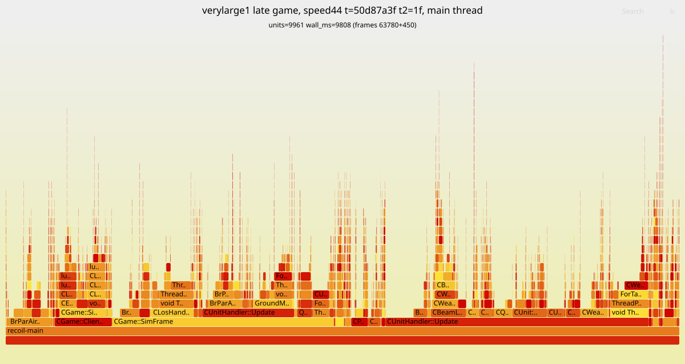
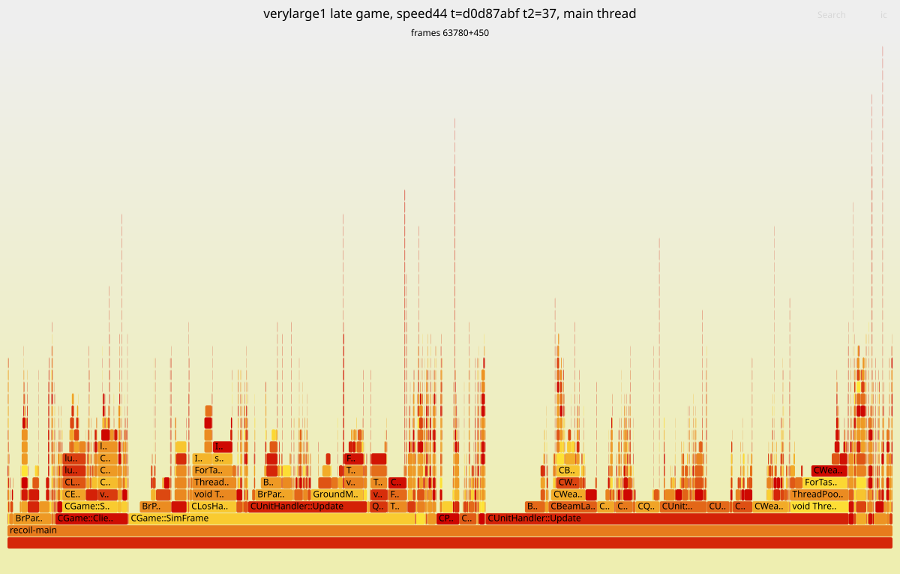
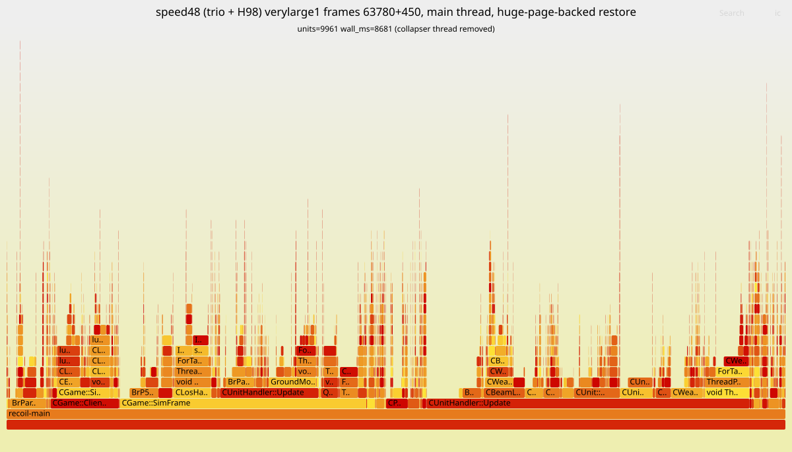
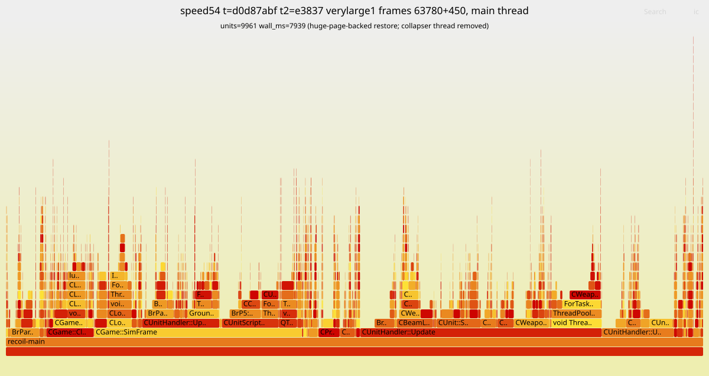

# Work log: re-simulation speed (round 3)

Branch `speed-optimization` (Recoil side: branch `speed3` in
`~/dev/barreplay-engine-build/recoil`). Newest entries at the bottom; every
entry from 2026-10-15 09:26 on carries the time (UTC). Round 1/2 history:
`patches/engine-2026.07.04/RESULTS.md` and `experiments/LOG.md` — read the
measurement rules there (interleaved pairs, never a sub-10% wall delta from
single runs on one box).

Host for this round: i7-4980HQ (4 cores / 8 threads), 15 GB RAM, no GPU;
/tmp is a 7.6 GB tmpfs (builds, captures and checkpoints live under ~/dev).

## Benchmarks

| name | gameId | what | how |
|---|---|---|---|
| **verylarge1** | `6a37d06acbb455b1d19179d8ec965f10` | late game, ~10k units, 19.5 fps | CRIU checkpoint at frame **63780**, windows of 450 / 900 frames (`tools/bench-ckpt/bench-ckpt.sh`) |
| medium | `4936896a8b258d038cbd28f55eb15ed2` | 16p 13:25, ~280 fps — TOO SMALL to judge speed by (the user's call); still the byte-identity gate | full runs |
| isthmus | `6122896ac3328104d12093d975c61214` | 8v8 27:31, ~210 fps | full runs (held-out identity check) |

## Results summary

Speed is judged on **verylarge1** from now on; the medium/isthmus numbers
below predate the checkpoint harness. "Identical" = the .brp is byte-identical
to the stock/rev-2 capture.

| candidate | identical | medium (full / bench window) | verylarge1 | verdict |
|---|---|---|---|---|
| BAR widget suite left on (sandbox) | yes | ±0 | — | no cost; dropped |
| `-worker-threads 7` | yes | ±0 | — | dropped |
| H60 FindAnim + COB DIV shift, H61 COB threaded dispatch, H62 Lua threaded dispatch | yes | instr -1.1%, wall ±0 | wall +0.8%, instr -0.2% (noise) | no late-game value |
| PGO (on H60-H62) | yes (medium, isthmus) | wall -3.8% (3/3), instr -3.3%; isthmus -4% | wall -1.9% / -3.7% (two sessions), instr -1.7..-3.3% | small |
| H63 GenerateWeaponTargets: TestTarget after LOS/range | yes (medium) | — | 23.34 s -> 23.37 s, ±0 | no value; kept (exact, harmless) |
| H64 prefetch in GenerateWeaponTargets | — | — | 23.32 s -> 23.36 s, ±0 | reverted |
| THP `always` (host setting) | — | — | 20.9 s -> 26.9-31.1 s (much WORSE) | dropped |
| PGO retrained on verylarge1's late game (`pgolto2`) | yes (medium) | — | 20.91 s -> 20.88 s, ±0 vs first PGO+LTO | no extra gain |
| CPU pinning: one hyperthread per core / main thread alone on a core | — | — | -1.1% (2/3) / -0.7% (3/3) | host setting, small; noted only |
| **PGO + LTO** (on H60-H63) = **revision 3, published** | yes (medium, isthmus, verylarge1 full 90,900 frames) | full run 1m25s -> **1m16s (-11%)** | wall **-10.2%** (3/3), instr **-15.3%** | **keep** |

Whole game against the stock engine (2026-10-18 00:55):

| verylarge1, whole game (90,900 frames), governed | stock 2026.07.04 | `speed24` `t=7fbf` (0014-0043) | ratio |
|---|---|---|---|
| active sim | 38m17s | ~14m39s | 2.61x |
| sim including thermal pauses | 1h0m38s | 38m19s | |
| main-thread cycles | 8.44e12 | 3.27e12 | 2.58x |
| main-thread average clock | 3.66 GHz | 3.68 GHz | |
| worker cycles (3 workers) | 6.07e12 | 2.97e12 | 2.04x |
| peak memory | 6.48 GiB | — | |

## Log

(Entries before 09:26 carry only the date; their commits landed at 07:16,
07:33, 08:07, 08:41, 08:52 and 09:08.)

- 2026-10-15: BAR decides which widgets load from the saved order list
  (`LuaUI/Config/BYAR.lua`, `barwidgets.lua` ~l.1362): a name with order <= 0
  never loads, sandbox or not. barreplay already seeds that file
  (`engine.EnableWidget`), with only its own widget, because it cannot name
  BAR's. The names ARE readable from the installed rapid package
  (`packages/<md5>.sdp` -> `pool/xx/yyy.gz`): 320 of test-31630's 326
  `luaui/widgets/*.lua` declare `name = "..."` in GetInfo (242 enabled).
- 2026-10-15: MEASURED, and dropped. The gate replay `4936896a…` on the
  patched build (rev 2), two interleaved pairs, BAR's suite disabled (the old
  default) vs enabled (what the sandbox now forces):
  sim 1m26s / 1m26s disabled, 1m24s / 1m27s enabled — no difference, and the
  captures are byte-identical. The patched engine already starves the draw
  side (0001 + throttle-draw), so the suite's per-frame callins are noise.
  Not worth harvesting widget names from the archive. Back to the engine.
- 2026-10-15: `perf_event_paranoid` was 4 (Ubuntu default), which blocks perf;
  set to 1 through a privileged container (sudo docker). RESTORE to 4 when done:
  `sudo docker run --rm --privileged  sh -c 'echo 4 > /proc/sys/kernel/perf_event_paranoid'`.
- 2026-10-15: fresh profile, medium mid-game, rev-2 build (`~/dev/perf3/profile.sh`,
  samples the engine by argv[0]; `--call-graph dwarf` works with the
  UNSTRIPPED binary). Threads: main 52%, workers 20/14/13% — still
  main-thread-bound. Main thread: SimFrame 95% of it; inside, COB VM ~24%
  (ExecuteLoop -> TickThread -> CCobThread::Tick 7% self of ALL samples), synced
  Lua callins ~22%, WaitForFinished on for_mt sections ~26% (TickAllAnims 4.4,
  QTPFS 3.9, GroundMove 2.2, ...). Annotating Tick: ~35% is per-opcode
  fetch/dispatch, and 12% sits on ONE `idiv` (the DIV opcode).
- Host: i7-4980HQ, 4 cores / 8 threads; the engine picks 4 threads (3 workers).
- 2026-10-15: `-worker-threads 7` (use the hyper-threads): 1m25s/1m26s vs
  1m26s/1m26s default — nothing. Dropped.
- 2026-10-15: main-thread shares by area (flat profile): synced Lua 21%
  (GC only 1.6%), COB + unit-script 20%, movement 10.6%, transforms 7%,
  LOS 4.2%, map height 3.9%, QTPFS 3.7%. Branch misses (main thread): the two
  interpreters lead (luaV_execute 6.5%, CCobThread::Tick 5.4%), then
  `CUnitScript::FindAnim` 3.3% — a linear find_if over a 3-field key.
- 2026-10-15: H60 (Recoil branch `speed3` in `~/dev/barreplay-engine-build/recoil`):
  - `FindAnim`: binary search while <anims> is known sorted (animsDirty
    false), else a scan with one branch per element; same element either way
    (the key is unique).
  - COB `DIV` by a power of two as a biased shift (exact truncation).
  - first A/B (medium, 2 pairs; builds ran alongside, so timing is rough):
    1m26s/1m25s vs 1m27s/1m26s, byte-identical.
- 2026-10-15: H61 COB THREADED DISPATCH: every top-level handler ends in its
  own fetch + `goto *table[(op>>12)-0x10000]` (COB_NEXT), the switch kept as
  the entry and fallback. GCC folded the copies back into one (3 indirect
  jumps) until `#pragma GCC optimize ("no-crossjumping", "no-gcse")` around
  Tick: now 67. Measuring (bench harness: instructions + SimFrame CPU + wall
  over frames 600-24000, 3 interleaved pairs).
- 2026-10-15: RESULT H60+H61 (medium, bench harness over frames 600-24000,
  3 interleaved pairs): main-thread instructions 265.96e9 -> 262.96e9
  (-1.1%), SimFrame wall 51.35 s -> 51.13 s (-0.4%, inside the box's ±3%).
  NOTE the bench harness `_exit(0)`s after its window, so a bench run's
  capture is TRUNCATED (md5 `834d4722…` for every build) — identity is checked
  on separate full runs (`~/dev/perf3/ab.sh`, BENCH=1 for timing only).
- 2026-10-15: H62 Lua VM threaded dispatch (`lvm.cpp`, same pattern: 38
  opcodes, per-handler fetch + hook check + `goto *disptab[op]`, the switch
  kept; 40 indirect jumps after the same pragma). Byte-identical (2 full
  runs), wall 1m25s/1m26s vs 1m24s/1m26s — no visible gain. Both interpreter
  results agree with the known caveat: Haswell's indirect predictor already
  learns a shared switch jump well. Kept for now (exact), will be re-judged
  inside the final stack.
- 2026-10-15: next: PGO (-fprofile-generate -> train on replays ->
  -fprofile-use -fprofile-partial-training), `~/dev/barreplay-engine-build/pgo.sh`.
  Same official image and flags otherwise; FP semantics unchanged (no FMA,
  -frounding-math), and the gate checks byte-identity regardless.
- 2026-10-15: PGO instrumented build done (`build-pgogen`, 1296 steps, ~50
  min at -j7). Training: medium gate replay (instrumented: sim 5m31s, 73 fps,
  ~4x slower than normal) + `c04fd06a…` (BAR test-31620, 5m54s). The engine's
  quitforce exit runs the gcov dump: 1073 .gcda files, 15 MB, in
  `~/dev/barreplay-engine-build/prof`. Building with -fprofile-use now.
- 2026-10-15: RESULT PGO (on top of H60-H62), medium:
  - full runs: byte-identical to the reference (md5 `0558d354…`), sim
    1m26s/1m25s -> 1m23s/1m22s;
  - bench harness, 3 interleaved pairs: SimFrame wall 50.29 s -> 48.38 s
    (-3.8%, PGO wins 3/3), main-thread instructions -3.3%.
  Medium was a TRAINING input; held-out check on isthmus (8v8, 27:31) running.
- 2026-10-15: held-out check of PGO on isthmus (8v8 27:31, not a training
  input): byte-identical to rev 2 (md5 `acba997c…`), sim 4m02s -> 3m52s (-4%).
- 2026-10-15: USER: medium is far too small (1m40s of sim, few units); the
  slow part of a re-sim is the late game of big ones (10k units, up to 20x
  slower per frame). Asked for a harness that re-sims to a late frame ONCE,
  snapshots the state, and restarts from it. Benchmark game: "verylarge1" =
  `6a37d06acbb455b1d19179d8ec965f10` from frame 63780, windows of 15 s or 30 s
  (450 / 900 frames).
- 2026-10-15: DECISION: CRIU (process checkpoint/restore), not the engine's
  savegame and not a VM. Savegame would have to round-trip BAR's whole gadget
  Lua state, and a loaded save cannot go on reading the demo's packet stream,
  so the window after it would not be the real game. A VM snapshot is exact
  but adds virtualization overhead to every timing. CRIU restores a NATIVE
  process with exact state (all threads, the demo server included). Its one
  limit — an image restores only into the binary that made it — is handled by
  dumping each build once: builds that pass the byte-identity gate reach the
  same state at the frame.
  Making CRIU work here: root through a privileged container entering pid 1's
  namespaces (`nsenter -t 1 -m -u -i -n -p`), `--manage-cgroups=ignore`, and
  the restore inside `systemd-run --scope` (otherwise the container's exit
  kills the restored tree).
- 2026-10-15: engine side, in the bench harness (NetCommands.cpp,
  BARREPLAY_PARK=<prefix>): at the window's first frame it points
  stdout/stderr at <prefix>.stdout (no pipe to the launcher left in the
  image), writes <prefix>.ready, and sleeps (clearing the watchdog) until
  <prefix>.go exists; the go file carries "<frames> <output>" because the
  environment is frozen into the image. Perf counters open after the wake
  (CRIU cannot carry perf fds). The bench line now also reports start= and
  units=.
- 2026-10-15: `tools/bench-ckpt/bench-ckpt.sh` (dump / trial / ab): dump runs
  barreplay to the frame, copies every regular file the engine has open
  (CRIU reopens them by path; each trial puts the copies back), then
  `criu dump`; trial restores and times the window. First dump of verylarge1
  at 63780 running.
- 2026-10-15: FIRST CHECKPOINT TRIAL WORKS: verylarge1 dumped at 63780
  (12m19s of re-sim at 89 fps to get there; image 5.7 GB). Restore + a
  450-frame window: units=9961, 23.1 s of SimFrame wall = 19.5 fps (medium
  runs at ~280), 78.9e9 main-thread instructions; the whole trial, restore
  included, took 33 s.
- 2026-10-15: (event-log branch) merged origin/main (#127, widget 1.11.2
  inferred ends) into it, opened and squash-merged PR #129 (`fbedbae`), tagged
  `patched-engine/2026.7.4-barreplay.2`.

### 2026-10-15 09:28 — checkpoint harness in use; builds under test

USER: timestamps with hour/minute, tables for results, keep optimizing.

`speed-optimization` was rebased onto `main` after #129 (only the log and
`tools/bench-ckpt` were on it). Builds checkpointed at verylarge1/63780:

| build | source | checkpoint |
|---|---|---|
| `spring-headless-base` | rev 2 (`72aeecb`) + the two park commits | done (5.7 GB) |
| `spring-headless-park` | `speed3`: H60-H62 + park | done (5.7 GB) |
| `spring-headless-pgopark` | `speed3` with -fprofile-use (profile from the medium + c04fd06a runs) | dumping |

`bench-ckpt.sh` gained `PERF="<perf record args>"`: a trial then also
profiles exactly its window (attaches to the restored pid before the go).

### 2026-10-15 09:55 — first verylarge1 results: the late game is somewhere else

verylarge1 from 63780, 450-frame windows, 3 rounds with the build order
rotated (raw: `~/dev/perf3/vl1-3way.txt`). Every trial starts at 9961 units.

| build | SimFrame wall, mean (3 runs) | vs base | main-thread instructions, mean | vs base |
|---|---|---|---|---|
| base (rev 2 + park) | 23.07 s (23.21 / 23.09 / 22.93) | — | 78.66e9 | — |
| speed3 (H60-H62) | 23.27 s (23.11 / 23.16 / 23.53) | +0.8% | 78.50e9 | -0.2% |
| speed3 + PGO | 22.64 s (22.54 / 22.75 / 22.62) | **-1.9%** | 76.03e9 | -3.3% |

At 19.5 fps the late game is ~14x slower per frame than medium's average,
and what helped there (the interpreters) is noise here. Run-to-run spread on
one checkpoint is ~1.5% of wall, ~1% of instructions. Next: profile this
window (bench-ckpt `PERF=`).

### 2026-10-15 10:12 — late-game profile (verylarge1, base build)

`PERF="-F 999 -e cycles"` over the 450-frame window. Threads: main 63.8%,
workers 12.3 / 11.8 / 11.8% — MORE main-bound than medium (52%). Main-thread
self time, as a share of the MAIN thread:

| function | share | note |
|---|---|---|
| luaH_get | 7.4% | BAR gadget table lookups |
| luaV_execute | 6.9% | |
| **CSyncChecker::Sync** | **4.7%** | one out-of-line call + XXH3 per synced write |
| GeneralMoveSystem::Update | 4.6% | |
| CLosHandler::Update lambda | 4.2% | |
| CGameHelper::GenerateWeaponTargets | 3.8% | |
| CUnit::UpdateWeapons | 3.7% | |
| CStrafeAirMoveType::Update + UpdateAirPhysics | 6.1% | aircraft |
| CGround::GetHeightReal + GetHeightAboveWater | 5.4% | |
| AMoveType::UpdateCollisionMap | 2.8% | |
| luaD_precall | 2.7% | |
| spring::VectorErase<CUnit*> | 1.0% | linear erase over a unit list |

DWARF call graphs (`--call-graph dwarf`) did not unwind on the CRIU-restored
process and `perf script` over the 800 MB debug info is too slow; working from
self time + source.

`CSyncChecker::Sync(const void*, unsigned)` is in SyncChecker.cpp, so every
synced primitive write is a call with a RUNTIME size into XXH3's length
dispatch, to hash 4 bytes. Inlining it with the size known computes the same
value; that is a header change that recompiles everything, i.e. the same cost
as LTO, which does it (and every other cross-file hot call) automatically. So
the next build is PGO + LTO (`pgo.sh ltouse`, -flto=4, no -g), building now.

### 2026-10-15 10:30 — what the late-game hot spots are made of

| hot spot | finding | action |
|---|---|---|
| `luaH_get` (7.4%) | annotated: ~50% of its samples on chain-walk loads (`cmpl $type,0x18(node)` after `mov 0x20(node)`), ~20% loading the key string's hash, the number path's `div` (hashmod) only ~3.5% | memory latency on BAR's tables; an exact fastmod would buy ~0.2% — not worth a patch |
| `spring::VectorErase<CUnit*>` (1.0%) | QuadField::MovedUnit swap-erases then re-inserts a moving unit in EVERY cell, even unchanged ones; the resulting order of units in a cell feeds unit queries (targeting) | cannot be shortcut without changing sim order — left alone |
| `CSyncChecker::Sync` (4.7%) | out-of-line call per synced write, runtime size into XXH3 | LTO (building) |

Plan: (1) PGO+LTO (building); (2) RE-TRAIN the PGO profile on verylarge1's
late game — the current profile is from medium + c04fd06a, small games that
never exercise mass air/targeting/LOS. The instrumented run must stop after a
late window, but the bench harness leaves by `_exit`, which skips gcov's
dump: add a weak `__gcov_dump()` call before it (a no-op in normal builds).

### 2026-10-15 10:45 — flame graphs; LTO link fix

USER: include flame graphs in the log now and then.

DWARF unwinding failed on the CRIU-restored engine, but Haswell's **LBR call
stacks** (`perf record --call-graph lbr`) need neither frame pointers nor
debug info and work there (~16 frames deep — enough to see who calls the hot
leaves). New subcommand: `bench-ckpt.sh flame <bin> <replay> <frame> <frames>
<out.svg>` (FlameGraph scripts in ~/dev/FlameGraph). Flame graphs go to
`docs/flamegraphs/`; the first clean one comes after the LTO build (a test
run made during the build already put weapon auto-targeting —
SlowUpdateWeapons → AutoTarget → GenerateWeaponTargets — and the LOS update
at the top).

PGO+LTO's first link failed: "undefined reference to mi_new /
SpringVersion::GetMajor" — the static libraries were archived by plain `ar`,
which writes no LTO symbol index. Reconfigured with gcc-ar-13 / gcc-ranlib-13
(only 31 steps: re-archive + link).

### 2026-10-15 11:00 — PGO + LTO: -10% on the late game

`spring-headless-pgolto` (speed3 + park, -O3 -flto=4 -fprofile-use, no -g;
101 MB unstripped). Medium full run: byte-identical (md5 `0558d354…`), sim
1m16s vs ~1m25s for the same source without them.

verylarge1 from 63780, 450 frames, 3 rounds, order rotated (raw:
`~/dev/perf3/vl1-lto.txt`):

| build | wall per round (ms) | mean | vs base | instructions, mean | vs base |
|---|---|---|---|---|---|
| base | 23310 / 23064 / 23117 | 23163 | — | 78.18e9 | — |
| PGO | 22276 / 22247 / 22377 | 22300 | -3.7% | 76.82e9 | -1.7% |
| **PGO + LTO** | 20933 / 20717 / 20759 | **20803** | **-10.2%** | **66.25e9** | **-15.3%** |

LTO is most of it: cross-file inlining — `CSyncChecker::Sync` (4.7% of the
main thread) is one obvious beneficiary.

Next: retrain PGO on verylarge1's LATE game. The bench harness now calls a
weak `__gcov_dump()` before `_exit`, so an instrumented run stops right after
a late window with its profile written: running to 63780+1800 now (~1 h at
~4x instrumented slowdown).

Lesson (now enforced by bench-ckpt `alone`): a trial during that training run
failed — the restored engine wants its UDP game-server port back ("Address
already in use") — and its file restore had copied the checkpoint's infolog
and widget stream over the training run's own (same game, same data dir).
Harmless for training (only the .gcda files matter), but no engine may run
beside a dump or a trial.

### 2026-10-15 10:50 — where the late-game main thread goes (by caller)

From an LBR sample of the verylarge1 window (recorded during a build, so
shares only), stacks summed by their two outermost frames:

| caller path | share of main-thread samples |
|---|---|
| CUnitHandler::SlowUpdateUnits -> CUnit::SlowUpdateWeapons (auto-targeting) | 11.1% |
| CUnitHandler::UpdateUnitWeapons -> CUnit::UpdateWeapons | 6.6% |
| CUnitScriptEngine::Tick -> ThreadPool::WaitForFinished (parallel anims) | 5.9% |
| UpdateUnitMoveTypes -> GeneralMoveSystem::Update (StrafeAir 3.2%) | 4.7% |
| CGame::SimFrame -> CLosHandler::Update (for_mt over ~7 LOS types; the main thread waits for the slowest) | 4.5% |
| luaD_precall -> luaB_pcall (gadgets) | 3.1% |
| CUnitHandler::Update -> CUnit::UpdateLosStatus | 2.8% |

**H63** (built as `spring-headless-h63`, speed3 + H63, no PGO; to be
A/B'd against `spring-headless-park` once the training run frees the host):
`CGameHelper::GenerateWeaponTargets` called the virtual, const
`weapon->TestTarget()` — a dozen reads of each candidate CUnit — BEFORE the
cheap LOS-state and 2D-range rejections that most of the thousands of
candidates in the scanned quads fail. Moved after them. Exact: every check is
a pure function of state the loop does not change before AllowWeaponTarget,
and TestTarget's own LOS test is a subset of the loop's; the same units pass
in the same order with the same priorities.

### 2026-10-15 11:50 — late-game PGO training wrote nothing; fixed

The verylarge1 training run (63780+1800 frames, 251 s of instrumented
SimFrame) completed but left every .gcda at its 10:42 timestamp: in the
instrumented binary `__gcov_dump` was a weak UNDEFINED symbol (`nm`: `w`) — a
linker does not pull an archive member in to satisfy a weak reference, so the
call resolved to null and was skipped. Fixed at link time only: the
instrumented build links with `-Wl,-u,__gcov_dump` (now `T __gcov_dump`), the
code keeps its weak reference (a no-op in normal builds). Rerunning the
training after the H63 checkpoint.

### 2026-10-15 12:15 — H63 measured: nothing

verylarge1 from 63780, 450 frames, 3 interleaved pairs (`bench-ckpt.sh ab`):

| pair | speed3 (`park`) wall ms | speed3 + H63 wall ms |
|---|---|---|
| 1 | 23587 | 23561 |
| 2 | 23206 | 23149 |
| 3 | 23217 | 23394 |
| mean | 23337 | 23368 (+0.1%) |

Byte-identical on medium (`0558d354…`). TestTarget was not the cost of
auto-targeting: the loop's time is walking thousands of candidate CUnits (a
cache miss each on `tempNum`/`losStatus`), which no reordering inside the loop
avoids. Late-game PGO training rerunning now (fixed gcov dump).

`bench-ckpt` `alone` fix: it matched its own caller's command line (a `strip`
of an engine binary in the same shell command); now anchored to processes
whose argv[0] is an engine binary.

### 2026-10-15 12:55 — late-game profile collected; H64 prefetch; rebuilding PGO+LTO

The rerun wrote its profile (gcda timestamps 12:50): instrumented
verylarge1 63780+1800 frames, 250.7 s of SimFrame. The profile dir now holds
medium + c04fd06a + verylarge1's whole game up to frame 65580 (counters
accumulate). PGO+LTO rebuilding from it (full recompile: every object's
profile changed).

**H64** (`spring-headless-h64`): the auto-targeting walk is a cache miss per
candidate unit, so `GenerateWeaponTargets` now prefetches the `tempNum` and
`losStatus[allyteam]` lines of the candidate 4 entries ahead
(`__builtin_prefetch`; changes no value). If it pays, the same applies to the
per-unit loops over the 10k active units (UpdateUnits, UpdateUnitWeapons,
LOS status). Checkpoint dumping alongside the build; trials once the host is
quiet.

### 2026-10-15 13:10 — H64 measured: nothing (reverted); the PGO rebuild had not rebuilt

| pair | H63 wall ms | H63 + H64 wall ms |
|---|---|---|
| 1 | 23281 | 23407 |
| 2 | 23474 | 23035 |
| 3 | 23194 | 23628 |
| mean | 23316 | 23357 |

Prefetching the candidates did nothing: either the out-of-order core
already overlaps those misses or the time is elsewhere in the loop. Reverted,
which also puts the source back exactly where the instrumented build was, so
the late-game profile matches every function.

The "PGO+LTO from the new profile" build finished in 10 minutes having
recompiled 3 files: the .gcda files are not ninja dependencies, so a changed
profile alone rebuilds nothing — and under LTO the profile is applied when
each object is compiled, so a relink does not pick it up either. `ninja -t
clean` and rebuilding (~1 h). Lesson for pgo.sh: a new profile needs a clean
build dir.

### 2026-10-15 13:15 — flame graph: verylarge1 late game, PGO+LTO build


([open the SVG](flamegraphs/2026-10-15-verylarge1-pgolto.svg) for the
interactive version — hover and click to zoom.) Main thread of the
450-frame window from 63780 (9961 units), LBR call stacks (≤16 frames, so
deep stacks start part-way up). Recorded while a build was running, so its
own wall time (34 s) is not comparable; the shape is what matters.

| caller > callee | share of main-thread samples |
|---|---|
| CGame::SimFrame > CUnitHandler::Update | 12.4% |
| CUnitHandler::Update > CWeapon::SlowUpdate (auto-targeting) | 10.0% |
| CUnitHandler::Update > CStrafeAirMoveType::Update (aircraft) | 6.5% |
| CGame::SimFrame > ThreadPool::WaitForFinished | 5.2% |
| CUnitHandler::Update > CUnit::SlowUpdate | 4.5% |
| CGame::SimFrame > CLosHandler::Update | 4.4% |
| CUnitHandler::Update > **CBeamLaser::Update** | 4.3% |
| CUnitHandler::Update > WaitForFinished (UpdateWeaponVectors for_mt) | 3.3% |
| CGame::SimFrame > CCobThread::Tick | 3.3% |

| leaf (self) | share |
|---|---|
| CUnitHandler::Update (LTO inlined unit/weapon/move code into it) | 9.9% |
| luaV_execute / luaV_gettable / luaD_precall | 5.5 / 4.7 / 2.6% |
| CUnitScript::TickAllAnims | 3.8% |
| CGameHelper::GenerateWeaponTargets | 3.5% |
| CStrafeAirMoveType::UpdateAirPhysics / UpdateFlying | 2.8 / 1.9% |
| CWeapon::UpdateWeaponVectors | 2.7% |

New candidates from it: **CBeamLaser::Update (4.3%)** — beam weapons — and
the aircraft move type (6.5%).

### 2026-10-15 13:25 — next: huge pages

`CBeamLaser::Update` recomputes its weapon vectors on the main thread right
after `UpdateUnitWeapons` computed every unit's in parallel — but not
removable: an earlier weapon of the same unit can fire in between and its
script may `turn ... now` a piece, so the second computation can differ.

The late game is memory-latency-bound (luaH_get, the targeting walk), with a
~5 GB working set — TLB-miss territory. The host's THP mode is `madvise`
(`AnonHugePages: 0 kB`): nothing in the engine asks for huge pages (not
mimalloc's heap, not the big .bss StaticMemPools). Huge pages cannot change
a simulated value. Experiment planned: CRIU restores memory into fresh
anonymous mappings, so toggling `/sys/kernel/mm/transparent_hugepage/enabled`
between `always` and `madvise` across trials of ONE checkpoint measures the
potential without a new dump. If it pays, the engine can `madvise` its own
pools and set mimalloc's large-page option, which works under the `madvise`
default every host has.

### 2026-10-15 13:40 — huge pages: much worse

PGO+LTO checkpoint, THP mode toggled between trials (3 pairs):

| pair | THP madvise (default) wall ms | THP always wall ms |
|---|---|---|
| 1 | 21081 | 31149 |
| 2 | 20795 | 26903 |
| 3 | 20918 | 27852 |

`always` costs 30-50%: on this 15 GB host, mostly page cache, building huge
pages for the restored 5 GB means compaction stalls inside the window.
Dropped (and it would have been a per-host setting anyway). THP back to
`madvise`.

Next: the PGO+LTO build retrained on the late game (`spring-headless-pgolto2`,
clean build) — identity on medium, then its checkpoint.

### 2026-10-15 14:15 — late-game PGO profile: no extra gain; CPU pinning: ~1%

`spring-headless-pgolto2` = PGO+LTO from a CLEAN build with the profile now
also covering verylarge1 up to frame 65580. Byte-identical on medium
(`0558d354…`, sim 1m16s). Its checkpoint dump is a useful whole-run number:
reaching frame 63780 took **10m12s at 104 fps vs 12m00s at 89 fps** for the
base build (-15% over the first 35 minutes of a big game).

verylarge1 450 frames, `pgolto` (first profile) vs `pgolto2`, 3 pairs:
20579/21109/21028 (mean 20905) vs 20884/21050/20705 (mean 20880) — the same.
The small-game profile already put the code in the right shape.

CPU placement (`bench-ckpt` `CPUSET=` / `MAINCPU= OTHERCPUS=`, new options;
host: CPUs 0-3 one thread per core, 4-7 their siblings), `pgolto2`, 3 pairs:

| placement | mean wall ms | vs unpinned |
|---|---|---|
| unpinned (all 8) | 20771 / 20732 | — |
| all threads on 0-3 (no hyperthread siblings) | 20548 | -1.1% (2/3 wins) |
| main thread alone on 0, the rest on 1-3,5-7 | 20586 | -0.7% (3/3 wins) |

A worker spinning on the main thread's sibling costs little here. It is a
per-host setting anyway (bringest could set it) — recorded, not pursued.

**Where this leaves round 3:** PGO+LTO is the one large win (-10% on the late
game, -11% medium, -15% over a big game's first 35 min, byte-identical).
Everything targeted since — interpreter dispatch, targeting reorder,
prefetching, huge pages, retraining, pinning — measured at noise or worse.

### 2026-10-15 14:00 — preparing revision 3 (PGO + LTO); identity gate on verylarge1 running

The flat profile of `pgolto2` on verylarge1: main thread 63.9%, workers
~12% each; `CSyncChecker::Sync` fell from 4.7% to **0.84%** of the main
thread (LTO inlined most calls); the top is now `CUnitHandler::Update` with
the unit code LTO folded into it (12.8%), `luaV_gettable` 5.0%,
`TickAllAnims` 4.4%, `luaV_execute` 3.9%, the LOS update 3.4%,
`GenerateWeaponTargets` 3.3%. A thin spread again.

PGO+LTO is the gain worth shipping, so it gets a stronger identity gate than
medium: full re-sims of verylarge1 (~10k units, the whole late game) on the
base build and on `pgolto2`, .brp md5 compared. Running.

Revision 3 of `patches/engine-2026.07.04/` (prepared, NOT pinned until that
gate passes):

| patch | content |
|---|---|
| 0005-bench-harness-park-and-gcov-dump | PARK point + go file + weak `__gcov_dump` before `_exit` (one patch from three commits) |
| 0006-findanim-and-cob-div-shift | H60 |
| 0007-cob-threaded-dispatch | H61 |
| 0008-lua-threaded-dispatch | H62 |
| 0009-weapon-targets-testtarget-last | H63 |
| `pgo/profile.tar.xz` | the training profile (16 MB of .gcda, 1.1 MB xz; deterministic tar) |
| `pgo/build.sh` | the PGO+LTO build (and the instrumented `gen` build) in the official image |

H60-H63 measured at noise on the late game but are kept: they are exact,
and the profile was trained on that source (dropping them would orphan
those functions' profile). `git am` of the series onto a clean 2026.07.04
checkout reproduces the trained/built tree exactly (0 diff lines in `rts/`).

`SeriesDigest` now also hashes every file under `pgo/` (sorted), so a new
profile or new flags is a new revision like a changed patch; revisions 1 and 2
(no pgo/) keep their digests. Test: `TestSeriesDigestTracksThePGODir`.

### 2026-10-15 14:20 — revision 3 builds from the series

`pgo/build.sh` built `spring-headless` from a fresh clone of the series
(`2026.07.04-22-gc9fac20`, 101.9 MB unstripped) in ~15 min. Two fixes on
the way, both now in the script and its header:

| problem | fix |
|---|---|
| "Failed to fetch git-describe" | the source must be a real clone with the tag — a git WORKTREE's `.git` points outside the mounted tree |
| root-owned leftovers of a failed build blocked `rm` | the container cleans `/build/out` itself (also guarantees the clean build a new profile needs) and `chown`s the output and profile back to the caller |

The verylarge1 full-run identity gate is still running (base build at frame
68400 after 22 min; slowed by the build).

### 2026-10-15 15:05 — gate passed on the whole big game; revision 3 published

verylarge1 re-simulated end to end (90,900 frames) on the base build and on
`pgolto2`:

| build | sim | fps | .brp md5 |
|---|---|---|---|
| base (rev 2 + park) | 37m54s | 40 | `a26e920d594a346884b93c3389053a1f` |
| PGO + LTO (`pgolto2`) | 27m12s | 56 | `a26e920d594a346884b93c3389053a1f` |

**Byte-identical over the whole game.** The wall times are NOT a fair
comparison: the revision-3 builds ran during part of the base run. A clean
rerun of base is queued for the headline number.

Pinned and published:

| item | value |
|---|---|
| series digest (revision 3) | `8b5780d6c6eddca16aebc59143854857f7ea133f34a9ce1c932089914f332ea4` |
| build | `pgo/build.sh` from a fresh clone of the series (`2026.07.04-22-gc9fac20`) |
| publish-engine gate (medium, stock vs stripped rev 3) | identical (capture sha256 `1facff5b…`) |
| published | `engines/2026.07.04/spring-headless-patched-2026.7.4-barreplay.3.gz`, 36 MB (13 MB gz) |
| sha256 (pinned in `patchedBuilds`, rev 1 and 2 superseded) | `2ea1aecf0528606631625c636fe3eb31905cab145371800ca1a42d8cdb4e9d74` — the public download hashes to it |

Docs: `docs/building-recoil.md` ("PGO + LTO"), RESULTS.md (round-3 pointer),
CLAUDE.md ("Benchmarking the late game"). Hosts pick it up once this branch is
merged (the pin is what they trust); after the merge:
`git tag -a patched-engine/2026.7.4-barreplay.3 … origin/main`.

### 2026-10-15 15:45 — the whole big game, measured cleanly: -12.4%

verylarge1, all 90,900 frames, each run alone on the host:

| build | sim | fps | .brp md5 |
|---|---|---|---|
| base (rev 2 + park), clean rerun | 31m03s | 49 | `a26e920d594a346884b93c3389053a1f` |
| PGO + LTO (`pgolto2`, = revision 3's code) | 27m12s | 56 | `a26e920d594a346884b93c3389053a1f` |
| | **-12.4%** | | identical |

(The earlier 37m54s base run had builds beside it; this replaces it.)

### 2026-10-16 01:02 — where the main thread's time goes (verylarge1 late window)

USER: report the main thread as % of ONE core (rows sum to 100%), workers
separately; only the late window matters, and only the main thread needs
optimizing. Published build (`pgolto2`), frames 63780+450, 9961 units.

**Threads** (task-clock sampling, 999 Hz):

| thread | CPU over the window | % of one core |
|---|---|---|
| main | 21.2 s (SimFrame thread-CPU 21,217 ms of 21,219 ms wall) | **~100%** — never sleeps |
| worker 1 / 2 / 3 | 4.4 / 4.2 / 4.2 s | ~20% each |

Workers run only the parallel sections (TickAllAnims, UpdateWeaponVectors,
LOS, projectile/weapon for_mt chunks, QTPFS node layers). The main thread
is CPU-bound; it does its share of each parallel section itself
(`WaitForFinished` self time 0.3%), so it is not waiting idle.

**Main thread, % of one core** (LBR call stacks, cycles at 1999 Hz; each
stack goes to the first phase found in it — 0.3% could not be placed;
script: phases.py, kept with the perf data):

| phase | % of core | of which Lua |
|---|---|---|
| **units** (`CUnitHandler::Update`) | **62.5%** | 6.9% |
| ├ LTO-inlined unit/weapon code (no debug info to split) | 12.5% | |
| ├ aircraft: `CStrafeAirMoveType::Update` | 11.4% | 0.9% |
| ├ weapon auto-targeting: `CWeapon::SlowUpdate` | 9.3% | 2.8% |
| ├ ground movement: `GroundMoveSystem::Update` | 5.3% | |
| ├ weapon vectors (parallel section) | 4.6% | |
| ├ `CUnit::SlowUpdate` | 4.3% | 0.6% |
| ├ `CBeamLaser::Update` | 3.6% | 1.1% |
| ├ `CWeapon::Update` | 2.4% | |
| ├ `CQuadField::MovedUnit` | 2.1% | |
| └ factories, builders, physics, LOS status, hover air, ... | 7.0% | |
| BAR gadget callins outside units (GameFrame etc.) | 11.7% | 11.7% |
| projectiles + collisions | 5.6% | 1.3% |
| unit-script anims (parallel section) | 5.4% | |
| LOS update (parallel section) | 4.2% | |
| COB scripts | 3.5% | |
| Lua GC | 2.1% | 2.1% |
| map damage, pathfinding, features, draw, net, other | 5.0% | |
| **total** | **100%** | **~22%** |

Serial work is ~85% of the main thread (parallel sections ~14%). Caveat:
LBR keeps the 16 innermost frames, so a gadget callin made from deep in a
unit update can land under "outside units" when its stack was cut.

## Round 4 (branch `speed-optimization-2`)

Everything below is measured on the verylarge1 late window only (frames
63780+450) and reported as the MAIN thread's time, % of one core, rows
summing to 100% — the main thread is the whole bottleneck (see 01:02).

### 2026-10-16 01:35 — plan, and two measurement tools under way

| step | what | status |
|---|---|---|
| 1 | revision 3 rebuilt WITH debug info (`-g`: GCC emits the same code), own checkpoint — splits the 12.5% LTO-merged `CUnitHandler::Update` blob and gives per-line annotation | building (`~/dev/perf3/build-pgolto-g.sh`) |
| 2 | aircraft movement (11.4%): exact-result speedups | profiled, waiting on step 1's lines |
| 3 | weapon auto-targeting (9.3%) | queued |
| 4 | BAR's Lua (~22%) by gadget: a sampling profiler in the bench harness | written (Recoil branch `luaprof`); build queued after step 1 |

Aircraft's 11.4%, from the 01:02 stacks:

| part of `CStrafeAirMoveType::Update` | % of core |
|---|---|
| `UpdateFlying` → `UpdateAirPhysics` | 4.7% |
| `Update` itself (inlined helpers) | 2.3% |
| `UpdateFlying` itself | 1.5% |
| `GetControlSurfaceAngles` | 1.1% |
| crash deaths → `ForcedKillUnit` → Lua `UnitDestroyed` | 0.9% |
| other (`UpdateAirPhysics` direct, `Move`, heading, sync checks) | 0.9% |
| **total** | **11.4%** |

THE LUA PROFILER (measurement builds only, never published): every
`luaV_execute` records which `lua_State` the thread is running (a
thread-local set/restored by an RAII guard, so exceptions unwind it); a
`CLOCK_THREAD_CPUTIME_ID` timer sends the main thread SIGPROF every 1 ms of
ITS CPU time, and the handler walks that state's CallInfo array — reading
only, no allocation, no Lua API — interning each frame (Lua: source file +
line defined; C: function pointer, symbolized later against `nm`). Samples
outside Lua are counted too, so the gadget table is a share of the same one
core. `bench-ckpt.sh trial` with `LUAPROF=1` asks for it (third token of
the go file); the folded stacks land in `<ckpt>/result.luaprof`.

### 2026-10-16 02:30 — the 12.5% blob is four loops waiting on memory; H65, H66

Debug-info build (`spring-headless-pgolto2g`, own checkpoint): same layout
as revision 3 (every function at the same address and size; constants moved
by the debug info, so not bit-identical) and the same table within 0.3 points
per row (21.06 s window). The 12.5% LTO folded into `CUnitHandler::Update`,
by the call it inlined, as % of the main core:

| loop over all ~10k units | % of core | where it stalls |
|---|---|---|
| `UpdateUnits` (`CUnit::Update`, `UpdateCollisionMap`) | 3.3% | first read of each unit (`frameNum + owner->id`) |
| `UpdateUnitMoveTypes` (general move types) | 3.1% | unit → `moveType` → vtable, before the virtual `Update()` |
| `UpdateUnitWeapons` (the serial `UpdateWeapons` loop) | 2.9% | weapon-use flags, then each weapon's vtable |
| `UpdateUnitLosStates` | 2.5% | `losStatus[at]`, first read of each unit |
| `SlowUpdateUnits`, `QueueDeleteUnits` | 0.6% | |
| **total** | **12.5%** | |

Annotated, the hot instructions are the ones right after a pointer load
(`mov 0x4f8(%rbp),%rdi; mov (%rdi),%rax` = 9.6% of the blob, `mov
0xc0(%rax)` 9.1%, `call *0x40(%rax)` 9.0%): cache misses on scattered unit
objects, not computation.

Candidates (Recoil branch `speed4` = revision 3 + these; building):

| id | change | why it is exact |
|---|---|---|
| H65 | Lua callin timers (`Lua::Callins::*`, 4 clock reads + 2 profile-map updates per callin, ~1.0% of the core, half in `AllowWeaponTarget`) run only while the profiler is on (`/debug`, barreplay `-profile`) | timings are never sim input |
| H66 | software prefetch 8 units ahead (and the move type / first weapon 4 ahead) in those four loops | a prefetch changes no value and no order; the general-move-system loop first collects its units in the view's own order (a read-only pass) |

Lua profiler build done; its checkpoint is being dumped.

### 2026-10-16 03:05 — the Lua profile: our own widget is the biggest Lua cost

Lua sampler build (`spring-headless-luaprof` = revision 3 + the sampler; its
window ran 20.75 s, so the sampler costs nothing visible). 21,203 samples of
main-thread CPU, 3,690 of them inside a Lua VM = **17.4% of the main core**
(perf's ~22% also counts callin entry/exit and GC, which run outside the VM).
Each sample goes to the innermost gadget/widget FILE on its Lua stack (handler
plumbing skipped); `~/dev/perf3/luaprof.py` makes the table.

| owner | % of main core | where |
|---|---|---|
| **LuaUI (widgets)** | **7.5%** | |
| ├ `snapshot_widget.lua` — barreplay's OWN re-sim widget | **4.55%** | `sample()` 2.16% (the 1 Hz unit read), `projectileFrame` 1.31% (polls `reloadFrame` of every ready launcher slot, every frame), `UnitDestroyed` 0.39% |
| ├ BAR `widget_profiling.lua` (wraps every widget callin) | 1.41% | `GetLuaMemUsage` 0.48% |
| ├ BAR `barwidgets.lua` (handler dispatch) | 0.75% | |
| └ BAR widgets (ecostats, notifications, nametags, ...) | ~0.8% | |
| **LuaRules (gadgets)** | **9.8%** | |
| ├ `gadgets.lua` (handler dispatch) | 2.92% | |
| ├ `unit_shield_behaviour` | 1.06% | `GetUnitsInSphere` |
| ├ `unit_aa_targeting_priority` (its `AllowWeaponTarget`) | 0.60% | `GetUnitDefID` 0.30% |
| ├ `unit_builder_priority` | 0.55% | |
| ├ `api_teamstats`, `unit_crashing_aircraft`, `api_unit_attributes` | 1.05% | |
| └ ~60 other gadgets | ~3.6% | each < 0.3% |
| other | 0.1% | |
| **total in Lua** | **17.4%** | |

WHY BAR's widget profiler runs at all: the Widget Selector always loads and
its load column defaults ON (`filters.profiler = data.profiler ~= false` for
a config that never saved it), which subscribes to `widget_profiling.lua` —
a timer and a `GetLuaMemUsage` call around every callin of every widget.

**W1** (barreplay, no engine change): the widget config barreplay seeds for
every re-sim (`engine.widgetConfigLua`) now carries
`data = { ["Widget Selector"] = { profiler = false } }`. Unsynced, so the
capture cannot change. Being measured: fresh checkpoints of revision 3
(`pgolto2w`) and of `speed4` (H65+H66), both with the new config.

### 2026-10-16 03:20 — W1 -2.4%, H65+H66 another -5.3%: -7.6% together

Fresh checkpoints at 63780 for revision 3 under the new widget config
(`pgolto2w`, same binary as `pgolto2`) and for `speed4` (revision 3 + H65 +
H66, new config). 450-frame window, 4 rounds, order rotated, main thread
pinned alone on core 3 (`MAINCPU=3 OTHERCPUS=0,1,2,4,5,6`; 7 is 3's
hyperthread). Raw: `~/dev/perf3/vl1-w1-h65h66.txt`.

| build | wall per round (ms) | mean | vs revision 3 | instructions, mean |
|---|---|---|---|---|
| revision 3 | 20732 / 20702 / 20584 / 20662 | 20670 | — | 66.73e9 |
| + W1 (selector profiler off) | 20162 / 20222 / 20221 / 20097 | 20176 | **-2.4%** | 65.03e9 |
| + W1 + H65 + H66 (`speed4`) | 19057 / 18956 / 19052 / 19325 | 19098 | **-7.6%** (-5.3% on W1) | 64.76e9 |

No overlap between the groups. `speed4` runs ~the same instructions as W1
and 5% fewer cycles: the prefetches hiding memory stalls, as intended. (H65
and H66 are not yet measured apart.)

Gate (medium, full run, new config): `speed4` and revision 3 both
`0558d3540c8e3f97d669505d1382ec20` = the reference. verylarge1 full run on
`speed4` running.

### 2026-10-16 03:45 — `speed4` identical on verylarge1's whole game; H67, H68 built

| check | result |
|---|---|
| verylarge1, all 90,900 frames, `speed4` + W1 | `a26e920d594a346884b93c3389053a1f` = stock / revision 3 (its 33m21s is NOT a timing: a build shared the CPU) |

Next build `speed5` = `speed4` + two more prefetches, aimed at the hottest
lines of the debug-info profile (global, main thread):

| id | stall it targets | % of core | change |
|---|---|---|---|
| H67 | terrain height reads (`InterpolateCornerHeight`, Ground.cpp:51: the height-map load), from unit physics 0.83%, aircraft flight control 1.35%, weapon vectors 0.5% | 3.1% | `CGround::PrefetchHeightReal(x, z)` for the unit 4 ahead in the `UpdateUnits` and general-move-type loops |
| H68 | `CStrafeAirMoveType::Update` reading `cmdQue.front()` (StrafeAirMoveType.cpp:470) | 0.75% | prefetch the command AI 4 ahead and its queue front 2 ahead in the general-move-type loop |

### 2026-10-16 04:35 — H67+H68: nothing; 7 ThreadPool threads: -6.0%

| comparison (4 rounds each, order rotated) | A mean | B mean | delta |
|---|---|---|---|
| `speed4` vs `speed5` (+H67 height-map prefetch, +H68 command-queue prefetch), pinned | 19076 ms | 19024 ms | -0.3%, noise: **dropped** |
| `speed4` default threads vs `-worker-threads 7`, unpinned | 19165 ms | 18015 ms | **-6.0%** (every round: 18157 / 17985 / 17900 / 18019 vs 19079 / 19105 / 19347 / 19128) |

`WorkerThreadCount` counts the MAIN thread too ("Number of workers
(including the main thread!)"); auto (-1) gives main + 3 here (4 cores), 7
gives main + 6 workers on the hyperthreads. It was measured as nothing on
medium in round 3's first hours, because a mid-size game has little parallel
work; this late window spends 15.6% of the main thread inside parallel
sections (anims 6.0, weapon vectors 5.0, LOS 4.6), and the main thread runs
its own share of each, which drops from 1/4 to 1/7. Scheduling only; medium
full run with 7: `0558d354…` = the reference. verylarge1 whole game with 7
running. (`bench-ckpt.sh dump` gained BARREPLAY_ARGS for such variants.)

Main thread of `speed4` (default threads), % of one core, for the record:

| phase | % of core | of which Lua |
|---|---|---|
| units | 61.5% | 5.4% |
| ├ aircraft (`CStrafeAirMoveType::Update`) | 12.1% | 0.8% |
| ├ weapon auto-targeting (`CWeapon::SlowUpdate`) | 9.4% | 1.9% |
| ├ ground movement | 5.8% | |
| ├ LTO-inlined unit loops (was 12.5%) | 5.7% | |
| ├ weapon vectors (parallel) | 5.0% | |
| ├ `CUnit::SlowUpdate` | 4.7% | 0.4% |
| ├ beam lasers | 3.9% | 1.1% |
| └ other unit work (weapon update, `CUnit::Update`, quad field, LOS checks, factories, builders, hover air) | 14.9% | 1.0% |
| BAR gadget callins outside units | 11.4% | 11.4% |
| projectiles + collisions | 6.0% | 1.4% |
| unit-script anims (parallel) | 6.0% | |
| LOS update (parallel) | 4.6% | |
| COB scripts | 4.0% | |
| Lua GC | 1.5% | 1.5% |
| map damage, pathfinding, features, draw, net, other | 5.0% | |
| **total** | **100%** | **~21%** |

### 2026-10-16 05:30 — GOAL: verylarge1 whole game in 10 minutes (was 5); where that time must come from

USER set the goal: the whole of verylarge1 re-simulated in 10 minutes,
byte-identical (first 5, then 10). Revision 3 takes 27m12s.

Whole game, `speed4` + W1 + `-worker-threads 7`: **sim 24m08s**, md5
`a26e920d…` (identical). -11% on revision 3. Time per game phase (from the
infolog's wall clock at each frame marker):

| game time | wall | frames/s | share |
|---|---|---|---|
| 0-10 min | 28 s | 650 | 1.9% |
| 10-20 min | 105 s | 170 | 7.3% |
| 20-30 min | 192 s | 94 | 13.4% |
| 30-51 min | 1111 s | 27-48 | **77.4%** |

So 10 minutes needs the late game ~2.5x faster per frame. What the main
thread's cycles are, over the 450-frame window (`bench-ckpt.sh` new
`PERFSTAT=` option, perf stat per thread):

| counter (main thread) | cycles | share |
|---|---|---|
| all | 72.8e9 | 100% |
| stalled with a memory load pending (`cycle_activity.stalls_ldm_pending`) | 40.0e9 | **55%** |
| stalled on loads missing L2 (`stalls_l2_pending`) | 38.1e9 | **52%** |
| data-load page walks (`dtlb_load_misses.walk_duration`) | 10.0e9 | **14%** |
| store / instruction page walks | 0.75e9 | 1% |
| IPC | 0.87 | |

More than half the late game is waiting for memory, a seventh is TLB
misses. That is the lever big enough for 2.5x: memory layout, not
instruction count. First test: transparent huge pages on a FRESH run (round
3's THP test restored a 5.7 GB checkpoint into huge pages, so the kernel's
page collapsing ran inside the window; not a fair test).

Approximate simulation is ruled out by measurement: the demo holds every
player's sync checksum every 60 frames (~1500 per player here), over every
synced write — an approximation changing any simulated value fails within 2
game-seconds; one that never fails is an exact optimization.

### 2026-10-16 07:10 — huge pages: -15.7% on the window, -9.6% on the whole game; making it work without root

Fresh runs (re-simulated from the start; the bench harness times the same
450-frame window at 63780), `speed4` + W1 + 7 threads
(`~/dev/perf3/thp-window.sh`):

| THP setting | huge pages in use | window wall | main cycles |
|---|---|---|---|
| default (`madvise`, nothing marked) | 0 | 18.19 s | 68.7e9 |
| `always`, memory fragmented | 96 MB | 17.93 s | 67.7e9 |
| `always` + `defrag=always` + caches dropped + compacted + mimalloc large pages | **4.96 GB** | **15.34 s (-15.7%)** | 57.9e9 |

Whole game under the last setting: **sim 21m49s** (24m08s without),
`a26e920d…` identical. Running total: 27m12s (rev 3) -> 24m08s (speed4, W1,
7 threads) -> 21m49s (+ huge pages).

DRAM-missing loads (`mem_load_uops_retired.l3_miss`, precise, with data
addresses) are spread over everything that walks units and weapons: the
unit loops 7.1% of all misses, targeting 5.4, LOS 3.8, `CUnit::Update` 3.5,
weapon vectors 3.5, aircraft 4.3, ... — ~10k unit objects of several KB each
plus their weapons against a 6 MB L3: every pass over the units streams from
DRAM.

Making it work WITHOUT root (a host's default is `enabled=madvise
defrag=madvise`: only memory marked MADV_HUGEPAGE gets huge pages, compacted
on demand):

| attempt | result |
|---|---|
| H69: StaticMemPool constructors mark their page arrays | only one pool is resident enough to matter |
| `MIMALLOC_ALLOW_LARGE_OS_PAGES=1` (barreplay now sets it) | ignored for the arenas: mimalloc reserves them uncommitted, and `if (!commit) allow_large = false` |
| both, measured | 61 MB huge, window 18.69 s: nothing |
| `/proc/<pid>/smaps` of the engine | 1 GB mimalloc arenas, a 628 MB brk `[heap]` and 640/256/128 MB anonymous blocks, none marked |
| **H70**: the engine marks every private anonymous mapping >= 16 MB (heap included) MADV_HUGEPAGE every 300 frames, and MADV_COLLAPSEs them on frame 0 (what loading made resident) | building (`speed6`) |

### 2026-10-16 09:40 — huge pages without root: the pages arrive, the time does not (yet); W2 written

Fresh-run window (450 frames at 63780), host defaults (`enabled=madvise
defrag=madvise`, no compaction beforehand), `speed6` builds:

| run | huge pages | window wall | main user cycles | main time outside user mode |
|---|---|---|---|---|
| none (`speed4`) | 0 | 18.19 s | 68.7e9 | ~0 |
| system-wide `always` (root, pre-compacted) | 4.96 GB | 15.34 s | 57.9e9 | ~0 |
| H70: engine marks large regions MADV_HUGEPAGE every 300 frames | 6.15 GB | 17.76 s | 55.8e9 | ~2.7 s |
| H71: no marking, low-priority thread MADV_COLLAPSEs resident memory every 2 s | 6.28 GB | 17.70 s | 55.6e9 | ~2.7 s |

Both get the pages and cut user-mode cycles 19% — more than the root setup
— but the main thread loses ~2.7 s to the kernel. Not fault-time
compaction (H71 marks nothing). Suspect: mimalloc returns freed memory
(`MADV_DONTNEED` after `purge_delay`), splitting huge pages; the next
allocation re-faults 4 KiB zero pages; the collapser rebuilds them. The
root run had mimalloc's large-page mode, which does not purge that way.
Testing H71 with `MIMALLOC_PURGE_DELAY=-1`.

**W2** (widget 1.13.0 + `Spring.GetUnitSampleData`, Recoil `speed7`): the 1 Hz
sample in one engine call — id, team, def, x, z, health, max health, build,
x/z speed, buildee and raw LOS bits per ally team, in GetAllUnits' order,
the same float values the per-unit calls push under full read. The harness
stubs it from its per-unit stubs; enginelog mode ran the bulk path on all
140 samples and wrote the same bytes. NOTE the version bump changes every
capture's GAME line, so identity is now checked against revision 3 run
with widget 1.13.0, not the old md5s.

Estimate (not measured): the STOCK engine on verylarge1 ~45 min (rev 2
was 31m03s here; stock was 39-45% slower than rev 2 on the largest game
both were measured on).

### 2026-10-16 10:35 — the "kernel time" was thermal throttling; H71 works

Kernel call-stack samples of the main thread over the window (H71, mimalloc
purge off; `kptr_restrict` lifted for the run and restored to 1): 0.19e9
kernel cycles in 25 s, i.e. ~0.05 s — scheduler ticks and syscalls. The ~2 s
gap between thread CPU time and user cycles was the CLOCK: those runs
averaged ~3.1 GHz against ~3.78 GHz for the baseline and root runs. This
laptop CPU throttles hard: `package_throttle_count` 182,692 since boot,
`core_throttle_count` 25,041 on core 2, 2.79 GHz at the moment of reading.
Fresh-run wall times therefore swing by +-0.5 s or more with the machine's
temperature (17.05 / 17.93 / 17.90 s for one configuration). Decisions now go by CYCLES (frequency-
independent) and interleaved A/Bs; whole-game wall times are reported but
carry this noise.

By cycles, the same fresh-run window:

| huge pages | in use | main user cycles | vs none |
|---|---|---|---|
| none | 0 | 68.7e9 | — |
| system-wide `always` (root, pre-compacted) | 4.96 GB | 57.9e9 | -15.7% |
| H70 (engine marks regions) | 6.15 GB | 55.8e9 | -18.8% |
| **H71 (background collapse, no marking)** | 6.28 GB | **55.6e9** | **-19.1%** |
| H71, mimalloc purge off | 6.26 GB | 56.1e9 | -18.3% |

H71 needs no root and no host setting and does at least as well as the root
setup; purge-off adds nothing. Building `speed7` = H71 + W2.

### 2026-10-16 12:40 — whole game by cycles: -26% main-thread work, eaten by heat

`speed7` = revision 3 + H65 + H66 + H71 (huge pages, no root) + W2 (engine
side) with widget 1.13.0. Whole verylarge1, perf stat per thread
(`~/dev/perf3/fullstat.sh`). Every run byte-identical (`a26e920d…`; the
widget version turns out not to reach a re-sim's .brp, so the old reference
holds — re-checked with revision 3 + widget 1.13.0).

| run | sim | main cycles | main avg clock | throttle events during the run |
|---|---|---|---|---|
| revision 3, default threads | 29m46s | 5.87e12 | 3.26 GHz | +11,419 |
| `speed7`, 7 threads | 26m47s | **4.36e12 (-26%)** | **2.65 GHz** | +15,389 |
| `speed7`, default threads | 25m14s | (counter merged every thread: attached before the pool existed) | — | +13,075 |

The patches cut the main thread's work by a quarter over the whole game, but
this laptop's SUSTAINED clock is set by heat: with 7 threads the package runs
hotter and the main thread averaged 2.65 GHz against revision 3's 3.26, so the
wall-clock gain is 10%. 7 threads won 6% in 20-second checkpoint trials on a
cool CPU and LOSE over 25 minutes (26m47s vs 25m14s with the default 4).
The same configuration also measured 27m12s and 29m46s for revision 3 on
different occasions: whole-game wall times here swing +-10% with the
machine's thermal state.

Consequences: (1) barreplay should NOT default to more threads; (2) the
yardstick for the 10-minute goal on this host is main-thread cycles —
at ~3 GHz sustained, 10 minutes is ~1.8e12 cycles, 2.4x fewer than today's
4.36e12; (3) on a thermally limited host, work removed from ANY thread
(workers included) buys clock for the main one.

### 2026-10-16 16:30 — the late game is 5,700 fighters; both big ideas measured and ruled out

`experiments/unitmix` (the unit population of a .brp at one frame) at 63780:
10,496 units — **5,711 aircraft** (legafigdef 2,878, corvamp 1,304, armhawk
599, corveng 322, legvenator 246, armfig 100), 1,421 ground/sea mobile,
3,364 structures. More than half the units are fighters: aircraft movement
(12.9% of the main core), most of auto-targeting (9.8%) and their weapons.

A measurement build (`measure7`, Recoil branch of the same name, never
published) counted over the 450-frame window:

| targeting (`GenerateWeaponTargets`) | count | per frame | share of candidates |
|---|---|---|---|
| scans | 234,366 | 521 | |
| candidates visited | 8,555,158 | 19,011 | 100% |
| rejected: not in LOS/radar | 395,282 | | 4.6% |
| rejected: out of range | 3,291,988 | | 38.5% |
| rejected: `TestTarget` (category, ...) | 3,472,169 | | 40.6% |
| into BAR's Lua `AllowWeaponTarget` | 1,395,719 | 3,102 | 16.3% |
| refused by the gadget | 0 | | |

| general move loop (aircraft, statics) | per frame | share |
|---|---|---|
| unit updates | 8,997 (5,656 aircraft) | 100% |
| draw from the synced RNG | 23 | 0.26% |
| target already updated earlier this frame | 120 | 1.3% |
| some unit within the collision query | 6,536 | 73% |
| **a neighbour already updated earlier this frame** | **4,965** | **55%** |

Ruled out:
- **An air-only candidate list for AA scans**: scans average 36 candidates;
  the cheap rejections are ~0.3% of the core. The cost is the 3,100 Lua
  callins a frame, which BAR's gadgets must see in full and in order.
- **Parallel aircraft updates (the moonshot)**: 55% of updates have a
  collision neighbour that already moved this frame — fighters fly in dense
  blobs, so an exact wavefront schedule would have almost nothing to run
  side by side. (RNG use would have been manageable; the coupling is not.)

**W3** (engine: Recoil `speed8`, every write of a weapon's `reloadStatus`
logged — five sites: fire, beam laser, the stunned per-frame increment, COB
and Lua setters; widget: the launcher loop keeps its order and rule and
reads the logged value instead of calling `GetUnitWeaponState` per ready
slot): harness fixtures unchanged (the enginelog run drained the log every
frame, 9 changes applied). Building.

### 2026-10-16 18:10 — W3: -1.7%; next: Lua GC pacing

`speed8` (= `speed7` + W3 engine) with widget W2+W3 vs `speed7`, late window,
4 rounds rotated, main thread pinned:

| build | cycles per round (e9) | mean | wall mean |
|---|---|---|---|
| `speed7` | 63.01 / 63.29 / 62.58 / 63.29 | 63.04e9 | 16.97 s |
| `speed8` | 62.18 / 61.72 / 62.41 / 61.45 | **61.94e9 (-1.7%)** | 16.68 s (-1.7%) |

Every round. Next, Lua GC (2.4% of the main core): `CLuaHandle::CollectGarbage`
runs collection only from the engine (automatic GC is stopped), skips a frame
with a probability drawn from the UNSYNCED RNG (`spring_lua_alloc_skip_gc`) and
stops on a wall-clock budget — so its timing already differs run to run and
machine to machine, and the simulation cannot depend on it. Two config
settings pace it: `LuaGarbageCollectionMemLoadMult` (1.33, min 1.0: lower
skips more) and `LuaGarbageCollectionRunTimeMult` (5 ms, min 1). Testing both
at their minimum (risk to watch: Lua memory; an allocation failure inside a
synced gadget would break the game).

### 2026-10-16 18:50 — Lua GC pacing at its minimum: nothing

| build | cycles per round (e9) | mean |
|---|---|---|
| `speed8` | 61.85 / 61.27 / 61.61 / 61.66 | 61.60e9 |
| `speed8` + `LuaGarbageCollectionMemLoadMult=1.0`, `RunTimeMult=1` | 62.24 / 61.84 / 62.27 / 61.82 | 62.05e9 (+0.7%, noise) |

Dropped (checkpoint image the same 6.0 GB, so no memory growth either). The
GC's share is the cost of the garbage BAR's gadgets make, not of how it is paced.

### 2026-10-16 19:30 — `speed8` whole game; where the 10-minute goal stands

| run (whole verylarge1, all identical `a26e920d…`) | sim | main cycles | main avg clock | throttle events |
|---|---|---|---|---|
| revision 3, default threads | 29m46s | 5.87e12 | 3.26 GHz | +11,419 |
| `speed7`, 7 threads | 26m47s | 4.36e12 | 2.65 GHz | +15,389 |
| `speed8` (W2+W3+H71+W1+H65+H66), default threads | 25m29s | 4.43e12 (from minute 1) | 2.98 GHz | +41,031 |
| best on record: `speed4` + root huge pages, 7 threads | 21m49s | — | — | — |

Main-thread work is ~25% below revision 3 for the whole game. On this laptop
the sustained clock (2.6-3.3 GHz under load, throttling all the time) decides
most of the wall time, and it varies from run to run by more than the last
several patches together.

The 10-minute goal needs ~2.4x less main-thread work than now. Measured and
ruled out on the way: approximate simulation (sync checksums every 60
frames), an air-only AA candidate list (cheap rejections are ~0.3%),
parallel aircraft movement (55% of updates touch an already-moved
neighbour), lighter Lua GC pacing, more threads (a loss over a whole game
on a throttling host). What remains is a list of 1-2% exact items.

### 2026-10-16 21:10 — x86-64-v3 (AVX2, no FMA contraction): exact, but slower

`speed8` rebuilt with `-march=x86-64-v3 -mtune=haswell -ffp-contract=off`
appended after the official `-mno-sse3 ... -mno-avx2` list (so it wins;
`-frounding-math -mieee-fp -mfpmath=sse` kept): medium gate
`0558d354…` = reference, no desync warnings. Late window, 4 rounds:

| build | cycles (e9) | mean | instructions mean |
|---|---|---|---|
| `speed8` | 61.89 / 62.22 / 61.55 / 61.77 | 61.86e9 | 64.11e9 |
| `speed8` x86-64-v3 | 62.12 / 62.42 / 62.54 / 62.59 | 62.42e9 (+0.9%) | 63.36e9 (-1.2%) |

Fewer instructions, more cycles, every round: dropped. (Also the beam laser's
3.7% is spread over ~20 lines of under 0.2% each, and BAR's handler loop for
`AllowWeaponTarget` carries no Tracy calls: nothing to take from either.)

### 2026-10-16 22:00 — revision 4's series written (not published); a correction

Recoil branch `rev4` = four clean commits on revision 3 (same `rts/` tree as
`speed8`), exported as 0010-0013 (callin timers, unit-loop prefetch,
background huge-page collapse, unit sample + reload log). Applying the whole
series to a clean `2026.07.04` checkout reproduces that tree exactly. Series
digest `33b518d4…` appended to `patchSeries`; no `patchedBuilds` pin yet (the
build is not gated, uploaded or tagged).

CORRECTION: the commit adding the series (`1194dbc`) says "late window
-11.7% main-thread cycles vs revision 3". That figure was not measured. What
was measured, in checkpoint trials of different setups: revision 3 ~79-80e9
cycles over the window (trials under perf recording), `speed8` 61.9e9 —
roughly -22%, but not a like-for-like A/B. A same-setup interleaved A/B
(revision 3 vs `speed8`, both under the new widget config) is queued; whole
game, measured: ~25% fewer main-thread cycles (5.87e12 -> 4.43e12).

### 2026-10-16 23:00 — revision 4 vs revision 3, like for like: -18%; thread count settled

Late window, 4 rounds rotated, main thread pinned; both under the new widget
config (W1), so this is the ENGINE + widget 1.13.0 (W2, W3) difference:

| build | cycles per round (e9) | mean | wall mean |
|---|---|---|---|
| revision 3 (`pgolto2w`) | 75.26 / 74.72 / 75.50 / 75.44 | 75.23e9 | 20.09 s |
| revision 4 (`speed8`) | 61.81 / 61.64 / 61.28 / 62.00 | **61.68e9 (-18.0%)** | 16.53 s (-17.7%) |

This replaces the unmeasured "-11.7%" in `1194dbc`'s message. With W1's own
-2.4%, revision 4 + the config is ~-20% on the late window against
revision 3 as published.

Whole game, `speed8`, by thread count (all `a26e920d…`):

| threads | sim | main cycles | main avg clock | throttle events |
|---|---|---|---|---|
| 2 | 26m31s | 5.62e12 | 3.63 GHz | +9,395 |
| **4 (engine default)** | **25m29s** | 4.43e12 | 2.98 GHz | +41,031 |
| 7 | 26m47s | 4.36e12 | 2.65 GHz | +15,389 |

On this laptop the default is best: fewer threads run cooler but leave the
parallel work to the main thread, more run hotter. barreplay keeps the
engine default.

### 2026-10-17 00:40 — W4: BAR's widget suite off again, -6.2%

The sandbox (BAR 2026.10.13) took `widgetHandler:DisableWidget` away from user
widgets, so every re-sim since then ran BAR's whole widget suite. W4 (barreplay
`6156ec4`): the widget config barreplay seeds lists every game widget at order
0, which BAR's handler reads as do-not-load. The names come from the game's
rapid package (`packages/<md5>.sdp` index -> `pool/` files ->
`luaui/widgets/*.lua` GetInfo name literals): 320 for this game. The widget
selector and "hidden" widgets stay forced on; the heartbeat now reports
`widgets=1`.

| build | cycles per round (e9) | mean | wall mean |
|---|---|---|---|
| `speed8` | 62.00 / 62.06 / 61.69 / 61.72 | 61.87e9 | 16.55 s |
| `speed8` + W4 | 57.57 / 57.99 / 58.59 / 57.99 | **58.04e9 (-6.2%)** | 15.69 s (-5.2%) |

Every round. Far more than the ~1.5% the Lua profile attributed to BAR's
widgets — their callins, garbage and cache traffic cost the engine around
them too. Medium gate `0558d354…` = reference (unsynced: cannot change the
capture). Round 3 measured "suite on vs off" on MEDIUM as no difference; the
late game is where it shows. Whole game running.

### 2026-10-17 01:30 — whole game with W4: 20m16s

| whole verylarge1 (all `a26e920d…`) | sim | main cycles | main avg clock |
|---|---|---|---|
| revision 3 | 29m46s (27m12s another day) | 5.87e12 | 3.26 GHz |
| `speed8` (revision 4) | 25m29s | 4.43e12 | 2.98 GHz |
| **`speed8` + W4** | **20m16s** | **3.92e12** | 3.35 GHz |

New best whole-game time on this host, without root. W4 is worth more over
the whole game than on the late window: BAR's widgets cost every frame of
the game, and their absence also leaves the package cooler (+28,546 throttle
events against +41,031).

### 2026-10-17 03:30 — the Lua profile with W4; W5 (re-sim sample loop): -1.4%

Lua sampler rebuilt on `speed8` (`luaprof8`), checkpoint taken under W4.
In Lua: 15.1% of the main core — BAR's gadgets 10.6% (handler dispatch
3.12%, `unit_shield_behaviour` 1.08, `unit_aa_targeting_priority` 0.67,
`unit_builder_priority` 0.54, `api_teamstats` 0.53, `unit_crashing_aircraft`
0.48, `api_unit_attributes` 0.43, ~50 more each < 0.25%) and OUR widget
4.31%: `sample()` 2.40% (now pure Lua: quantization + predictor), the
per-frame launcher loop 0.91%. BAR's widget handler: 0.10% (was 2.2%).

**W5** (widget, `f9cd0df`): when the bulk sample is in hand (re-sim, full
view, patched engine), a loop with what cannot happen there taken out —
nothing is buried in a re-sim, no enemies, no last-known cache, no nil
values — and the shield read skipped for non-shield defs (its own first
checks). Every harness fixture byte-identical.

| build (widget in the checkpoint) | cycles mean | wall mean |
|---|---|---|
| `speed8` + W4 | 57.69e9 | 15.64 s |
| `speed8` + W4 + W5 | 56.87e9 (-1.4%) | 15.47 s (-1.1%) |

### 2026-10-17 04:20 — whole game with W4 + W5: thermal noise dominates

| whole verylarge1 (all `a26e920d…`) | sim | main instructions | main cycles | avg clock | throttle events |
|---|---|---|---|---|---|
| `speed8` + W4 | 20m16s | 4.50e12 | 3.92e12 | 3.35 GHz | +28,546 |
| `speed8` + W4 + W5 | 22m49s | 4.47e12 | 4.02e12 | 3.04 GHz | +46,036 |

W5 removes instructions as expected, but this run throttled far more and
took 2.5 minutes longer. One whole-game wall time on this laptop moves by
+-10% with the package temperature — more than the last several changes
together — so changes are judged on the late window (interleaved, pinned)
and whole games only check identity and the trend. Best measured remains
20m16s.

### 2026-10-17 06:00 — host tuning: capping the worker cores does not help

Whole verylarge1, `speed8` + W4 + W5, main thread pinned to cpu3, every other
cpu but 3's sibling capped at 2.0 GHz (`scaling_max_freq`, restored to 4.0 GHz
afterwards; `~/dev/perf3/capfull.sh`): **sim 23m06s**, `a26e920d…`, +53,830
throttle events. No better than uncapped (20m16s-22m49s): Haswell's cores
share one clock domain, so the cap cannot buy the main core headroom.

Every main-thread bucket of the late window has now been drilled into (COB
scripts last: FindAnim ~0.5%, thread-map lookups, the sleep queue — no line
above 0.22%). Nothing measured or sized is above 1-2%; the 10-minute goal
needs about half of today's main-thread work.

### 2026-10-16 21:31 — aircraft movement, and the sync checker: -7.9%

(Host clock; the four entries above carry dates ahead of it.)

Fresh LBR profile of the late window on `speed8` + W5, main thread as % of one
core (the huge-page collapser thread, which shares the main thread's name and
took the equivalent of 11% of a core on its own cpu right after the restore,
filtered out):

| phase | % of main core | of which Lua |
|---|---|---|
| unit updates | 64.5% | 4.9% |
| Lua callins not from unit updates | 9.6% | 9.6% |
| unit-script anims (parallel section) | 6.5% | |
| LOS update (parallel section) | 4.8% | |
| projectiles + collisions | 4.1% | 1.5% |
| COB scripts | 4.1% | |
| Lua GC | 1.7% | 1.7% |
| map damage / terrain | 1.6% | |
| pathfinding | 1.4% | |
| rest | 1.6% | |

Inside `CStrafeAirMoveType::Update` (13.7%): its own code 7.9% (UpdateAirPhysics
3.2, Update 2.9, UpdateFlying 1.7), CSolidObject::Move 1.5, control surfaces
1.3, CSyncChecker::Sync 1.2, crash kills 0.9. By source line, **xxhash** (the
sync checker's hash) is all over it, and summed over the whole main thread the
sync checker costs **6.2%**: every write to a `SyncedFloat3`/`SyncedPrimitive`
(pos, midPos, aimPos, the direction vectors, speed...) hashes the new value
into a running checksum, and with `SYNC_HISTORY` (defined in these builds)
appends it to a 10 MB ring buffer too.

That checksum is only ever SENT (NETMSG_SYNCRESPONSE) or compared with the
demo's; nothing in the simulation reads it. The one Lua reader in the game
package, `Spring.GetPrevFrameSyncChecksum` / `Platform.hasSyncChecksums`, is
BAR's dev-only `dbg_synctest.lua`, which runs only on an authorised
developer's command. So **build with `-DSYNCCHECK=OFF`** (`speed9` = `speed8` +
the fixes upstream needs to compile that way, which it never does):
`float3::bitExactEquals` (GroundMoveType compares waypoints with it — same
comparison, so a -0.0/0.0 waypoint keeps the old value exactly as before),
the in-synced-code counter kept (the thread pool picks queue priority by it),
sync history and its dump only with the checker, and six includes that came
through the sync headers.

| | |
|---|---|
| medium gate | `0558d354…` = reference |

| late window, 4 interleaved pairs, main pinned | cycles | instructions | wall |
|---|---|---|---|
| `speed8` + W5 | 58.51e9 | 58.82e9 | 15.77 s |
| `speed9` + W5 (SYNCCHECK=OFF) | **53.88e9 (-7.9%)** | 54.18e9 (-7.9%) | 14.54 s (-7.8%) |

Every pair won by 4.3-4.6e9 cycles. The cost: a re-sim no longer reports
desyncs in its infolog (no checksums to compare) — the byte-identity gate on
publish is the check that remains, and it is the one that matters.

### 2026-10-17 00:35 — `speed9` whole game 19m14s; parallel aircraft after all (P1)

| run (whole verylarge1) | sim | main cycles | main instructions | md5 |
|---|---|---|---|---|
| `speed8` + W4 | 20m16s | 3.92e12 | 4.50e12 | `a26e920d…` |
| `speed8` + W5 | 22m49s | 4.02e12 | 4.47e12 | `a26e920d…` |
| **`speed9` + W5** (SYNCCHECK=OFF) | **19m14s** | 3.92e12 | 4.39e12 | `a26e920d…` |

Identical, and the best whole game so far (3.34 GHz average main clock, a
cool run). The whole game's main-thread instructions fall only 1.8% where the
late window's fall 7.9%: the cheaper the frame, the more of the main thread's
time is spent outside SimFrame (the early game runs ahead of the demo feed).

Fresh late-window profile on `speed9` (main thread, % of core): units 62.9%
(weapon auto-targeting 11.5, **aircraft movement 10.9**, LTO-inlined unit
loops 6.2, ground movement 5.3, weapon vectors 4.7, CUnit::SlowUpdate 4.5, beam
lasers 4.2), gadget callins 9.6, anims 6.8, LOS 5.0, COB 4.5, projectiles 3.9,
Lua GC 2.0. Sync hashing is gone from every function.

**The parallel-aircraft argument of 16:30 was wrong as a bound**, as the
user said: "55% of updates have a neighbour already moved" says nothing about
how many updates could overlap. The right measure is the critical path of
the dependency DAG — item k must follow every earlier item it can interact
with. `experiments/airdag` builds it from the .brp's aircraft positions
(random update order, crashing aircraft as barriers: they can die and
explode):

| frame | aircraft | crashing | neighbourhood | critical path | bound | 4 threads, free start | 4 threads, in-order start |
|---|---|---|---|---|---|---|---|
| 54780 | 2635 | 1 | 1024-elmo cells, ±1 | 637 | 4.1x | | |
| 60780 | 3221 | 66 | 512, ±2 | 1219 | 2.6x | 2.50x | 2.33x |
| **63780** | 5711 | 187 | 1024, ±1 | 1696 | 3.4x | 2.70x | 2.47x |
| **63780** | 5711 | 187 | 512, ±2 | 1547 | 3.7x | 2.81x | 2.61x |
| 66780 | 2388 | 573 | 512, ±2 | 1287 | 1.9x | 1.80x | 1.76x |

Fighters fly in blobs, but there are many blobs. What blocks is mostly the
crashing aircraft (barriers), not the neighbours.

**P1** (Recoil `speed10`, behind toggle bit 0 — `BARREPLAY_TOGGLES` or the
bench harness's new `t=<hex>`, so one binary A/Bs itself from one
checkpoint): the general move-type loop on all threads, exactly sequential.
What a flying strafe aircraft's update touches outside its own unit (read
off StrafeAirMoveType/AAirMoveType line by line): its target's position, the
units its two quad-field collision queries list (positions), a unit it
overlaps (moved), the death-dependence lists of its collidee, the synced RNG
(loop-back maneuvers, ~23 draws a frame) and, on a speed transition to/from
zero, its script. So:

- items START in loop order, and each waits for the last earlier item
  touching a grid cell within R of its own position's cell or its target's
  (interaction reach bounded at ~1255 elmos: query reach + radii + a quad +
  the quad field's registration lag; R*S must cover it);
- at its start an item checks again that it is still a flying strafe
  aircraft in the planned cell with the planned target — anything run before
  it may have changed that, and the in-order start makes this the first
  moment nothing later has started — and otherwise runs SERIAL: after every
  earlier item, before any later one, on the main thread (crashing, landing,
  hover aircraft, scripted, stunned, unfinished, transported);
- RNG draws wait for every earlier item (`SerialPoint`); death-dependence
  edits take a lock (the lists are sorted, insertion order is moot); the
  queries use the calling thread's buffers (`threadOwner`; 0 on the main
  thread, as before). Static move types (empty Update) are skipped.
- counters for anything that should never happen in a parallel item (script
  calls, out-of-bounds kills, moving a unit of radius > 250) and for how often
  a plan had to be redone.

Upstream already runs ground movement this way in parts and names the sync
checker's synced variables as what stops the rest ("the vars are synced and
that's what is stopping this being MT'ed"); `speed9` removed that. Building.

### 2026-10-17 00:50 — flame graph and main-thread breakdown: `speed9` (SYNCCHECK=OFF)

USER (again): a flame graph and the main thread's breakdown after each major
improvement. This is the late window on `speed9` + W5 (the state after the
sync-checker removal), LBR call stacks at 499 Hz:


([open the SVG](flamegraphs/2026-10-17-verylarge1-speed9.svg) to zoom.)

Main thread, % of one core (sums to 100%):

| phase | % of main core | of which Lua |
|---|---|---|
| unit updates | 62.9% | 5.8% |
| ├ weapon auto-targeting (`CWeapon::SlowUpdate`) | 11.5% | 2.6% |
| ├ aircraft movement (`CStrafeAirMoveType::Update`) | 10.9% | 0.9% |
| ├ LTO-inlined unit loops (LOS states, update/weapon loops) | 6.2% | |
| ├ ground movement (`GroundMoveSystem`, partly parallel) | 5.3% | |
| ├ weapon vectors (parallel section) | 4.7% | |
| ├ `CUnit::SlowUpdate` | 4.5% | 0.2% |
| ├ beam lasers | 4.2% | 1.0% |
| ├ weapon update | 2.9% | 0.1% |
| ├ `CUnit::Update` | 2.6% | |
| ├ quad field (`MovedUnit`) | 2.3% | |
| ├ LOS checks (`InLos`) | 2.2% | |
| └ builders 1.5, factories 1.4, hover aircraft 0.7, rest 1.8 | 5.4% | 0.9% |
| Lua callins (gadgets), not from units | 9.6% | 9.6% |
| unit-script anims (parallel section) | 6.8% | |
| LOS update (parallel section) | 5.0% | |
| COB scripts | 4.5% | |
| projectiles + collisions | 3.9% | 1.2% |
| Lua GC | 2.0% | 2.0% |
| pathfinding (QTPFS) | 1.8% | |
| map damage / terrain | 1.8% | |
| SimFrame other, draw/unsynced, events, net, features | 1.7% | |
| **total** | **100%** | **~18.6%** |

Other threads over the same window (samples relative to the main thread's):
worker1 24%, worker2 23%, worker3 22% of a core — they are idle most of the
time, waiting for the main thread's serial loops. Over the whole game
(perf stat): main 1174 s, workers 336 / 307 / 307 s.

### 2026-10-17 02:19 — P1 reworked: aircraft do not collide; two hangs found and fixed; P2, N1, H72

- **P1 never engaged on `speed10`**: BAR's modrules set
  `allowUnitCollisionDamage = true`, which P1 refused (a collision does damage,
  whose Lua callins can reach anything), so the loop fell back to sequential —
  and the medium gate's "identical" meant nothing. But `alldefs_post.lua` sets
  **`collide = false` on every aircraft** except four flying fortresses
  (fepoch, fblackhy, corcrw, legfort), and with collide off both collision
  queries (CheckForCollision, HandleCollisions) are skipped outright. A flying
  non-colliding strafe aircraft then touches nothing outside its own unit but
  its target (position, isDead, def) and the RNG. **P1 v2**: no grid; the only
  dependencies are target edges (an item after its target if the target is
  earlier in the loop, before it if later); colliding aircraft are serial.
- **P1 v3** (toggle bit 3): a crashing aircraft that provably cannot reach the
  ground this frame (it moves at most speed + a frame of gravity; the terrain
  under any point is at most the highest height-map corner around it) runs in
  parallel too; its smoke trail (unsynced particles, unsynced RNG) is deferred
  and emitted in loop order before the next serial item, so even the unsynced
  state is created in the sequential order. A crashing aircraft that may land
  stays serial (it dies and explodes).
- **Hang 1**: a serial item on the main thread (a crash kill) starts a nested
  parallel loop; the thread pool waits for every worker to pop the task, and
  the workers are spinning in P1 waiting for that same item. Fix: while the main
  thread runs a serial item, `ThreadPool::HasThreads()` is false for it, so
  nested parallel loops run inline (the engine's single-thread mode, which
  multithreaded results must equal).
- **Hang 2**: the frontier (the lowest unfinished item) was advanced after a
  release store of the item's done flag; two items finishing together could each
  read the other's flag as unset through their store buffers (x86 TSO, the
  Dekker pattern) and the frontier stopped short of both, forever. Fix: seq_cst
  store + fence; every spin also re-scans the frontier every 1024 iterations,
  and a wait of seconds logs the schedule's state once.
- **P2** (toggle bit 1): unit LOS states. A unit's new status is a pure function
  of its own state and the LOS maps, and no SYNCED client receives the
  Unit{Entered,Left}{Los,Radar} events in BAR (only unsynced gfx/debug gadgets),
  so: compute all on all threads, then apply in order, firing the same events
  at the same points (only changed statuses are applied; an unchanged one is a
  no-op in SetLosStatus).
- **N1** (toggle bit 2): BAR's only `AllowWeaponTarget` handler, "AA Targeting
  Priority", multiplies the priority by a per-target-def constant (bombers 0.1,
  gunships/transports/builders 1, fighters 2, scouts 100) and always allows
  (`lua_Number` is float in Recoil, so the product is the same single-precision
  multiply). Taken natively only after checking, once: the files' hashes
  (gadgets.lua, the gadget), the installed global closure, the handler's list
  holding exactly that gadget, its function's source and line, its upvalues
  (`spGetUnitDefID` is the engine's C function, the multiplier table read from
  the gadget itself) — and each frame: same closure, same single list entry, no
  pending gadget reorder. The medium gate replay runs another BAR build, so N1
  correctly stays off there; verylarge1's own build is the one hashed.
- **H72**: the per-anim checksum in `TickAllAnims` is read only by the sync
  checker; computed only with SYNCCHECK.

### 2026-10-17 03:06 — `speed11`: P1 + P2 + N1 + H72 = -12.9% main cycles, -14.6% wall on the late window

`speed11` (Recoil `ed31fec`): medium gate with every switch on (`t=f`)
`0558d354…` = reference, no hang. Late window, interleaved pairs, main thread
pinned (cpu 3, the rest on 0-2,4-7):

| toggles | cycles (e9) per trial | mean | wall mean |
|---|---|---|---|
| `t=0` (all off = `speed9` behaviour) | (63.90 cold first restore) / 54.03 / 54.34 / 53.48 | **53.95** | 16.00 s |
| `t=f` (P1 + v3 + P2 + N1) | 47.41 / 47.15 / 47.89 / 45.42 | **46.97 (-12.9%)** | **13.65 s (-14.6%)** |

Separately (a hotter host, 3 pairs each):

| comparison | cycles | wall |
|---|---|---|
| P1 (parallel aircraft): `t=f` vs `t=e` | 45.88 vs 50.01 (**-8.3%**) | 15.64 vs 16.76 s (-6.7%) |
| P1 v3 (crashing aircraft too): `t=f` vs `t=7` | 47.24 vs 46.56 (noise) | 15.40 vs 15.60 s (-1.3%) |
| so P2 + N1 + H72: `t=e` vs `t=0` | ~50.0 vs ~53.95 (**~-7%**) | |

Counters with `t=f`, per frame: 5,656 non-static items, **5,231 run in
parallel**, 425 serial (hover aircraft, aircraft that may land or crash into
the ground, colliding ones), 3,340 static move types skipped, 254 target edges,
405 crashing aircraft in parallel with deferred trails; no plan had to be
redone, and none of the should-never-happen counters moved (no crash kill, no
script call, no RNG serial point in a parallel item). N1: "native AA targeting
priority: on" — verylarge1's BAR build is the one whose files are hashed.

Flame graph and main-thread breakdown, `t=f`:


| phase | % of main core | of which Lua |
|---|---|---|
| unit updates | 58.8% | 3.6% |
| ├ aircraft / general move-type loop (P1) | 11.1% | 0.8% |
| ├ weapon auto-targeting | 9.5% | 0.3% (N1: was 2.6%) |
| ├ ground movement | 6.1% | |
| ├ weapon vectors (parallel section) | 5.8% | |
| ├ `CUnit::SlowUpdate` | 5.4% | 0.3% |
| ├ beam lasers | 4.8% | 1.3% |
| ├ LTO-inlined unit loops (P2 took the LOS states out) | 3.8% | |
| ├ `CUnit::Update` 3.0, weapon update 3.0, quad field 2.5 | 8.5% | 0.2% |
| └ factories 1.5, builders 1.3, rest 1.1 | 3.9% | 0.7% |
| Lua callins (gadgets), not from units | 11.4% | 11.4% |
| unit-script anims (parallel section) | 6.6% | |
| COB scripts | 5.5% | 0.1% |
| LOS update (parallel section) | 5.1% | |
| projectiles + collisions | 4.4% | 1.8% |
| Lua GC | 2.8% | 2.8% |
| map damage 1.8, pathfinding 1.8, rest 1.7 | 5.3% | 0.1% |
| **total** | **100%** | |

Workers over the window (samples relative to the main thread's): 34% / 32% /
32% of a core (was 24/23/22%).

What the main thread still spends in the P1 loop (11.1%) is mostly serial
overhead: the classification pre-pass (`Run` 2.2% + `ParallelSafe` 1.3%, a
cache miss per unit for ~9000 units) and the in-order start chain (`Process`
1.7%). **P1 v4** (building): the classification on all threads, and each
item's plan check done ahead of its turn, redone only if a serial item ran in
between. Whole-game identity run of `speed11 t=f` under way (alongside the
build, so its time does not count).

### 2026-10-17 04:20 — whole game identical with P1/P2/N1/H72; three "headless" patches were dead code, one of them wrong

- **Identity**: verylarge1, all 90,900 frames, `speed11` with `t=f` (P1 + v3 +
  P2 + N1 + H72): `a26e920d…` = reference. (Its 58 min is no timing: two
  engine builds shared the CPU — and spin-waiting threads suffer badly when
  oversubscribed, so P1's waits now yield to the OS after a few thousand
  pauses.) `speed12` (P1 v4) medium gate with `t=f`: `0558d354…`.
- **`#ifdef HEADLESS` in `rts/Sim` never compiles**: only `rts/builds/headless`
  adds `-DHEADLESS`, and `rts/Sim` builds once into the shared `engineSim`
  library. Three earlier patches gated that way never ran (their "identical"
  gates were trivially so): the eager piece-transform walk skip in
  `TickAllAnims` (the profile shows the walk), the expiry of unsynced
  projectiles on arrival, and the unchecked COB bytecode fetch. `rts/Game` IS
  per build, so `SpringVersion::IsHeadless()` answers at run time.
- **H73** (toggle bit 4) = the anim walk skip as a run-time test. Turning the
  projectile expiry on the same way crashed the medium replay at frame 6597
  (SIGSEGV in `CSmokeTrailProjectile::UpdateEndPos` from
  `CMissileProjectile::Update`): a missile keeps a pointer to its unsynced smoke
  trail and updates it every frame, so freeing the trail early is wrong. Left
  out for good. The COB fetch stays checked: an out-of-range program counter in
  the live game threw, and the re-sim must throw the same way.

### 2026-10-17 06:05 — whole games are measuring the laptop's temperature; at a fixed clock the gains hold (P1 v4, H73, 7 threads)

Whole verylarge1 runs, both identical (`a26e920d…`), back to back after a
day of continuous load:

| run | sim | main avg clock | throttle events |
|---|---|---|---|
| `speed9` (yesterday, cool host) | 19m14s | 3.34 GHz | +26,835 |
| `speed13`, everything on (`t=1f`) | 22m49s | (stat broken, see below) | +46,975 |
| `speed13`, everything off (`t=0`) | **23m21s** | **2.78 GHz** (3.94e12 cycles — the same work as `speed9`) | +45,736 |

Everything off was SLOWER than everything on, and did `speed9`'s exact work at
2.78 GHz instead of 3.34: the heat-soaked laptop, not the code. (`fullrun.sh`
attached perf stat before the thread pool existed, which folds later threads
into the main thread's counts; it now waits for the threads.)

So A/Bs now run with **every core capped at 2.6 GHz** (`capall.sh`), a clock
the laptop holds without throttling. `speed13` (P1 v4 + H73), `t=0` vs
`t=1f`, 3 pairs, wall:

| window | all off | all on | |
|---|---|---|---|
| frame 20,000 +1,800 (minute 11) | 8.76 s | 8.88 s | +1.3% (noise; no gain this early) |
| frame 40,000 +900 (minute 22) | 9.18 s | 8.85 s | **-3.6%** |
| frame 63,780 +450 (minute 35) | 18.93 s | 16.37 s | **-13.5%** |

The late game is ~77% of a whole run, so a whole game should come out ~9-10%
faster at equal clocks. At the late window, same toggles (`t=1f`), capped:

| threads | wall (3 pairs) | mean |
|---|---|---|
| default (main + 3) | 16.56 / 16.76 / 16.38 s | 16.57 s |
| `-worker-threads 7` (main + 6) | 15.40 / 15.77 / 15.45 s | **15.54 s (-6.2%)** |

Uncapped late-window pairs (earlier, noisy): P1 v4 vs v3 no clear difference;
H73 (anim walk skip) -2.9% wall. Whole game uncapped with 7 threads and
`t=1f` running.

### 2026-10-17 06:55 — the laptop is power-limited, so measure at a fixed package power; there the late window is -15%, with less energy

Whole game, `speed13`, uncapped, `t=1f` with `-worker-threads 7`: **24m27s**,
identical. Per-thread average clocks from perf stat:

| run | main thread | each worker |
|---|---|---|
| 4 threads, everything off | 2.78 GHz over 1416 s | 2.3-2.4 GHz, ~395 s busy |
| 7 threads, everything on | **2.36 GHz** over 1488 s (15% fewer instructions) | 1.7-1.9 GHz, ~460 s busy |

On this chassis every busy core takes clock from the main thread; a whole
game is decided by total energy, not the main thread's critical path, and the
starting temperature moves it by ±10%. Two tools:

- `rapl.sh`: package energy (RAPL, read as root through the privileged
  container).
- `pkgcap.sh <W>`: a fixed package power limit (PL1 = PL2). At 30 W the CPU
  never reaches its thermal limit (0 throttle events), so the clocks follow the
  workload's power draw and runs repeat — the throttled regime, reproducibly.

Late window, `speed13`, 30 W cap, main pinned:

| toggles | wall | package energy per trial (incl. restore) |
|---|---|---|
| `t=0` | 15.55 / 15.61 s | 561 / 566 J |
| `t=1f` | 13.12 / 13.29 s (**-15.3%**) | 497 / 497 J (**-12%**) |

Uncapped on a cooled host: 14.35/14.63 s vs 12.28/12.17 s (-15.5%), 657 vs
596 J. So the late-window gain is not bought with power. Workers' time in that
window (speed11 `t=f`): 13% spinning in P1's waits, ~9% in the anim piece
transforms H73 now skips, 9% weapon vectors, 6% LOS, 3.6% pathfinding node
updates — P1's waits are the clearest waste left. `speed14` (building): P1
engages only with >= 256 parallel items (no gain in the early game), counters
for why items are serial, Lua GC cycles per Lua state. Then whole games at 30 W.

### 2026-10-17 08:00 — clean measurements: cooled trials, fans pinned, a pause governor for whole games

USER: wait for the CPU to cool before each benchmark, raise the fan speed, and
for whole games pause the sim when it nears throttling. Done:

- `fans.sh max|auto`: both fans at maximum (`mbpfan` stopped) or back to
  `mbpfan`. At idle with max fans the package reaches ~48 C in a minute.
- `bench-ckpt.sh` `COOL=<milli-C>`: each trial waits until the package is
  below that before the restore. (A first version reused the script's `n` —
  the trial's frame count — as its loop counter, so the engine ran 1 frame;
  fixed.)
- `fullrun.sh` thermal governor: SIGSTOP the engine at 88 C, SIGCONT at 55 C,
  report the paused seconds; **active time = sim time - paused**.

Late window, `speed14`, uncapped, every trial from 50 C, fans max, 4 pairs,
**0 throttle events**:

| toggles | wall per trial | mean |
|---|---|---|
| `t=0` | 14.59 / 14.95 / 14.94 / 14.79 s | 14.82 s |
| `t=1f` | 11.94 / 11.92 / 12.23 / 11.78 s | **11.97 s (-19.2%)** |

Counters (`t=1f`, per frame): 425 serial items — 222 not strafe aircraft
(hover: gunships, transports, constructors), 114 landing / take-off, 72
stunned or unfinished, 10 crashing near the ground, 6 standing still; the
early plan check stood for 84% of items. Lua GC per state over the whole game
up to the window: LuaUI (our widget) 19.3e9 cycles, LuaRules 15.3e9, the rest
~0.2e9 — together under 1% of the game's main-thread cycles.

Whole game, `speed14`, `t=1f`, governor on: sim 37m27s, paused 20m39s, so
**16m48s active**, identical (`a26e920d…`), 230 throttle events. A governed
`t=0` run is next for the baseline (after `speed15`: P1 v5, hover aircraft
flying/hovering and stunned/unfinished aircraft in parallel, toggle bit 5).

USER also asked which engine changes (not exact, but not changing gameplay)
would unlock the most: [engine-changes-for-speed.md](engine-changes-for-speed.md).

### 2026-10-17 09:50 — `speed15` (P1 v5): late window -18% vs all off; governed whole game 18m23s -> 16m39s active

- **P1 v5** (toggle bit 5): hover aircraft flying or hovering run in parallel
  (their state changes there only set own flags; the RNG draws for hover wind
  and circling wait at a SerialPoint), and so do stunned or unfinished aircraft
  of both kinds (that path is the unit's own physics, collide being off).
  Serial items per frame 425 -> **253** (116 standing still, 127 landing or
  taking off, 10 crashing near the ground); 6.6 SerialPoints and 0.2 script
  calls per frame inside parallel items. Medium gate `0558d354…`.
- Late window, cooled (50 C), fans max, 4 pairs: `t=1f` 12.41 s -> `t=3f`
  **12.12 s (-2.3%)**; against everything off (14.82 s, `speed14`): **-18%**.
- **Governed whole games** (`speed15`, pause at 88 C / resume at 55 C):

| toggles | sim | paused | **active** | md5 |
|---|---|---|---|---|
| `t=0` | 35m49s | 17m26s | **18m23s** | `a26e920d…` |
| `t=3f` | 37m21s | 20m42s | **16m39s (-9.4%)** | `a26e920d…` |

  The whole game gains half the late window's share: the early and middle
  game have few aircraft (P1 does nothing there) and less of everything else.

Main thread now (`t=3f`, late window), % of core:


| phase | % of main core |
|---|---|
| unit updates | 61.8% |
| ├ weapon auto-targeting | 10.0% |
| ├ aircraft loop (P1: ~3% own items, ~3.6% waits/plan/dispatch, 1.4% serial items' Lua) | 9.6% |
| ├ weapon vectors (parallel section; H73 moved the lazy piece transforms here) | 8.9% |
| ├ ground movement | 6.4% |
| ├ `CUnit::SlowUpdate` 5.3, beam lasers 4.5, weapon update 3.5 | 13.3% |
| ├ quad field 2.9, `CUnit::Update` 2.5, inlined loops 3.5 | 8.9% |
| └ factories 1.8, builders 1.7, rest 1.1 | 4.6% |
| Lua callins (gadgets), not from units | 11.4% |
| LOS update (parallel section) | 5.9% |
| COB scripts | 5.4% |
| projectiles + collisions | 4.4% |
| unit-script anims (parallel; was 6.6% before H73) | 3.0% |
| Lua GC 2.3, pathfinding 2.3, map damage 1.9, rest 1.8 | 8.3% |
| **total** | **100%** |

### 2026-10-17 11:20 — 7 threads governed: 15m54s active; the main thread is 44% memory-stalled everywhere; H74 (run-ahead prefetch helper)

- Governed whole game, `speed15` `t=3f` with `-worker-threads 7`: sim 42m18s,
  paused 26m24s, **15m54s active** (-4.5% vs 4 threads), identical. Real,
  ungoverned runs lose this to heat (24m27s measured earlier), so 4 threads
  stays the default on this laptop.
- Late window, cooled, `t=3f`, perf stat per thread: main thread 45.3e9
  cycles, IPC 1.03, **44% of cycles with an L2 miss pending**
  (`cycle_activity.stalls_l2_pending` 20.1e9), dTLB walks 1.3% (huge pages).
  Workers ~50% stalled. A stall-sampled profile spreads the stalls like the
  cycles: ~44% of every phase, no hot spot — memory latency on scattered unit,
  weapon, piece and script objects, loop after loop.
- Weapon loop and COB scripts reviewed for P1-style parallelism: both possible
  in principle (most weapon updates in a frame only reload or aim; most COB
  ticks only animate their own pieces) but the plan checks would have to replay
  CanFire / CanCallAimingScript / salvo / sweep rules exactly, or buffer every
  global COB opcode — each a big, risky change for ~3-5%. Parked; see
  engine-changes-for-speed.md for why upstream changes would make them easy.
- **H74** (Recoil `speed16`, toggle bit 6, building): a helper thread pinned to
  the main thread's hyperthread sibling (shared L1/L2) walks the three serial
  unit loops (UpdateUnits, the serial weapon pass, SlowUpdateUnits) 16 units
  ahead of the main thread's cursor and prefetches the unit's hot lines, its
  move type, script, command AI, weapons and their targets. Prefetches and
  relaxed pointer loads from pool memory only; it parks on a futex between
  loops (a spinning sibling would take the main thread's issue slots).

### 2026-10-17 12:40 — H74 (prefetch helper on the hyperthread sibling): +11%, dropped; where the goal stands

`speed16` = `speed15` + H74 (toggle bit 6). Medium gate `0558d354…`. Late
window, cooled, main on cpu 3, workers on 0-2,4-6 (cpu 7 left to the helper):

| toggles | wall per trial | mean | main cycles |
|---|---|---|---|
| `t=3f` | 12.00 / 11.98 / 11.95 / 11.81 s | 11.93 s | 44.3e9 |
| `t=7f` (+H74) | 13.38 / 13.18 / 13.32 / 13.41 s | 13.32 s (**+11.6%**) | 49.4e9 |

A busy sibling takes the main thread's issue slots and L1/L2 bandwidth; the
prefetches do not pay for that. Off (it stays behind its toggle).

Also sized and left: map damage's `RecalcArea` (1.6%) is mostly
`ILosType::UpdateHeightMapSynced` scanning every LOS instance of the terrain-
blocked LOS types for each finished crater (~1%); pathfinding's 1.9% on the
main thread is its own threaded node-layer update.

**Where the 10-minute goal stands.** Best exact results: late window -18%
(14.8 -> 12.1 s); governed whole game 18m23s -> 16m39s active (4 threads),
15m54s (7 threads); real runs on a cool laptop ~19 min. What is left exact is
a list of 0.5-3% items (weapon loop, COB ticks, LOS overlap scan, widget),
perhaps ~10% together. Getting to 10 minutes needs most of the remaining
serial ~75% of the main thread to run in parallel, which the engine's rules
forbid while the output must stay byte-identical: the sequential synced RNG,
order-dependent reads, and synced Lua inside the unit loops
(engine-changes-for-speed.md).

### 2026-10-17 13:00 — W6 (widget sample loop in the engine), W7 (launcher slots visited on change), and an upstream heap overflow

Lua profile of the late window on `speed16` (`luaprof16` = speed16 + the
sampler; 12.4 s window, 16.0% of the main core in Lua): LuaRules 10.35%,
LuaUI 5.59%, of which our own capture widget **5.48%**:

| widget function | % of main core |
|---|---|
| `sample()` — the 1 Hz bulk loop over ~10k units (quantize, predict, compare) | 2.79% (+0.34% in `GetUnitSampleData`) |
| `projectileFrame` — every launcher slot, every frame | 1.32% |
| `UnitDestroyed` (unit ends, hit drains) | 0.67% |

- **W6**: `Spring.GetUnitSampleDelta` (Recoil `speed17`): the widget's bulk
  sample loop in C++, the delta predictor kept engine-side, only changed rows
  (and the dead list, shield candidates and visibility changes) coming back.
  Every value goes through the same float operations the Lua loop applies to
  the numbers `GetUnitSampleData` returns (`lua_Number` is float; `math::floor`
  as Lua's `math.floor` and `%` use it; the build has `-mno-fma`, so nothing is
  contracted). Engaged and left only at a keyframe. The dead list comes out
  sorted by id where `pairs()` order was arbitrary; the decoder treats it as a
  set. A harness stub of the same function (`tools/brep-harness`) reproduces the
  enginelog fixture **byte for byte** (140 samples through the new path).
- **W7** (widget only): with the reload log on, `projectileFrame` visits only
  the slots whose visit can do anything — touched by the log this frame, due
  (cur moved while rf was still ahead), in a launch window, or with no reading —
  instead of every slot of every launcher every frame. A slot left out has
  `cur == rf` (or rf still ahead with nothing logged), so the old walk read rf
  back unchanged and looked for nothing. Visited in (unit, slot) order: the old
  `pairs()` order was arbitrary already, and the .brp sorts tracks by birth and
  id. Harness: identical fixture (4194 frames through the new path, 106 visits
  in total).
- Medium gate on `speed17` + the new widget: `0558d354…` (identical).

**The heap overflow.** `speed17` (and `speed17` with the OLD widget) segfaulted
at frame 78 of verylarge1 in `Rml::Element::Update`: an RmlUi context's root
element read as all zeroes. A gdb watchpoint on it caught the writer:
`CSMFReadMap::UpdateFaceNormalsUnsynced` copying face normals past the end of
its arrays. The unsynced heightmap update rectangles come out of
`CRectangleOverlapHandler::Process` (which merges the queued rectangles) with
corners far outside the map — `z1=1263 z2=2553` and `z1=1319 z2=2353` on a
1536-row map, on this lava map from frame ~78 on — and nothing clamps them
again. Upstream Recoil, not ours: every earlier build ran the same overflow,
and only the heap layout decided what it hit (`speed17`'s few extra bytes of
`.bss` moved it onto RmlUi). It is unsynced and timing-dependent (which
rectangles merge depends on the draw cadence), and nothing showed it in the
.brp hashes. Fix: `CReadMap::UpdateDraw` clamps each rectangle to corner space
before the unsynced update (drawing data only; it cannot reach the
simulation). `speed18` = `speed17` + the clamp, building.

### 2026-10-17 14:25 — W6 + W7 measured: late window -7.2%, governed whole game 15m25s active, identical

`speed18` = `speed17` + the heightmap-rectangle clamp (W6 now uses
`math::floor`, exactly what Lua's `math.floor` and `%` use). Medium gate
`0558d354…`. One intermittent failure is still unexplained: one of three
verylarge1 dumps with the new widget exited with status 21 at frame 78
(infolog lost to the next run); the retry and both later runs went through.

Late window, cooled, `t=3f`, the same engine with the old and the new widget
(two checkpoints, `speed18w0` is a copy of the binary):

| widget | wall per trial | mean | main cycles |
|---|---|---|---|
| old (`speed18w0`) | 12.10 / 11.96 / 12.09 / 12.01 s | 12.04 s | 44.7e9 |
| W6 + W7 (`speed18`) | 11.15 / 11.15 / 11.17 / 11.26 s | **11.18 s (-7.2%)** | 41.6e9 |

More than the Lua profile's 4.4%: the old loop also built a predictor table
per new unit and pushed ~130k numbers per sample through the Lua stack, which
its GC then had to clear.

Governed whole game (`speed18`, new widget, `t=3f`, 4 threads, pause at
88 C / resume at 55 C): sim 35m26s, paused 20m01s, **15m25s active** (speed15:
16m39s), **identical** (`a26e920d…`). Both runs also paused during load
(load 36 s / 31 s against ~19 s unpaused), which this subtraction counts as
sim time saved; correcting for it, -6.8%.


Main thread, late window (`t=3f`, 10.91 s), % of one core:

| phase | % of main core |
|---|---|
| unit updates | 64.5% |
| ├ weapon auto-targeting (`CWeapon::SlowUpdate`; 6.6 of it `GenerateWeaponTargets`) | 10.3% |
| ├ aircraft loop (P1) | 9.6% |
| ├ weapon vectors (parallel section) | 9.4% |
| ├ ground movement (3.6 of it its parallel sections) | 6.4% |
| ├ `CUnit::SlowUpdate` 5.9, beam lasers 5.3, weapon update 3.5 | 14.7% |
| ├ quad field 3.0, `CUnit::Update` 2.4, inlined loops 4.2 | 9.6% |
| └ builders 1.7, factories 1.6, rest 1.1 | 4.4% |
| Lua callins, not from units (was 11.4%: our widget went from 5.5% to ~1%) | 8.7% |
| COB scripts | 5.8% |
| LOS update (parallel section) | 5.4% |
| projectiles + collisions | 4.5% |
| unit-script anims (parallel) | 2.8% |
| Lua GC 2.3, map damage 2.1, pathfinding 2.0, rest 1.5 | 7.9% |
| **total** | **100%** |

Workers over the whole game (perf stat): main 3.51e12 cycles, the three
workers 1.17 / 1.03 / 1.02e12.

Next (`speed19`, building): **P1 v6** (toggle `0x80`): landed aircraft and
aircraft taking off as parallel items. Of the 253 serial items a frame, 116
are stationary (nearly all landed hover aircraft, which v5 let through the
type check) and 127 are landing / taking off. A landed aircraft only settles on
the terrain under it (its own speed, position, direction vectors and aim
point), and the one transition a take-off can make (to FLYING) only sets its
own flags. The transitions with outside effects (Activate/UnBlock leaving
LANDED, StopMove/Deactivate/Block on touching down) start from neither state,
so landing stays serial. **H75** (toggle `0x100`): the serial weapon loop
prefetches every weapon of the unit 4 ahead (H66 took only the first) and the
target units of the unit 2 ahead's weapons (`Update` reads the target's
`isDead`, position and speed every frame).

### 2026-10-17 15:05 — the heap overflow's real cause: a use-after-free in `CRectangleOverlapHandler::StageSplitTooLarge`

The clamp (13:00 entry) treated a symptom. `speed20` (v6 + H75 + H76, below)
crashed its verylarge1 dump at frame 78 again, this time inside
`CRectangleOverlapHandler::Process`. The cause, upstream Recoil:

```cpp
for (size_t i = frontIdx; i < rectangles.size(); i++) {
	SRectangle& rect1 = rectangles[i];          // a reference into the vector
	...
	while ((width * height) > maxAreaPerRect) {
		...
		rectangles.push_back(rect2);           // can reallocate
		width  = rect1.GetWidth();             // reads the freed buffer
```

Once `push_back` reallocates, every later split writes through a dangling
reference into freed heap memory and reads back whatever is there. The garbage
rectangles (`z2 = 2553` on a 1536-row map) were that, and so was the zeroed
RmlUi context. It needs a split (an unsynced heightmap update larger than
`maxAreaPerRect`, here the lava map's) and a reallocation at that moment, which
depends on the draw cadence. So it is intermittent, and the layout of each
build decides what the stale writes hit. It explains every early failure today:
the `speed17` segfault, the one exit-21 run, and the `speed20` crash. It is
unsynced; the simulation never reads these rectangles.

Fix (Recoil `speed21`): work on a copy and store it back by index before each
`push_back`, which produces exactly what the old loop did whenever no
reallocation happened. `HandleOverlapping` also takes pointers into the vector
and pushes, but it writes before the push and returns right after, so it is
fine. Worth reporting upstream (not done: outward-facing).

`speed20` = `speed19` + **H76** (toggle `0x200`): the unit loops'
`for_mt_chunk` calls (weapon vectors, LOS states, P1's plan pass) cut their
range into ONE chunk per thread, so the main thread, done with its own,
spun in `ThreadPool::DoTask` until the slowest worker finished: **4.1% of
the main core** in the late window (speed18 profile), all of it under
`CUnitHandler::Update`. With chunks of at most 32 units the task group's
guided slices balance them. Each element still runs once, independently.
`speed21` = `speed20` + the fix + **H77** (toggle `0x400`):
`GenerateWeaponTargets` (6.6% of the main core, 4.2% in its own candidate
loop) prefetches the candidate 6 ahead in the quad's unit list: the three
lines it reads before rejecting most candidates (`tempNum` at offset 188,
`losStatus[allyTeam]` at 3464, `aimPos` at 1072). Medium gates: `speed19`
`t=1bf` and `speed20` `t=3bf` both `0558d354…`.

### 2026-10-17 16:50 — v6 -0.8%, H75 -0.5%, H76 -2.2%, H77 -1.2%; BOLT tried and dropped

`speed21` (v6, H75, H76, H77, the use-after-free fix), medium gate `t=7bf`
`0558d354…`. Late window, cooled, one checkpoint, each toggle added on top of
the previous ones, 3 interleaved pairs:

| step | before | after | change |
|---|---|---|---|
| v6 (`3f` → `bf`) | 11.77 / 11.46 / 11.86 s | 11.61 / 11.74 / 11.47 s | -0.8% (noise level) |
| H75 (`bf` → `1bf`) | 11.67 / 11.48 / 11.49 s | 11.56 / 11.57 / 11.35 s | -0.5% (noise level) |
| H76 (`1bf` → `3bf`) | 11.55 / 11.50 / 11.42 s | 11.30 / 11.18 / 11.25 s | **-2.2%**, every pair |
| H77 (`3bf` → `7bf`) | 11.37 / 11.28 / 11.55 s | 11.21 / 11.25 / 11.33 s | **-1.2%**, every pair |

Together -3.8% (11.70 → 11.26 s). v6 helps less than the 116 + 127 barriers a
frame suggested: a landed aircraft is cheap to update, so the barriers it
removed were short ones.

**BOLT** (post-link layout optimizer; exact, it moves code and changes no
instruction's meaning). It needs relocations in the binary (`-Wl,-q`), and gold
cannot emit them for this link (`internal error in do_layout`, and
`emit_relocs_scan` without `--icf`), so `speed21` was linked with GNU ld.
That link alone measured ~4.6% slower in the late window than the gold builds
(`t=3f` 11.70 s against `speed18`'s 11.18 s; no gold `--icf=all`, no
`-Wl,-O3`). BOLT then needed OpenSSL's hand-written asm skipped (`RC4_options`
keeps data in `.text`), and so were both threaded interpreters (`luaV_execute`,
`CCobThread::Tick`: computed gotos BOLT cannot follow). Result:
`spring-headless-speed21b`, exact (medium `0558d354…`), but CRIU cannot
checkpoint it: the process takes a SIGSEGV as soon as CRIU's parasite runs,
twice. On the medium replay, interleaved, `t=3bf`: gold `speed20`, GNU-ld
`speed21` and BOLTed `speed21b` all simulate in 1m7s ±1 s. No visible gain, a
slower base link, and no checkpoints: dropped. Back to gold links.

`speed22` = `speed21` + **H78** (toggle `0x800`): `CQuadField::MovedUnit` copies
the new quad list into the unit's own buffer instead of taking the pooled
query vector's buffer. Moving it left the pool with an empty vector to allocate
again and freed the unit's old buffer: a malloc and a free per unit changing
quads, ~0.3% of the main core in mimalloc. Same contents. Building (gold).

### 2026-10-17 17:45 — `speed22`, every toggle on: whole game identical; PGO retraining; H79

`speed22` (gold link) `t=fbf` (P1 v1-v6, P2, N1, H72/H73, H75, H76, H77, H78): medium
gate `0558d354…`, and the **whole verylarge1 game identical** (`a26e920d…`;
an ungoverned md5 run sharing the CPU with a build, so its time means
nothing).

The PGO profile is still revision 3's: none of P1, P2, N1, W6, H72/H73 or the
prefetches existed when it was trained. Retraining on `speed22`'s code with
every toggle on: instrumented build done (`pgo22-work`), training running
(the medium replay and the sandboxed-BAR game c04fd06a whole, verylarge1 up to
frame 65580, as before).

**H79** (toggle `0x1000`, `speed23`): `CQuadField::GetQuads` is 3.7% of the main
core (weapon auto-targeting, the air command AI, `MovedUnit`), almost all of it
the per-quad centre and distance test, not memory. In one row of quads the test
is `dx*dx + dz*dz < maxSqLength` with `dz` fixed and `dx = pos.x - centre.x`
falling as `x` grows. IEEE rounding is monotone, so the sum first does not
grow, then does not shrink, and the quads that pass form one unbroken run. H79
finds the run's two ends with exactly the same float expressions and pushes
the run: the same quads, in the same order, with the tests only at the ends.

### 2026-10-17 18:50 — new PGO profile trained; P1 v7 (release the start chain before waiting for targets); H80

**Training** (`pgo22-work` instrumented build, every toggle on, `t=fbf`): the
medium replay 5m53s, c04fd06a 8m8s, verylarge1 up to frame 65580. The same
1800-frame late window now executes **229e9 instructions** where revision 3's
training run executed 363e9 (37% fewer, the speed work since then, counted by
the instrumented builds). Profile: 1071 `.gcda` files, 1.15 MB as `.tar.xz`
(`~/dev/perf3/pgo22-profile.tar.xz`). `speed24` builds with it.

**P1 v7** (toggle `0x2000`, `speed23`): in `Process`, a parallel item waited
for its targets (target edges, ~250 a frame) BEFORE passing the in-order start
on to the next item, so while it waited for a target still being updated,
every later item stalled behind it. The plan check it makes at its turn reads
only its own unit (state and target pointer), which no other parallel item
writes, so v7 runs the check, passes the start on, and only then waits for its
targets. The targets are earlier items, already started (they were claimed and
started before it), so the wait cannot close a cycle; an item that fails its
check still turns serial before passing anything on. Medium gate `t=3fbf`
(H79 + v7) `0558d354…`.

**H80** (toggle `0x4000`, `speed24`): `CUnitScript::FindAnim` (1.9% of the main
core under `AddAnim`, COB `turn`/`move`) binary-searches the unit's anims on
`(piece, animType, axis)` compared as a tuple, which is up to three dependent
branches per step. H80 compares one 64-bit key, built from the three values
offset into 32/16/16-bit fields, which orders exactly like the tuple for any
piece index and the small type and axis values, so it finds the same element.

### 2026-10-17 19:10 — the engine branches as patches; identifiers renumbered

The Recoil branches of this work are now patch files under
[`patches/engine-2026.07.04/speed/`](../patches/engine-2026.07.04/speed/README.md),
numbered on from the series so that every patch number in the directory is
unique: 0014-0043 the main line (the published series plus these reproduce
the work branch exactly), 0044-0045 rejected experiments, 0046-0051 tools.
Not listed in `series`, so no pinned digest changes.

The change identifiers of this work that were not letter + number, or sat next
to another meaning, moved into the H-series after H73. In the order they were
introduced: R1 -> **H74** (run-ahead prefetch helper; R2 is the storage
bucket elsewhere in the repo), PW -> **H75**, CH -> **H76**, PG -> **H77**,
MU -> **H78**, QG -> **H79**, FA -> **H80**. The entries above use the new
names. The engine branch with the renamed comments is `speed24h` (identical
to `speed24` but for 8 comment lines). P1 (v2-v7), P2, N1 and the widget's
W1-W7 do not occur in main and keep their names.

### 2026-10-17 19:35 — new profile -1.1%, H79 -1.7%, P1 v7 -1.5%, H80 noise; the late window at 10.54 s

`speed24` = `speed23` (H79, P1 v7) + H80, built with the new profile. Medium
gate `t=7fbf` `0558d354…`. Late window, cooled, 3 interleaved pairs each:

| step | before | after | change |
|---|---|---|---|
| profile: `speed23` → `speed24`, `t=fbf` | 10.93 / 10.98 / 10.85 s | 10.97 / 10.69 / 10.74 s | **-1.1%** |
| H79 (`fbf` → `1fbf`) | 10.82 / 11.06 / 11.03 s | 10.83 / 10.75 / 10.75 s | **-1.7%** |
| P1 v7 (`1fbf` → `3fbf`) | 11.01 / 10.92 / 10.77 s | 10.79 / 10.72 / 10.70 s | **-1.5%**, every pair |
| H80 (`3fbf` → `7fbf`) | 10.61 / 10.70 / 10.45 s | 10.46 / 10.53 / 10.63 s | -0.4% (noise level) |

Everything on (`speed24`, `t=7fbf`): **10.54 s**, against 14.82 s with every
toggle off (-28.9%) and `speed18`'s 11.18 s (-5.7%). Governed whole game
running.

### 2026-10-17 20:15 — governed whole game, everything on: identical, ~14m39s active; flame graph

`speed24` `t=7fbf`, 4 threads, pause at 88 C / resume at 55 C: sim 38m19s,
paused 24m26s, **identical** (`a26e920d…`). Sim minus paused is 13m53s, but
the run started right after the A/B trials on a hot package and paused during
load as well (load 1m5s against ~19 s unpaused), so the like-for-like figure is
**~14m39s active** (`speed18` with the same correction: ~15m42s, -6.7%). The
clock-free reading agrees: main thread 3.27e12 cycles over the whole game
against `speed18`'s 3.51e12 (-6.8%); workers 1.09 / 0.94 / … e12.


Main thread, late window (`t=7fbf`, 10.21 s under perf), % of one core:

| phase | % of main core |
|---|---|
| unit updates | 61.8% |
| ├ weapon auto-targeting (`CWeapon::SlowUpdate`) | 10.2% |
| ├ aircraft loop (P1) | 8.2% |
| ├ parallel sections under `CUnitHandler::Update` (weapon vectors, LOS states, bounding volumes) | 7.7% |
| ├ ground movement | 6.8% |
| ├ inlined unit/weapon loops | 6.0% |
| ├ `CUnit::SlowUpdate` 5.9, beam lasers 5.0, weapon update 3.6 | 14.5% |
| ├ quad field 2.3, `UpdatePhysicalState` 1.6 | 3.9% |
| └ builders 1.6, factories 1.6, rest 1.0 | 4.2% |
| Lua callins, not from units | 9.5% |
| COB scripts | 6.0% |
| LOS update (parallel section) | 5.4% |
| projectiles + collisions | 5.2% |
| unit-script anims (parallel) | 3.3% |
| Lua GC 2.5, map damage 2.2, pathfinding 2.1, rest 2.0 | 8.8% |
| **total** | **100%** |

**H81** (toggle `0x8000`, `speed25`, building): weapon vectors are recomputed
in three places a frame or a slow update apart: the parallel weapon-vectors
pass, `CWeapon::SlowUpdate`, and every beam laser's `Update` (1.0% of the main
core, right after the pass that computed the same). `UpdateWeaponVectors` reads
the two pieces' transforms, the unit's script, position and direction vectors,
and the synced height map at one point. H81 stamps those inputs: a per-model
counter bumped by every change of a piece's position, rotation or scale
(bit-exact) and by `SetModel`, a counter bumped by every synced height-map
write (`CReadMap::SetHeight`), the piece indices and script pointer, and the
position and directions compared bit for bit. It skips the recompute when all
match. Anything else writing the outputs (the beam laser's sweep path,
`LoadWeaponVectors` after `TryTargetHeading`) drops the stamp.

### 2026-10-17 21:50 — H81 a wash, H82 noise: both dropped; the disk filled up

`speed26` = `speed24h` + H81 + H82 (**H82**, toggle `0x10000`: in
`GenerateWeaponTargets` a prefetch pipeline through the next quads, because
H77 only reaches 6 candidates ahead inside one list and most lists there are
short: the Quad 3 ahead, its list header 2 ahead, its pointer array 1 ahead,
the first 6 candidates of the current one). Medium gate `t=ffbf` (H81) and
`t=1ffbf` (both) `0558d354…`. Late window, cooled, 3 pairs each:

| step | before | after | change |
|---|---|---|---|
| H81 (`7fbf` → `ffbf`) | 10.95 / 11.21 / 11.11 s | 11.10 / 10.76 / 11.07 s | -1.0%, mixed pairs |
| H82 (`ffbf` → `1ffbf`) | 10.91 / 10.97 / 11.08 s | 10.94 / 10.86 / 10.98 s | -0.5%, noise level |
| `speed24` → `speed26`, both `t=7fbf` | 10.86 / 10.65 / 10.92 s | 11.06 / 10.86 / 11.00 s | **+1.5%** |

H81's bookkeeping runs whatever the toggle says (the stamp written on every
vector computation, the change counter bumped on every piece change, both on
paths that run for every unit every frame), and it costs about what H81 saves
when on. Both dropped (`speed/rejected/0052-0054`); the main line stays at
0043. (Every number here is ~2.5% above the 19:35 ones: a warmer evening
room, the same binary `speed24` at `t=7fbf` reads 10.81 s now against 10.54 s
then. Only interleaved pairs compare.)

**The disk filled up** (227 GB, 100%) with 6 GB checkpoints and 2.3 GB build
trees, one each per build. The symptom was a CRIU restore refusing
`infolog.txt` ("bad size 0"): the trial's copy of it back into the data dir
had failed for lack of space, silently (`cp … 2>/dev/null`). Superseded
checkpoints, build trees and engine binaries deleted: 122 GB free.

### 2026-10-17 23:20 — a gate run OOM'd the host once and took the session with it

`speed27` = `speed24h` + **H83** (layout only, no toggle: in `CSolidObject`
the direction vectors and mid/aim positions moved up next to
`physicalState`/`allyteam`, and in `CUnit` the state flags every unit loop
tests — `activated`, `isDead`, `onTempHoldFire`, `deathScriptFinished`,
`beingBuilt`, `stunned`, `forceUseWeapons`/`allowUseWeapons` — next to the
`moveType`/`script` pointers; the speed24 latency profile had those fields in
four separate cache lines carrying 18% of all slow loads). Its first medium
gate (`t=7fbf`) never finished: `recoil-main` grew to **14.6 GB resident plus
2.6 GB swapped, 33.6 GB virtual**, swap ran out, and the global OOM killer
took it, along with the tmux scope it had been started from (user scopes
default to `OOMPolicy=stop`), which was the session driving the benchmark.
The medium replay peaks at ~3.7 GB.

It did not happen again. The same binary, rerun twice inside a capped scope,
gated byte-identical (`0558d354…`) at a 3.68 GB peak and 6.3 GB virtual. The
dead run was slow long before it died (`Sim` 54 s by frame 23400 against
33 s), so it was probably growing for most of the game, and it stopped
logging at frame 23685 (the resign) with the log buffer unflushed. The
kernel's report puts the main thread in a write fault on fresh anonymous
memory, with `R12 = 0x40000000` and two glibc-`mmap`-style pointers 16 GiB
apart. Nothing in H83 depends on layout (no `offsetof` on unit fields, no
copies of member ranges; the speed patches only prefetch by address).
Something nondeterministic in the patch set (one of the threaded passes, the
prefetch helper) or about the host at the time is more likely, but this is
unproven.

Not H71's huge-page collapser either, though it looked like it at first.
`MADV_COLLAPSE` ignores `khugepaged`'s `max_ptes_none`, so it fills any
2 MiB range holding one resident page, and the 1 GiB `.bss` pools and
mimalloc's 1 GiB arenas are sparse. Measured with a pagemap scan through a
whole gate run: collapsing every touched range would add 224 MiB at most
(during load), 15-21 MiB in the sim, with 3.6 of 3.7 GB already in huge
pages. And the dead run's 27 GB of extra *virtual* memory was allocated, not
inflated.

From now on every engine runs capped so this cannot kill anything else:
`bench-ckpt` puts dumps (`systemd-run --user --scope`) and restores (the root
scope) under `MemoryMax=$MEMMAX` (11G) / `MemorySwapMax=$SWAPMAX` (1G) with
`OOMPolicy=continue`, and gates and whole games run the same way. A watchdog
beside each run (`~/dev/perf3/memwatch.sh`) logs the engine's RSS and, past a
limit, takes gdb backtraces of every thread and its smaps before killing it,
so a recurrence comes with stacks.

### 2026-10-17 23:45 — H83 +1.1%: dropped; a stale barreplay had faked +7.6%

Late window, cooled, 3 pairs, both `t=7fbf`:

| | speed24 | speed27 (H83) | change |
|---|---|---|---|
| wall | 10.54 / 10.40 / 10.31 s | 10.51 / 10.64 / 10.44 s | **+1.1%** (pairs -0.3, +2.3, +1.3%) |
| main-thread cycles | 38.73e9 | 39.08e9 | +0.9% |
| main-thread instructions | 37.05e9 | 36.84e9 | -0.6% |

The fields the latency profile blamed are no cheaper in fewer lines. A guess
at why, not measured: the moved direction vectors and mid/aim positions are
written by the parallel movement passes and now share a line with what other
threads read (`physicalState`, `allyteam`), which may cost as much as the
saved misses. Dropped (`speed/rejected/0055`).

The first A/B read **+7.6%**, and that was wrong. The instructions were up
5.5% too, which a layout change cannot do, and a per-symbol diff showed why:
the speed27 checkpoint's widget sampled with `GetUnitSampleData` (W5) where
speed24's used `GetUnitSampleDelta` (W6/W7), +50% Lua on the main thread. A
checkpoint freezes the widget's Lua state, so the barreplay that dumps it
picks the widget every trial runs, and `bench-ckpt` had kept the
`barreplay-bench` it built once (October 16, before W6). The speed24 dump
had been made with a newer binary by hand. Now `bench-ckpt` rebuilds the
default barreplay from the checkout at every dump, keeps its id in the
checkpoint (`barreplay.id`), and `ab` refuses two checkpoints whose ids
differ. Earlier cross-build pairs are not affected: speed24 against speed26
read +1.5%, where a W5 widget costs ~8%, and every toggle A/B runs one
checkpoint.

### 2026-10-18 00:55 — the stock engine, governed whole game: 38m17s active, 2.6x the patched build's time

The release `spring-headless` 2026.07.04 with no patches, run under the same
conditions as `speed24`'s governed run (20:15): the same barreplay
(`barreplay-w6`, widget 1.13.0), 4 threads, pause at 88 C and resume at 55 C,
started from a 50 C package, in a memory-capped scope.

| | stock | `speed24` `t=7fbf` | stock / patched |
|---|---|---|---|
| **active sim** (sim minus pauses during it) | **38m17s** | ~14m39s | **2.61x** |
| sim, pauses included | 1h0m38s | 38m19s | |
| paused during sim | 22m21s (272 pauses) | — | |
| load | 41 s | 1m5s (paused) | |
| main thread cycles | 8.44e12 | 3.27e12 | 2.58x |
| main thread instructions | 7.15e12 | 3.18e12 | 2.25x |
| main thread CPU time | 2305 s | 891 s | 2.59x |
| main thread average clock | 3.66 GHz | 3.68 GHz | |
| worker cycles (3 workers) | 6.07e12 | 2.97e12 | 2.04x |
| peak RSS | 6.48 GiB | — | |

The two main threads ran at the same average clock, so the governor held the
thermal conditions equal, and the clock-free ratio (cycles, 2.58x) agrees
with the wall-clock one (2.61x). The patched figure is the 20:15 entry's
estimate, corrected by hand for its pauses during load. This run's figure
comes from `fullrun.sh`'s new accounting: it records every pause and
subtracts only those after the sim started. For comparison, the ungoverned
estimate for stock was ~45 min (2026-10-16: 39-45% slower than revision 2's
31m03s).

The stock capture is **not** `a26e920d…` but `dd4d2f00…`, and that is not a
desync. Section by section, K, F, X, E, C, G, V, U and Q are byte-identical:
the simulation and every sampled record. Only H (hits), R (projectile tracks)
and W (blasts) differ, and M only by the section lengths it lists. This game
build sandboxes user widgets, so on a stock engine the widget has neither
the real handler nor the engine event log (patch 0004):

- Hits name no attacker: the same 1,059,959 hits, in a smaller H.
- Explosions are inferred: 2,086 blasts against 6,722, and 47,234 tracks
  against 47,454.

The stock time also includes what the patched engine takes off the widget:
the Lua sample loop (no `GetUnitSampleDelta`) and the every-frame sweep of
open tracks. So earlier entries that call `a26e920d…` "stock" mean the
patched reference capture. A stock engine can't produce it for this game.

`fullrun.sh` changes, now also in `speed/tools/scripts/`:

- It waits for a 50 C start.
- It runs the engine in a capped scope (`OOMPolicy=continue`).
- It matches the engine by its `--write-dir`. The first stock attempt
  latched onto barreplay's `--version` probe and ran 4 minutes with no
  governor and no perf stat.
- It prints the active sim.

`memwatch.sh` (the RSS watchdog) and `thpscan.py` (the huge-page scan of the
23:20 entry) are beside it. The watchdog saw this run peak at 6.48 GiB.

### 2026-10-18 01:40 — GOAL again: 10 minutes, byte-identical; where the main thread's time is now

USER set the goal: verylarge1 in 10 minutes, the output byte-identical. If
clear improvements run out, try moonshots, approaches unlikely to work but
with a large payoff if they do. From ~14m39s active that is **-32%**. The
patches of the last day each moved the late window 1-2% or less, so the
search starts over from the measurements.

**About 23% of the main thread's time is fork-join.** The main thread
takes its share of a parallel section's chunks, then waits for the slowest
worker (`ThreadPool::WaitForFinished` on its stack in the speed24 late-window
profile):

| parallel section | % of main thread |
|---|---|
| weapon vectors + unit LOS states (`UpdateUnitWeapons`, P2) | 7.66% (vectors 3.4, piece matrices 1.5, LOS states ~1.3, spinning ~1.9) |
| LOS update (`CLosHandler::Update`, one task per sensor type) | 5.41% |
| ground movement (`GroundMoveSystem`) | 3.41% |
| unit-script anims (`TickAllAnims`) | 3.31% |
| QTPFS node layers | 1.78% |
| P1 aircraft | 0.79% |
| **total** | **22.8%** (~3% of it pure spinning) |

Making a section asynchronous saves its whole share only if serial work that
cannot touch the section's data runs meanwhile. That holds for the LOS update
(nothing reads the LOS maps until a Lua call or the next frame's map damage /
LOS states), not for the weapon vectors (the serial weapon loop reads them
right after).

**Half of the main thread's L2 misses go to DRAM, with no hotspot.** Over
the late window (450 frames, 10.3 s):

| main thread, late window | count |
|---|---|
| cycles | 38.4e9 |
| stalled with an L2 miss pending | 16.8e9 (44%) |
| loads missing L2 | 438M |
| ├ served from L3 | 190M (43%) |
| └ served from DRAM | 230M (52%) |
| loads hitting an in-flight fill buffer | 780M |

L3 misses sampled with call stacks (`mem_load_uops_retired.l3_miss`, LBR):
the largest are terrain height reads at 5.8%
(`GetHeightReal`/`InterpolateCornerHeight`, which H67 already tried to
prefetch), the unit collision-map update in `UpdateUnits` at 4.0%, the
weapon loop at 3.6 + 2.8%, radar position errors at 2.1%, the unit
iterators of `QueueDeleteUnits` at 1.9% and P1's per-aircraft check at
2.9%. The rest each fall under 1.7%. DRAM misses are spread like the cycles,
over every loop that walks ~10k unit, weapon, piece and script objects.

**H74 on its own physical core: nothing gained, nothing lost.** H74's
run-ahead prefetch helper lost 11.6% on 10-17 because it ran on the main
thread's hyperthread sibling and took its issue slots. The idea behind
trying it on another core: Haswell's L3 is shared and inclusive, so a line
the helper fetches would be an L3 hit (~40 cycles) for the main thread
instead of a DRAM miss (~300). `speed24` still has H74 (toggle `0x40`); its
helper thread was moved to cpu 2 from outside (`taskset`) as soon as it
appeared, with the workers on 0,1,4,5,6:

| 3 pairs, interleaved | wall | main-thread cycles |
|---|---|---|
| H74 off (`t=7fbf`) | 10.90 / 10.84 / 11.08 s (10.94) | 41.06e9 |
| H74 on its own core (`t=7fff`) | 10.90 / 10.96 / 10.86 s (10.91) | 40.87e9 |
| change | -0.3% (noise) | -0.4% |

So H74's whole loss was the shared issue slots, and the prefetches are worth
nothing: the lines it fetches (each unit's hot lines, move type, script,
command AI, weapons, their targets) are already covered by the loops' own
prefetches (H66, H75). The misses that remain are on data no simple walk
ahead of the unit list predicts. The memory route has no cheap lever left.

**What keeps the serial loops serial** (read from the code):

- **Weapon `SlowUpdate`'s random draws depend only on the RNG stream.**
  Every call draws `NextVector()` (rejection sampling, 3 floats per attempt)
  and one `NextFloat()` first, unconditionally. The number of draws depends
  only on the stream, not on the simulation, and the targeting after it
  draws nothing (`GetUnitPositionWithError` uses the unit's stored error).
  So the draws of a whole slow-update pass could be precomputed in order. RNG
  is not what pins targeting.
- What does pin it:
  - `CUnitHandler::SlowUpdateUnits` interleaves `CUnit::SlowUpdate` and
    `SlowUpdateWeapons` unit by unit, and the first can change what the
    second reads for a later unit. For example, auto-heal changes `health`,
    which is in every target priority.
  - The scan's dedup writes `tempNum` into every candidate.
  - `SetAttackTarget` writes the target's death-dependence list.
  - `AllowWeaponTarget` is Lua unless N1 holds.
  - A parallel scan would have to be validated against all of that in order.
- **The serial weapon loop (`CWeapon::Update`, 14.6% inclusive) can change
  later weapons' reads.**
  - Beam lasers apply their damage inside `Fire`, so `UnitPreDamaged` /
    `UnitDamaged` / `UnitDestroyed` callins, impulses and kills happen in
    the middle of the loop.
  - A later weapon reads its target's speed (lead prediction), `isDead` and
    health.
  - Weapons with a cost read and write their team's resources in loop order.
  - `AimWeapon`, `FireWeapon` and `Shot` are COB calls.
  - Running it in parallel needs optimistic execution with in-order
    validation and rollback of a weapon's own state. That is P1-sized work.

Inclusive main-thread shares from the same profile, for scale: weapons
`Update` 14.6% (beam lasers 5.2), weapons `SlowUpdate` 10.2%, Lua callins
16.8% in all (`GameFrame` 3.3, GC 2.5, `UnitPreDamaged` 1.7, `UnitDestroyed`
1.5, ~20 more under 1% each), COB 6.3%, `CUnit::SlowUpdate` 5.9%,
projectiles 5.4%.

Plan, ordered by cost:

| step | what | est. main-thread gain | status |
|---|---|---|---|
| 1 | 7 threads (main alone on its core, 6 workers): fork-join shrinks | 4-8% | checkpoint dumping |
| 2 | H84: LOS update async on the workers; join at every LOS read or mutation, read unit fields from a snapshot | <=5% | sized |
| 3 | P3: weapon `SlowUpdate` candidate scan precomputed in parallel, validated in order | ~4% | sized |
| 4 | anims async (join at every piece read) | <=3% | |
| 5 | serial weapon loop optimistic in parallel (P1-style, with rollback) | 5-8% | moonshot |
| 6 | COB tick: per-unit local opcodes in parallel, global ones in order | ~4% | moonshot |

### 2026-10-18 01:54 — 7 threads -2.5% on the late window; anims cannot go async; unsynced work is negligible; H84 building

`speed24` dumped a second time with `-worker-threads 7`
(`spring-headless-speed24t7`, same binary): main thread alone on core 3,
six workers on the other cores' hyperthreads. Late window, `t=7fbf`, 3
pairs, every pair faster:

| late window, `t=7fbf` | wall | main-thread cycles | main-thread instructions | worker CPU |
|---|---|---|---|---|
| 4 threads | 10.41 / 10.13 / 10.24 s (10.26) | 38.27e9 | 36.69e9 | 3 × ~3.3 s |
| 7 threads | 10.01 / 10.02 / 10.02 s (10.01) | 36.89e9 | 36.13e9 | 6 × ~2.9 s |
| change | **-2.5%** | -3.6% | -1.5% | +76% |

The fork-join sections finish sooner, and the main thread spins less
(instructions -1.5%). The price is worker CPU, +76%. That is why real,
ungoverned whole games on this laptop lost the gain to heat before (10-17
11:20), while the governed whole game counts only active time and read
-4.5%. So 7 threads helps wherever heat is not the limit; it is a host
setting, not a code change.

**The anims cannot go async.** `CUnitScriptEngine::Tick` runs the COB
threads, then `TickAllAnims` in parallel, then a serial pass that reads
every script's finished-anim flags (`TickAnimFinished`) and wakes the COB
threads waiting on them, in the same frame. The anims' results are needed
immediately.

**Unsynced work is negligible in the late window.** Smoke trails,
explosion generators, particle constructors, the unsynced projectile update,
the drawers and the unsynced game update add up to under 1.5% of the main
thread. Dropping them would be exact but would not pay.

**H84** (Recoil `speed28` = `speed24h` + H84, toggle `0x8000`, building).
`CLosHandler::Update` hands its seven sensor-type tasks to the workers
(`for_mt_background`) and returns. The tasks iterate a copy of the active-unit
list and use the frame number Update was called in, since the main thread
increments `gs->frameNum` before the next join. `BrLosJoin()` waits for them
and runs any task not yet started, so a join from any thread cannot
deadlock. Joins happen:

- in every LOS read (`ILosType::InSight`, which `CLosHandler::In*` all go
  through) and every LOS mutation (unit destroyed, taken, loaded, reverse
  built; global LOS; height-map updates; kill);
- in every write to a field the tasks read: `midPos` (`UpdateMidAndAimPos`,
  `SetMidAndAimPos`), `isDead` (`ForcedKillUnit`), `stunned`, `beingBuilt`
  (`FinishedBuilding`, `TurnIntoNanoframe`), `activated`, `allyteam`
  (`ChangeTeam`), the sensor radii (`ChangeLos`, COB `SetUnitVal`);
- at the top of every synced Lua control function (`LuaSyncedCtrl` 188,
  `MoveCtrl` 30, `UnitScript` 38);
- at the start of the next frame's map damage, unit update and synced
  height-map rebuild;
- before the bench harness parks, so no checkpoint holds LOS tasks in
  flight.

It engages only with full view (otherwise `CLosMap::AddRaycast` calls into
the unsynced read map) and worker threads. `BARREPLAY_H84_STATS=1` logs how
many joins found the tasks unfinished and how long they waited, which is the
overlap lost.

### 2026-10-18 02:00 — sizing what is left: no single exact lever, a bound, and the moonshots

From the speed24 late-window profile, main thread, % of one core:

| part | % | what limits it |
|---|---|---|
| Lua interpreter loop (`luaV_execute`, leaf only) | 8.1% | the largest single function left; BAR's gadget handler already dispatches with tight while-loops (`gadgets.lua` of test-31620), and the 2 Tracy zone calls per gadget per callin cost ~0.3% |
| allocator, memcpy/memcmp, hash tables (leaf) | < 3% together | nothing to win |
| serial weapon loop (`CWeapon::Update`, not under `SlowUpdate`) | 9.4% | beam lasers 5.2%, of which `Fire` 2.8% deals damage in the loop; the purely local part is ~5% |
| COB (`CCobThread::Tick`) | 5.8% | interpreter 2.6%, `AddAnim` 2.4% (memory latency on script objects; `FindAnim` is H80's already) |
| our capture widget, engine side | ~1.5-2.5% | `GetUnitSampleDelta` 0.56%, the event log 0.56%, its `GameFramePost` 0.31%, writes 0.08% |
| unsynced effects (smoke, explosion generators, drawers) | < 1.5% | |

Running the weapon loop's local part in parallel would save ~3-4% for
P1-sized work, so it is not worth doing alone.

**A bound.** The parts that must stay serial under exactness are Lua
callins (16.8% inclusive), COB (5.8%), firing (3.3%), the quad field (2.3%)
and smaller ones, ~30% in all. If everything else ran on 4 cores, the main
thread would be at ~30% + 70%/3 ≈ 53% of now, so -47% is possible in
principle. The goal needs ~-40% of the late game (it is ~77% of the whole).
The exact candidates found are each 1-5%:

| candidate | est. on the late window | status |
|---|---|---|
| 7 threads | -2.5% | measured (host setting) |
| H84 LOS update async | <= -5% | building |
| P3 weapon `SlowUpdate` scan precomputed in parallel, validated by per-unit write stamps | ~-3% | designed |
| weapon loop local part in parallel | ~-3% | sized |
| Lua VM exact fast paths | ~-1-2% | |
| engine-side recorder | ~-1.5% | |

They add up to ~15-18%. Moonshots that could cover the rest:

| moonshot | gain if it works | cost / risk |
|---|---|---|
| M1: optimistic parallel unit loops (slow update, weapons) with per-object write tracking and in-order commit or rollback, P1 generalized | up to the bound above | weeks; COB calls on every weapon `SlowUpdate` (`QueryWeapon`, `AimFromWeapon`) would need a thread-safe pure-COB evaluator first |
| M2: compile BAR's hot gadget Lua ahead of time to C on the same VM primitives (same table operations in the same order, so the same state) | <= 8% (the interpreter's share) | high |
| M3: clang + ThinLTO + its own PGO | +-5% | the pinned build image (Ubuntu 18.04) has gcc-13 only; UB could desync |

### 2026-10-18 02:15 — H85 and P3 written; the first H84 build had the sync checker on

The first `speed28` build failed: `build-pgolto-g.sh` was run without
`EXTRA_CMAKE="-DSYNCCHECK=OFF"`, so `SyncedFloat3` came back and P1's crash
check no longer compiled. The speed README says to pass it; rebuilt with it.

**H85** (toggle `0x10000`, in `speed28`): P2's serial apply pass walked all
~10k units' LOS states every frame to apply the few that changed. The
parallel pass already compares each new status with the current one, so it
now marks the units that changed, and the serial pass visits only those, in
the same order. This is exact: an unmarked unit had new == current, and
nothing between the two passes can change a status (an apply fires only
unsynced events), so the old pass found it equal and did nothing.

**P3** (toggle `0x20000`, Recoil `speed29` = `speed28` + P3): the slow-update
slice's targeting scans (`GenerateWeaponTargets`, 4.7% of the main thread)
are precomputed on all threads before the slice's serial loop, then replayed
in order.

- **What the scan really depends on.** It visits, team by team, the enemy
  units in the quads around the owner, in quad and list order, keeping each
  unit's first occurrence. Of most candidates it reads only two things
  before rejecting them: the LOS state for the owner's ally team, and the
  target position (aimPos, or the radar position with the weapon's error).
  Every other read happens after the range check, on the few that pass.
- **Precompute.** For each weapon in the slice that can auto-target, it
  records every enemy unit in a slightly larger set of quads, with those two
  values. `GetQuads` of a larger radius returns a superset in the same
  row-major order: its rectangle and its circle test both grow with the
  radius.
- **Replay.** At the weapon's turn it takes the exact quads, keeps the first
  occurrence of each unit, and hands each to the scan's own scoring (the
  original loop body, factored out unchanged as `BrScoreCandidate`). So the
  same `AllowWeaponTarget` calls are made, in the same order, and the same
  sorted list comes out. Only units that pass range and LOS have their
  memory touched.
- **Validity.** Write hooks (`BrLosJoin.h`) mark:
  - a unit, when its LOS state, mid/aim position, position or speed is
    written (the speed scales a radar target's error);
  - a quad, when its unit lists change (`MovedUnit`, `RemoveUnit`);
  - everything, on any synced Lua control call, COB set-value, team change
    or radar error size change.

  A replay also needs the owner unmarked and at the same position, its exact
  radius inside the precomputed one, and the weapon's error vector,
  ground-target flag and move-error experience as recorded. Otherwise the
  weapon scans the old way.
- **Inputs stable during the loop by construction**: the radar position
  error (`posErrorVector` changes in `CUnit::Update`, after the loop), the
  weapon error vector (also in `CUnit::Update`) and the height bounds (frame
  start).
- **tempNum.** The replay sets no tempNum marks. Each scan takes a fresh
  number and nothing compares a mark against an older one, but
  `gs->GetTempNum()` is still called once per scan to keep the counter
  where it was.

`BARREPLAY_P3_STATS=1` logs replays against fallbacks.

### 2026-10-18 02:25 — H84 + H85 gate identical; H84's join comes before the work is done

`speed28` (H84 + H85, rebuilt with `SYNCCHECK=OFF`), medium gate with both
on (`t=1ffbf`): **`0558d354…`, identical**, no desync lines. The join
statistics (`BARREPLAY_H84_STATS=1`) show exactly one join per frame, and
in the second half of the game every join waits:

| frames | joins | waited | time waiting |
|---|---|---|---|
| 0-1800 | 1800 | 47 | 0.1 ms |
| 5400-7200 | 1800 | 447 | 12.0 ms |
| 10800-12600 | 1800 | 1608 | 97.9 ms |
| 14400-16200 | 1800 | 1800 | 126.9 ms (0.07 ms a frame) |

So whatever reads LOS first comes before the background update has
finished, and part of its time is still on the main thread's path. `speed29`
(H84 + H85 + P3 + H86) logs the call site of each join, to tell whether that
reader is a gadget in `GameFramePost`/`GameFrame` (a Lua LOS query) or the
next frame's map damage / unit update.

H86 (toggle `0x40000`): `QueueDeleteUnits` prefetches the death flag 16
units ahead. The loop reads one byte of every unit, a DRAM miss each (1.9%
of the main thread's L3 misses).

### 2026-10-18 02:45 — P3's first build crashed in its own precompute

`speed29`, medium gate with everything on (`t=7ffbf`): segfault at frame 393
in `CQuadField::GetQuads` called from P3's precompute on a worker thread. A
`QuadFieldQuery` draws its vectors from a per-thread pool and defaults to
the main thread's, so two workers corrupted it; the existing parallel callers
(move types, trap checks) set `threadOwner = ThreadPool::GetThreadNum()`, and
now P3 does too. Rebuilding.

### 2026-10-18 03:20 — speed29 identical, but slower: +3.0% with its toggles off, +2.4% more with them on

`speed29` (P3's thread-pool fix in), medium gate with everything on
(`t=7ffbf`): **`0558d354…`, identical**, no desync lines. P3 replays ~85% of
the scans even with the coarse invalidation: 34k replays against 5k
fallbacks per 1800 frames in the second half of the game.

H84's join site is `ILosType::InSight` (not inlined in this build). The
first synced reader after the background start is BAR's `api_teamstats`
gadget: its `GameFrame` runs `scanStep` every frame, and that calls
`GetPositionLosState` for a quota of map points and every ally team. So the
overlap H84 gets is the end of the frame (intercepts, team and player
updates, `GameFramePost`) plus the stretch between frames, up to that gadget
in the next frame's `GameFrame`. A Lua LOS query has to see the frame's
final maps, so nothing exact can move it later.

Late window, interleaved, 3 pairs each:

| A/B | A | B | change |
|---|---|---|---|
| `speed29` base vs everything on (`t=7fbf` vs `t=7ffbf`) | 11.17 / 11.10 / 11.23 s (11.17) | 11.44 / 11.38 / 11.50 s (11.44) | **+2.4%** wall, +2.0% cycles, instructions ±0 |
| `speed24` vs `speed29`, both `t=7fbf` | 10.82 / 10.63 / 10.51 s (10.65) | 10.84 / 11.04 / 11.03 s (10.97) | **+3.0%** wall, +3.1% cycles, **+2.5% instructions** |

**The new build is slower with every new toggle off.** The extra
instructions point at two things:

- **The always-on hook checks.** One flag load and branch each: in every
  `InSight`, `UpdateMidAndAimPos`, `SetSpeed`, `SetPosition` and Lua control
  call.
- **Lost PGO, more likely the bulk of it.** GCC drops a function's profile
  when its control flow no longer matches the one it was trained on, and the
  hooks inline into hot code: `UpdateMidAndAimPos` into every move path,
  `SetSpeed` into the move types, plus the reworked scan, the unit handler's
  loops, the LOS handler and all 188 Lua control functions. Those functions
  now compile without their profile, and PGO was worth ~10% when introduced.

The per-toggle A/Bs (H84, H85, P3 and H86 each alone) are running. A
profile retrained on this code would separate the two causes.

### 2026-10-18 03:33 — H84, H85, P3, H86 each measured alone: none helps; all rejected

`speed29` checkpoint, late window, each toggle alone against the base
(`t=7fbf`), 3 interleaved pairs each:

| on its own, late window | base | with it | wall | cycles | instructions |
|---|---|---|---|---|---|
| H84 (LOS update async) | 10.89 s | 10.88 s | -0.1% | ±0 | -0.8% |
| H85 (apply only changed LOS states) | 10.76 s | 10.80 s | +0.3% | ±0 | -1.2% |
| P3 (targeting scans precomputed + replayed) | 10.81 s | 11.00 s | **+1.8%** | +1.4% | +1.3% |
| H86 (prefetch in `QueueDeleteUnits`) | 10.74 s | 10.82 s | +0.7% | +0.7% | +0.5% |

Why each failed:

- **H84 has too little to overlap.** `api_teamstats` asks for LOS at the
  top of the next frame's `GameFrame`. Then the main thread waits for the
  longest sensor-type task, which is about what the fork-join cost it.
- **H85's pass was already cheap.** The apply loop it removes was a
  prefetched walk over a contiguous array of pointers. Instructions fell
  1.2%; time did not.
- **P3 costs more than it saves.** Its precompute is a fork-join section of
  its own. It visits more than the scan (a larger radius, every occurrence
  without dedup, a radar position for each), and the main thread does its
  share and waits. The replay then still walks the occurrence list. 85% of
  replays succeeded, so the loss is cost, not invalidation.
- **H86 hides nothing.** The loop's miss latency was already overlapped by
  the out-of-order core; the prefetch only adds instructions.

All four are exported to `speed/rejected/0056-0062` (`0060`-`0062` are
H84's statistics and P3's two fixes). The main line stays `speed24h`, whose
PGO profile matches its code. Lesson for anything further: **every hook in
a hot inline path, and every changed hot function, costs PGO.** speed29 was
3% slower with all of these off, so a candidate now has to beat ~3% before
it shows.

### 2026-10-18 03:41 — the runaway memory caught with stacks: a 4 GiB rectangle queue in the draw-side height-map update; H87

The governed whole game on `speed24` with 7 threads never got going: at
frame 60 the engine was at 12.5 GB resident and growing, and the watchdog
(`memwatch.sh`) took gdb stacks of every thread and killed it. This is the
same runaway growth as last night's OOM (14.6 GB resident in a medium gate),
and this time it is in hand. The main thread was in
`CRectangleOverlapHandler::StageSplitTooLarge`, reallocating a vector of
rectangles that already spanned **4 GiB** (~268M of them), called from
`CReadMap::UpdateDraw`. That is the unsynced, draw-side height-map update,
run from `CGame::UpdateUnsynced`.

**How a 4 GiB rectangle queue happens.** The split loop cuts every rectangle
over 250,000 squares in half until it fits, so a rectangle of area A becomes
about A / 250,000 pieces. Rectangles enter the queue clamped to the map
(1536 × 1536 corners here, ~10 pieces at most), and the merge and overlap
stages only shrink, split or join them. So 268M pieces need an input
rectangle of millions by millions of squares: garbage. Something corrupted
the queue, and it is the victim, not the cause. It is the same queue patch
0033 had to clamp (z2 = 2553 on a 1536-row map) and patch 0039 found a
use-after-free in. The draw-side normal update fed by it once overflowed its
own arrays. Draw frames are scheduled by wall-clock time, which explains why
it strikes at random: frame 60 here, frame ~23,700 last night, and not at
all in most runs.

**H87** (toggle `0x80000`, Recoil `speed30` = `speed24h` + H87): a
headless demo replay queues no unsynced height-map updates.
`CReadMap::UpdateHeightMapSynced` keeps all of its synced work (center
height map, mip maps, face normals, slope map) and skips only the draw-side
queueing that follows: the rectangle push, the view digests and
`HeightMapUpdateLOSCheck`. Their only consumers are drawing (normals,
textures, the ROAM mesh) and the `UnsyncedHeightMapUpdate` callin, and
nothing unsynced can reach the simulation in demo playback. So the capture
cannot change, and both the victim and the suspected source of the
corruption are gone. Building.

### 2026-10-18 04:06 — speed30 (H87) identical; the next batch (H88, H89) for one PGO retrain

`speed30` medium gate with H87 on (`t=87fbf`): **`0558d354…`,
identical**, no desync lines. Its late-window A/B and a governed whole game
with 7 threads are running.

The last batches showed that a changed hot function loses its PGO profile,
and the loss alone is ~3% (`speed29`). So the next exact items go into
one branch, `speed31` = `speed30` + H88 + H89, which will be built once
with a profile retrained on its own code and compared against `speed24`:

- **H88** (toggle `0x100000`): `CUnit::UpdatePhysicalState` runs for
  every unit every frame (1.8% of the main thread). It reads the ground
  height under the unit (`GetHeightReal`: four corners of the height map,
  the biggest single source of the main thread's DRAM misses at 5.8%). The
  rest of it is arithmetic on the unit's own fields; water is a constant
  plane. For a unit whose x and z are bit-for-bit the same as last time
  (buildings, landed and parked units), with no synced height write since
  (a version counter in `CReadMap::SetHeight`, the one way the synced
  corner map is written), the height is the one the last call read. The
  cache lives after `CUnit`'s last member, so no unit field moves.
- **H89** (no toggle; it lives in the Lua library): `OP_GETTABLE`,
  `OP_GETGLOBAL` and `OP_SELF` do `luaV_gettable`'s first step inline:
  a primitive get that finds a value, or no `__index` to consult.
  `OP_SETTABLE` and `OP_SETGLOBAL` do `luaV_settable`'s first step
  the same way. Otherwise they make the full call, whose own first step
  repeats the same primitive get or set. For a set that is a slot the first
  call already made, so the table ends up identical. `luaV_gettable` alone
  was 3.2% of the main thread (self), a call per table read. The
  short-circuit order is unchanged, so `fasttm`'s cached-absence flags are
  updated in the same cases. `L->savedpc` is set before `luaH_set`,
  which can raise an error.

**Note for production.** The published series (0001-0013) has neither
patch 0039 (the upstream use-after-free in `StageSplitTooLarge`) nor H87.
So re-sim hosts run the stock draw-side height-map path, with that bug and
whatever corrupts the queue. Some re-sims recorded as out-of-memory may be
this, not load-time memory.

### 2026-10-18 04:10 — H87 speed-neutral (kept for robustness); governed whole game with it running

`speed30` checkpoint, late window, 3 interleaved pairs:

| late window, 3 pairs | wall | cycles | instructions |
|---|---|---|---|
| base (`t=7fbf`) | 10.94 / 10.80 / 10.74 s (10.83) | 40.31e9 | 37.05e9 |
| H87 (`t=87fbf`) | 10.69 / 10.67 / 10.95 s (10.77) | 39.96e9 | 36.93e9 |
| change | -0.5% (pairs -2.3, -1.2, +1.9: noise) | -0.9% | -0.3% |

As expected, the draw-side height-map work was small in the late window.
H87's value is that the runaway-memory path no longer runs. The governed
whole game (`speed30`, `t=87fbf`, 7 threads, unpinned) is running, and
it is also the test of whether the blow-up is gone.

`fullrun.sh` gained `PIN=1`: the main thread alone on cpu 3, every
other thread on 0-2,4-6, as the bench harness runs. Threads created later
(H71's huge-page collapser starts at frame 0) inherit the main thread's cpu,
so they are moved off it every 10 s.

### 2026-10-18 04:42 — governed whole game, H87 + 7 threads: 13m50s active, identical, no runaway memory

`speed30` (`speed24h` + H87), `t=87fbf`, `-worker-threads 7`
(unpinned), the same governor (pause at 88 C, resume at 55 C, start at 50 C):

| governed whole game | active sim | main-thread cycles | peak memory |
|---|---|---|---|
| `speed24`, 4 threads (10-17 20:15) | ~14m39s | 3.27e12 | — |
| `speed30` (H87), 7 threads | **13m50.1s** | 3.08e12 | 6.03 GiB |
| change | **-5.6%** | -5.8% | |

Details: sim 30m58s, of which 17m08s paused; load 18 s; **`a26e920d…`,
identical**; +306 throttle events. The six workers ran 0.84 / 0.67 / 0.67 /
0.67 / 0.66 / ... e12 cycles. The cycles, which do not depend on the clock,
agree with the time. The late window showed -2.5% from 7 threads. The whole
game gains more because earlier phases have proportionally more fork-join
work: pathfinding, LOS and ground movement with fewer units each.

The memory stayed flat to the end: 6.0 GB at the peak, 5.0 GB at the last
frame. The previous attempt with the same thread count, without H87, was
killed at frame 60 at 12.5 GB.

Next (running automatically): `speed31` = `speed30` + H88 + H89, with
a PGO profile retrained on its own code (instrumented build, the three
training replays, PGO+LTO build), then its gate and A/Bs.

Where those 13m50s go, by game time. Infolog heartbeat timestamps with
every recorded pause subtracted:

| game time | active time | share | frames/s | average units |
|---|---|---|---|---|
| 0–10 min | 0.3 min | 2.4% | 906 | 1,077 |
| 10–20 min | 1.1 min | 8.1% | 271 | 2,756 |
| 20–30 min | 1.9 min | 14.1% | 156 | 4,724 |
| 30–40 min | 4.3 min | 31.6% | 70 | 7,577 |
| 40–50 min | 6.0 min | 43.9% | 53 | 8,637 |

10 minutes means saving 3.8 minutes, nearly all of it from the last 20
game minutes, which would have to run ~37% faster: the late window
(frames 63780+) is the right benchmark.

### 2026-10-18 04:46 — H90 added to the speed31 batch; pipeline restarted

**H90** (toggle `0x200000`): `CQuadField::MovedUnit` runs for every
unit whose position changed, which in the late game is mostly 5,700
aircraft every frame. It costs 1.7% plus 0.6% in its `memcmp`. It
recomputes the unit's quad list (`GetQuads`) and compares it with the
stored one, which almost never changed.

`GetQuads(pos, r)` is a fixed set of tests: the bounding rectangle's four
quad indices `int((p ∓ r) / q)`, a distance test per quad in it, and a
clamp to the map. After a full computation H90 records the distance to the
nearest point where any of those tests could flip, in double precision,
less 0.01 elmo. That margin is far above the tests' float rounding (~1e-4
elmo at these magnitudes: positions up to 12,288, quads of 128). While the
unit stays within that distance (squared, times 0.98), the list is provably
the one stored, and the old code would have compared, found it equal and
returned. So H90 returns.

The cache sits after `CUnit`'s last member and is invalidated wherever
else a unit's list is edited: `RemoveUnit` (death, transport, team change),
`InsertUnitIf` and `RemoveUnitIf`. Aircraft move 5-15 elmos a frame
through 128-elmo quads, so most calls should take the shortcut.

`speed31` = `speed30` + H88 + H89 + H90. The pipeline (instrumented
build, training at `t=387fbf`, PGO+LTO build, gate, checkpoint, A/Bs) was
restarted with it.

### 2026-10-18 06:33 — speed31 (H88, H89, H90, own PGO profile): identical; the profile retrain works, H88 + H90 do not pay

Pipeline: instrumented build, then training at `t=387fbf`:

- the medium replay, 5m9s;
- c04fd06a, 5m4s;
- verylarge1's 1800-frame late window: **227e9 instructions**, against
  229e9 in the speed22 training.

The profile has 1071 `.gcda` files (`~/dev/perf3/pgo31-profile.tar.xz`).
The PGO+LTO build gates **`0558d354…`, identical** (medium, `t=387fbf`).

| late window, 3 pairs | A | B | wall | cycles | instructions |
|---|---|---|---|---|---|
| `speed31`: base vs H87+H88+H90 (`t=7fbf` vs `t=387fbf`) | 10.65 / 10.45 / 10.51 s (10.54) | 10.73 / 10.67 / 10.55 s (10.65) | **+1.1%** | +1.0% | **+1.4%** |
| `speed24` vs `speed31`, both `t=7fbf` (H89 is always on) | 10.66 / 10.55 / 10.80 s (10.67) | 10.53 / 10.59 / 10.60 s (10.57) | -0.9% (noise level) | -0.6% | -0.4% |

- **Retraining removes the PGO penalty.** `speed29`'s extra code cost 3%
  with its toggles off; `speed31`'s costs nothing, and with H89 (Lua
  fast paths) it reads -0.9%.
- **H88 and H90 add 1.4% instructions and save nothing.** Each is being
  measured alone, with a line-level profile after.

### 2026-10-18 06:43 — H88 alone -1.1% (noisy), H90 alone +0.8% (dropped); CUnitHandler::Update's own time by line; H91

`speed31` checkpoint, each alone against `t=7fbf`, 3 pairs:

| alone, late window | base | with it | wall | cycles | instructions |
|---|---|---|---|---|---|
| H88 (ground-height reuse) | 10.99 / 10.46 / 10.67 s (10.70) | 10.47 / 10.76 / 10.53 s (10.58) | -1.1% (pairs -4.7, +2.9, -1.3: noisy) | -1.1% | -0.1% |
| H90 (`MovedUnit` safe distance) | 10.55 / 10.62 / 10.50 s (10.56) | 10.68 / 10.63 / 10.61 s (10.64) | **+0.8%** | +0.5% | +0.2% |

**Why H90 fails.** With 128-elmo quads the nearest threshold is typically
only a few elmos away. Each of the four rectangle edges lies within ~13
elmos of its boundary on average, and each quad's circle test adds more
chances. Aircraft move 5-15 elmos a frame, so they leave the safe distance
most frames and pay for the full computation plus the safe-distance square
roots. It is reverted in `speed32`.

**`CUnitHandler::Update`'s own samples by source line** (plain cycles,
`perf annotate -l`, the code inlined into it):

| line | share of its own time | what |
|---|---|---|
| `MoveType.cpp:90` | 27.2% | `UpdateCollisionMap`'s `(frameNum + owner->id) % unitQuadPositionUpdateRate`: reaches the unit id through the move-type object, plus an integer division |
| `Unit.cpp:674` | 9.8% | `UpdatePosErrorParams(true, false)`: `posErrorVector += posErrorDelta` for every unit, every frame |
| `float3.cpp:92` | 7.8% | `float3::equals`, the `pos != oldCollisionUpdatePos` of the same function |
| `UnitHandler.cpp:660`, `:650` | 5.6%, 5.1% | the serial weapon loop's prefetch code (H75, H66), which loads each unit's weapon list to find what to prefetch |
| `Unit.cpp:682` | 4.2% | `recentDamage *= 0.9f` and the per-frame unit counters |
| `UnitHandler.cpp:428` | 3.8% | `QueueDeleteUnits` |

**H91** (toggle `0x400000`, `speed32` = `speed31` − H90 + H91):
`UpdateUnits` does `UpdateCollisionMap`'s rate test itself, using the
unit's own id. The move type's owner is the unit, so the arithmetic is the
same; the function is non-virtual and repeats the test. H66's move-type
prefetch then covers only the units that will pass it. At BAR's rate of 3,
two units in three no longer touch their move type in this loop.
`speed32` is built with `speed31`'s profile: a toggle A/B inside one
binary cancels the profile mismatch of the one changed function, and the
retrain waits until the batch is settled.

**Every serial hotspot left is latency on scattered objects** (line-level
annotations, `speed31`):

- **The targeting scan** (`GenerateWeaponTargets`): 20% of its time on the
  quads' per-team unit-list headers (a dependent load per scanned quad,
  enemies in it or not), 12% on the candidates' `tempNum`, 10% on the list
  elements. H82 already tried prefetching through the next quads.
- **`CWeapon::Update`**: 69% on one line, `GetLeadTargetPos`, which reads
  the target's position and speed (a miss on the target despite H75).

The speed24 load-latency profile (`mem-loads`, ldlat 50, `memfields.py`)
says where the main thread's latency goes:

| main thread's load latency | share |
|---|---|
| unit pool (`CUnit` objects) | 36.3% |
| weapon pool | 5.3% |
| projectiles | 1.5% |
| everything else (Lua heap, pieces, scripts, quads, LOS maps) | 56.8% |

Inside the unit pool the hottest fields are spread over the whole ~4.4 KB
object, each 0.6-1.3%: `id` (+184), the position (+224/232),
`physicalState` (+464), the direction vectors (+1000-1032), `moveType`
(+1272) and its embedded state (+1880), and the state flags at the far end
(`isDead`, `beingBuilt`, `deathScriptFinished`, `stunned`:
+4245-4321). A loop reading a handful of them touches a handful of lines per
unit. Packing the fields by which loops read them together is the one exact
lever aimed at this. It covers about a third of the latency, and H83's
smaller version lost 1.1%, so it is a gamble.

### 2026-10-18 07:14 — speed32 identical; H91 -0.6% (noise level); governed whole game with every kept item running

`speed32` (`speed31` − H90 + H91, built with `speed31`'s profile),
medium gate at `t=587fbf`: **`0558d354…`, identical**. Late window, 4
pairs:

| H91, on top of H87+H88, 4 pairs | wall | cycles | instructions |
|---|---|---|---|
| without (`t=187fbf`) | 10.67 / 10.86 / 10.65 / 10.51 s (10.67) | | |
| with (`t=587fbf`) | 10.56 / 10.58 / 10.61 / 10.70 s (10.61) | | |
| change | -0.6% (pairs -1.0, -2.6, -0.4, +1.8) | -0.6% | -0.1% |

The items kept so far (H87, H88, H89, H91) are each at noise level, around
-0.5 to -1%. The governed whole game on `speed32` with all of them on
(`t=587fbf`), 7 threads and the main thread pinned (`PIN=1`) is
running, to see what they add up to on the measure that counts.

**The unit-pool latency by line of the unit object** (speed24 load-latency
profile, `~/dev/perf3/memlines.py`): about 20 lines per unit carry it.

| unit-object line | main thread's latency | fields |
|---|---|---|
| 3 (+192) | 3.9% | position |
| 16 (+1024) | 3.4% | updir, midPos, aimPos |
| 15 (+960) | 3.2% | frontdir, rightdir |
| 66 (+4224) | 3.2% | beingBuilt, deathScriptFinished, isDead, onTempHoldFire, weapon-use flags |
| 7 (+448) | 1.5% | physicalState, allyteam, team |
| 65 (+4160) | 1.4% | flanking bonus, recentDamage, armor multiple |
| 67 (+4288) | 1.3% | stunned |
| 19 (+1216) | 1.2% | moveType, transporter |
| 29-31 (+1856-2047) | 2.8% | the embedded move type's state |
| ~10 more | ~0.5-1% each | script buffer, `id`/`tempNum`, losRadius/category, radius, ... |

The direct way to compress that is to put the tail flags (lines 65-67) next
to the move-type and script pointers (lines 19-20). **H83 did exactly that,
and lost 1.1%.** The layout moonshot has been tried in its most direct form.
A fuller repack would need the hot fields of three classes
(`CWorldObject`, `CSolidObject`, `CUnit`), which can only be reordered
within each class, and several build-and-retrain cycles to find a layout
that does not trade one loop's locality for another's.

### 2026-10-18 07:48 — governed whole game, speed32 (H87+H88+H89+H91), 7 threads, pinned: 13m21s active, identical

| governed whole game | active sim | main-thread cycles |
|---|---|---|
| `speed24`, 4 threads | ~14m39s | 3.27e12 |
| `speed30` (H87), 7 threads, unpinned | 13m50.1s | 3.08e12 |
| `speed32` (H87+H88+H89+H91), 7 threads, pinned | **13m21.3s** | 2.98e12 |
| change from `speed24` | **-8.9%** | -8.9% |

`t=587fbf`, `PIN=1` (main thread alone on cpu 3), sim 32m57s with
19m36s paused, **`a26e920d…`, identical**, peak memory 6.09 GiB, +148
throttle events. The kept small items and the pinning add up to -3.5% on
the whole game, where each read at noise level alone on the late window.

Until now the late-window A/Bs used 4-thread checkpoints, while the whole
games run 7 threads. The older toggles were tuned at 4 threads; H76's chunk
size for the parallel loops especially may want something else at 7. So
next: a 7-thread `speed32` checkpoint, and each existing toggle switched
off against it (no build).

### 2026-10-18 08:21 — at 7 threads, existing toggles switched off one at a time

`speed32` dumped again with `-worker-threads 7` (`spring-headless-speed32t7`),
each toggle off against `t=587fbf`, 3 pairs, every trial from 50 C. The
base drifted from 11.02 s to 11.70 s over the sweep (room and package
heat), so only the pairs inside each A/B compare:

| off, 7-thread checkpoint, 3 pairs | base | off | wall | cycles | pairs |
|---|---|---|---|---|---|
| H75 (weapon-loop prefetch) | 11.02 s | 10.79 s | **-2.1%** | -1.7% | +0.3 -4.7 -1.9 |
| H76 (chunks of 32) | 11.19 s | 11.07 s | -1.1% | -0.4% | -4.0 -4.4 +5.3 |
| H77 (scan prefetch) | 11.42 s | 11.25 s | -1.4% | -1.3% | -1.0 -0.3 -2.9 |
| H79 (row runs in `GetQuads`) | 11.61 s | 11.69 s | +0.8% | +1.6% | -0.1 +0.2 +2.2 |
| H80 (`FindAnim` key) | 11.64 s | 11.62 s | -0.1% | -0.4% | +1.3 -1.9 +0.2 |
| P1 v6 (landed / take-off aircraft in parallel) | 11.70 s | 11.24 s | **-4.0%** | -0.9% | -6.7 -3.2 -2.0 |

Three toggles tuned at 4 threads now seem to cost time:

- **P1 v6** loses wall time far beyond its cycles, which points at
  synchronisation waits (landed aircraft made more parallel items, each
  with in-order start and target edges).
- **H75 and H77**, both prefetches: the line profile had H75's prefetch
  code itself at ~11% of `CUnitHandler::Update`'s own time, loading each
  unit's weapon list to find what to prefetch.

A combined A/B (all three off, `t=587a3f`, 5 pairs) is running to
confirm.

### 2026-10-18 08:30 — at 7 threads: P1 v6, H75, H77 off -2.5%; H88 confirmed; the best configuration is now t=587a3f

7-thread `speed32` checkpoint, late window:

| 7-thread checkpoint, late window | base (`t=587fbf`) | with it | wall | cycles | instructions | pairs |
|---|---|---|---|---|---|---|
| P1 v6 + H75 + H77 off (`t=587a3f`), 5 pairs | 11.50 / 11.98 / 11.76 / 11.92 / 11.99 s (11.83) | 11.04 / 12.88 / 11.32 / 11.29 / 11.17 s (11.54) | **-2.5%** | -0.9% | -1.1% | -4.0 +7.5 -3.7 -5.3 -6.9 |
| H88 off (`t=487fbf`), 3 pairs | 11.99 / 11.76 / 11.81 s (11.85) | 12.48 / 11.84 / 12.01 s (12.11) | **+2.2%** | +1.3% | +1.0% | +4.1 +0.7 +1.7 |

- Four of the five pairs are 4-7% faster with the three off; the second
  pair's 12.88 s is an outlier.
- The wall gain is well beyond the cycle saving. That points at less
  waiting: P1 v6's extra parallel items each start in order and wait on
  target edges, which costs more than it saves once six workers share the
  aircraft.
- H88 helps at 7 threads.

The best configuration is `t=587a3f`. (The late window now reads ~11.5 s
where it read ~10.5 s earlier in the night: the host's heat; only pairs
compare.)

**Direction from here (USER):** no more thread and toggle tuning. The
large changes, in this order:

1. ordered parallel execution of the weapon and slow-update loops;
2. a parallel COB tick, or a replacement for COB;
3. ahead-of-time compiled Lua, or a replacement.

Tweakdefs (game-supplied Lua) and BAR's Lua sandbox must keep working and
stay secure.

The design notes behind that order:

- **Weapons and slow update.** P1's machinery generalizes: in-order start,
  edges, serial items as barriers, re-checked plans. The weapon loop's
  global actions are COB calls (`AimWeapon`, `FireWeapon`, `Shot`),
  firing (beam lasers deal damage inside the loop; projectile creation
  assigns ids in order), RNG, Lua callins, team resources and `tempNum`
  marks on other units (line-of-fire and targeting queries).

  The slow update adds COB `QueryWeapon`/`AimFromWeapon` on every weapon,
  every time, and an unconditional RNG draw per weapon. Its items would
  need pre-computed stream positions, which work only if the items with
  extra conditional draws (Lua `math.random`, CAI) can be told apart in
  advance.

  First step: a counting build. Per frame, which items take which global
  actions, and what the purely local ones cost. It tells whether this pays
  off before it is built.
- **COB** is an integer-only stack VM, so there is no floating-point trap,
  and compiling its bytecode exactly is very feasible. Query functions that
  return a piece from static variables could be evaluated without the VM's
  global machinery, which is also what unblocks a parallel slow update.
  COB files are game assets; tweakdefs cannot add COB.
- **Lua.** Another VM (LuaJIT, Luau) cannot be exact: doubles instead of
  Recoil's floats, a different table layout and so a different `pairs`
  order, and no `setfenv`, which BAR's gadget handler relies on. The exact
  route is to compile BAR's known gadget files, matched by content hash,
  ahead of time into native code shipped with the engine. That code calls
  the same Lua 5.1 table, string and GC primitives, so the state comes out
  identical. Everything else stays in the sandboxed interpreter:
  tweakdefs, mods, any unknown or user file. No untrusted code is ever
  compiled, so the sandbox keeps exactly its present guarantees.

### 2026-10-18 09:00 — which items of the weapon and slow-update loops are local: the counting build

`measure-par` (`speed32` + counters, `BARREPLAY_PM=1`): every global
action counted, per item, around each unit's step in the serial weapon loop
and the slow-update loop. The actions:

- COB calls, query functions apart;
- synced RNG draws;
- `Fire`, projectile creation, damage;
- Lua callins;
- `GetTempNum`;
- `SetAttackTarget`;
- `UseResources`;
- quad-list changes;
- unit creation and death;
- `FinishCommand`.

Late window, 150 frames:

**Weapon loop** (7.3M cycles a frame, ~2 ms):

| class | share of items | share of cycles |
|---|---|---|
| purely local | 97.7% | 40.1% |
| firing (COB, RNG, projectiles, often damage and Lua) | ~1% | ~45% |
| COB only (aiming) | 0.4% | 5.5% |
| resources only | 1.0% | 1.5% |

**Slow-update loop** (11.6M cycles a frame, ~3.1 ms, ~700 units a frame):

| class | share of items | share of cycles |
|---|---|---|
| COB queries + RNG + `tempNum` + resources (weapon units) | 48.8% | 43.5% |
| ... plus attack-target changes | 2.6% | 26.7% |
| ... plus Lua callins | 12.8% | 10.6% |
| resources only (units without weapons) | 20.7% | 4.0% |
| COB + resources + command finished | 2.5% | 5.5% |

Whole game (to frame 64,230):

| | whole game | parallelizable as-is | blocker |
|---|---|---|---|
| weapon loop | 75.8 G cycles | 54.9% purely local | firing, aiming |
| slow update | 151.6 G cycles | ~57%, once the obstacles below are handled | 33.2% of its cycles make Lua callins and must stay serial |

The two loops are ~22% of the main thread in the late game. What follows:

- **Weapon loop.** The local items are the cheap ones (~285 cycles each),
  so parallel items must be runs of consecutive local units. Ceiling ~3%
  of the frame.
- **Slow update.** The larger prize, ~8% of the frame in the late game.
  Four things stand in the way:
  1. RNG: every weapon draws, so items need pre-computed stream positions.
  2. COB queries: they must be evaluated without the VM's thread-id
     counter, whose order is visible to scheduling.
  3. `tempNum`: each thread needs its own dedup.
  4. Team resources: check the slice's draws against the team's storage,
     subtract in item order (float rounding).
- **Lua compilation** (step 3) speeds up exactly the serial, Lua-calling
  third of the slow update. The steps compound.

**P4 design (weapon loop, Recoil `speed33`).** P1's scheduler (in-order
start, frontier, serial items exclusive on the main thread), with parallel
items made of runs of consecutive local units.

- **Serial items:**
  - a unit whose weapons may fire (all of `CanFire`'s early-outs fail:
    `angleGood`, salvo, target, reload, stockpile) or have a salvo due;
  - re-targeting (dead target with fast auto-retarget; a free weapon while
    the unit has a target);
  - pending stockpiles and shields.

  Anything that can deal damage or reach Lua is in one of these.
- **COB aiming** (`AimWeapon`) in a parallel item waits at a serial point,
  so it runs once every earlier item has finished. That is allowed only when
  the script's function, and everything it calls, is statically free of
  `LUA_CALL`, `BATCH_LUA`, `EMIT_SFX`, `EXPLODE`, `ATTACH`,
  `DROP` and globally acting `SET`s. Later items are local and never
  touch COB, so COB still runs in exactly serial order.
- **The plan check** runs in parallel ahead of each item's turn and is redone
  at the turn if a serial item ran meanwhile, so it always sees final state.
- **Violation counters** on every global action point catch a misprediction
  during gating.

### 2026-10-18 09:51 — P4: the slow-update loop's target searches pipelined onto the workers

**Where the late window's main thread goes now** (`speed32`, 7 threads,
`t=587a3f`, LBR call graphs, the main thread's tid only). The previous
"main thread" profiles filtered by thread NAME, and the huge-page collapser
thread (H71) shares it: here it was 30% of the samples (44% of a core over
the window, which starts from a 4 KiB-page restore). Inclusive shares, so
rows overlap:

| | % of main |
|---|---|
| fork-join sections (main's own share): LOS 6.0, unit LOS states 5.6, ground moves 2.8, paths 1.8 | 19.9 |
| Lua (`luaV_execute` inclusive) | 14.0 |
| `CWeapon::SlowUpdate` | 10.6 |
| ├ `GenerateWeaponTargets` | 6.6 |
| ├ `TryTarget` (the candidates' line-of-fire rays) | 2.6 |
| └ weapon vectors, COB queries | ~1.3 |
| P1's air loop (`BrParAir::Loop`) | 9.7 |
| `CWeapon::Update` (5.9 of it beam lasers firing) | 8.8 |
| COB tick (`CCobEngine::Tick`) | 5.8 |
| `CUnit::SlowUpdate` (mostly command AI) | 5.5 |
| explosions 3.8, projectiles 3.2, `CUnit::Update` 3.6 | |

The target search (`GenerateWeaponTargets` + `TryTarget`, 9.2%) is the
largest block of pure computation left on the main thread. It only reads.

**Counting build, whole game** (to frame 64,230; cycles summed per class):

| loop | cycles | purely local | biggest classes |
|---|---|---|---|
| weapons (`Update`) | 75.8 G | 54.9% | firing 30% (COB + RNG + projectiles + Lua + damage), COB aiming 5.2% |
| slow update | 151.6 G | 7.8% (resources only) | COB queries + RNG + tempNum + resources 33.6%, the same + Lua 33.2%, + attack 12.5% |

The slow update's RNG draws are 7.1-7.5 per item at ~1.0-1.1 weapons per
item, and 0 for units without weapons. That is exactly `CWeapon::SlowUpdate`'s
two lines: `NextVector` (rejection sampling, 3 draws a try, expected
3/(π/6) = 5.73) plus `NextFloat`. They depend only on the stream, so they
stay on the main thread in order, at no cost.

**P4's design.** The search of each weapon's `AutoTarget` runs on a worker
while the main thread goes on with the next units' slow updates. Each result
(`SetAttackTarget`) is applied in launch order. Everything else stays on the
main thread exactly where it was: the RNG draws, COB queries, tempNum, Lua.

What a search reads:
1. the ENEMY units in the scan quads around its weapon;
2. the units and features its rays meet (any team);
3. the ground, its weapon and owner, and global tables.

The main thread waits for the searches still running only before something
that could change those:
- **before a unit's slow update**, when the unit is an enemy of a running
  search's weapon and stands inside its scan circle. A slow update writes its
  own unit (health, paralysis, radar error, cloak state...), and only the
  scan reads those fields of other units;
- **before every Lua callin** (a hook in `ScopedCallInTimer`, which every
  callin constructs);
- **before every COB call that can reach Lua, or move pieces at once on a
  unit whose collision volume is its piece tree** (rays read those);
- **before every write the rays or the scan read**, at the engine function
  that makes it:
  - deaths and damage (units and features), explosions;
  - quad-list changes;
  - moves, rotations, mid/aim position changes, cloak changes;
  - collidable bits and the void state;
  - transport attach/detach, team changes, LOS-state changes.

**Offline estimate of the wait rule** (`experiments/p4conflict`: verylarge1's
late frames, random slice order, each unit's longest weapon as its scan):

| searches in flight | units that must wait, any team | enemy only | enemy and damaged |
|---|---|---|---|
| 2 | 8.8% | 1.1% | 0.4% |
| 4 | 16.0% | 2.0% | 0.7% |
| 6 | 22.1% | 2.8% | 1.0% |
| 12 | 36.5% | 5.1% | 1.8% |

Units mostly stand among their own side, so waiting only for enemies is what
makes this work. A search takes ~4.4 µs and the main thread spends ~2.4 µs
per unit, so ~1.5 searches are in flight on average, and the enemy rule
stalls ~1%.

**COB** (`experiments/cobpurity`, the same rules over BAR's 744 `.cob`
files). Every weapon query function is harmless:
- `QueryWeaponN` 631/631;
- `AimFromWeaponN` 578/578;
- `QueryPrimary` 123/124 (one does a `GET_UNIT_VALUE`).

So the per-weapon COB queries never wait. `Activate`/`Deactivate`/
`StartBuilding` are often `SET`/`EMIT_SFX`. Those effects go through hooked
engine functions anyway, so P4 drains only for Lua and for piece writes
(`*_NOW`, `SHOW`/`HIDE`, `EXPLODE`) on piece-tree units.

**Two non-obvious things found on the way:**

- **Reading a piece matrix can be a write.**
  - BAR gives many units (tanks, pop-up defences) piece-tree collision
    volumes (`usepiececollisionvolumes`, ~60 unit defs), and
    `IntersectPieceTree` reads every piece's matrix.
  - Those are computed lazily: `UpdateParentMatricesRec` clears `dirty`
    BEFORE writing the matrices, so a concurrent reader can see a clean flag
    and a half-written matrix.
  - The fix: while a slice runs, a dirty piece is computed into
    thread-local scratch by the same operations (bitwise the same value),
    and nobody writes the cache.
- **N1's once-a-frame validation reads the Lua state.** It used to run at the
  frame's first `AllowWeaponTarget` call. If a worker made that first call,
  it would read the Lua state off the main thread. P4 now asks
  `eventHandler.BrAllowWeaponTargetNative(def)` on the main thread at launch,
  which runs the check there. A weapon whose `AllowWeaponTarget` would run
  Lua (N1 off, another client, or a COB/Lua `TargetWeight`) is searched in
  order as before.

**Dedup marks.** A search on a worker marks candidates with its thread's
`mtTempNum` (the per-thread marks the engine's parallel quad queries already
use), and the main thread takes the synced tempNum at the launch, so the
counter advances exactly as before. Nothing compares a unit's tempNum
against anything but the number its own scan just took, so marks a search
does not leave behind are never missed. `QueryVectorCache` pools are per
thread; `QuadFieldQuery`'s default owner is now a thread-local, set to the
worker's index while it runs a search, so the queries deep inside `TraceRay`
use the worker's pool.

`BARREPLAY_P4_CHECK=1` also runs every search in order at its launch and
logs any difference from the pipelined result (using the in-order one).
`BARREPLAY_P4_STATS=1` logs the drain reasons. `BARREPLAY_P4_WORKERS`
(default 2) sets how many workers take searches: ~1.5 are in flight on
average, and spinning cores heat the package.

Recoil `speed33` (`f12a67b`) = `speed32` + P4, building with the speed31
profile; gate with check mode first.

### 2026-10-18 10:13 — P4 gates byte-identical, 0 mismatches in check mode

`speed33` (PGO-LTO with the speed31 profile; built in 17 min, mostly from
ccache). Medium gate, 7 threads:

| toggles | md5 | sim |
|---|---|---|
| `d87a3f` (P4 on), `BARREPLAY_P4_CHECK=1` | `0558d354…` | 1m09s |
| `d87a3f` (P4 on) | `0558d354…` | 1m08s |
| `587a3f` (P4 off) | `0558d354…` | 1m08s |

Check mode ran each search in order at its launch and compared it with the
pipelined result: **210,486 searches, 0 mismatches**, and no hook fired on a
worker.

What the main thread waited for (whole medium game):

| reason | drains |
|---|---|
| Lua callin | 17,697 |
| slaved weapon (reads its master's target) | 4,871 |
| enemy inside a running search's circle | 3,732 |
| move with a non-zero step | 17 |
| death | 9 |

58,025 searches ran in order because their weapon's `AllowWeaponTarget`
would run Lua: this gate replay's BAR build differs from verylarge1's, so N1
is off there. In the medium game P4 changes nothing measurable: its slow
updates are small, and most of their searches are not native.

### 2026-10-18 10:29 — P4 on the late window: -2.3% wall; the main thread waits ~1 ms a frame, mostly at Lua callins

`speed33` checkpoint (7 threads, `t=587a3f` up to frame 63780), late
window, 3 interleaved pairs, main thread pinned:

| | P4 off (`587a3f`) | P4 on (`d87a3f`) | |
|---|---|---|---|
| wall | 10.56 / 10.40 / 10.50 s (10.49) | 10.18 / 10.34 / 10.22 s (10.25) | **-2.3%** |
| main cycles | 38.52e9 | 37.79e9 | -1.9% |
| main instructions | 37.08e9 | 33.59e9 | **-9.4%** |

The search work left the main thread (instructions -9.4%, about the 9.2%
the profile gave the searches), but most of its cycles did not. P4's
counters over 900 late frames (a 1000-frame trial):

| | per frame |
|---|---|
| searches launched | 461 |
| times the main thread waited | 82 |
| time waiting | ~0.96 ms (~12 µs a wait) |
| waits at a Lua callin | 58 |
| waits for an enemy in a running search's circle | 6.3 |
| searches run by the main thread itself | 0.3 |

**Insight:** the pattern is a launch followed almost at once by a Lua callin.
Unit j's weapon launches its search; unit j+1's command AI runs a callin
(`UnitCmdDone`, `AllowCommand`...); the drain then waits out the search
just started, which takes longer on a worker with cold caches. The entry
drain was conservative: a callin that only reads cannot observe a running
search, because a search writes nothing until it is applied, and the only
state an application changes is the weapon's target.

`speed34` therefore:
- **Lua waits only at the functions that write sim state** (every
  `LuaSyncedCtrl`, `MoveCtrl` and Lua unit-script function, and
  `Script.SetWatch*`), **or read a weapon's target** (`GetUnitWeapon*`).
  A trampoline (`BrLuaDrainingCall`, a C closure carrying the original
  function) drains before calling through. COB's Lua calls are relaxed the
  same way.
- **A slaved weapon's target copy** is queued behind its master's pending
  search instead of waiting for it.
- **The waiting main thread runs pending searches** nobody has taken.
- **The worker count is a toggle** (bits 24-25: 2 + 2k workers), so one
  checkpoint can compare counts.

### 2026-10-18 11:17 — speed34 gates: identical; Lua waits 30x fewer

`speed34` = `speed33` + Lua waiting only at writing functions, slave copies
queued, the waiting main thread running pending searches, and the worker
count toggle. Medium gate, P4 on (`d87a3f`, check mode) and with 6 workers
(`2d87a3f`): both **`0558d354…`**, **0 mismatches** in 210,486 checked
searches.

| whole medium game | speed33 | speed34, 2 workers | speed34, 6 workers |
|---|---|---|---|
| waits at Lua | 17,697 | **585** | 573 |
| waits for a slaved weapon's master | 4,871 | 0 (4,871 copies queued) | 0 |
| waits for an enemy in range | 3,732 | 3,820 | 4,694 |
| waits at a move | 17 | 234 | 253 |
| times waited | 26,583 | 10,227 | 12,670 |
| time waiting | 43.0 ms | **20.8 ms** | 42.2 ms |
| searches the main thread ran itself | 1,487 | 754 | 508 |

**Insight:** more workers make the main thread wait longer, not shorter. A
search the main thread runs itself is fast: its caches are warm from the
unit's own slow update. A worker takes searches sooner, so the main thread
then waits for a slower search it could have run.

### 2026-10-18 11:29 — speed34 on the late window: P4 -4.1% wall, -4.4% main cycles

`speed34` checkpoint, late window, 3 interleaved pairs, main thread pinned:

| | P4 off (`587a3f`) | P4 on (`d87a3f`) | |
|---|---|---|---|
| wall | 11.26 / 11.00 / 10.95 s (11.07) | 10.63 / 10.78 / 10.44 s (10.62) | **-4.1%** |
| main cycles | 40.49e9 | 38.70e9 | **-4.4%** |
| main instructions | 37.27e9 | 34.09e9 | -8.5% |

That is twice what `speed33`'s P4 gave (-2.3% wall, -1.9% cycles); the Lua
waits were the difference.

**Open question:** this checkpoint's P4-off baseline runs ~5% more cycles
than `speed33`'s (40.5e9 against 38.5e9). Each binary has its own
checkpoint, and 7-thread dumps land in different heap layouts. An A/B
between the two builds with P4 off is queued, to tell whether speed34's
P4-off code got slower (the Lua trampoline sits on every synced-control
call, P4 or not) or the checkpoints differ.

### 2026-10-18 12:03 — the COB tick, counted: two thirds of it touches nothing but its own unit

Measurement build `measure-cob` (`speed33` + counters, `BARREPLAY_CM=1`):
every thread tick of the COB engine's frame (the running list, then the
sleepers due), classified by the global operations it performed. Late window
(frames 63,900-64,050, 150 frames):

| | per frame |
|---|---|
| thread ticks | ~1,040 |
| their cycles | ~4.1M (~1.1 ms, ~4.6% of the frame) |
| COB calls the engine makes outside the tick (queries, `AimWeapon`, ...) | ~1,330, ~0.9M cycles |
| a tick of the same unit as the tick before it | 5% |

| class (operations performed) | share of ticks | share of cycles | cycles/tick |
|---|---|---|---|
| anim + sleep (turns/moves, then sleep) | 28.2% | **63.9%** | 8,849 |
| get + get-unit-value + anim + sleep | 11.2% | 9.1% | 3,164 |
| get + get-unit-value + sfx + anim + sleep | 4.1% | 5.1% | 4,816 |
| get-unit-value + sleep | 12.7% | 3.4% | 1,054 |
| get-unit-value + sfx + sleep | 4.4% | 3.3% | 2,899 |
| get-unit-value + anim + sleep | 7.7% | 2.9% | 1,471 |
| rand + get-unit-value + sleep | 7.8% | 1.8% | 917 |
| dies | 5.8% | 1.3% | 882 |
| ... with Lua | 0.2% | 1.6% | 26-40k |

Most read values (late window, 150 frames):
- `GET_UNIT_VALUE`: 29 (56k), 82 `HEADING` (32k), 28 (19k), 75 `MAX_SPEED`
  (7k), 9 `UNIT_XZ` (5k);
- `GET`: 135, 133, 78 `GROUND_WATER_HEIGHT`, 132, 131.
- The only `SET` is 5, `INBUILDSTANCE` (3.2k).

**Insights:**
- **The anim-only ticks are the COB tick's bulk.** 64% of its cycles are
  threads that only animate their own unit and sleep: walk cycles and turret
  idles. Their only effects beyond the unit's own script state are scheduling
  (the sleep queue, ordered by (wake time, id), so its pop order does not
  depend on push order) and the animation registry (an append). Those ticks
  can run in parallel with per-unit ordering and in-order bookkeeping.
- **That is a ~2.5% ceiling** (64% of ~4.6%, on 7 threads, minus
  scheduling).
- **Ticks that read unit values (`GET`) are another matter.** Damage from
  an earlier tick's sfx/fire can change what they read (speed after an
  impulse, health), so they would wait for every earlier tick (P1's serial
  point).
- **`AddAnim` is not the cost.** The registry insert is a plain append and
  `FindAnim` is H80's binary search, so the 8.8k cycles are the scripts
  themselves.

### 2026-10-18 12:22 — H92, H93 and P5 written; speed36 gates identical

Three more exact changes:
- **H92** (toggle `0x4000000`): `UpdateWeaponVectors` keeps last frame's
  aim and muzzle vectors while every input is bitwise unchanged: the unit's
  position and direction vectors, both pieces clean with the same transform
  version, and the outputs still as it left them (beam-laser sweeps and the
  heading test write them directly). Only the ground clamp is redone. Every
  write of a piece's model-space transform bumps the piece's version, which
  starts at a value unique to the piece object.
  - **Insight:** a missing muzzle piece leaves the outputs as they were, and
    the next call transforms `weaponDir` again, so that case is never
    cached.
- **H93** (toggle `0x8000000`): the LOS update ran each of its 7 types'
  loops over all ~10k units (`UpdateUnit` per unit and type), and most calls
  return at once.
  - A parallel pre-pass computes a 7-bit "needs work" mask per unit with
    `BrNeedsUpdate`, a read-only mirror of `UpdateUnit`'s tests. Each type's
    serial loop then visits only the flagged units, in order.
  - **Insight:** this is exact for two reasons. Every early return of
    `UpdateUnit` writes nothing (`RemoveUnit` is a no-op on a unit with no
    instance). And no type's update reads what another type's writes (each
    touches only its own `unit->los[type]` and instances).
  - **Insight:** in the profile, the main thread's LOS share was mostly these
    loops (2.97% `CLosHandler::Update` self of 4.81%).
- **P5** (toggle `0x10000000`, Recoil `speed37`): the COB tick on all
  threads, exactly sequential.
  - **Order:** ticks run in the engine's order. The running list, then the due
    sleepers, popped up front: nothing a tick schedules can fall due in the
    same tick, so the due set and its order are fixed.
  - **Which ticks:** a tick runs on a worker when every function on its call
    stack (and their callees) uses only own-unit operations: script state,
    pieces, animations, sleep/wait, signals, own-flag sets
    (`INBUILDSTANCE`/`BUSY`), and reads of unit values from a read-only
    list. A read's id is found by walking back over the bytecode to its
    `PUSH_CONSTANT`.
  - **Within a segment:** `RAND` and `START` are serial points (wait for
    every earlier tick, then act in place), and a unit's ticks keep their
    order. Sleeps scheduled, threads ended, kills signalled and animation-list
    joins and leaves are buffered and applied in tick order at the segment's
    end.
  - **Insight:** sleep pushes commute, because the sleep queue orders by
    (wake time, id).
  - **Insight:** a dying thread's callback (`AimScriptFinished`,
    `KilledScriptFinished`) only touches its own unit, so it runs at once;
    only the thread table's erase waits.
  - **Everything else** (sfx, explode, show, other sets and reads, Lua)
    runs alone on the main thread, as before.
  - Offline, under these rules, 9,312 of BAR's 12,173 COB functions qualify
    (`experiments/cobpurity/p5safe.py`).

`speed36` (= `speed34` + H92 + H93) medium gate: `cd87a3f` (P4, H92, H93
on) and `587a3f` (all off) both **`0558d354…`**. Its late-window A/Bs and
`speed37`'s build are queued behind a per-script COB measurement and a
fresh Lua profile.

### 2026-10-18 12:39 — H92 and H93: noise level; both left off

`speed36` checkpoint, late window, 3 interleaved pairs each, against P4 on
(`d87a3f`):

| | base | with it | wall | main cycles | main instructions |
|---|---|---|---|---|---|
| H92 (`4d87a3f`, weapon-vector skip) | 10.06 / 10.13 / 10.17 s | 10.14 / 9.99 / 10.11 s | -0.4% | -0.2% | -0.6% |
| H93 (`8d87a3f`, LOS pre-pass) | 9.99 / 10.05 / 10.08 s | 10.00 / 9.92 / 10.06 s | -0.5% | -0.5% | **+6.6%** |

**Insights:**
- **H92 skips too little.** In the late game nearly every armed unit is
  either moving (5.7k aircraft) or has a turret that animated since its
  last update, so a dirty piece or a changed transform forces the
  recompute.
- **H93 moved the cost instead of removing it.** The per-unit test reads the
  same instance fields (`basePos`, `baseHeight`, `radius`) as the loops it
  replaces, so the misses happen in the pre-pass instead. The main thread's
  instructions rise by its share of a test for all 7 types. The LOS phase's
  wall time is not made of those loops alone.

Both stay in the code behind their toggles, off (patches not exported).

### 2026-10-18 13:06 — one walk script is 43% of the COB tick

The COB counting build again, with each tick attributed to (script, the
function the thread was in). Late window, 150 frames, share of the COB
tick's cycles:

| script : function | ticks | share | cycles/tick | operations | P5 (static rule) |
|---|---|---|---|---|---|
| `CORAK` : `Walk` | 25,662 | **42.9%** | 9,802 | anim, sleep | worker |
| `ARMSH` : `HoverCraftMotion` | 16,830 | 11.1% | 3,880 | rand, get, sfx, anim, sleep | serial: `EMIT_SFX` |
| `ARMPW` : `Walk` | 3,028 | 3.5% | 6,687 | anim, sleep | worker |
| `CORAK` : `AimWeapon1` | 5,250 | 2.4% | 2,628 | start, anim, sleep | worker |
| `ARMBANTH` : `Walk` | 930 | 2.0% | 12,781 | get, sfx, Lua, anim | serial: detonate sfx |
| `legsh` : `StartMoving` | 4,125 | 1.8% | 2,601 | sfx, sleep | serial: `EMIT_SFX` |
| `legsh` : `BankControl`, `CORAK` : `UnitSpeed`, `LEGSTR` : `Walk` | | 1.7% each | | | worker |
| ... 16 more over 0.7% | | | | | 12 worker |

**Insights:**
- **The COB tick is mostly one unit type walking.** `CORAK` (Cortex's AK
  raider) runs its `Walk` 171 times a frame at ~9.8k cycles: a long
  sequence of turns and moves per step. It is worker-safe.
- **Visual sfx are the main barrier.** `HoverCraftMotion` and
  `StartMoving` are serial only because they `EMIT_SFX`, and the hover
  ticks (112 a frame) are interleaved with everything else. As barriers they
  would cut the parallel runs to ~4 ticks.
- **The barrier is unnecessary.** Their sfx are wakes, i.e. VISUAL types
  (wake, smoke, bubble, CEG). `EmitAbsSFX` turns those into unsynced
  particles using the unsynced RNG (`guRNG`), so nothing synced depends on
  when or in what order they are made. Only the fire-weapon and
  detonate-weapon types are synced.
- **P5 v2 (`speed38`)** therefore treats an `EMIT_SFX` whose type is a
  constant visual type as worker-safe. It captures `EmitAbsSFX`'s
  arguments (positions already computed) and emits the particles at the
  segment's end, in tick order.
- **Coverage:** with that, 10,399 of BAR's 12,173 functions qualify. Of the
  25 hottest, only 3 stay serial: `ARMBANTH` `Walk` (a detonate-weapon
  stomp), `LEGNANOTCTEMP` `RequestState` (`SHOW`) and `armmar` `Walk`
  (`lua_UnitScriptDecal`).

### 2026-10-18 13:38 — P5 v1: identical, but no faster yet

`speed37` (P5 v1). Medium gate `1cd87a3f` (P4, H92, H93, P5): **`0558d354…`**.
On the medium game 85% of the COB ticks ran on workers, in segments of
~23 ticks. Its sim was 1m12s against 1m08s: on a small game the scheduling
costs more than it gives.

Late window, 3 interleaved pairs against `cd87a3f`:

| | without P5 | with P5 v1 | |
|---|---|---|---|
| wall | 9.92 / 9.66 / 9.65 s (9.74) | 9.86 / 9.66 / 9.81 s (9.78) | +0.4% |
| main cycles | 36.10e9 | 36.35e9 | +0.7% |
| main instructions | 35.78e9 | 34.86e9 | -2.6% |

P5's counters over 900 late frames, per frame:

| | per frame |
|---|---|
| ticks | 1,050 |
| on workers | 49% |
| segments | 27.5 (18.8 ticks each) |
| serial points (`RAND`, `START`) | 82 |

**Insights:**
- **Only half the late game's ticks qualify, against 85% in the medium
  game.** The late game has many more hover units, and each one's
  `HoverCraftMotion` is a barrier because of its wake sfx. v2 removes that
  (`speed38`, building).
- **The main thread did not save the cycles the workers took.** Two costs
  are suspects. Classification costs two hash lookups per tick (the thread
  table, and the per-script safety memo keyed by `CCobFile*`), plus a hash
  map for per-unit chaining, for ~1,050 ticks a frame on the main thread.
  v3 (`speed39`) moves the memo into the COB file and the chaining into the
  instance, and reuses the classification's thread pointer (the registry is
  node-based, and only a thread's own tick erases it).

### 2026-10-18 14:38 — P5 v2 and v3 identical; the frame-60 runaway is back with H87 on; the disk filled again

- **Gates.** `speed38` (P5 v2, visual sfx deferred) and `speed39` (P5 v3,
  O(1) classification plus counters) both give **`0558d354…`** at
  `t=1cd87a3f`. With wakes deferred, 87.2% of the medium game's COB ticks
  run on workers (v1: 85%).
- **v3's counters on the medium game.** Of the ticks run in parallel, the
  main thread took 16% and the workers 84%. The main thread spent 3.1e9
  cycles over 24,160 frames (~128k a frame) waiting at segment ends for the
  frontier, and 0.3e9 waking workers.
- **The runaway memory again, with H87 on.** `speed38`'s verylarge1
  checkpoint run (`t=587a3f`, which has H87 and not P5) was killed by its
  scope's 11 GiB limit **at frame 60**: 11.5 GB anonymous resident, 4 fps
  over those 60 frames. A normal run of the same game peaks at ~6 GB, late in
  the game. This is the same shape as the frame-60 runaway on 10-18 03:41,
  but H87 now stops every push into the draw-side height-map queue (its only
  two push sites are behind H87's return), so that queue cannot be the
  victim this time. **So H87 removed one victim, not the cause.** The cause
  is still unknown. It is timing-dependent: `speed39`'s run of the same
  checkpoint, armed with the memory watchdog (`memwatch.sh`, gdb stacks at
  8.9 GB), went through at a 6.1 GB peak. The watchdog stays armed on every
  dump until it catches one.
- **The disk filled** (227 GB, 0 free) while `speed39`'s A/B started, so
  the A/B produced nothing. Old checkpoints (6.2 GB each) and build
  directories (2.3 GB each) of superseded builds were deleted: 82 GB free.
  The A/B is re-running.

### 2026-10-18 14:52 — P5 v3 on the late window: -1.2% wall

`speed39` checkpoint, late window, 3 interleaved pairs against `cd87a3f`
(P4, H92, H93):

| late window | without P5 (`cd87a3f`) | with P5 v3 (`1cd87a3f`) | change |
|---|---|---|---|
| wall | 10.44 / 10.34 / 10.56 s (10.45) | 10.23 / 10.43 / 10.32 s (10.33) | **-1.2%** (every pair) |
| main cycles | 38.19e9 | 37.74e9 | -1.2% |
| main instructions | 36.07e9 | 33.78e9 | -6.3% |

**Insights:**
- **v3 turned P5 from a loss into a gain.** v1 was +0.4% wall on the same
  pairs. The difference is v2's deferred wakes, plus v3's per-tick
  classification without hash maps.
- **The ceiling is the COB tick's share, ~5.5% of the main thread,** and
  P5 takes a fifth of it. Instructions fall 6.3% but cycles only 1.2%: the
  ticks left on the main thread are the ones that wait for memory. Each
  segment's end also waits for the slowest worker's tick, and a tick that
  misses cache on another core's data costs as much there as it did here.
- **This checkpoint runs ~7% slower than `speed37`'s with the same
  toggles** (10.45 s against 9.74 s for `cd87a3f`). Each dump is a separate
  re-simulation, and its heap layout differs, so absolute times are not
  comparable across checkpoints. Only pairs within one checkpoint are.

P5 is kept (toggle `0x10000000`). Next, the Lua profile (`luaprof35`,
building) decides the Lua step.

Sizing that step from `speed32`'s main-thread profile (late window, % of
the main thread):

| | inclusive | own |
|---|---|---|
| all Lua (callins + GC) | ~14% | |
| `luaV_execute` (the interpreter loop) | 14.0% | **3.7%** |
| `luaH_get` (table reads) | | 2.9% |
| `luaD_precall` (calls) | 6.6% | 1.5% |
| GC (`CollectGarbage`) | 2.2% | |
| allocator | 1.3% | |

**Insight: compiling Lua ahead of time can remove at most the interpreter's
own 3.7%, plus part of the call setup.** The rest is table lookups
(`luaH_get`: mostly cache misses on unit-id-keyed tables of ~10k
entries), engine calls, allocation and GC. A compiler would make exactly
the same table operations, so they stay. Since W6/W7 moved our widget's
sample loop into C++, the interpreter is a smaller share than the ~8% the
plan of 10-18 02:00 assumed. The profile will show whether a few hot gadget
callins (ported natively, the way N1 ported `AllowWeaponTarget`) are worth
more than a general compiler.

### 2026-10-18 15:08 — the Lua profile on the current line: 15% of the main core, no hot spot

`luaprof35` (= `speed36` + the Lua sampler), late window, `t=cd87a3f`
(P4 on). 10,107 main-core samples, 1,514 of them (15.0%) with Lua on the
stack:

| Lua state | % of main core |
|---|---|
| LuaRules (BAR's gadgets) | 12.57% |
| LuaUI (our capture widget; BAR's widgets are disabled) | 2.32% |

By the gadget function each callin entered (the innermost non-handler frame
nearest the root):

| gadget : function | % of main core |
|---|---|
| `gadgets.lua` (the handler's own dispatch: `installed` wrappers, the per-callin `ipairs` loops) | 2.91% |
| `snapshot_widget.lua` (ours) | 2.05% |
| `unit_shield_behaviour` : `GameFrame` | 1.17% |
| `unit_builder_priority` : `GameFrame` | 0.71% |
| `api_unit_attributes` : `GameFrame` | 0.63% |
| `unit_shield_behaviour` : `ShieldPreDamaged` | 0.50% |
| `unit_crashing_aircraft` : `UnitPreDamaged` | 0.45% |
| `unit_lightning_splash_dmg` : `ProjectileDestroyed` | 0.34% |
| `map_lava` : `GameFrame` | 0.30% |
| `api_teamstats` : `UnitDestroyed` + `GameFrame` | 0.42% |
| `unit_jammed_fix` : `GameFrame` | 0.23% |
| ~60 more under 0.2% each | ~5% |

**Insights:**
- **There is no hot spot to port.** The largest gadget function is 1.2% of
  the main core. `unit_shield_behaviour` is BAR's game-side shield system,
  ~1,100 lines of state that other gadgets reach through `GG.Shields`.
  Porting it natively the way N1 ported `AllowWeaponTarget` (one
  stateless multiply) would mean re-implementing that state exactly, for
  1.7%.
- **The handler's dispatch is the biggest single item (2.9%).** BAR wraps
  every top-level callin in an `installed = function(...)` closure
  (`callinDepth` counter, varargs) and then loops over the callin's
  gadget list with `ipairs`. Calling the listed gadget functions from C++
  would skip both. The trust anchor would be the same as N1's: `gadgets.lua`'s
  hash, the installed closures and the lists checked each frame.
- **A general ahead-of-time compiler is the only thing that reaches the
  whole tail.** Its ceiling is the interpreter's own time: 3.7% of the main
  thread (`luaV_execute` self, `speed32`), maybe 4-5% with direct
  Lua-to-Lua calls replacing `luaD_precall`. Table lookups (2.9%), the
  allocator and GC stay as they are, because exactness needs the same table
  operations in the same order.
- **Security and tweakdefs.** A compiler must not widen what Lua can do.
  Translating the bytecode the Lua compiler made from source, op for op onto
  the same VM primitives, keeps every sandbox check where it is: in the
  environment tables and metatables the code runs against, not in the
  interpreter. The risk is translator bugs. Compiling only files whose
  content hash is on a built-in list (BAR's own gadgets) contains it:
  tweakdefs, mods and user widgets always run interpreted, exactly as now.

### 2026-10-18 15:29 — where the main thread's time is now (speed39, P4 + P5 on)

Main-thread profile of the late window (`speed39`, `t=10d87a3f`: P4 and P5
on, H92/H93 off; LBR call stacks, 4,854 main-thread samples). Wall 9.59 s,
30.7e9 instructions.

| block | % of main thread | how it runs now |
|---|---|---|
| Lua (callins and GC) | ~15.4 | serial (see the Lua profile above) |
| weapon loop: `CBeamLaser::Update` 6.5, other `CWeapon::Update` 4.5 | 10.7 | serial; firing (`Fire`: damage, projectiles) 4.6 of it |
| LOS update | 6.7 | parallel by sensor type; the main thread runs one type itself (`ILosType::UpdateUnit` 3.7, `ILosType::Update` 1.9) |
| weapon vectors + unit LOS states (P2's section) | 6.2 | parallel; main does its share (vectors 3.7) and spins 1.5 |
| `CUnit::SlowUpdate` (command AI: `CAirCAI::ExecuteFight` 1.5, `SlowUpdate` 1.2, `FinishCommand` 1.1) | 6.5 | serial |
| ground movement | 3.6 | parallel; main's share + 0.7 spin |
| P1 (aircraft) | 5.1 + 8.2 (`Loop`: own items 2.3, exclusive items 1.6, **spinning 2.9**) | ordered-parallel |
| P4 | 3.1 (**`CommitThrough` waiting 2.1**, own searches 0.9) | pipelined |
| P5 | 3.3 (own ticks 2.2, scheduling 1.0) | ordered-parallel |
| `CUnit::Update` 3.4, `UpdatePhysicalState` 2.9, `MovedUnit` 2.7 | 9.0 | serial |
| projectiles 3.5, map damage 2.5, QTPFS 2.2 | 8.2 | mixed |

Three worker threads sampled in the same window are busy only **35-49%** of
it. What they do:

| worker activity | share of samples |
|---|---|
| P1 | 22.5% |
| P4 | 20.2% |
| P5 | 9.8% |
| LOS | 9.8% |
| weapon vectors | 8.5% |
| ground move | 6.4% |
| anims | 5.4% |
| idle in the pool | 13.6% |

**Insights:**
- **The workers have capacity to spare; the main thread does not.** The main
  thread spends **~10% of its time waiting for workers**: P1's spinning
  (2.9%), P4's commit waits (2.1%), P5's segment ends (~1.3%), and the
  fork-join spins (~3.5%). That is the waiting cost of the ordered schemes
  and the barriers, not a shortage of threads.
- **No exact lever left is bigger than ~3%.** Estimated ceilings:

  | candidate | est. gain | size of job |
  |---|---|---|
  | PGO retrained on the current code | ~3% (`speed39` runs 3.1% more cycles than `speed37` for the same instructions; P5's changes to hot COB code lost their profile) | running |
  | fewer barriers in P1 (~243 serial aircraft a frame), and P4's commit waits | 1-3% | medium; instrumented build `speed40` (`dba618c`) queued |
  | engine-side recorder for re-sim mode (our widget is 2.05% plus its GC) | ~2-2.5% | large |
  | weapon loop in ordered parallel (P6) | 1.5-2.5% | large: the local weapons cost ~285 cycles each, and every firing one is a barrier |
  | Lua compiled ahead of time | 2-3% | very large; the interpreter's own time is 4.6%, dispatch is already threaded |
  | native dispatch of the gadget handler's callins (N2) | ~1% | medium |

  Together that is ~12-15%, against the ~22% the 10-minute goal needs from
  here.
- **The Lua compiler and security.** If built, it compiles only files whose
  content hash is on a built-in list. Its translation calls the same VM
  primitives, so the sandbox's checks (environment tables, metatables) are
  untouched, and tweakdefs and user code run interpreted.

### 2026-10-18 15:38 — the interpreter's own time is memory, not dispatch; H94; H95 designed and dropped

**Where `luaV_execute`'s own cycles go** (`perf annotate`, `speed39` late
window). The single hottest instruction, **12.5% of the interpreter's own
samples**, is one load: `OP_GETUPVAL`'s read of the value an upvalue points
to (`cl->upvals[b]->v`, two dependent pointer loads into heap objects).
Neighbouring loads of the same handler add ~7% more. The dispatch sequence
(fetch, hook-mask test, decode, `jmp *disptab[op]`) is a few percent.

**Insight: compiling Lua ahead of time would remove the dispatch, but the
interpreter is waiting on memory.** BAR's gadgets keep their engine functions
and state tables in upvalues (`local spGetUnitDefID = Spring.GetUnitDefID`
at file scope). Each use is a pointer chase into a separately allocated
`UpVal` object, and with ~70 gadgets those objects are spread over the heap.
A compiled function makes the same loads. The estimate for compiling Lua
drops to ~1% of the main thread. It is not worth a compiler's size and risk,
and it stays parked.

**H94** (toggle `0x40000000`, `speed40`): `CLosHandler::UpdateHeightMapSynced`
runs its seven sensor types on all threads. Map damage calls it once per
crater (`CBasicMapDamage::RecalcArea`), and each type then scans every one
of its instances for overlap with the changed rectangle: `RecalcArea` is
1.9% of the main thread, nearly all of it that scan inlined. Each type
touches only its own instances, cache and queues, in its own order, so
running the types side by side is exact. Est. -1%.

**H95, designed and dropped: `UpdateUnits` in two passes.** The serial unit
loop runs `CUnit::Update` (3.7% of the main thread). Almost all of it touches
only the unit itself: physical state, radar error, recent damage, rest
time. The plan was:
1. A pure pass marks the units whose physical state changes, since those fire
   `UnitEnteredAir`/`Water`/... Lua events (BAR has handlers that write
   state: speed modifiers, fall damage).
2. Everything between marked units runs in parallel.
3. The marked units and the collision-map updates run in order.

It fails on the units with their own `Update`:
- `CBuilder` and `CFactory` are **1,273 of 10,496 units** at frame 63780.
- Their `Update` writes other units (build progress, `beingBuilt`,
  reclaim kills) and makes Lua callins.
- So they would have to be serial too: ~1,400 barriers a frame, segments of
  ~7 units. The barrier costs P1 and P5 already show would eat the gain.
- Running all plain units first is not exact either. A builder's Lua callin
  may read a plain unit's flanking or physical state, and in the original
  order a later unit has not been updated yet.

### 2026-10-18 15:49 — speed40: P1 v8, N2, measurement counters; the pipeline

`speed40` (= `speed39` + the following), built on the profile retrained
on `speed39`:

- **Measurement.** P1's main-thread waits by kind (in-order start, targets,
  serial items, serial points, the final wait) and its serial items by
  (hover/strafe, aircraft state, zero speed). P4's and P5's counters go on
  the bench harness's result line, so a trial reports them with no
  environment set at dump time.
- **H94** (above).
- **P1 v8** (toggle `0x80000000`): a hover aircraft standing still in the
  air (`FLYING`/`HOVERING`, not stopping, not crashing) runs as a
  parallel item. Its paths are those of a moving one: the
  `StartMoving`/`StopMoving` script calls and the RNG draws already wait
  for every earlier item, state changes there set only its own flags, and
  with collide off nothing reads another unit. The move rate's script call
  is in `SlowUpdate`, outside the loop. Zero speed made ~116 aircraft a
  frame serial before.
- **N2** (`toggle2` `0x1`): BAR's callin dispatch done natively for
  `UnitPreDamaged`, `UnitDamaged`, `Explosion` and `ProjectileDestroyed`.
  The damage callins are 3.6% of the main thread, the handler's own share
  ~1.3%: per hit, the `installed` wrapper and the handler loop are two Lua
  calls, plus two calls of the empty tracy stubs.
  - **When it engages.** The global the engine fetches must be BAR's
    `installed` wrapper over the handler function. Both are checked by a hash
    of their bytecode, constants, nested functions and upvalue names (no
    debug info, so moved lines do not matter), against an allowlist. The
    handler's tracy upvalues must be empty stubs, i.e. a headless build.
  - **What it does.** A C function takes the same steps: the same table
    reads (with metamethods), the same method lookups, the same gadget
    calls with the same arguments in the same order, Lua's arithmetic
    (coercion and metamethods through Lua itself for anything but two
    numbers), the same depth counter and deferred-reorder check.
  - **What differs.** Only error tracebacks, and the C-call depth is one
    higher.
  - **Security.** It never runs code the handler would not run; tweakdefs,
    mods and changed handlers are simply not on the allowlist.
  - **The allowlist.** It starts empty: the first run logs the hashes, and
    `BARREPLAY_N2_HASHES` supplies them until they are built in.
- A second toggles word (`BARREPLAY_TOGGLES2`, the go file's `t2=`;
  bench-ckpt `TOGGLES2`, and `abt` settings written `<t>/<t2>`): the
  first word's 32 bits are all used.

The queued pipeline (`pipe-next.sh`):
1. Train the profile and build `speed39p` and `speed40` on it.
2. Gate `speed39p`, and `speed40` with H94 + P1 v8.
3. Learn N2's hashes on the medium game and on verylarge1's own BAR build,
   then gate with N2 native.
4. Dump both checkpoints (memory watchdog armed).
5. A/B the PGO retrain (`speed39` against `speed39p`, same toggles), then
   H94, P1 v8 and N2 one at a time on `speed40`.
6. Run a governed whole game on `speed39p`.

### 2026-10-18 15:54 — next structural candidate: P7, the LOS update overlapped with the script tick

Running the LOS update asynchronously after its usual point (H84, 10-18
02:25) bought nothing: the first LOS reader comes almost at once (in the
medium game a gadget's `GameFrame` LOS queries, and the interceptor update
runs right after the LOS point). The other side of the LOS point is free of
readers: **nothing in the script tick reads LOS** (COB threads, animations,
`UpdatePostAnimation`, `envResHandler`). That window costs the main thread
~6% (P5 3.3%, anims 2.5%), and the main thread spends ~5.6% in the LOS
update itself (one sensor type's unit loop 3.7%, its map update 1.9%).

**P7 design** (not built yet):
- **Split the LOS update in two.** Phase A is each type's per-unit loop:
  instance lookup, creation and refcounts, `unit->los[type]`, and the
  raycasts of new and recalculated instances. Phase B is the map update
  (`LosRemove`/`LosAdd`) and the cache bookkeeping.
- **Phase A starts on the workers when the script tick starts.** It reads
  the LOS inputs (`isDead`, `beingBuilt`, `activated`, `stunned`,
  `midPos`, the sensor radii, `allyteam`, the global-LOS flags) and writes
  only instance state, which nothing in the window reads: LOS queries read
  the maps.
- **Phase B stays at the LOS point**, so every reader before it still sees
  last frame's maps.
- **Inputs that change in the window are fixed up in phase B.** The writers
  in the window:
  - COB `SET` of activation or a sensor radius: per unit, hooked in
    `SetUnitVal`.
  - Transportees moved in `UpdatePostAnimation`: per unit.
  - Lua writes through the P4 trampoline, e.g. from a Lua unit script's
    `AnimFinished` (any unit; global).

  A marked unit gets `UpdateUnit` again for each type in phase B. A global
  mark redoes the whole loop, sequentially, as today. Re-running the loop is
  exact: it brings each unit's instance in line with its current inputs,
  and the map contributions are integer sums.
- **The risk is capacity.** The window's own parallel work (P5's segments,
  the animation tick) needs the same workers, so the overlap may be partial.
  Est. -2 to -4%.

### 2026-10-18 16:08 — P7 written (v2: a read-only phase A); P5's worker count as a toggle

`speed41` = `speed40` + P7 + a P5 worker-count toggle.

**The first P7 (two phases over the LOS instances) had an exactness bug,
found in review before any build.** Phase A ran the real `UpdateUnit` early,
on inputs from before the window. Take a unit that crossed an LOS square and
then died in the window:
- In the ordinary order, its `UnitDestroyed` removes the instance it had
  (with the 1.5 s delayed removal that keeps a dead unit's sight a little
  longer), and the LOS update then skips it as dead.
- In the two-phase version, phase A had already moved it to a new instance,
  and that one would have been the lingering one: 45 frames of different
  LOS maps.

**P7 v2** (`toggle2` `0x10`):
- **Phase A only tests.** It runs H93's predicate (`UpdateUnit`'s tests in
  its own order, reads only): would `UpdateUnit` act on this unit for this
  type? It runs for every unit and type, in chunks of 256 units, as a
  background task on the workers during the script tick.
- **The LOS point does the ordinary work for fewer units.** In unit order,
  each type runs the real `UpdateUnit` for the units phase A flagged and
  the units marked in the window, then its ordinary `Update()`.
- **Why that is exact.** A unit whose inputs did not change in the window
  gets the same answer from the predicate then as now, and skipping a call
  that would do nothing changes nothing. Every write of an input in the
  window marks its unit:
  - `SetUnitVal` (all values; radii, activation and heading are inputs);
  - `Activate`, `Deactivate`, `ChangeLos`, `SetStunned`,
    `ForcedKillUnit`, `ChangeTeam`, `FinishedBuilding`,
    `TurnIntoNanoframe`;
  - attach and detach;
  - the transportees moved after the animations;
  - the LOS handler's own events.
- **A Lua write anywhere in the window** (the P4 trampoline: `LuaSyncedCtrl`
  and `MoveCtrl`) redoes the whole ordinary update. Lua unit scripts get a
  trampoline of their own without that, since their writes go through
  `SetUnitVal` and the engine's own marked paths.
- **Unit order is unchanged**, so even the LOS bookkeeping (instance ids,
  cache order) comes out as in the ordinary update.
- **The expected saving** is the per-unit scan the main thread does today
  (its own type's loop, 3.7%) minus the flagged units it still updates.
  `BARREPLAY_P7_STATS` logs how many unit/type pairs were flagged and how
  often a Lua write forced the full redo.

**H93 was noise because it moved the scan, not off the main thread.** H93
ran the same predicate as a parallel pre-pass at the LOS point, where the
main thread does its share. P7 moves the scan into the script tick's window.

`toggle2` bits 1-3 set P5's worker count (0 = 6): six spinning workers
for the whole COB tick may cost more power than they save, and the window
P7 uses needs the same workers.

### 2026-10-18 17:09 — profile retrained on speed39; gates: speed39p, H94 + P1 v8, N2, P7 all identical

Training of the new profile (instrumented `speed39`, `t=10d87a3f`): the
medium gate replay (6m02s), the sandboxed-BAR game (5m28s), and verylarge1
to frame 65580. It packs to 1.2 MB (`pgo39-profile.tar.xz`); `speed39p`
and `speed41` are built on it.

Medium gates (7 threads):

| build, toggles | md5 | sim |
|---|---|---|
| `speed39p`, `10d87a3f` (P4, P5) | **`0558d354…`** | 1m10s |
| `speed41`, `d0d87a3f` (+ H94 + P1 v8), N2 learning | **`0558d354…`** | 1m09s |
| `speed41`, + N2 with the learned hashes | **`0558d354…`** | 1m09s |
| `speed41`, + N2 + P7 | **`0558d354…`** | 1m07s |

**N2.**
- The handler wrapper's hash is the same for every callin
  (`01272659fbb8cef7`), as it should be: one `installed` closure body.
- Handler hashes: `Explosion` `66262d25…`, `UnitPreDamaged` `a40bbe22…`,
  `UnitDamaged` `795c83f0…` (in both the synced and unsynced LuaRules
  states), `ProjectileDestroyed` `7365bbaa…`.
- **Only `Explosion` went native.** The other three handlers call the
  tracy helpers, and in this headless build those are not BAR's Lua stubs:
  without Tracy compiled in, the engine registers every `tracy.*` function
  as the same C `noop` (`TracyLua.hpp`).
- **Fix (`speed42`, `758d495`):** also accept that function. The tests are
  a build without `TRACY_ENABLE` and `tracy.ZoneBeginN`, `ZoneEnd` and
  `Message` all one C function (a real Tracy build registers a different
  function for each).
- Skipping a call to a C function that only returns is exact.

**P7 counters on the medium game:**
- the window opened on every one of the 23,401 frames;
- a Lua write forced the full redo on **209** of them (0.9%);
- ~2 units a frame were marked;
- in the last frame **5,075 of 11,088 unit/type pairs (46%)** still needed
  the real `UpdateUnit`.

**Insight:** moving units, aircraft above all, change their LOS key nearly
every frame (their LOS square or their height bucket). So P7 can save at most
about half of the scan, not all of it.

### 2026-10-18 17:29 — the profile retrained on speed39: -3.6% on the late window

Same code, same toggles (`10d87a3f`: P4 + P5), the old profile
(`speed39`, trained on `speed31`) against the new one (`speed39p`);
two checkpoints, 3 interleaved pairs:

| late window | `speed39` | `speed39p` | change |
|---|---|---|---|
| wall | 9.92 / 9.80 / 9.81 s (9.84) | 9.54 / 9.43 / 9.51 s (9.49) | **-3.6%** (every pair) |
| main cycles | 36.16e9 | 34.96e9 | -3.3% |
| main instructions | 31.34e9 | 30.92e9 | -1.4% |
| main clock | 3.72 GHz | 3.73 GHz | |

**Insight:** the drift since the `speed31` profile (P4, P5, N1's changes,
the hooks) had cost about as much as P5 gained. A retrain belongs after every
batch that touches hot functions, not only at the end. The profile is
`~/dev/perf3/pgo39-profile.tar.xz` (to be copied into `speed/tools/` with
the next export).

### 2026-10-18 17:41 — H94 -1.8%, P1 v8 -0.4%; P1's real cost is its in-order start chain (4.4% of the main thread); P1 v9

`speed41` checkpoint (new profile), late window, 3 interleaved pairs each:

| A/B | without | with | change |
|---|---|---|---|
| H94 (`10d87a3f` → `50d87a3f`) | 9.86 / 9.78 / 9.72 s (9.79) | 9.65 / 9.54 / 9.65 s (9.61) | **-1.8%** wall, -1.3% cycles (every pair) |
| P1 v8 (`10d87a3f` → `90d87a3f`) | 9.77 / 9.67 / 9.79 s (9.74) | 9.71 / 9.74 / 9.67 s (9.70) | -0.4% wall, -0.9% cycles (noise level) |

Both kept (exact either way).

**P1's main-thread waits** (the new counters, one 450-frame trial):

| wait | cycles | count |
|---|---|---|
| in-order start (the item before must have started) | **1,554e6** | 216,143 |
| serial items (all earlier items done) | 38e6 | 15,961 |
| targets | 8.6e6 | 415,052 |
| serial points (RNG, script calls) | 3.0e6 | 1,409 |
| final | 0.9e6 | 450 |

Serial aircraft by type, state (0 landed, 1 flying, 2 landing, 3 crashing,
4 takeoff, 5 hovering) and speed (z = zero), over the trial:

| | count |
|---|---|
| strafe, takeoff | 50,646 |
| hover, landed, zero speed | 30,886 |
| strafe, crashing | 4,525 |
| hover, landing | 3,241 |
| hover, takeoff | 2,212 |
| strafe, landed, zero speed | 1,992 |
| the rest | under 1,000 each |

**Insight: P1's cost is the chain, not the barriers.**
- The main thread waits 1.55e9 cycles, **4.4% of all its cycles in the
  window**, for the in-order start. That is 480 waits a frame at ~7k cycles
  each, against 0.1% for all serial items together.
- Every item has to see the one before it start: a token passed through all
  ~5,600 items a frame, one cache-line hop between cores at a time
  (~200 ns). So the loop cannot end sooner than ~1 ms however many
  threads work on it.
- The serial-reason table says where P1 v8 missed. The common serial
  aircraft are strafe aircraft taking off and hover aircraft parked
  landed. The flying zero-speed ones v8 targeted are only a few hundred.

**P1 v9** (`toggle2` `0x20`, `speed42`):
- **Items are claimed in batches** of consecutive planned-parallel units:
  8 (`toggle2` bits 6-7: 8, 4, 16, 32), never across a planned serial
  item, which stays a batch of its own.
- **The batch takes the in-order start once.** The owner checks every item's
  plan (early, off the chain, re-checked at the turn if a serial item ran
  meanwhile), passes the start past the items that still hold, and runs
  them in order, each waiting for its targets as in v7.
- **An item whose plan fails keeps the start.** Nothing later can begin
  while it runs serially, exactly as `Process` handles it, and the rest of
  its batch goes item by item.
- The chain drops from ~5,600 hops a frame to ~700-950.

### 2026-10-18 17:50 — P7 -1.5%; P5 with 2 workers worse; N2's allowlist must name verified code only

`speed41` checkpoint, late window, 3 interleaved pairs:

| A/B | without | with | change |
|---|---|---|---|
| P7 (`t2` `1` → `11`) | 9.85 / 9.96 / 9.60 s (9.81) | 9.68 / 9.69 / 9.61 s (9.66) | **-1.5%** wall, -1.4% cycles |
| N2, `Explosion` only (`t2` `0` → `1`) | 9.60 / 9.86 / 9.72 s (9.73) | 9.64 / 9.60 / 9.73 s (9.65) | -0.8% (one trial disturbed by a syntax check; noise) |
| P5 with 2 workers instead of 6 (`t2` `1` → `5`) | 9.70 / 9.65 / 9.64 s (9.66) | 9.85 / 9.71 / 9.63 s (9.73) | +0.7%: six stay |

P7 is kept.

**N2 on verylarge1's own BAR build (test-31620)** logged different handler
hashes from the medium game's (test-31030):

| | test-31620 (verylarge1) | test-31030 (medium gate) |
|---|---|---|
| wrapper | `01272659…` | `01272659…` |
| `Explosion` | `66262d25…` | `66262d25…` |
| `UnitPreDamaged` | `812ad0ef…` | `a40bbe22…` |
| `UnitDamaged` | `61eea1fd…` | `795c83f0…` |
| `ProjectileDestroyed` | `f4541253…` | `7365bbaa…` |

Reading test-31030's `gadgets.lua` (extracted from the rapid pool) shows
why they differ:
- it loops with `ipairs` (raw reads, stops at the first nil), where
  test-31620 uses `while g do … list[i]` (reads with metamethods, stops at
  the first false value);
- it calls `tracy.ZoneBeginN` through the global table on every call,
  where test-31620 uses captured upvalues.

So those are not the code N2 replicates. N2's structural check already
refused them (it requires exactly the two tracy upvalues), but they had been
put on the learned allowlist all the same.

**Insight:** a hash a run *logged* says only "this is what the code is".
Only a hash whose source was read against the native code may say "this is
what N2 does". The allowlist is now built in (`ebda0df`) with exactly the
verified five: the wrapper and `Explosion` (identical in both builds), plus
test-31620's three loops. A new BAR build's hashes are added only after
reading its handlers.

### 2026-10-18 18:24 — speed42: everything on is identical; N2 -2.2%; P1 v9 moves the wait rather than removing it

`speed42` (= `speed41` + N2's tracy fix + P1 v9), medium gate with every
item on (`t=d0d87a3f`, `t2=31`: P4, P5, H94, P1 v8, N2, P7, v9):
**`0558d354…`**. On the medium game's BAR build only `Explosion` goes
native, by design (its other handlers are test-31030 code).

Late window, `speed42` checkpoint, 3 interleaved pairs:

| A/B | without | with | wall | cycles | instructions |
|---|---|---|---|---|---|
| N2 (`t2` `30` → `31`), all four callins native | 10.08 / 10.27 / 10.34 s (10.23) | 9.99 / 10.12 / 9.91 s (10.01) | **-2.2%** (every pair) | -1.6% | -0.7% |
| P1 v9 (`t2` `11` → `31`) | 10.35 / 10.44 / 10.02 s (10.27) | 10.04 / 10.05 / 10.20 s (10.10) | -1.7% | **+0.2%** | +1.2% |

N2 is kept.

**v9's wall gain is not real work saved.** Main-thread cycles are flat; the
main clock read 3.68 GHz in the baseline trials and 3.75 GHz in v9's. Its
own counters (last trial) show why:

| P1 main-thread waits | v8 (`speed41`) | v9 (`speed42`) |
|---|---|---|
| in-order start | 1,554e6 cycles / 216,143 | **1,857e6 / 55,836** |
| serial items (all earlier done) | 38e6 / 15,961 | **226e6 / 15,657** |

**Insight: the start chain's cost is the serial aircraft, not the hop
latency.**
- The chain stops at each of the ~250 serial items a frame until every
  earlier item has *finished*.
- With batches of 8, the batch just before a serial item takes longer to
  drain, so every one of those barriers costs more.
- The serial aircraft are mostly what P1 v6 parallelizes: strafe aircraft
  taking off (50,646 in the window, 112 a frame) and hover aircraft parked
  (30,886).
- v6 was switched off at 7 threads (10-18 08:30), because each of its items
  then paid the chain. With v9's batches it may pay off: queued as
  `d0d87abf`. So is v9 with batches of 4, and a repeat of v9 on/off.

The `speed42` checkpoint runs ~5% slower than `speed41`'s with the same
toggles, another heap-layout difference between dumps. Only pairs inside one
checkpoint compare.

### 2026-10-18 19:24 — the whole game with everything on DIFFERS; hunting the divergence

Governed whole game, `speed42`, every item on (`t=d0d87a3f`, `t2=31`: P4,
P5, H94, P1 v8, N2, P7, P1 v9), 7 threads, pinned: md5 **`635e45f2…`**,
not `a26e920d…`. Active sim 15m10s (2467 s of sim, 1557 s of it paused
for heat). Until the output is exact, that time means nothing: a
re-simulation that has left the recorded game plays a different one.

Where it differs (raw streams against `speed32`'s exact whole game, same
widget binary, per record type):
- **Chat records differ from frame 0.** That is only the widget's console
  path stamping chat at draw time, which varies run to run; the `.brp`
  takes the demo's comms instead.
- **Every other type agrees until frame ~66,690**: frames, events, hits,
  unit ends, visibility, projectile tracks, blasts, shields, facts.
- **The first event that differs** is at frame 66,706: unit 16369 dies to
  the same killer def (1237), team 0 and weapon (1674), but credited to unit
  65 instead of 30226.

**From the `speed42` checkpoint at frame 63,780 the divergence does not
happen.** That checkpoint was simulated with every new item off. 3,000-frame
trials from it, comparing frames and events up to 66,780 with the
reference, are equal for:
- every new item off (`587a3f`);
- every item on (`d0d87a3f`/`31`);
- P4 + P5 only.

**Insight:** the cause lies before frame 63,780 and stayed out of
everything the capture records for a long time. That means hidden state: the
synced RNG, a script's state, Lua state, weapon timers, the order of
something. The medium gate never exercised it.

**Next:** `speed42` rebuilt with the sync checker, which compares every
frame's checksum with what the original players recorded in the demo and
logs the first mismatch as `[DESYNC WARNING]`. Then a run with everything
on, stopped at the first warning, then bisection with short runs.

### 2026-10-18 19:54 — the sync checker points at P1 v8

`speed42s` = `speed42` built with `SYNCCHECK` on. It needed one fix
(`25f051f`): `std::min` over a `SyncedFloat` in P1's crash bound.
verylarge1, every item on: the first `[DESYNC WARNING]` (our checksum
against the one the original players recorded) is at **frame 20,880**.

The same build with every new item off flags **frame 20,940**. The checksum
hashes the *sequence* of synced writes, not only the state, so earlier
patches that skip a redundant write or reorder writes move it away from the
original players' without changing the game. Against the demo it is a
relative signal for these builds, not an absolute one. Runs to frame 21,000,
each item alone:

| toggles | first mismatch with the demo |
|---|---|
| every new item off (`587a3f`) | 20,940 |
| P4 + P5 (`10d87a3f`) | 20,940 |
| H94 | 20,940 |
| N2 | 20,940 |
| P7 | 20,940 |
| P1 v9 | 20,940 |
| **P1 v8** | **20,880** |
| today's five together | 20,880 |

**P1 v8 alone changes the synced state 60 frames earlier than everything
else does; it is rejected** (it measured -0.4%, noise). Its code stays
behind its toggle (`0x80000000`), off. Which zero-speed hover path is
unsafe in parallel is not found yet. `CanLandAt` reads the ground-blocking
map, but only serial items write it.

**Insight:** a 21,000-frame run on a sync-checked build (~1.5 min) bisects
exactness far faster than whole games (~40 min). The medium gate never
caught v8: zero-speed hovering aircraft are rare there.

Running: a governed whole game with everything else on (`t=50d87a3f`,
`t2=31`), which should be exact again.

### 2026-10-18 20:39 — not P1 v8 after all: the whole game without it is byte-identical to the one with it

Governed whole game, `speed42`, every item but P1 v8 (`t=50d87a3f`,
`t2=31`): md5 **`635e45f2…`**, the same as with v8 (and 15m14s active).
**v8 never changed the output.** Its earlier sync-checksum difference was
only a different order of synced writes, which the checker's running hash
sees and the game does not. The diverging output is also deterministic: two
runs, one md5.

**Insight: the sync checker cannot judge exactness for these builds.** It
keeps one order-sensitive hash over every synced write (`CSyncChecker::Sync`
is a running `LiteHash`, not thread-aware), so any change in write order
flags it. Ground truth stays the output.

So the cause is one of P4, P5, H94, N2, P7 and P1 v9. P4 and P5 were never
run on a whole verylarge1 game; the last exact whole game was `speed32`,
before both. The bisection now uses runs from frame 0 to 66,720 (stopped by
the bench harness, ~12 minutes each without the heat governor), comparing
events and frames from 60,000 to 66,715 with the exact reference stream.

### 2026-10-18 22:35 — the divergence is P4's, and only with searches running beside the main thread

Runs from frame 0 to 66,720, events and frames from 60,000 to 66,715
compared with the exact reference (`speed42`, or the `diag2` build of it
with two diagnostic knobs):

| run | toggles | first differing record |
|---|---|---|
| P4 + P5 | `10d87a3f` | 66706: kill credited to 65, not 30226 |
| P4 | `d87a3f` | 66706, the same |
| P5 | `10587a3f` | none |
| P4, check mode (`BARREPLAY_P4_CHECK`) | `d87a3f` | none, 0 mismatches |
| P4, 0 workers (every search inline on the main thread, at its drain) | `d87a3f` | none |
| P4, `waitLaunch` (search on a worker, main waits for it at once) | `d87a3f` | none |
| P4, `unitSync` (all searches done before the next unit's slow update) | `d87a3f` | none |

So P5, H94, N2, P7, P1 v8 and v9 are not involved. P4 is wrong only when a
search overlaps the slow updates of LATER units. Its per-thread state
(temp-number counters and marks, quad pools, scratch matrices) is fine:
`waitLaunch` keeps the search on a worker thread and is exact.

**Insights:**
- The zero-worker run runs every search late, at the next drain, and applies
  it late, and it is exact. So the drains cover everything a search reads in
  sequential order, and applying late is harmless. The conflicting write
  must be one a search only sees half-way: a value set and restored, or a
  container changed in place while a worker walks it.
- `BeforeUnit` waits only for later units that are ENEMIES of a running
  search inside its area, so the writer is a unit that rule leaves out: an
  ally on a line-of-fire ray, or a unit outside the area.
- Check mode is no use against this kind of bug. It runs the in-order search
  on the main thread before publishing the task, so a worker search
  overlaps almost nothing.
- Both whole games with P4 (with and without P1 v8) were byte-identical to
  each other. A race that resolves the same way in every run still looks
  like a deterministic bug.

Next: engine state dumps (`DumpState`, gated by `BARREPLAY_DUMPSTATE`,
with each weapon's target, reload and aim added) every 6,000 frames, P4 off
and on, to find the first frame and object that differ.

### 2026-10-18 23:57 — P4's race is intermittent; a race detector finds the uncovered write

Reproducibility of plain P4 (`t=d87a3f`) to frame 66,720:

| binary | machine | first differing record |
|---|---|---|
| `speed42` (runs at 20:46, 20:53, two whole games) | idle | 66706, kill credit 65 instead of 30226 |
| `speed42` (22:51) | idle | none |
| `diag2` (speed42 + dump and knob code) | idle | none |
| `diag3` | a build running beside it | 66706, the same |

So it is a race that does not fire in every run, and the `waitLaunch` and
`unitSync` results above prove nothing (their control was exact too).
When it does fire, the wrong outcome is always the same.

**The detector** (`BARREPLAY_P4_RACE=1`, diagnostic branch `diag-dump`): a
worker runs each search, waits until the main thread has slow-updated two
more units (bounded; never while the main thread waits for that very
search), runs it again and compares the candidate lists, priorities and
`TryTarget` results. While a search is unfinished, P4's drains promise
that nothing it reads is written, so any difference is a write no drain
covers, whether or not it changes the chosen target. Over 8.0 million checks
to frame 66,720 it found **three**. In all three, one candidate's
`TryTarget` flipped while its priority stayed the same, and all three
candidates were Legion Goblins (`leggob`) that died 1-33 frames later. The
first (frame 31,991) is followed at once by checksum mismatches against the
demo.

Version 2 adds snapshots of the candidates and the list of units
slow-updated between the two runs. Frame 65,348: searcher 18040 (Glaucus,
`legsh`, team 10, ally team 1), target Goblin 4536 (team 2).
`TryTarget` 0 then 1, the Goblin identical in both runs (position, speed,
aim, lead position, 4.4 health, physical and collidable state, heading).
Between the runs the main thread slow-updated only 13517 (Grunt, team 13)
and 23172 (another Glaucus from the same factory, built 15 frames after the
searcher). Both are the searcher's ALLIES.

**Insight:** `BeforeUnit` drains only for later units that are ENEMIES of
a running search inside its area. But `TryTarget`'s line-of-fire cone
(`TraceRay::TestCone`) reads the searcher's allies along the ray: their
collision volumes, transforms and collidable bits. So an ally's slow update
can change a running search's `TryTarget` unless every write it makes to
those fields has a hook. Version 3 snapshots every ally in the search's
area at both runs to find which field changes.

### 2026-10-19 01:54 — found: `CWeapon::TryTargetHeading` turns a unit for a moment, and P4's searches can see it

How it was cornered, after the detector named the units in between:

1. **A sequential probe** (`BARREPLAY_P4_PROBE`, P4 off): in frame 65,348's
   slow-update loop, `TryTarget(Glaucus 18040 → Goblin 4536)` re-evaluated
   after every unit's slow update. It is 0 at the start, 0 after the
   searcher's own slow update, and 0 after every unit. Frame 31,991
   (`18716 → 1718`) is 1 throughout. So the value the detector's second
   run saw **never exists between two slow updates**. It is a transient.
2. **A spinning probe** (`BARREPLAY_P4_PROBE2`, P4 on): from the
   searcher's slow update to the end of the loop, a separate thread
   evaluates the same `TryTarget` over and over, recording each change with
   a phase marker the main thread writes (unit id and step: before and after
   each part of `CUnit::SlowUpdate`, the move type's `Block()`, the
   weapons, the result applies). In 1,418 evaluations it changed twice:
   0 → 1 and back to 0, **both inside Glaucus 23172's
   `commandAI->SlowUpdate()`**.

The cause: `CMobileCAI` (attack orders, hold-position target checks) calls
`CWeapon::TryTargetRotate`/`TryTargetHeading`, which answer "could I hit
this after turning?" by writing the owner's `heading`, `frontdir` and
`rightdir` directly, calling `TryTarget`, and writing them back. For that
moment the unit's collision volume is rotated. A worker search by one of its
ALLIES whose friendly-fire ray passes it sees the rotated volume: here the
heat ray from 18040 slipped past its turned neighbour 23172, so the Goblin
read as a free shot, and the Glaucus took it a frame early.

**Insights:**
- Every P4 hook so far is on a write that STAYS: positions, deaths, quad
  lists. A write that is undone a few lines later is invisible to anything
  that checks state at drain points or unit boundaries: the zero-worker run,
  check mode, the sequential probe. Only a reader running *during* the
  window sees it, and the window is a few microseconds per call, which is
  why the race fired in about half the runs.
- `BeforeUnit` waits only for ENEMY units because the target scan reads
  only enemies. But the line-of-fire rays read the searcher's OWN side
  (`TraceRay` and `TestCone` scan allied and neutral units, never
  enemies), so any write to a unit that its allies' rays read needs its own
  rule.
- The only other direct transform write in the sim, `CalcSkidRot`, runs in
  the per-frame update, outside the slice. The Lua path drains before any
  write.

**The fix** (`speed43`, `25a1367`): `TryTargetHeading` first calls
`BrP4::BeforeTurn(owner)`. That waits for the running searches by the
unit's ally team (or any side, if the unit is neutral) whose area contains
it, by `BeforeUnit`'s distance rule (new drain reason `turn`). Running:
the medium gate, three runs to frame 66,720 and a governed whole game, all
with everything on except P1 v8.

### 2026-10-19 03:10 — `speed43` (the P4 fix): exact over the whole game, 13m07.8s active, the best so far

`speed43` = `speed42` + `25a1367`, everything on except P1 v8
(`t=50d87a3f`, `t2=31`):

| check | result |
|---|---|
| medium gate | `0558d354…`, identical |
| three runs to frame 66,720 | all three identical to the reference |
| governed whole game, 7 threads, main pinned | **`a26e920d…`, identical**; active 13m07.8s, paused 1298 s |

Against the last exact whole game:

| whole game, governed | `speed32` (`t=587fbf`) | `speed43` (all on but v8) | change |
|---|---|---|---|
| active sim | 13m21.3s | **13m07.8s** | -1.7% |
| main-thread instructions | 3.028e12 | 2.779e12 | -8.2% |
| main-thread cycles | 2.978e12 | 2.941e12 | -1.2% |
| main-thread IPC | 1.017 | 0.945 | -7.1% |
| main-thread clock while running | 3.66 GHz | 3.68 GHz | |
| worker instructions | 2.74e12 | 4.34e12 | +59% |
| worker cycles | 4.17e12 | 6.49e12 | +56% |
| worker CPU time | 1,423 s | 2,005 s | +41% |

The diverged `speed42` game (`635e45f2…`, 15m14s) is not comparable: its
late game differs (845k hits against 1.06M).

**Insights:**
- **The late-window gains do not carry over to the whole game.** Since
  `speed32` the items measured -1.2% to -4.4% each on the late window,
  about -15% together, but the whole game's main thread runs only 1.2% fewer
  cycles.
- **What the main thread gives up in instructions it loses in IPC.** It
  executes 8.2% fewer instructions (the work moved to workers) at 7.1% lower
  IPC. The likely causes are its own spin-waits for workers (a `pause`
  loop is about one instruction per ten cycles) and workers using the shared
  L3 and memory bandwidth 56% more.
- **The clock is not the lever.** The main thread ran at 3.68 GHz while
  running in both games, the 4-core turbo bin of this i7-4980HQ (1-core
  4.0 GHz). Pauses grow with the heat, but active time does not.

Running next: early (15,000), middle (35,000) and late (63,780) checkpoints of
`speed43`, `speed32`-like settings (`587a3f`) against everything on, to see
where over the game the new items gain or lose.

### 2026-10-19 03:12 — turbo bins: how much clock the main core loses to the others

The main core (cpu3) spinning alone for 3 s, with other logical CPUs spinning
beside it (idle machine, `perf stat` cycles):

| other CPUs busy | main core clock |
|---|---|
| none | 3.95 GHz |
| cpu0 | 3.83 GHz |
| cpu0, 1 | 3.79 GHz |
| cpu0, 1, 2 | 3.76 GHz |
| cpu0 and its SMT sibling cpu4 | 3.80 GHz |
| cpu0-2 and their siblings 4-6 | 3.69 GHz |

**Insight:** the most the clock can give is 7% (3.69 → 3.95 GHz), and only
with nothing else running. Both whole games ran the main thread at 3.68 GHz,
the all-busy bin, because the workers spin through the P1, P4 and P5
sections whether they have work or not. Idle workers sleeping instead of
spinning would put the main core in a higher bin part of the time: worth
perhaps 2-4%, and less heat, so fewer governor pauses.

### 2026-10-19 03:33 — the new items cost early in the game and pay late

`speed43` checkpoints, `speed32`-like settings (`587a3f`: P4, P5, H94, N2
and P7 off) against everything on (`50d87a3f/1f`), 3 interleaved pairs each,
main thread pinned:

| window | wall | main cycles | main instructions |
|---|---|---|---|
| early: frame 15,000, +1,800 frames | **+6.7%** | +7.3% | +16.5% |
| middle: frame 35,000, +900 | -2.5% | -1.6% | -4.2% |
| late: frame 63,780, +450 | -6.5% | -5.4% | -11.4% |

**Insights:**
- **This is where the whole game's gain went.** Each of P4, P5, H94, N2 and
  P7 was measured only on the late window, where it won. In the early game,
  with a few hundred units, their per-frame fixed costs (starting workers,
  spinning, publishing tasks, phase A over small lists) are larger than the
  work they move. The late window, which every A/B so far used, cannot show
  that.
- **Together they give less than the sum of their parts.** On the late
  window they measured -1.2% to -4.1% each, about -11% summed, but -6.5%
  together: they compete for the same workers and the same idle time.
- **Fix:** gate each item by the size of its frame's work (the slice's
  units, the COB tick's threads, the LOS update's units). It stays exact,
  since every item is exact either way. Every A/B from now on runs early,
  middle and late.

Running: each item alone against the same base, early and middle.

### 2026-10-19 03:54 — per item: P7 is the early cost

`speed43`, each item alone against `587a3f`, 3 interleaved pairs, main thread
pinned (late: the items' own late-window A/Bs from before):

| item | early: frame 15,000 (1,405 units, 1.4 ms a frame) | middle: frame 35,000 (3,719 units, 5.1 ms) | late: frame 63,780 (9,961 units, 24 ms) |
|---|---|---|---|
| P4 | -0.6% | **-3.7%** | -4.1% |
| P5 | +0.4% | -0.7% | -1.2% |
| H94 | +0.2% | -1.5% | -1.8% |
| N2 | -0.7% | +0.8% | -2.2% |
| **P7** | **+7.6%** wall, +17.7% main instructions | **+2.9%** | -1.5% |

**Insights:**
- **P7 alone is the early game's loss.** It launches phase A on the workers
  and waits for it at the LOS point every frame. With a short script tick the
  main thread gets there first and spins until the workers wake and finish.
  And whenever any unit was marked, it clears a 32,000-entry index (128 KB)
  every frame. Neither depends on how many units there are, so both stand out
  when frames are short.
- Weighted by where the whole game's time goes (about 5% early, 20% middle,
  75% late), P7 nets about 0, and every other item pays or is at noise
  level.
- **Fix:** run P7 only in frames with enough units (it loses at 3,719 and wins
  at 9,961), and clear only the index entries it set.

### 2026-10-19 04:00 — the late window is 9.2% faster than `speed32`; half the game's time is after frame 70,000

**Two binaries, interleaved** (`trial`, 3 rounds, late window 63,780 +450):

| | wall | cycles | instructions | clock |
|---|---|---|---|---|
| `speed32`, `t=587fbf` (its best) | 10.72 s | 38.74e9 | 36.31e9 | 3.65 GHz |
| `speed43`, `t=587fbf` | +0.2% | +1.2% | +1.7% | 3.68 GHz |
| `speed43`, everything on | **-9.2%** | -6.4% | -11.1% | 3.77 GHz |

The always-on hooks cost about 1% of cycles; the items themselves give 9.2%
on this window.

**Where the whole game's active time goes** (`speed43`, from the infolog's
frame stamps minus the governor's pauses; 778 s against the reported 788 s):

| frames | active | share |
|---|---|---|
| 0-20,000 | 20.7 s | 2.6% |
| 20,000-40,000 | 78.3 s | 10.1% |
| 40,000-60,000 | 148.2 s | 19.0% |
| 60,000-70,000 | 151.8 s | 19.5% |
| 70,000-80,000 | 170.2 s | 21.9% |
| 80,000-90,900 | 208.9 s | 26.9% |

**Insights:**
- **Half the game's time (47%) is after frame 70,000, and no A/B has
  measured there.** The late window at 63,780, every A/B's checkpoint so far,
  stands for only the 60,000-70,000 range. With 9.2% there and the early
  results, the whole game should be at least 4% faster than `speed32`. It is
  1.7%, so the items gain less after frame 70,000, or lose.
- **From now on every A/B covers five windows** (15,000, 35,000, 63,780,
  72,000, 82,000), each standing for its share of the game.

Running: `speed44` = `speed43` + P7 v3 (`2c991a0`: no window under
`BARREPLAY_P7_MINUNITS` = 6,000 active units; phase A records each unit's
index instead of the per-frame clear of a 32,000-entry map), gated, then the
five windows.

### 2026-10-19 05:13 — `speed44` (P7 v3, gated at 6,000 units): five windows

`speed44` = `speed43` + `2c991a0`. Medium gate identical (`0558d354…`).
Base settings (`587a3f`) against everything on (`50d87a3f/1f`), 3
interleaved pairs per window, from checkpoints dumped with the base settings:

| window | units | wall | main cycles | main instructions | share of the game it stands for |
|---|---|---|---|---|---|
| 15,000 +1,800 | 1,405 | +1.7% (was +6.7% with P7 ungated) | +1.6% | +0.6% | 0-20k: 2.6% |
| 35,000 +900 | 3,719 | -2.4% | -2.3% | -9.3% | 20k-40k: 10.1% |
| 63,780 +450 | 9,961 | **-7.9%** (was -6.5%) | -6.2% | -7.1% | 60k-70k: 19.5% |
| 72,000 +450 | 7,228 | -6.4% | -5.4% | -4.0% | 70k-80k: 21.9% |
| 82,000 +450 | 9,576 | -4.2% | -3.5% | -4.7% | 80k-91k: 26.9% |

Weighted by those shares (and -5% assumed for 40k-60k), the whole game
should be about **-5%** against the base settings. The base settings in this
binary are within 0.2% of `speed32`'s best, so the forecast is ~12m40s.
`speed43`'s whole game measured -1.7%.

**Insights:**
- The gain shrinks after the air-heavy peak at 63,780. The 82,000 window,
  where the game's longest stretch is, has 43% aircraft against 54% and gains
  half as much. P1, already in the base, is what scales with aircraft;
  the new items gain most where units are many and air-heavy.
- **Running:** the late window from a checkpoint dumped with everything on
  since frame 0 against the usual base-dumped one, both with everything on in
  the window. If the first is slower, whole runs lose something that 450-frame
  trials restored from a base checkpoint cannot see (heap layout built up by
  the workers' allocations, for instance).

### 2026-10-19 05:26 — a run's history does not slow the window

Late window, everything on in the window, from two `speed44` checkpoints at
63,780: one dumped with the base settings (as every A/B so far), one with
everything on since frame 0. 3 interleaved rounds:

| checkpoint dumped with | wall | cycles | instructions | clock |
|---|---|---|---|---|
| base settings | 9.77 s | 36.45e9 | 34.07e9 | 3.76 GHz |
| everything on | 9.68 s (-1.0%) | 36.16e9 (-0.8%) | 34.26e9 | 3.77 GHz |

**Insights:**
- The heap layout and state the workers build up over a whole run do not
  make the window slower. Base-dumped checkpoints measure the items fairly.
- One real difference between trials and whole games: from a cool start, the
  trials run everything-on at a higher clock than the base (3.76 against
  3.70 GHz). The whole games ran both at 3.68 GHz. So a trial's wall gain
  overstates a hot whole game's by the clock part, about 1.5%.
- Redone in cycles with the 1.2% base overhead, the five windows forecast
  about -2.6% for `speed43` against `speed32`. It measured -1.2%, a gap of
  the size single whole-game runs cannot resolve. The `speed44` whole game
  (running) is the check.

### 2026-10-19 06:00 — `speed44` whole game: 12m41.4s active, identical, -5.0% against `speed32`

Governed whole game, `speed44`, `t=50d87a3f`, `t2=1f`, 7 threads, main pinned:
**`a26e920d…`, identical**, active **12m41.4s** (paused 1188 s). The
five-window forecast was ~12m40s.

| whole game, governed | `speed32` | `speed43` | `speed44` |
|---|---|---|---|
| active sim | 13m21.3s | 13m07.8s | **12m41.4s** (-5.0%, -3.4%) |
| main-thread instructions | 3.028e12 | 2.779e12 | 2.912e12 |
| main-thread cycles | 2.978e12 | 2.941e12 | 2.843e12 (-4.5%, -3.3%) |
| main-thread IPC | 1.017 | 0.945 | 1.024 |
| worker cycles | 4.17e12 | 6.49e12 | 6.44e12 |

Active time by frame range, `speed43` → `speed44`:

| frames | `speed43` | `speed44` |
|---|---|---|
| 0-20,000 | 20.7 s | 22.6 s |
| 20,000-40,000 | 78.3 s | 76.0 s |
| 40,000-60,000 | 148.2 s | 146.3 s |
| 60,000-70,000 | 151.8 s | 146.0 s |
| 70,000-80,000 | 170.2 s | 163.4 s |
| 80,000-90,900 | 208.9 s | 196.5 s |

**Insights:**
- **Gating P7 gave the main thread its IPC back** (0.945 → 1.024). In
  frames under 6,000 units it now runs the LOS update itself, more
  instructions but no waiting. That is also why the main thread's
  instruction count went up while its cycles went down.
- The late game improved too (-4 to -6% from frame 60,000), where P7 still
  runs in most frames. That is the index fix (no 128 KB clear a frame), plus
  the frames between 60k and 90k that dip under 6,000 units.
- **The five-window forecast now matches the whole game to 1 second.**
  Five base-dumped windows, weighted by the game's time per range, are a
  sound proxy, and the single late window was not.

### 2026-10-19 06:03 — where the time is now: `speed44`, late window, everything on

Late window (63,780 +450, 9,961 units), `speed44` `t=50d87a3f t2=1f`, LBR
call stacks at 499 Hz, main thread pinned alone on its core. Wall 9.81 s, main
thread 36.4e9 cycles. (The huge-page collapser thread, which shares the main
thread's name, is filtered out.)



**Main thread**, % of one core:

| block | % | of which Lua |
|---|---|---|
| **units** | **61.2** | 3.7 |
| ├ aircraft move loop (P1) | 12.5 | 0.8 |
| ├ ground movement (parallel section) | 6.5 | |
| ├ `CUnit::SlowUpdate` (command AI, move type) | 6.1 | 0.3 |
| ├ weapon vectors (parallel section) | 6.1 | |
| ├ `CBeamLaser::Update` | 5.3 | 1.1 |
| ├ LTO-inlined unit and weapon code | 5.2 | |
| ├ `CWeapon::Update` (other weapons) | 4.1 | 0.2 |
| ├ `CQuadField::MovedUnit` | 2.7 | |
| ├ `CUnit::UpdatePhysicalState` | 2.6 | |
| ├ `CWeapon::SlowUpdate` | 2.5 | |
| ├ P4 (commits, waits, own searches) | 2.4 | 0.1 |
| ├ `CFactory::Update` | 2.0 | 0.8 |
| ├ `CBuilder::Update` | 1.9 | 0.3 |
| └ rest | 1.3 | |
| Lua callins (gadgets), not from units | 12.2 | 12.2 |
| LOS update | 7.2 | |
| projectiles and collisions | 5.2 | 1.4 |
| `SimFrame`, other | 4.4 | |
| Lua GC | 2.6 | 2.6 |
| unit-script anims (parallel section) | 2.5 | |
| pathfinding (QTPFS) | 2.3 | |
| map damage, features, COB, net, other | 2.1 | 0.1 |
| **total** | **100** | **~18.5** |

Of that, the main thread **waits** for 10.8%: fork-join sections 4.6, P4 2.1,
P1 2.1, P5 1.6, P7 0.4.

**Workers** (six threads, together 191% of one core, about 32% each), % of one
core summed over all six:

| activity | % |
|---|---|
| P1 aircraft work | 41.5 |
| weapon vectors | 16.3 |
| LOS update (by type) | 12.8 |
| ground movement | 12.6 |
| unit-script anims | 10.7 |
| P4 target searches | 8.5 |
| P7 LOS phase A | 8.1 |
| pathfinding (QTPFS) | 6.9 |
| P5 COB ticks | 5.8 |
| **spinning, waiting for work: P1 14.5, P5 13.3, P4 11.6** | **39.4** |
| other (pool, unresolved) | 28.4 |

**Insights:**
- **Lua is the largest block outside the unit loops**: ~18.5% of the main
  thread with GC, and serial by nature. Every other block is under 8%.
- **The workers spin about 39% of a core.** P5 spins twice as long as it
  ticks, and P4 longer than it searches. That spinning keeps every core
  active, and with it the main core in its lowest turbo bin (3.69 against up
  to 3.95 GHz).
- The main thread waits 10.8%, the same as `speed39`'s ~10%. The ordered
  schemes' barriers have not grown, but they have not shrunk either.

### 2026-10-19 06:14 — fewer P5 workers: no clock to win back

`speed44`, everything on, P5's worker count set by `t2` bits 1-3, 3
interleaved rounds:

| P5 workers | 63,780 wall | main instructions | 82,000 wall | main instructions |
|---|---|---|---|---|
| 7 (`t2=1f`, the whole games') | 9.74 s | 33.33e9 | 8.72 s | 29.15e9 |
| 4 (`19`) | -0.3% | -7.0% | -0.4% | -7.4% |
| 3 (`17`) | -1.1% | -7.6% | -0.3% | -8.4% |

**Insight:** with fewer workers the main thread spins 7-8% fewer
instructions, but its cycles barely move (-0.4 to -0.9%), and its clock stays
at 3.71-3.73 GHz. In these pinned, cool trials, workers spinning do not
lower the main core's clock measurably. The turbo-bin lever (up to 7%) needs
the other cores idle, and at this level of parallelism they never are. The
whole games use 3 P5 workers from now on (`t2=17`): no slower, less heat.

### 2026-10-19 06:42 — the Lua profile on `speed44`; the main thread does a third of every parallel section

**Lua** (`luaprof44` = `speed44` + the sampler, late window, everything on,
`t2=17`): 9,887 main-core samples, 14.0% with Lua on the stack (LuaRules
11.9%, LuaUI 2.0%).

| owner | % of main core | of it |
|---|---|---|
| `gadgets.lua` (the handler) | 1.87 | was 2.91 before N2 |
| our capture widget | 1.82 | `GetUnitSampleDelta` (C++) 0.64, Lua 0.73, `string.format` 0.11 |
| `unit_shield_behaviour` | 1.78 | |
| `unit_builder_priority` | 0.69 | |
| `unit_crashing_aircraft` | 0.64 | |
| `api_teamstats` | 0.61 | |
| `api_unit_attributes` | 0.57 | |
| ~60 more | ~6 | under 0.35 each |

Most of the widget's time is `sample()`: the engine fills Lua tables with
each sample's delta, then Lua packs them into the binary frame record.
Packing in C++ would save **at most ~1%**, so it waits behind bigger levers.

**The thread pool.** In the `speed44` profile the main thread does far more
than its share of each parallel section:

| parallel section | main thread | workers | main's share | fair share (1 of 8) |
|---|---|---|---|---|
| weapon vectors | 6.1% | 16.3% | 27% | 12.5% |
| ground movement | 6.5% | 12.6% | 34% | 12.5% |
| LOS update | 7.2% | 12.8% | 36% | 12.5% |

The cause is `ThreadPool::WorkerLoop`: only worker 1 spins (30 µs) when
idle. Every other worker sleeps at once, with an exponential backoff up to
**30 ms**, and `NotifyWorkerThreads(false)` wakes nobody unless all of them
sleep. So a section often starts with one or two workers awake, the main
thread takes chunks immediately, and the sleepers wake on their own timeouts,
sometimes after the section is over.

**Insight:** about 20% of the main thread is these sections. At a fair share
the main thread would do roughly a third as much of them, so there are a
few percent available from scheduling alone, which cannot change any result.
**H96** (`a4827c9`, `speed45`, `t2` bits 8-9): every worker spins 2 ms
(`0x100`) or 20 ms (`0x200`, about a late frame) after its last task and
sleeps at most 0.5 ms at a time. Measuring it at three windows. The P5 test
showed spinning does not cost the main core clock.

### 2026-10-19 07:32 — H96 rejected: spinning pool workers make everything slower

`speed45` = `speed44` + H96 (`1afd03b`). Medium gate identical, but its
unpinned sim took 1m16s against 1m06s. Late window, everything else on, 3
interleaved rounds, main thread pinned alone:

| pool workers idle | wall | main cycles | main instructions | clock |
|---|---|---|---|---|
| stock (sleep at once, backoff to 30 ms) | 9.91 s | 36.38e9 | 31.49e9 | 3.71 GHz |
| spin 2 ms, sleep ≤ 0.5 ms (`t2=117`) | **+7.0%** | +7.2% | **+40.4%** | 3.71 GHz |
| spin 20 ms (`t2=217`) | **+28.2%** | +11.8% | +38.6% | **3.26 GHz** |

**Insights:**
- **The main thread's large share of each parallel section is not wake-up
  latency.** Keeping the workers awake makes the main thread run 40% more
  instructions. Spinning workers poll the task queue (`DoTask`) and contend
  with it for the queue's cache lines, so every waiting loop on the main
  thread (P1, P4, P5, fork-join) runs longer.
- **Spinning does cost clock once enough of it runs at once:** 20 ms of spin
  on every worker pushes the package to its power limit (3.26 GHz). The
  shorter spins of P1, P4 and P5 stayed under it.
- Unpinned (the gate), a spinning worker can land on the main core's SMT
  sibling: +15% there.
- H96 stays in the code behind its toggle, off. Why the main thread does a
  third of each section is still open. Candidates are uneven chunks (the
  last chunk taken by the main thread) and workers still busy with P7's
  background phase A when a section starts.

### 2026-10-19 07:35 — what the main thread does in the parallel sections; the front end; BOLT

**Work or waiting** (main thread, `speed44` late profile):

| section | main thread working | main thread waiting |
|---|---|---|
| weapon vectors (+ the serial weapon loop under the same caller) | 3.5% | 0.9% |
| ground movement | 5.7% | 0.8% |
| LOS update | 2.9% | **4.3%** |

**Insights:**
- In ground movement and the weapon section the main thread mostly
  *works*: those systems have serial phases, so the main thread's large
  share is their serial part, not scheduling (H96 already ruled that out).
- **LOS is waiting.** P7's finish runs one task per sensor type. The
  terrain raycasts (`CLosMap::UnsafeLosAdd`, 6.2% of a core) already run in
  parallel inside each type (`PrepareRaycast`). What the main thread waits
  for is the heaviest type's serial bookkeeping: per-unit instance updates
  (`UpdateUnit`), adding and removing sight on the map, the instance cache.
  The map changes are integer adds, so their order does not matter and they
  could run in parallel exactly, but splitting a type means partitioning its
  shared state (instance hash, queues). Estimated 2-3%, a large refactor.

**The front end.** Late window, everything on, main thread (`perf stat`):

| | value |
|---|---|
| cycles | 36.2e9 |
| instructions | 31.2e9 |
| uop slots not delivered by the front end | 15.1e9 = **10.4%** of 4 × cycles |
| instruction-cache misses | 80.1M = 2.6 per 1,000 instructions |
| iTLB walks | 2.4M |
| mispredicted branches | 150M = 4.8 per 1,000 instructions |

**BOLT** (moonshot, running). Post-link layout optimization: LBR profiles
reorder basic blocks (ext-tsp) and functions (cdsort) and split cold code
out, on top of PGO+LTO. It changes no instruction's meaning, only where code
sits, so results cannot change, but the gate and a whole game still check
that. With 10% front-end stalls, a few percent is a realistic hope. Steps:
`speed44r` (= `speed44` linked with `-Wl,--emit-relocs`), one LBR-profiled
run of the game to frame 88,000, `perf2bolt` and `llvm-bolt` (LLVM 20), the
gate, then interleaved trials at 63,780 and 82,000, bolted against the same
binary unbolted.

### 2026-10-19 09:18 — BOLT: nothing in non-relocation mode; checkpoints run the late window 19% slower than fresh runs

**Relocation mode is blocked.** BOLT moves whole functions only in a binary
linked with `--emit-relocs`, and gold (the linker Recoil's build uses, with
`--icf=all`) dies on it: `internal error in do_layout` (object.cc:1814), and
with ICF off `internal error in emit_relocs_scan` (reloc.cc:518). bfd rejects
the gold-only `--icf=all` the CMake adds, and lld cannot link GCC's LTO
objects.

**Non-relocation mode** (`speed44` as built, LBR profile of one run to frame
88,000, `-reorder-blocks=ext-tsp -split-functions -split-all-cold`):
2,548 of 55,190 functions rewritten, covering 99.86% of the executed simple
functions. The gate is identical. CRIU cannot checkpoint the result: its
parasite crashes the process (SIGSEGV), likely on the new code segment. So
the A/B ran without checkpoints: fresh runs from frame 0 measuring
63,780 +450 with the bench harness's counters, main thread pinned, the two
binaries alternating, cooled to 50 °C before each run:

| binary | wall | main cycles | main instructions |
|---|---|---|---|
| `speed44` | 9.14 s | 30.67e9 | 30.00e9 |
| `speed44b` (BOLT) | 9.31 s (+1.9%, a lower clock) | 30.70e9 (**+0.1%**) | 30.04e9 |

The bolted governed whole game is identical (`a26e920d…`), 12m30.5s active
(`t2=17`, 3 P5 workers). Against `speed44`'s 12m41.4s (7 P5 workers) that
is the worker change and noise, not BOLT.

**Insights:**
- **PGO+LTO has already laid the code out.** With GCC's profile-driven block
  and function ordering, what BOLT can still do without moving functions is
  worth nothing here. The 10% of slots the front end leaves empty are not a
  layout problem it can fix.
- **A checkpoint restore runs the late window 19% slower than a fresh run**
  (36.4e9 against 30.7e9 cycles, the same binary, settings and frames).
  The likely cause is that restored memory loses the transparent huge pages
  the engine collapses its heap into at frame 0, so the window takes more
  TLB misses. A/Bs within one checkpoint still compare like with like, but
  items whose gain is memory or TLB behaviour can measure differently in
  real runs. That may be part of why late-window gains have overstated
  whole games.

BOLT is dropped. The engine-side recorder (~1%) and N2 for more callins (~1%)
are next.

### 2026-10-19 09:26 — page walks in a fresh run: under 1%

Fresh run of `speed44` (everything on, `t2=17`), main thread pinned,
`perf stat` attached to the main thread for 10 s from frame ~63,800:

| counter | value | of main cycles |
|---|---|---|
| cycles | 30.69e9 | |
| data-TLB load walks | 175M cycles | 0.57% |
| data-TLB store walks | 18M cycles | 0.06% |
| instruction-TLB walks | 81M cycles | 0.26% |
| L1 DTLB misses that hit the STLB | 221M | (~7 cycles each, ~5%) |
| resident memory / of it on huge pages | 6.17 GB / 6.11 GB (99%) | |

**Insights:**
- **H71's background collapser does its job.** By the late game 99% of the
  heap is on 2 MB pages, and page walks cost under 1% of the main thread.
  That is also why a checkpoint restore runs 19% slower: it starts on
  4 KB pages, and the collapser (every 2 s, at nice 19) has not caught up
  within a 10 s window.
- 1 GB pages would not help. Haswell's STLB does not hold them, so the
  ~5% of L1-DTLB misses served by the STLB would become walks.

### 2026-10-19 09:56 — P1 v6, v8 and v9 pay together: -1.4 to -3.3% late

The P1 variants queued before the divergence hunt, now on `speed44`
(base `t=50d87a3f t2=17`), 3 rounds each, wall (main cycles):

| setting | 63,780 | 72,000 | 82,000 |
|---|---|---|---|
| + v6 (`0x80`: aircraft landing and taking off in parallel) | +1.6% (+0.4%) | +0.5% (-0.8%) | +3.6% (+0.2%) |
| + v9 (`t2` `0x20`: claims in batches of 8) | +0.2% (+1.5%) | +1.8% (+2.1%) | +1.7% (+2.0%) |
| + v6 + v9 | -1.8% (-0.5%) | -1.0% (-1.0%) | -1.0% (-1.2%) |
| **+ v6 + v8 + v9** (`t=d0d87abf t2=37`) | **-3.3% (-2.2%)** | **-2.5% (-2.5%)** | **-1.4% (-1.7%)** |

**Insight: the barriers have to go together.** v6 makes aircraft landing
and taking off parallel items, v8 aircraft parked in the air, and v9 lets
the start chain hand items out in batches. Each alone leaves the other kinds
of serial aircraft as barriers, and v6 or v9 alone loses: v6's new
parallel items pay the start chain each, v9's batches drain slower before
each remaining barrier. With all three the chain stops at far fewer serial
items. P1 v8, rejected alone at -0.4%, is part of the best setting.

Running: the same at 15,000 and 35,000, then a governed whole game with
`t=d0d87abf t2=37`. v9 has never run in an exact whole game, and v8 only
in the diverged ones (where it changed nothing).

### 2026-10-19 10:32 — whole game with the P1 trio: 12m18.2s active, identical, the best so far

Early and middle windows of the trio (`d0d87abf/37` against `50d87a3f/17`):
**+0.9%** at 15,000, **-1.5%** at 35,000. Weighted with the late windows,
about -1.8% for the game.

Governed whole game, `speed44`, `t=d0d87abf t2=37` (P4, P5 with 3 workers,
H94, N2, P7 gated, P1 v6 + v8 + v9), 7 threads, main pinned:
**`a26e920d…`, identical**, **12m18.2s** active (paused 1111 s). This is the
first exact whole game with v9, and with v8 apart from the diverged runs.

| whole game, governed | active | main cycles | main instructions |
|---|---|---|---|
| `speed32` (`587fbf`) | 13m21.3s | 2.978e12 | 3.028e12 |
| `speed44` (`50d87a3f/1f`) | 12m41.4s | 2.843e12 | 2.912e12 |
| `speed44` + BOLT (`50d87a3f/17`) | 12m30.5s | 2.800e12 | 2.669e12 |
| **`speed44` (`d0d87abf/37`)** | **12m18.2s** | **2.751e12** | 2.643e12 |

Active time by frame range against `speed44`'s first run: 0-20k 22.7 s
(22.6), 20k-40k 76.9 (76.0), 40k-60k 143.3 (146.3), 60k-70k 139.8 (146.0),
70k-80k 158.6 (163.4), 80k-90.9k 186.8 (196.5). The gain is where the
aircraft are.

Against `speed32`, the best line two days ago: -7.9%. Against stock 2026.07.04
(38m17s): 3.11x.

### 2026-10-19 10:33 — profile with the P1 trio (`speed44`, `t=d0d87abf t2=37`)

Late window (63,780 +450, 9,961 units), LBR at 499 Hz, main thread pinned.
Wall 9.22 s, 34.2e9 main cycles (checkpoint restore; a fresh run is ~19%
fewer, see above).



**Main thread**, % of one core:

| block | % | of which Lua | was (`50d87a3f/1f`) |
|---|---|---|---|
| **units** | **60.5** | 2.7 | 61.2 |
| ├ aircraft move loop (P1) | **9.3** | 0.8 | 12.5 |
| ├ weapon vectors (parallel section; 4.1 work, 1.0 waiting) | 7.1 | | 6.1 |
| ├ ground movement (parallel section) | 6.7 | | 6.5 |
| ├ `CUnit::SlowUpdate` | 6.4 | 0.3 | 6.1 |
| ├ `CBeamLaser::Update` | 5.5 | 0.7 | 5.3 |
| ├ LTO-inlined unit and weapon code | 5.2 | | 5.2 |
| ├ `CWeapon::Update` | 4.1 | 0.1 | 4.1 |
| ├ `CQuadField::MovedUnit` | 2.7 | | 2.7 |
| ├ P4 | 2.7 | | 2.4 |
| ├ `CUnit::UpdatePhysicalState` | 2.6 | | 2.6 |
| ├ `CWeapon::SlowUpdate` | 2.6 | | 2.5 |
| ├ `CBuilder::Update` | 2.1 | 0.2 | 1.9 |
| ├ `CFactory::Update` | 2.0 | 0.6 | 2.0 |
| └ rest | 1.2 | | 1.3 |
| Lua callins (gadgets) | 12.6 | 12.6 | 12.2 |
| LOS update | 6.5 | | 7.2 |
| projectiles and collisions | 5.5 | 1.5 | 5.2 |
| `SimFrame`, other | 5.3 | | 4.4 |
| Lua GC | 2.7 | 2.7 | 2.6 |
| unit-script anims | 2.1 | | 2.5 |
| pathfinding (QTPFS) | 2.0 | | 2.3 |
| map damage, events, net, COB, other | 2.8 | 0.1 | 2.1 |
| **total** | **100** | **~17.5** | |

**Insight:** the trio took a quarter of P1's main-thread share (12.5 → 9.3).
Of P1's main-thread wait, the in-order start chain is what is left (1.06e9
cycles in the window, about 3%), with ~38 serial aircraft a frame, most of
them state transitions. The chain exists so that an item whose plan check
fails at its turn can still run alone with nothing after it started.
Removing it would need a proof that a run's checks cannot fail once the
serial item before it is done.

**P6 (the weapon loop in ordered parallel) is dropped.** About 230 weapon
items a frame are serial, which leaves runs of ~43 cheap local items between
them. A fork-join per run costs more than it saves, and running past a
serial item is unsafe: firing applies damage, impulses and area explosions
to units that cannot be bounded in advance. Estimated under 1%.

### 2026-10-19 10:38 — H97: leaving a quad without a linear search

In the trio profile `CQuadField::MovedUnit` is 2.7% of the main thread:
1.92% its own code, 0.56% `memcmp` (the unchanged-quads check), 0.15%
`GetQuads`. The own time is `spring::VectorErase`, inlined: a unit that
changed quads leaves each old quad's `units` and `teamUnits` lists by a
linear `find`, then the last element moves into its slot. In the late
game's dense air swarms those lists hold hundreds of units.

**H97** (`6480b7b`, `speed46`, `t2` `0x400`): beside `unit->quads` the
engine keeps the unit's slot in each of those lists. The erase goes straight
to the slot and moves the same last element into the same slot (then updates
that element's slot), so the lists come out exactly as the search would
leave them. All five writers keep the table (`MovedUnit`, `RemoveUnit`,
`InsertUnitIf`/`RemoveUnitIf`, which a weapon uses to add its target to
an extra quad and which reorder `unit->quads` by swap-with-last; and team
changes, which go through `RemoveUnit` and `MovedUnit`). **Every slot is
checked before use** (`list[slot] == unit`). A wrong one falls back to the
search and the table is rebuilt from the lists, so bookkeeping can only cost
time, never change a list. It is also rebuilt whenever the toggle comes on,
which is what makes checkpoint A/Bs work. `[BR_H97]` logs rebuilds and misses.

Expected: most of the 1.9%. Not attempted: precomputing the projectile
collision queries (`GetUnitsAndFeaturesColVol`, 1.35%), whose results
explosions can change mid-pass (new wrecks).

### 2026-10-19 11:18 — H97 rejected: `MovedUnit`'s time is cache misses, not searches; H98

`speed46` (H97) gates identical with H97 on (one rebuild at the toggle, no
misses over the medium game). Late window (63,780), `d0d87abf/37` against
`/437`: **+1.0% wall, +0.9% cycles, +0.0% instructions**. Unchanged
instructions mean the searches were never the cost.

`perf annotate` of `MovedUnit` (`speed44` trio profile) shows where its own
time goes:

| instruction | share of `MovedUnit`'s self samples | what it waits on |
|---|---|---|
| `mov 0xeb0(%rbx),%rax` (after `mov 0xea8(%rbx),%rsi`) | 23.6% | the `CUnit` line holding `quads` (begin/end at 0xea8/0xeb0) |
| `mov (%r14),%r10` (after `movslq (%rsi),%rax`) | 27.0% | the `quads` vector's heap buffer |
| `mov (%r10),%rax` | 7.9% | the `Quad` object of the first quad |
| the `find` loops' compares | ~2% each | |

**Insights:**
- **It is three dependent cache misses per moved unit:** the unit line with
  its quad list, the list's buffer, then the quad. The VectorErase searches
  H97 removed run over lists already in cache. H97's slot table only added
  memory traffic. It stays in the code, off.
- **Lesson: annotate a hot function before rewriting it.** "Self time" in a
  flame graph includes everything inlined, and here it was memory latency.

**H98** (`1e9f2e0`, `speed47`, `t2` `0x800`): the unit loop (which
already prefetches each unit 8 ahead, H66) prefetches, for the units whose
collision-map update runs this frame, the unit's `quads` line 8 ahead, the
list's buffer 4 ahead, and the first two `Quad`s 2 ahead. Loads only. Building.

### 2026-10-19 13:13 — trials on huge-page memory; H97 and H98 again; the profile without TLB misses

**The harness** (`6ecd274`/`46dba91`, `speed48`): after a restore, the
engine waits until transparent huge pages cover 90% of its resident memory
(at most 90 s) before the window starts. H71's collapser gets there in
1.6-6.5 s; a fresh run has 99%. Late window, speed44-like setting
(`50d87a3f/17`), main thread cycles:

| run | cycles | instructions |
|---|---|---|
| restored, window at once (`speed43`, earlier) | ~36-37e9 | |
| restored, waited for huge pages (`speed48`) | 32.90e9 | 29.80e9 |
| fresh run to the window (trio + H98, `speed48`) | 30.72e9 | 30.09e9 |
| restored, waited, same setting | 32.59e9 | 29.69e9 |

A/Bs on the waited trials, `speed48`, 3 interleaved rounds, main thread
pinned:

| setting | 63,780 wall | cycles | 82,000 wall | cycles |
|---|---|---|---|---|
| speed44-like (`50d87a3f/17`) | 8.75 s | 32.90e9 | 7.60 s | 28.50e9 |
| trio (`d0d87abf/37`) | -1.5% | -1.1% | -1.8% | -1.6% |
| trio + H97 (`/437`) | -1.4% | -1.2% | -0.6% | -0.5% |
| trio + H98 (`/837`) | **-1.8%** | **-1.6%** | **-2.0%** | **-1.9%** |



**Main thread**, % of one core (`t=d0d87abf t2=837`, collapser thread
removed):

| block | % | of which Lua | was (speed44 trio, 4 KiB pages) |
|---|---|---|---|
| **units** | **60.4** | 3.0 | 60.5 |
| ├ aircraft move loop (P1) | 9.0 | 0.8 | 9.3 |
| ├ `CUnit::SlowUpdate` | 7.0 | 0.3 | 6.4 |
| ├ ground movement (parallel section) | 6.7 | | 6.7 |
| ├ weapon vectors (parallel section) | 6.1 | | 7.1 |
| ├ `CBeamLaser::Update` | 5.3 | 0.7 | 5.5 |
| ├ LTO-inlined unit and weapon code | 4.9 | | 5.2 |
| ├ `CUnit::Update` | 4.3 | | |
| ├ `CWeapon::Update` | 4.1 | 0.2 | 4.1 |
| ├ P4 | 2.7 | | 2.7 |
| ├ `CBuilder::Update` | 2.4 | 0.3 | 2.1 |
| ├ `CWeapon::SlowUpdate` | 2.3 | | 2.6 |
| ├ `CFactory::Update` | 2.2 | 0.7 | 2.0 |
| ├ `CQuadField::MovedUnit` | **1.6** | | **2.7** |
| └ rest | 1.8 | | |
| Lua callins (gadgets) | 13.0 | 13.0 | 12.6 |
| LOS update | 6.1 | | 6.5 |
| projectiles and collisions | 5.2 | 1.4 | 5.5 |
| `SimFrame`, other | 5.1 | | 5.3 |
| Lua GC | 2.9 | 2.9 | 2.7 |
| unit-script anims | 2.3 | | 2.1 |
| pathfinding (QTPFS) | 2.2 | | 2.0 |
| map damage, events, net, COB, other | 3.0 | 0.1 | 2.8 |
| **total** | **100** | **~19** | |

**Insights:**
- **Restored trials ran on 4 KiB pages.** Waiting for the collapser brings
  a trial from ~19% to ~6% above a fresh run of the same frames. The rest
  is the last ~8% of memory being collapsed during the window (the
  collapser thread used ~1.9 s of CPU in it) and whatever else a restore
  leaves different. `speed49` waits until the share stops growing.
- **The earlier flame graphs counted the collapser as the main thread:**
  it inherits the main thread's name (`recoil-main`), and here it was
  17.8% of that name's samples. Its samples are removed above; the
  shares barely move once they are, so the target list stands.
- **In a fresh run the collapser is idle:** 0.03 s of CPU per 10 s at
  frame ~41,600, 99% of resident memory on huge pages, and 86 involuntary
  switches of the main thread per 10 s.
- **H97 stays rejected** on huge-page memory (-0.1% and +1.1% against the
  trio). **H98 holds** at -0.5% and -0.3% cycles: small, but a load-only
  change.
- `MovedUnit` drops from 2.7% to 1.6% with huge pages: its dependent
  loads were partly page walks.
- **Half the Lua GC is the capture widget.** Cumulative GC cycles per Lua
  state from frame 0 to 63,780: LuaUI (our widget plus BAR's hidden
  widgets) 16.2e9, LuaRules 15.1e9, LuaGaia 0.08e9. An engine-side
  recorder would cut that half as well as the widget's own ~1.8%.

**H99** (`abda66c`, `speed49`, `t2` `0x1000`): the per-frame Lua GC
step moves to its own thread during the LOS update. All Lua GC work happens
in `CLuaHandle::CollectGarbage` (the collector is stopped between calls)
on a wall-clock budget, so no Lua code can depend on when or how much is
collected. The LOS update runs no Lua on any thread, and each Lua state's
allocator touches only its own pool and an atomic total. The step starts
right before the LOS update and is joined right after it, in place of the
call at the start of the frame. The thread exists from frame 0 whatever the
toggles, so a checkpoint holds it and trials pin it with the workers. Up to
2.9% of the main thread. Building.

### 2026-10-19 14:17 — H99 (Lua GC beside the LOS update): -1.9% and -3.5% late, identical

`speed49` = `speed48` + H99 (`abda66c`). Medium gate with H98+H99 on
(`t2=1837`): **`0558d354…`, identical**. The harness now waits until the
huge-page share stops growing: trials start with 98-99% of resident memory
on huge pages after 6-8 s, and the late window costs 31.85e9 cycles against
a fresh run's 30.72e9 (3.7% apart; 6% with the 90% rule, 19% with none).

| H99, on top of trio + H98 (`d0d87abf/837`), 3 rounds | wall | cycles | instructions |
|---|---|---|---|
| 63,780: without | 8.46 s | 31.85e9 | 29.88e9 |
| 63,780: with (`/1837`) | 8.32 s (**-1.7%**) | **-1.9%** | +4.7% |
| 82,000: without | 7.55 s | 28.16e9 | 26.19e9 |
| 82,000: with | 7.31 s (**-3.2%**) | **-3.5%** | +3.5% |

**Insights:**
- **The GC step fits beside the LOS update.** The main thread's GC share
  (2.9% at 63,780) is nearly all gone; at 82,000 the gain is larger than
  that share, the end of the game being where the most garbage is made.
- **The first build hung at exit:** the GC thread waits on a static
  condition variable, and destroying a condition variable that still has a
  waiter blocks. Trials end with `_exit` and never got there; the gate's
  normal exit did. `speed50` keeps both primitives on the heap, never
  destroyed (`5fa13e3`).

Queued in `speed50`, measured next against `t2=837` and `1837`:

- **H100** (`1a8bf86`, `t2` `0x2000`): the ground system's two
  single-threaded loops, applying heading changes and the final
  `CGroundMoveType::Update`, on all threads. Upstream keeps them serial
  "due to the numerous synced vars", which matters only to its sync
  checker. Each unit's work reads and writes only that unit, its move type
  and the static maps. Two things reach beyond it and each keeps its loop
  serial: a Lua unit script that defines `ChangeHeading` (COB's is empty;
  counted as scripts are made and freed) and a `UnitMoved` listener. ~3%
  of the main thread is in those loops.
- **H101** (`8024801`, `d4fde36`, `t2` `0x4000`): `CUnit::Update`
  (4.3%) on all threads in runs, then each unit's reload-log entries and
  collision-map update in order. BAR's synced gadgets receive the air and
  water events (`unit_collision_damage_behavior`,
  `unit_water_depth_damage`, `unit_waterspeedmultiplier`), and
  `CBuilder`/`CFactory` override `Update` with work on other units, so
  those units are serial points, planned on all threads and planned again
  after one that wrote through Lua (a counter in the trampoline P4 and P7
  rely on), changed the height map or created a unit.
- **H102** (`bf11700`, `t2` `0x8000` / `0x10000`): only 2.6 of 6
  workers are present on average in the weapon-vectors section. A push
  wakes sleepers only when every worker sleeps, so a section that starts
  while one is busy runs without the rest until their timers expire (up to
  30 ms backoff). `0x8000`: the push wakes any sleeper. `0x10000`:
  worker 1 alone spins 1 ms (pausing) instead of 30 µs, so it takes each
  section's first chunk and wakes the rest at its own cost. Scheduling only.

### 2026-10-19 15:40 — speed50: H100 -1.4%/-2.6%, H102's wake -2.1%/-1.9%; H101 (first form) +2%/+4%, rejected

`speed50` = `speed49` + the H99 exit fix + H100 + H101 + H102. Medium gate
with H98-H101 on (`t2=7837`): **`0558d354…`, identical**, and it exits in
76 s again. Its logs: no Lua unit script defines `ChangeHeading`, nothing
listens to `UnitMoved`, but the medium game never reaches H100's 512
ground units (285 at the last log line), so for H100's exactness the gate
says little; the next whole verylarge1 game must.

Late windows, 3 interleaved rounds each, against trio + H98
(`d0d87abf/837`), main thread cycles:

| added | 63,780 wall | cycles | 82,000 wall | cycles |
|---|---|---|---|---|
| H99 (`/1837`) | +0.5% | -0.4% | -3.0% | -3.4% |
| H100 (`/2837`) | **-1.6%** | **-1.4%** | **-2.2%** | **-2.6%** |
| H101 (`/4837`) | +1.8% | +2.0% | +3.9% | +3.9% |
| all three (`/7837`) | -1.4% | -2.2% | -0.7% | -0.9% |

H102, on top of all three (`d0d87abf/7837`):

| added | 63,780 wall | cycles | 82,000 wall | cycles |
|---|---|---|---|---|
| the push wakes any sleeper (`0x8000`) | **-2.0%** | **-2.1%** | **-1.2%** | **-1.9%** |
| worker 1 spins 1 ms (`0x10000`) | -0.8% | +0.5% | -0.4% | 0.0% |
| both | -0.9% | -0.9% | -1.3% | -1.8% |

**Insights:**
- **H100 pays where the ground armies are big.** The two loops it spreads
  are ~3% of the main thread; most of that comes back.
- **H101 in its first form loses.** In the late window it finds 1,276
  serial points among 10,496 units in one frame: 26 runs cover 2,577 units,
  the rest go the ordinary way with the planning on top. Every
  `CBuilder` and `CFactory` was a serial point. `speed51` treats idle
  ones as plain units (no target, no terraform; a factory with nothing
  queued and its yard closed): what their `Update` adds is then only a bit
  shift of the nano-piece mask.
- **H99's late-window gain moves between builds** (-1.9% at 63,780 on
  `speed49`, -0.4% here; -3.5% and -3.4% at 82,000). Run-to-run noise of
  about 1.5% at one window is the floor of this harness.
- **Waking the sleepers at each push works where spinning did not:** the
  workers join a section at once, and nothing polls the queue between
  sections. One futex wake per push is cheap next to a section that runs
  with half its workers. Kept: `0x8000`. The 1 ms spin of worker 1 adds
  nothing and is dropped.

**H103** (`f2950f9`, `speed51`, `t2` `0x20000`): synced Lua's `next`
(`CSyncedLuaHandle::SyncedNext`, 0.56% of the main thread) fetched the
original `next` from the registry and entered it through `lua_call`, only
for that to run `lua_next`. It now calls `lua_next` itself, the same keys
in the same order, then makes the same key-type check.

`speed51` is building; it measures, against H98-H100 (`/3837`), the wake
(`/b837`), the refined H101 (`/f837`) and H103 (`/2b837`, `/2f837`).

### 2026-10-19 16:44 — speed51: H101 rejected for good (752 busy builders a frame); H102's wake and H103 at noise level

`speed51` = `speed50` + H103 + H101 with idle builders and factories as plain
units. Medium gate with H98-H103 on (`t2=2f837`): **`0558d354…`,
identical**. Late windows against H98+H99+H100 (`d0d87abf/3837`), 3 rounds:

| added | 63,780 wall | cycles | 82,000 wall | cycles |
|---|---|---|---|---|
| base (`/3837`) | 8.19 s | 30.60e9 | 7.18 s | 26.91e9 |
| H102's wake (`/b837`) | +1.1% | +0.8% | -0.6% | -1.2% |
| + refined H101 (`/f837`) | +2.2% | +1.5% | +1.8% | +0.5% |
| + H103 (`/2b837`) | -0.6% | -0.7% | -0.5% | -0.7% |
| all (`/2f837`) | +2.5% | +1.6% | +1.7% | +0.9% |

H101's counters at frame 63,780: 10,496 units, **755 serial points, 752 of
them busy builders and factories**, 3 events, 33 runs. In the medium game
too: 81 busy builders a frame, 4 events.

**Insights:**
- **Most builders are busy in a late game.** BAR's nano turrets assist
  factories all the time, and every busy builder adds build power to some
  other unit (its buildee's health, progress and `beingBuilt`, which
  `CUnit::Update` reads), so each one is a serial point. Taking the loop
  apart around them would need speculative updates committed in order,
  and the commit touches the same unit lines on the main thread that the
  update does. **H101 is rejected** (code stays, toggle off).
- **H102's wake measured -2% only beside the first H101**, whose dozens of
  small parallel sections per frame started without their sleepers. Without
  them it is -1.2% to +0.8%: noise. Not kept.
- **H103 is a pure cut of work and measures at noise level** (-0.7% at
  both windows against the base, within the 1.5% floor). Kept for the
  whole game, where it cannot hurt.
- **The base (H98+H99+H100) is 4% below `speed50`'s `/837`** at 63,780
  (30.60e9 against 31.87e9 cycles) and 4.8% at 82,000.

`speed52` (H104) is building: its trials compare `/3837`, `/43837`
(H104), `/23837` (H103) and `/63837` (both).

### 2026-10-19 18:07 — speed53: H104 (unsynced Lua muted) -2.2%/-2.4%, P7 v4 -1.2%/-0.8%; with H103, -3.4%/-3.6%

**H104** (`9f557f8`, `f19680f`, `t2` `0x40000`): in a demo replay the
unsynced halves of LuaRules and LuaGaia leave every event list at the first
frame (and do not put themselves back through `UpdateCallIn`), and
`SendToUnsynced` keeps its argument checks (all a synced caller can
observe) but delivers nothing. Unsynced Lua cannot change the simulation,
and the capture widget reads only the engine: it uses no `WG`, `GG`,
`SYNCED`, `Script.LuaRules` or `RegisterGlobal`. In a headless replay
those halves only kept state for drawing that never happens: they received
every unit event, and `SendToUnsynced` alone was 0.79% of the main thread
(0.61% of it the unsynced gadgets' Lua).

**P7 v4** (`0ec9c91`, `t2` `0x80000`): P7's phase A only tested which
units' sensor instances would change; phase B then did those changes
(`ILosType::UpdateUnit`, 1.9% of the main thread) and the map updates,
and the main thread ran the heaviest type alone. Phase A now runs the
ordinary per-unit loop itself, one task per sensor type (each type's
instances, hash, queues and cache are its own, and the LOS maps are integer
sums of the active instances' squares, so the order of instance changes
within a type cannot change a map). Phase B redoes the units marked in the
window, then each type's `Update`. What it needed besides:
- The LOS handler's event functions (`UnitDestroyed`, `UnitTaken`,
  `UnitReverseBuilt`, `UnitLoaded`) and `UpdateHeightMapSynced` now join
  phase A first, since it writes the types' state. A join claims any type
  nobody has started and runs it itself, so it never waits on a worker
  that is waiting in turn.
- A marked unit's phase-A instance can be created (`NEW`) and released
  again before `Update`. The stock status logic would add it to the map
  (`NEW` wins; the zero-count assert is debug-only), so `Update` now
  discards such an instance: no `LosRemove`, no cache (a cached instance
  must have its squares). Stock never makes one, since nothing runs between
  a type's per-unit loop and its `Update`.

Medium gate with H98-H100, H103, H104 and P7 v4 on (`t2=e3837`, P7 forced
on every frame with `BARREPLAY_P7_MINUNITS=0`): **`0558d354…`, identical**,
sim 1m03s (1m05-1m07s before). Late windows, 3 rounds, against H98+H99+H100
(`d0d87abf/3837`):

| added | 63,780 wall | cycles | instr | 82,000 wall | cycles | instr |
|---|---|---|---|---|---|---|
| base | 8.16 s | 30.48e9 | 31.06e9 | 7.12 s | 26.53e9 | 26.92e9 |
| H104 (`/43837`) | **-2.0%** | **-2.2%** | -1.9% | **-2.3%** | **-2.4%** | -1.1% |
| P7 v4 (`/83837`) | -0.7% | -1.2% | -5.0% | -0.1% | -0.8% | -3.7% |
| H103 + H104 + P7 v4 (`/e3837`) | **-3.0%** | **-3.4%** | -7.5% | **-2.4%** | **-3.6%** | -6.7% |

**Insights:**
- **Muting the unsynced gadgets is worth more than its visible part.**
  `SendToUnsynced` was 0.79%; the whole effect is 2.2-2.4%, the rest being
  the unsynced halves' own unit-event callins, which a profile cannot tell
  from the synced ones (they share `CLuaHandle`'s symbols).
- **P7 v4 removes 4-5% of the main thread's instructions but only ~1% of
  its cycles:** the instance work moved off the main thread was mostly
  cache misses on units the main thread no longer touches, but phase B still
  waits for the heaviest type's map update.
- One P7 v4 trial in the first batch never produced a result and its CRIU
  restore log was empty; 25 trials with P7 v4 since then ran normally. The
  whole game below is the check.

A governed whole game with everything kept is running (`speed53`,
`t=d0d87abf t2=e3837`).

### 2026-10-19 19:03 — speed53 whole game: 11m34.0s, but the capture differs; two causes found, fixed in speed54

Governed whole game, `speed53`, `t=d0d87abf t2=e3837` (the trio, H98, H99,
H100, H103, H104, P7 v4), the usual settings: **11m34.0s active** (-6.0%
against 12m18.2s), but the `.brp` is `4c62538b…`, **not `a26e920d…`**.

Record by record against the reference stream:

| records | result |
|---|---|
| F (all 3,031 sampled frames) | identical: every unit's position, health, team, build progress |
| E (events) | 191 fewer, all `given`, at frames 77,176 and 82,033 only |
| V (visibility) | 8 of 2,947 differ, from frame 65,400 |
| C (chat), P (profiler) | differ, as in every run (draw-timed; the packer replaces C with the demo's) |

Trials from the 63,780 checkpoint through frame 77,300, one toggle at a
time, pin each difference on one item: `given` events at 77,176 are 451
on the base, 268 with H104, 451 with P7 v4 or H103; the visibility record
at 65,400 changes with P7 v4 only.

**H104:** no transfer was missing. The reference recorded 181 of the 266
units given at 77,176 **twice**. BAR's unsynced `api_widget_events.lua`
("Widget Events") forwards `UnitGiven` and `UnitTaken` to LuaUI
(`Script.LuaUI.UnitGiven`) when neither team is allied with the local one
and the unit is in its radar or LOS. Unlike its other forwards it does not
skip a full-view spectator, and the capture widget records every call it
gets. Muting the unsynced gadgets removed the second call. Fix (`4aa6b05`):
the muted handles keep `UnitGiven` and `UnitTaken` (also through
`UpdateCallIn`).

**P7 v4:** a unit that dies inside the window has, in stock, its sight
released with a delay (it keeps seeing for 1.5 s) at its old square, since
the LOS update skips dead units. In v4, phase A had already moved its
instance, so the delayed release kept the new one. Fix (`4aa6b05`): phase A
records each unit's previous instance per type. The first LOS handler event
for a unit in the window (destroyed, taken, reverse-built, loaded) takes
phase A's change back for that unit before the stock logic runs. Phase B's
redo of the marked unit then does what the stock update would. A height-map
change in the window takes it back for every unit and runs the full
ordinary update.

**Insights:**
- **The medium gate cannot see either one.** Its transfers are between
  allied teams, which BAR's forwarder skips, and P7's window only opens from
  6,000 units, so in the gate no unit died inside a v4 window except by
  chance. The whole verylarge1 game is the gate for these.
- **The simulation stayed identical in both cases.** Both are capture
  differences: a callback a gadget makes into the recorder, and 1.5 s of a
  dead unit's sight. Comparing the raw stream record by record is what told
  the two apart in minutes.
- 11m34.0s is the time this setting reaches; the fixes cost nearly nothing
  (two event lists kept, a revert per unit dying in the window).

### 2026-10-19 19:55 — speed54: 11m38.6s, identical

`speed54` = `speed53` + `4aa6b05` (patch 0109). Medium gate (`t2=e3837`, P7
every frame): **`0558d354…`**. Governed whole game, `t=d0d87abf t2=e3837`,
7 threads, the main thread pinned, the usual governor:

| governed whole game | active sim | against `speed44` trio |
|---|---|---|
| `speed44` `t=d0d87abf t2=37` | 12m18.2s | |
| `speed53` `t2=e3837` (capture differed) | 11m34.0s | -6.0% |
| **`speed54` `t2=e3837`** | **11m38.6s** | **-5.4%** |

**`a26e920d…`, identical.** Against stock (38m17s) that is 3.29x. The 4.6 s
between `speed53` and `speed54` is within run-to-run spread (the two fixes
add two event lists and a revert per unit dying in a window).

Patches 0092-0109 are exported (`patches/engine-2026.07.04/speed`, the
rejected ones in `rejected/`) and the speed README has the new toggles,
apply order and best result.

### 2026-10-19 20:28 — speed54 late window A/B and profile

`speed54` trials, 3 rounds, everything kept (`d0d87abf/e3837`) against
H98-H100 (`/3837`): 63,780 **-4.1% cycles** (-2.9% wall), 82,000 **-2.9%
cycles** (-2.1% wall). The fixes of 0109 cost nothing measurable.



**Main thread**, % of one core (huge-page-backed restore, collapser thread
removed; `speed48` trio + H98 for comparison):

| block | % | of which Lua | was (`speed48`) |
|---|---|---|---|
| **units** | **62.5** | 2.9 | 60.4 |
| ├ aircraft move loop (P1) | 9.1 | 0.7 | 9.0 |
| ├ weapon vectors (parallel section) | 7.5 | | 6.1 |
| ├ `CUnit::SlowUpdate` | 7.3 | 0.3 | 7.0 |
| ├ ground movement | 5.2 | | 6.7 |
| ├ `CBeamLaser::Update` | 5.1 | 0.6 | 5.3 |
| ├ `CWeapon::Update` | 5.1 | 0.2 | 4.1 |
| ├ LTO-inlined unit and weapon code | 4.8 | | 4.9 |
| ├ `CUnit::Update` | 3.3 | | 4.3 |
| ├ P4 | 3.2 | | 2.7 |
| ├ `CWeapon::SlowUpdate` | 2.8 | 0.1 | 2.3 |
| ├ `UpdateUnits` (collision maps) | 2.4 | 0.3 | |
| ├ `CFactory::Update` | 2.1 | 0.6 | 2.2 |
| ├ `CBuilder::Update` | 1.5 | 0.2 | 2.4 |
| ├ `CQuadField::MovedUnit` | 1.3 | | 1.6 |
| └ rest | 1.8 | | |
| Lua callins (gadgets) | **11.5** | 11.5 | 13.0 |
| script tick (P5 COB 4.3, animations 3.1, own 1.2) | 9.0 | | 7.4 (3.4 under "SimFrame, other") |
| projectiles and collisions | 6.2 | 1.7 | 5.2 |
| LOS update | **4.7** | | 6.1 |
| pathfinding (QTPFS) | 2.6 | | 2.2 |
| Lua GC | **0.0** | | 2.9 |
| map damage, events, net, other | 3.5 | 0.1 | 4.1 |
| **total** | **100** | **~16** | |

Threads (samples against the main thread's): the six workers together 2.1
cores, the Lua GC thread (H99) 0.03 of a core, which is the 2.9% the main
thread no longer spends.

**Insights:**
- **Shares move as the work moves.** The GC is gone from the main thread,
  LOS phase B is 1.4 points smaller, and Lua is 1.5 smaller (the unsynced
  gadgets). Everything else is a slightly larger share of a smaller whole.
- **P7 v4's phase A competes with the script tick for workers.** Its
  per-type tasks (two of them long: LOS and air LOS over 10,000 units) run in
  the background during exactly the window where P5's COB phases and the
  animation section want the workers, and the main thread's share of the
  animation section went from ~2.3% to 3.1%.
- **The serial unit loop is now nearly two thirds of the main thread**, and
  what remains in it is the hard part: command AI, weapons firing, builders
  and factories, P4's in-order application, each with effects on other
  units.

### 2026-10-19 21:17 — the engine built for Haswell: 2-3% fewer cycles, eaten by the AVX clock

Upstream builds the engine for baseline x86-64 (`-march=x86-64 -mtune=generic
-msse -mfpmath=sse`, SSE3 and up, AVX and FMA all switched off) so that
every player's CPU computes the same floats. A re-simulation only has to
compute the same floats as that build. Every IEEE operation rounds the same
whatever instruction encodes it, so the one real danger is FMA contraction
(one rounding instead of two). `speed54h` = `speed54` built with
`-DMARCH_FLAG=haswell -DSSE_FLAGS='-mno-fma -mno-fma4 -ffp-contract=off'`
(`-march=haswell -mtune=haswell` on every object, contraction off on every
object, not only the 145 where upstream sets it), with the same PGO profile.
Medium gate: **`0558d354…`, identical**.

Late windows, 3 rounds, `t=d0d87abf t2=e3837`, against `speed54`:

| | 63,780 | 82,000 |
|---|---|---|
| main-thread cycles | **-1.8%** | **-2.8%** |
| instructions | -6.4% | -7.8% |
| clock | 3.66 against 3.77 GHz | 3.62 against 3.73 GHz |
| wall | **+0.9%** | **+0.3%** |

**Insight: Haswell lowers its turbo clock for 256-bit AVX code** (the AVX
frequency offset), and the auto-vectorized loops now use it, on the workers
as much as the main thread. The cycles are saved and the clock gives them
back. 128-bit VEX code does not trigger the offset, so `speed55h` keeps the
Haswell instructions with `-mprefer-vector-width=128`. It is `speed55`, so
it also measures **P7 v4.1** (`15bd2f9`, `t2` `0x100000`): phase A in two
stages, the per-unit tests in short chunks on all threads (which also record
each unit's instances for the revert), then each type's `UpdateUnit` over
the units its test flagged only, instead of v4's task per type walking all
10,000 units. Every task claims chunks, waits only for chunks already
claimed, then claims types.

### 2026-10-19 22:13 — Haswell with 128-bit vectors: -1.0%/-1.3% wall, no clock loss; P7 v4.1 adds nothing

`speed55h` = `speed55` (P7 v4.1 in the code, toggle `0x100000`) built with
`-march=haswell -mtune=haswell -mno-fma -ffp-contract=off
-mprefer-vector-width=128`, the old PGO profile. Medium gate (P7 v4.1 on,
P7 every frame): **`0558d354…`, identical**. Late windows, 3 rounds,
against `speed54` at `t2=e3837`:

| | 63,780 wall | cycles | instr | clock | 82,000 wall | cycles | instr | clock |
|---|---|---|---|---|---|---|---|---|
| `speed54` (x86-64) | 8.06 s | 29.62e9 | 28.59e9 | 3.75 GHz | 7.03 s | 25.92e9 | 25.27e9 | 3.74 GHz |
| `speed55h` `/e3837` | **-1.0%** | **-0.8%** | -6.5% | 3.74 GHz | **-1.3%** | **-1.3%** | -7.9% | 3.72 GHz |
| `speed55h` `/1e3837` (+P7 v4.1) | -0.8% | -1.0% | -4.8% | 3.73 GHz | -0.5% | -1.3% | -7.6% | 3.72 GHz |

**Insights:**
- **Holding vectors to 128 bits keeps the clock** (3.74 against 3.75 GHz;
  the 256-bit build lost 0.11 GHz) and keeps nearly all of the instruction
  saving: 6.5-7.9% fewer instructions, 1.0-1.3% less wall time. Most of the
  saving is scalar: VEX three-operand forms, `roundss`, BMI, `popcnt`.
- **P7 v4.1 is not worth it:** the chunked tests make the phase-A tasks
  shorter, but the separate pass and its barrier cost as much again. P7
  stays at v4.
- The first attempt at these trials ran into a full disk (sixteen 6 GB
  checkpoints); the failed restore left the data dir's map empty. It was
  restored from a checkpoint's copy (md5 checked) and the old checkpoints
  deleted.

**Next: a PGO retrain on this line** (`speed56` = `speed55` + the P8
weapon-loop counters), the Haswell-128 flags, training with `t2=e3837` and
7 threads (`pgotrain2.sh`; the old training passed neither the second
toggle word nor the thread count, so the newer parallel paths went
untrained). Then the old profile against the new, and a governed whole game.

### 2026-10-19 22:40 — queued: P4's search workers again, and P8 (weapon vectors pipelined into the weapon loop)

**P4's main-thread time is waiting.** In the `speed54` profile P4 is 3.5% of
the main thread, 2.5% of it `CommitThrough` itself (applying results in
order, spinning on the ones not ready). Its own counter agrees: 688M cycles
of waits in the late window (2.3%). Its log line says **2 workers**: bits
24-25 of the first toggle word give 2 + 2k, and 6 measured +1.5% against 2 when
it was introduced, many changes ago. Since the count is read per slice, a
retest needs no build: 2 / 4 / 6 workers on `speed57`'s checkpoints, after
the retrain.

**P8** (`d9fd1db`, branch `speed57-p8`, `t2` `0x200000`, from 2,048
units): the weapon-vectors section (7.5% of the main thread, a parallel
section the serial weapon loop waits for) becomes a pipeline. The workers
compute units' vectors in unit order, chunk by chunk, while the main thread's
weapon loop runs behind them. The vectors read only the unit's position,
direction vectors, piece matrices, weapon-use flags and the height map, so
each is exact as long as it is computed before anything in the loop changes
those for that unit. Every unit is "made ready" (computed by whoever claims
it first, else waited for) before:
- its own weapons update;
- damage to it (hit-by-weapon scripts move pieces, stuns and kills clear its
  weapon-use flags), a kill, a stun, a team change, a move or turn (the solid
  object's position and direction writers);
- anything that reads another unit's vectors in the loop: a beam laser's
  shield hit (the shield weapon's muzzle), Lua's two weapon-vector reads;

and every unit is made ready before every Lua write, every transport change
and every interceptable projectile's creation (its intercept check reads all
interceptors). Units created during the loop get none, as in stock. It is
worth up to the 7.5% the section costs, less what the first Lua write in a
frame forces; `speed56`'s counters (the index of the first Lua write in the
loop) will say how much.

### 2026-10-19 23:25 — P8's audit (who reads another unit in the weapon loop); P9 (the collision-map check on all threads)

**P8, second pass** (`9f35034`). Going through what the weapon loop reads
of units other than the one updating turned up more than the first pass had:
- **Piece matrices.** A weapon vector is computed from the unit's piece
  matrices, which the engine updates lazily on read. Collision tests against
  piece-tree volumes (a beam's `TraceRay`) and Lua's piece reads do that
  too. With P8 such a read could race a worker computing the same unit, so
  `CCollisionHandler::DetectHit` and the piece-volume transform make the
  object ready first.
- **P4's search tasks** run on workers during the loop and read the searching
  weapon's `aimFromPos`. Each task makes its unit ready first, on its own
  worker: computing it there, or waiting for whoever is.
- **Shields:** the quad field's repulser query (beams) reads every nearby
  shield's muzzle. **Lua:** every unit lookup in synced and unsynced reads, and
  `CallAsUnit`. **Weapon-use flags:** `SetHoldFire` and the hover-aircraft
  landing state.

The map is fixed during the loop: map damage is queued and applied in its own
phase. A gate replay that never reaches 2,048 units would not exercise P8 or
P9, so `BARREPLAY_P8_MINUNITS` / `BARREPLAY_P9_MINUNITS` lower the start,
and the gate runs both from frame 0.

**Insights:**
- **The weapon-vector section had a second job nobody wrote down:** it left
  every unit's aim and muzzle piece chains clean (matrices up to date), so
  everything after it in the loop, including P4's workers, read those
  matrices without writing them. A pipeline that removes a parallel section
  must take over its side effects too, not only its results.

**P9** (`c5fe655`, made exact by construction in its third commit; `t2`
`0x400000`, needs H91; from 2,048 units): `UpdateUnits`' collision-map
update (2.4% of the main thread in the loop itself, 1.3% more in
`MovedUnit`) mostly decides that nothing changed: the unit did not move, or
moved within the same quads. That decision runs on all threads before the
loop, for the units due this frame, and writes nothing. It records every
input it read (position, the move type's last collision position, radius, and
a per-unit version of the quad list, which the quad field bumps on each of its
two writes). At the unit's turn the recorded answer is used only if all of
them are still bitwise the same. Then the move type does exactly what
`UpdateCollisionMap` would have done with that answer; otherwise
`UpdateCollisionMap` runs as always. It needs no list of who might move a
unit during the loop: the answer is a pure function of inputs it checks.

**Queue:** the retrain's use build, gate, A/B and whole game; then P4 with
2/4/6 workers; then `speed58` (P8 + P9 under the new profile): gate from
frame 0, trials for each alone and both at 63,780 and 82,000, and a governed
whole game with both.

### 2026-10-20 00:50 — the PGO retrain on Haswell-128: -1.0% / -0.6% late, whole game 11m36.1s identical

`speed57` = `speed56` (`speed55` + the P8 counters) built for Haswell with
128-bit vectors and a profile trained on that build (`t2=e3837`), against
`speed55ht7` (same flags and code, the old profile). Medium gate identical
(`0558d354…`). Late windows, 3 interleaved rounds:

| window | `speed55ht7` (old profile) | `speed57` (new profile) | wall | cycles | instructions |
|---|---|---|---|---|---|
| 63,780, rounds 2-3 | 7.97 / 7.82 s | 7.85 / 7.77 s | **-1.0%** | -1.6% | -2.3% |
| 63,780, round 1 | 10.69 s | 9.89 s | | | |
| 82,000 | 6.86 / 7.04 / 6.87 s | 6.89 / 6.92 / 6.85 s | **-0.6%** | -1.4% | -2.8% |

**Governed whole game** (`t=d0d87abf`, `t2=e3837`): **11m36.1s active**
(sim 1787 s, paused 1091 s, load 17 s), **identical** (`a26e920d…`), against
`speed54`'s 11m38.6s (-0.4%).

P8's counters over the whole game (at frame 81,000): Lua writes run in the
weapon loop in 27% of frames (0.79 per frame on average, 4.1 damage calls,
0.08 kills); in a frame that has one, the first comes at unit 2,583 on
average (of about 4,500 averaged over the game).

**Insights:**
- **The first trial after a dump runs slow, whichever binary it restores**
  (10.7 s and 9.9 s, then 7.8-8.0 s): the dump runs leave memory fragmented and
  the first restore gets fewer huge pages. Every window now starts with a
  discarded warm-up trial (pipe58 and the P4-worker test).
- **A profile retrained on the build it optimizes is worth about 1%** on top
  of the flags. The new profile cuts instructions (-2.3% / -2.8%) more than
  cycles: better inlining and layout decisions for the Haswell code.
- **For P8, the first Lua write in a frame comes late enough to matter
  little:** around unit 2,500, by which time six workers have long finished
  the vectors (each unit's vectors cost far less than its weapon update).

### 2026-10-20 01:03 — P4 with more search workers: nothing

`speed57`, `t2=e3837`, a discarded warm-up trial then 3 interleaved rounds;
the worker count is bits 24-25 of the first word (2 + 2k):

| P4 workers | 63,780 | 82,000 |
|---|---|---|
| 2 (`d0d87abf`) | 7.78 s, 28.68e9 cycles | 6.81 s, 24.97e9 cycles |
| 4 (`d1d87abf`) | -0.2% wall, -0.2% cycles | +0.3%, +0.5% |
| 6 (`d2d87abf`) | +0.3%, +0.4% | +0.7%, +1.1% |

A 6-worker trial's own counters (63,780): 230,282 searches in 450 frames,
5,131 main-thread waits costing 831M cycles (2.9% of the main thread), and
3,219 "enemy" drains (before a unit's slow update, every running search whose
area holds the unit must finish, since the update writes what the scan reads).

**Insights:**
- **P4's waits are not a shortage of workers:** they come from the enemy
  drains, which make the main thread wait for searches it has only just
  launched. More workers only add contention for the claim counter. The count
  stays at 2.
- **The enemy drain guards a whole slow update** (position error, health,
  paralysis, the command AI, the move type). Waiting less there would need the
  searches to read versioned copies of what they read from enemies. That is a
  bigger change than the 2.9% it could recover.

### 2026-10-20 02:19 — speed58: P8 -2.7%/-2.9%, P10 -2.2%/-0.7%, H92 now pays; P9 rejected

`speed58` = `speed57` + P8 (with the cross-unit hooks and the Lua-write
counting), P9, P10, the bench `p4check` word, built with `speed57`'s
profile and flags. **Medium gate identical** (`0558d354…`) with P8, P9, the
data exemption and P10 on from frame 0
(`BARREPLAY_P8_MINUNITS=0 BARREPLAY_P9_MINUNITS=0`). Late windows, two
discarded warm-up trials, then 3 interleaved rounds:

| variant (`t` / `t2`) | 63,780 | vs `speed57` | 82,000 | vs `speed57` |
|---|---|---|---|---|
| `speed57` `d0d87abf` / `e3837` | 7.78 s | | 6.85 s | |
| `speed58`, nothing new on | 7.87 s | +1.1% | 6.88 s | +0.5% |
| + P8 (`2e3837`) | **7.66 s** | **-1.6%** | **6.68 s** | **-2.4%** |
| + P9 (`4e3837`) | 7.94 s | +2.0% | 6.87 s | +0.4% |
| + P8 + P9 (`6e3837`) | 7.72 s | -0.8% | 6.72 s | -1.8% |
| + P8 + P9 + data (`ee3837`) | 7.80 s | +0.3% | 6.69 s | -2.3% |
| the same + H92 (`d4d87abf`) | 7.69 s | -1.2% | 6.64 s | -3.0% |
| the same + P10 (`1ee3837`) | **7.63 s** | **-2.0%** | **6.64 s** | **-3.0%** |

Against `speed58` with nothing new on: **P8 -2.7% / -2.9%**, P9 +0.9% /
-0.1%. Against P8 + P9 + data: **P10 -2.2% / -0.7%** (instructions -2.6% /
-2.4%), **H92 -1.4% / -0.7%**. The data exemption reads +1.0% / -0.4%
against P8 + P9, which is noise for a change that only skips work.

P10's counters over the 63,780 window: 80,206 searches launched, **75,665
answers used (94%)**, 2,635 stale (a drain after the launch), 160 with
different arguments, 3,917 searches that were never launched. The main thread
still ran 11,292 of them itself: P4's two workers fall behind the main thread
through the slice.

**Insights:**
- **P8 is the first change to the weapon loop that pays.** The vectors
  section ran on all threads already, but the main thread did a third of it
  and the loop waited for its end. Pipelined, the main thread computes only
  what the workers have not reached.
- **P9 rejected:** most units due a collision-map update return at the first
  position comparison anyway, so the pre-check saves `GetQuads` only for the
  ones that moved, which is about what one more fork-join section per frame
  costs (the main thread does part of the pre-check itself).
- **H92 pays now, after it lost at `speed36`:** the beam laser's own vector
  update repeats a computation from moments earlier in the same frame, so
  H92's cache hits there. Its misses (the vectors section) cost the
  workers, not the main thread, once P8 moves that section off it.
- **P10's searches outrun the workers:** 15% of the used answers were
  computed by the main thread at the fighter's turn, so P4 with more workers
  is worth retrying now that its queue holds P10's work too (it gained
  nothing without it).
- **`speed58` with nothing new on is 0.5-1.1% slower than `speed57`:** the
  new code paths lost their profile data (the profile was trained on
  `speed56`). A retrain on the final code should take that back.
- **The first P4/P10 check trial ran unchecked:** a checkpoint dumped with P4
  off (`t=587a3f`) had not initialized P4, so its first slice ran after the
  park and reset the check flag from the environment. Fixed in `1ca986d` (the
  init keeps a flag the harness set). Its "0 mismatches" therefore says
  nothing. `speed59`'s check trial reads the result file, which carries the
  counters (the harness prints only the timing line).

**Next** (`speed59`, building after `speed58`'s whole game): `t=d4d87abf`,
`t2=1ae3837` (P8, data, P10; P9 off) against `speed58`, plus P4 v2, P4 with
4 and 6 workers, and P5 with 5 and 7 workers; a real P4/P10 check trial; then
a governed whole game with the fastest.

### 2026-10-20 02:47 — speed58 governed whole game: 11m04.2s, identical (P8, P9, data, P10 on)

`speed58`, `t=d0d87abf`, `t2=1ee3837` (P8, P9, the data exemption, P10;
H92 off): **11m04.2s active** (sim 1755 s, paused 1091 s, load 18 s),
**identical** (`a26e920d…`). Against `speed57`'s 11m36.1s: **-4.6%**,
with P9 (a small loss in the late windows) still on and H92 still off.

P8's counters over the game (to frame 90,434): the weapon loop's Lua writes
made every unit ready 77,179 times; 28,588 data writes skipped it. By
function:

| Lua function | calls in the weapon loop | |
|---|---|---|
| `SpawnCEG` | 33,798 | makes every unit ready |
| `SetUnitRulesParam` | 28,515 | skipped (data) |
| `GiveOrderToUnit` | 13,719 | |
| `GetUnitWeaponState` | 6,996 | a read, in the draining list for P4 |
| `SetUnitWeaponState` | 6,066 | |
| `Turn` (a Lua unit script) | 2,568 | |
| `SetUnitBlocking` | 2,180 | |
| `GetUnitWeaponVectors` | 1,303 | a read, already hooked per unit |

(1.17 Lua writes per frame in the weapon loop on average, 28,460 frames with
any; the first one at unit 2,795 on average.)

**Insights:**
- **P8 and P10 are exact over the whole game**, and so are P9 and the data
  exemption. That is the test the hook audits were for: the pipeline moved the
  vectors of ~10,000 units a frame off their fixed point in the frame without
  changing one byte of the capture.
- **Half of what still makes every unit ready is visual effects and reads:**
  `SpawnCEG` creates explosion generators (no unit state), and the two weapon
  reads are in the draining list only for P4. Exempting them would remove
  ~42,000 of the 77,179, but the first write already comes after the workers
  are done in most frames, so this is worth little.

### 2026-10-20 04:09 — speed59: P4 v2 halves P4's enemy waits; P4 and P10 checked (0 mismatches); worker counts within noise

`speed59` = `speed58` + P4 v2 (`t2` `0x2000000`) and the check-mode init
fix, same profile. **Medium gate identical** with H92, P8, the data
exemption, P10 and P4 v2 on from frame 0 (P4 v2 skipped 2,391 waits for unseen
enemies and 1,181 for out-of-range ones there). Late windows, warm-ups
discarded, 3 rounds; the speed59 rows also compare against each other:

| variant (`t` / `t2`) | 63,780 | 82,000 | mean |
|---|---|---|---|
| `speed58` `d4d87abf` / `1ae3837` | 7.54 s | 6.55 s | 7.05 s |
| `speed59` `d4d87abf` / `1ae3837` | 7.60 s | 6.69 s | 7.15 s |
| + P4 v2 (`3ae3837`) | 7.50 s | 6.73 s | 7.12 s |
| + P4 v2, 4 P4 workers (`d5d87abf`) | 7.55 s | 6.75 s | 7.15 s |
| + P4 v2, 6 P4 workers (`d6d87abf`) | 7.55 s | 6.69 s | 7.12 s |
| + P4 v2, 5 P5 workers (`3ae383b`) | 7.47 s | 6.71 s | 7.09 s |
| + P4 v2, 7 P5 workers (`3ae383f`) | 7.50 s | 6.66 s | **7.08 s** |

P4's own counters at 63,780 (one trial each):

| | enemy drains | main-thread waits | wait cycles | searches run by the main thread |
|---|---|---|---|---|
| P4 v1 | 3,370 | 8,392 | 711M | 10,682 |
| P4 v2 | 1,778 | 5,559 | 591M | 9,185 |
| P4 v2, 4 workers | 1,691 | 3,576 | 592M | 1,757 |
| P4 v2, 6 workers | 1,743 | 3,488 | 694M | 693 |

(P4 v2 skipped 964 waits for unseen enemies and 8,212 for out-of-range ones.)

**The check trial** (`P4CHECK=1`, 63,780, P4 v2 on, the init fix in): 8.41 s
against ~7.5 s, i.e. it really ran every search a second time in order, and
found **0 mismatches** for P4's 230,282 searches (with P4 v2 skipping 3,593
waits in that run) and **0** for P10's 75,665 used answers.

**Insights:**
- **P4 v2 is exact** by the check trial: no search whose wait it skipped read
  anything different. It halves the enemy drains.
- **The searches the main thread runs itself fall from 9,185 to 1,757 with 4
  P4 workers,** yet the wall time does not move: the work moves to the
  workers, but what the main thread waits for at a drain is still a search
  that started moments earlier.
- **`speed59` trails `speed58` by 0.8% / 2.1% at the same setting,** though the
  code that setting runs is the same. A different binary and a different dump
  are a 1-2% confound for comparisons across builds; comparisons within one
  build and the governed whole game are what count.
- **Whole game** with the fastest mean (`d4d87abf` / `3ae383f`), then the
  flame graph of that setting and a PGO retrain on this code (`speed60`).

### 2026-10-20 04:30 — speed59 governed whole game: 11m15.3s, identical (H92, P8, data, P10, P4 v2, P5 x7)

`speed59`, `t=d4d87abf`, `t2=3ae383f` (the fastest mean of the late
windows): **11m15.3s active** (sim 1809 s, paused 1134 s, load 18 s),
**identical** (`a26e920d…`).

That is +1.7% against `speed58`'s 11m04.2s (`d0d87abf` / `1ee3837`), in line
with the late windows, where `speed59` at `speed58`'s setting already trailed
by 0.8% / 2.1%. The settings gained inside `speed59` (P4 v2 -1.3% at 63,780,
P5 with more workers -1 to -2%, H92 on and P9 off since `speed58`) and the build
gave it back.

**Insights:**
- **Exactness holds for every change now on:** H92 with P8, P4 v2 and P5's
  worker count. That last one is by design: it decides who runs a tick, not
  what the tick does.
- **Two builds of nearly the same code differ by 1-2% here,** with the same
  profile and flags: code layout. This is now as large as a typical change,
  so a retrained profile is the fair baseline for the next comparison.
  `speed60` (retrain on `1ca986d` with this setting) is building.

### 2026-10-20 04:39 — speed59's profile; every perf profile since speed48 included the huge-page wait

Flame graph: [2026-10-20-verylarge1-speed59.svg](flamegraphs/2026-10-20-verylarge1-speed59.svg)
(`speed59`, `t=d4d87abf`, `t2=3ae383f`, 63,780 + 450 frames, LBR call
stacks at 499 Hz, the main thread only, cut to the window).

**The profiles were wrong.** The bench harness attached perf before
releasing the engine, which then waits for huge pages (up to 120 s) before
the window starts. So every perf profile since that wait went in (`speed48`)
also profiled the wait: the main thread in its `smaps_rollup` loop
(`fgets`), and H71's huge-page collapser thread at work on the restored
heap. That thread inherited the name `recoil-main`, so a profile filtered on
the main thread's name counted it as the main thread: **20% of this "main
thread" profile was the collapser**, all of it in the ~2 s of wait (16 samples
inside the window, against 1,002 in the recording). Fixes: the harness
attaches the profiler after the wait (the `sync` word, `afdf751` and the engine
side `278439c`), the
collapser is named `recoil-thp` (H105, `85e33ca`), and this profile is cut to
the window by time and filtered by thread id.

| block | main thread, % | workers, % of one core |
|---|---|---|
| Lua callins (gadgets) | **18.1** | 0.5 |
| aircraft move loop (P1) | 8.7 | 52.3 |
| `CUnit::Update` | 8.5 | |
| script tick (COB, animations, P5) | 8.4 | 32.1 |
| `CUnit::SlowUpdate` (command AI) | 5.5 | |
| ground movement | 5.4 | 22.3 |
| LOS update | 5.1 | 38.1 |
| projectiles and collisions | 4.6 | 0.2 |
| `CWeapon::Update` | 4.4 | |
| weapon vectors | 4.3 | 37.5 |
| `CFactory` / `CBuilder` | 3.9 | |
| beam lasers | 3.7 | |
| P4 searches (P10 included on the workers) | 3.3 | 24.6 |
| weapon loop, inlined weapon code | 3.1 | |
| unit handler, inlined unit code | 2.6 | 4.4 |
| pathfinding (QTPFS) | 2.2 | 9.8 |
| SimFrame, own and inlined | 2.2 | |
| UpdateUnits (collision maps) | 2.0 | |
| `CWeapon::SlowUpdate` | 1.8 | |
| map damage and height map | 1.5 | 0.2 |
| unit deletion, other | 0.8 | 27.4 (mostly idle spinning) |
| **total** | **100** | **249** |

(Each sample goes to the first block of the list any of its frames matches,
Lua first, so Lua called from anywhere counts as Lua; the script is
`perf3/s2/tools/maintable.py`.)

Where the main thread's remaining weapon-vector time goes (3.9%): 1.4% is
the beam lasers' own update hitting H92's cache, 1.6% `CWeapon::SlowUpdate`
(before the weapon loop, a miss for every unit that moved), 0.35% P8 making
units ready from a collision test, the rest attacks and shields.

**Insights:**
- **Lua is now the largest block, at 18% of the main thread,** larger than
  any engine loop. It is BAR's gadgets, which the engine can only call faster,
  not change.
- **H92's hit path costs 1.4% by itself:** nine out-of-line `memcmp` calls
  (GCC does not inline a 12-byte compare here) and a height-map lookup for the
  ground clamp on every hit. **H92b** (`t2` `0x8000000`, next build) compares
  inline and keeps the clamp's answer while the height map's version is
  unchanged.
- **The workers spend 37.5% of a core on the weapon vectors**, against 16.3%
  in `speed44`'s section, for the same computation: they now run beside the
  main thread on hyperthreads, and with H92 on, the first call of a frame pays
  H92's cache fill. That costs the main thread nothing it waits for.
- **Profiles from before this entry overstate the main thread's blocks by up
  to a fifth** (the collapser's share), unevenly. Use them for what is inside
  a block, not for comparisons across them.

### 2026-10-20 05:02 — queued for speed61: H92b, H106, H107 (and H105, the sync word)

From `speed59`'s window-only profile:
- **H92b** (`t2` `0x8000000`, `b1c3104`): H92's hit path compares inline (it
  called `memcmp` nine times per hit) and keeps the ground clamp's answer while
  the height map's version is unchanged. The hit path was 1.4% of the main
  thread, almost all from the beam lasers' own vector update.
- **H106** (`t2` `0x10000000`, `f8e31b5`): half of `CUnit::Update`'s own time is
  `GetHeightReal`'s corner interpolation in `UpdatePhysicalState` (about 2.3%
  of the main thread), mostly for aircraft far above the ground. Per block of
  32 x 32 squares the map keeps an upper bound of the synced corner heights,
  raised by every synced write and never lowered, so it stays a bound. A unit
  above its block's bound + 1 elmo, with mid-height plus radius above it as
  well, gets the state from the bound: ground contact and underground are
  false whatever the real height, and in-air is decided by whichever of bound
  and water is higher, both of which put the unit above. So the bits are the
  same.
- **H107** (`t2` `0x20000000` / `0x40000000`, `7b2213c`): the main thread ticks most
  animations itself (3.4%) and half of P5's COB ticks, because P7's LOS phase A
  holds the workers through the script tick. H107 starts phase A after the COB
  tick, or after the animations' parallel section. Phase A then overlaps less,
  and its window holds fewer events to revert.
- **H105** (collapser backoff after failures, its thread named `recoil-thp`)
  and the bench `sync` word (above).

Also looked at and set aside:
- **A native `AllowCommand`:** four BAR gadgets subscribe to every command,
  so no command's gadget list is ever empty, and the argument tables are built
  every time anyway.
- **The builders' repair search:** it reads allies' moving bits and the builder
  caches, which other units' slow updates change inside the slice.
- **The explosion-listener `VectorErase`:** it is identical-code folding;
  the time is `MovedUnit`'s quad lists, known cache misses.

### 2026-10-20 18:32 — speed60 (profile retrained on the final code): whole game 10m41.1s identical; worker pinning; speed61's variants

**`speed60`** = `speed59`'s code (`1ca986d`) with a PGO profile trained on it
(`t=d4d87abf`, `t2=3ae383f`). Medium gate identical. Late windows, warm-ups
discarded, 3 rounds:

| window | `speed59` | `speed60` | wall | cycles | instructions |
|---|---|---|---|---|---|
| 63,780 | 7.29 / 7.42 / 7.30 s | 7.21 / 7.32 / 7.29 s | -0.9% | -1.0% | +0.2% |
| 82,000 | 6.51 / 6.67 / 6.63 s | 6.36 / 6.41 / 6.45 s | **-3.0%** | -2.7% | +0.2% |

**Governed whole game: 10m41.1s active** (sim 1750 s, paused 1109 s, load
18 s), **identical** (`a26e920d…`). Against `speed58`'s 11m04.2s: **-3.5%**;
against `speed59` (same code, `speed57`'s profile): -5.1%.

**Where the workers run** (`speed60`, the dump's 7 worker threads pinned per
trial, main thread on CPU 3; the host is a 4-core / 8-thread i7-4980HQ, CPU
`n` and `n+4` share a core):

| workers on | 63,780 | 82,000 | main clock |
|---|---|---|---|
| 0,1,2,4,5,6 (three cores, both threads; now) | 7.31 s | 6.34 s | 3.77 / 3.74 GHz |
| 0,1,4,5 (two cores) | +39.6% | +34.9% | 3.37 / 3.42 GHz |
| 0,1,2 (three cores, one thread each) | +45.2% | +40.1% | 3.34 / 3.36 GHz |
| 0,1,2,4,5,6,7 (with the main core's sibling) | +5.2% | +6.9% | 3.76 / 3.72 GHz |

**`speed61`** (= the code plus H92b, H105, the `sync` word, H106, H107,
P11, built with `speed60`'s profile, which does not know the changed
functions). Gate identical with H92b, H106, H107 (second position) and P11 on
from frame 0. Variants within the one binary:

| `t2` | what | 63,780 | 82,000 |
|---|---|---|---|
| `3ae383f` | `speed60`'s setting | 7.42 s | 6.51 s |
| `bae383f` | + H92b | **-0.9%** | **-0.9%** |
| `13ae383f` | + H106 | +0.2% (instructions +2.3%) | -0.5% |
| `1bae383f` | + H92b + H106 | +0.9% | -1.8% |
| `3bae383f` | + both + H107 (P7 after the COB tick) | +2.8% | -0.5% |
| `5bae383f` | + both + H107 (P7 after the animation section) | **+5.9%** | +1.6% |
| `9bae383f` | + both + P11 | +0.6% | -2.2% |
| `dbae383f` | + both + H107 (second) + P11 | +6.1% | +4.5% |

Governed whole game with the fastest mean (`bae383f`, H92b): **10m48.4s**,
identical, on the profile that predates the code. H105's counters over
that game: 390 passes, 1.70M `madvise` calls, 559,650 `EINVAL` (ranges the
kernel cannot collapse: cheap), 10 `EAGAIN`, 1 `ENOMEM`, 21.9 ms a pass.

**Insights:**
- **A profile trained on the code it builds is worth 3-5% on the whole game**
  here: the same code went from 11m15.3s (`speed59`, an older profile) to
  10m41.1s. Every code change now loses a little until the next retrain, so
  changes are tested inside one binary and kept with a retrain after.
- **The workers' placement is right as it is.** Fewer cores for the workers is
  35-45% slower and drops the main core's clock (3.34-3.42 GHz): with less
  parallel capacity the main thread waits on its sections, and the package
  runs hotter for longer. The main thread's own core must stay free (+5-7% when
  it is shared).
- **P7's phase A needs the whole script tick:** starting it later (H107) costs
  up to 6%, much more than the animations and COB ticks it hands the workers
  back. H107 rejected.
- **H106's bound upkeep cost more than it saved:** every synced height write
  (craters, constantly) paid a block lookup with an integer division (+2.3%
  instructions). A write that lowers a corner cannot raise a bound, so
  `70207be` updates only on raising writes; `speed62` measures it again.
- **The collapser fails cheaply:** its failures are `EINVAL` (ranges that can
  never be collapsed), at 22 ms per 2-second pass on a worker core. H105's
  backoff stays off; its thread name is what mattered.

**Next:** `speed62`: a profile retrained on `70207be` with H92b, H106 and P11
on, variants inside it, a window-only flame graph (the `sync` word), and a
governed whole game.

### 2026-10-20 19:15 — queued for speed63: H108, P12, H109, H110, H111 (a third toggle word)

`t2` is full, so a third word: `BARREPLAY_TOGGLES3`, `t3=<hex>` in `park.go`,
`TOGGLES3=` in the harness (`a13fdc4`). From `speed59`'s window-only profile:

- **H108** (`t3` `0x1`, `a13fdc4`): every crater of a frame's map damage
  called `ILosType::UpdateHeightMapSynced`, which scans every cached and every
  used sensor instance of every type (1.3% of the main thread). The batch
  collects the frame's crater rectangles and makes one pass per type: cached
  instances nobody holds that overlap any crater are deleted, used ones that
  overlap any are queued for recalculation. Those are the same two sets the
  craters produce one by one: nothing between them reads or changes an
  instance (heights, features, the smooth mesh and pathing are updated in
  between, none of which looks at sensors), a crater only deletes instances
  nobody holds and only queues instances somebody does, and a deleted one is
  never queued. Only the order of queueing can differ, and the queue is drained
  whole into an update whose map changes are integer sums.
- **P12** (`t3` `0x2`, `5b526e1`, `aaa5072`): the synced projectile collision
  pass (1.8% of the main thread) runs its detections on all threads first. A
  projectile whose detection found nothing to act on is skipped in the pass,
  drawing the synced `tempNum` its query would have, when nothing it read can
  have changed: the pass's effects mark the cells (256 elmos) of what they
  touch (a damaged or killed unit and its shields, an added or removed
  feature, a shield taking a projectile), and a Lua write other than rules
  params and team resources, a unit or shield changing quads, or a transport
  dying marks everything. The projectile's own position, speed and radius must
  also be unchanged, exactly. Every other projectile runs the ordinary code.
  `BARREPLAY_P12_CHECK` (or `p12check` in `park.go`, `P12CHECK=1` in the
  harness) runs the ordinary code for every would-be skip and counts the ones
  that acted; the bench line carries the pass's counters either way.
- **H109** (`t3` `0x4`, from the environment at engine start only;
  `10f3cef`): the unit, feature and projectile drawers take no events in a
  headless run. Adding and removing units and projectiles in their lists
  (linear searches over ~10k entries, two allocators) was ~0.9% of the main
  thread. Nothing synced reads those lists or the fields they write (icon
  index, draw flags, LOD); the capture widget uses none of Lua's render reads.
  Latched, because emptying the lists in the middle of a run would leave dead
  objects in other drawing state, so it is measured across two checkpoints
  (`speed63t7`, `speed63t7n`).
- **H110** (`t3` `0x8`, `10f3cef`): builders' nano particles (0.68%, three
  quarters of it the nano piece's lazy matrix) are skipped after the piece
  query, which runs the unit's script and so stays.
- **H111** (`t3` `0x10`, `b4c4578`): Lua's table hash for number and pointer keys takes
  `n % ((sizenode-1)|1)`, a 32-bit division (~25 cycles) on every unit-id
  lookup. `lsizenode` is at most 26, so there are 27 divisors, each given
  Lemire's reciprocal (`M = floor((2^64-1)/d) + 1`, then
  `((M*n mod 2^64) * d) >> 64`, exact for every 32-bit `n` and `d`). Every
  key lands where it did, so `pairs` order is unchanged. The table's struct is
  untouched on purpose: a bigger `Table` would move allocations, and the
  iteration order of tables keyed by tables or functions follows addresses.
  Tested against `%` for 41.6e9 numerators (exhaustive for tables of up to
  256 nodes, every 7th number up to 4,096 nodes, plus each size's multiples of
  `d` and 20M random numbers): 0 differences. `b4c4578`.

Looked at and set aside:
- **Smoke trails:** a missile copies its newest trail's `useAirLos`, which
  `CLosHandler::InLos` reads, so the trails stay.
- **CEG explosions:** their spawn loop depends only on particle saturation (a
  client setting, so synced code cannot depend on it) and the return value
  does not depend on it; ~0.2%, left for later.
- **QTPFS's per-frame node-layer update** (2.0%): the main thread does about
  its fair share of a section the path searches need right after it in the
  same call. Overlapping it means moving it across other frame work.
- **The builders' repair search** (0.73% in `GetUnitsExact`): a memo of the
  query, validated like P12, would need the search radius ahead of the slice.

**Insight:** a client-side setting is a safety argument. Particle limits
(`MaxParticles`, `MaxNanoParticles`) differ between the players of one game,
so nothing synced can depend on what they decide; what a visual effect
returns or writes back to synced state still has to be checked (the trails'
`useAirLos`).

`pipe64` builds `speed63` (`speed62`'s profile) after `speed62`, then:
gates with `t3=0`, `t3=1b` with P12's check mode and `t3=1f` (H109 from the
environment), everything from zero work; trials of `t3` 0, 1, 2, 8, 10 and `1b`
with the P12 counters; a P12 check trial per window; `speed63t7` against
`speed63t7n` for H109; and a governed whole game with the best.

### 2026-10-20 20:05 — two more for speed63 (H112, H113); the whole game runs at full clock; hits are few

- **H112** (`t3` `0x20`, `364e365`): `CUnit::Update` (4.4% of the main
  thread, nearly all its own time) touches ten of a unit's 68 cache lines:
  `pos`, `radius`, the physical state and `midPos` in the base classes, and
  lines 60-62 and 65-67 of `CUnit` (position error, `restTime`,
  `recentDamage` and the flanking bonus, `isDead`/`beingBuilt`, `stunned` and
  H88's ground cache). H66 prefetched only the first line of the unit 8 ahead,
  and H74's helper, which covers more, is off; H112 prefetches the rest. The
  layout study of 10-18 had already ranked lines 65 and 67 among the misses
  (1.4% and 1.3%), where H83's move of those fields lost 1.1%.
- **H113** (`t3` `0x40`, `d0764af`): the explosion generators give their
  answer without spawning anything. Every class a CEG can spawn
  (`CExpGenSpawnable`'s list) is an unsynced effect drawing on the unsynced
  random generator, the standard generator always answers true and a custom
  one true or the standard's answer, so `SpawnCEG`'s result in Lua, weapon
  explosions and crash trails are unchanged. ~0.2-0.3%.
- `pipe64` now trials `t3` 0, 1, 2, 10, 20, `48` (H110 + H113, the two
  unsynced-effect cuts) and `7b`, and gates `7b` checked and `7f`. `pipe65`
  then builds `luaprof63` (the Lua sampler on this code, `3a2e5d2`) for a Lua
  profile of the late window.

**Insights:**
- **The governed whole game is not clock-starved.** `speed60`'s whole game:
  the main thread was busy 660 s of a 641 s active sim (plus load) at 3.65 GHz
  of user-mode cycles, the workers 3.1-3.4 GHz and ~40% busy. The governor
  keeps the package out of throttling, so what decides a whole game is the
  main thread's work, as in the late window.
- **Hits are few:** the whole game records 1.06M hits, 4-10 per frame before
  frame 55,000 and 26-52 in the late windows. The capture widget's per-hit Lua
  (`recordHitAt`, ten small calls) is therefore ~0.25% of the game; inlining
  it is not worth a widget change.
- **The builders' repair search** (`GetUnitsExact`, 0.73%, reached through
  `FinishCommand` and `ExecuteFight`): a precompute on all threads would meet
  P3's fate (85% of scans replayed, yet +1.8% wall: more work than the scans
  and a fork-join section of its own). Set aside.
- **Unit creation** (`CUnitLoader::LoadUnit`, 1.6% in factories): Lua's
  `UnitCreated` 0.76%, the drawer's 0.25% (H109 removes it), the id pool
  0.19% (a sorted map; too small to replace).

### 2026-10-20 20:35 — speed62 gated identical; its 82000 dump died of the old runaway: dumps ran with H87 off

`speed62` (`70207be`: H92b, the fixed H106 and P11; profile retrained on it
with `t2=9bae383f`) gated **identical** (`0558d354…`, 1m06s sim, 368 fps)
with all three on from frame 0. Its 63780 dump took 7m43s (5.9 GB). Its 82000
dump died 40 s in: the cgroup's OOM killer, **11.4 GB anonymous memory at
frame ~60**, crawling at 3 fps through swap.

It is the runaway of 10-18 03:41 (a 4 GiB rectangle queue in the draw-side
height-map update, `CReadMap::UpdateDraw`, struck at random because draw frames
follow wall time), which **H87** (`t` `0x80000`) prevents. **The harness never
gave a dump any toggles:** `TOGGLES` reaches trials through `park.go`, but a
dump ran with `g_brToggles` = 0, so H87 was off. The journal has two earlier
runs with the same signature, both 82000 dumps (10-19 11:49, `speed47`; 10-19
21:43, `speed55h`): 11 GB, OOM-killed within 40 s. Every other engine run of
the last two days peaked at 3.6-6.3 GB. Fixed in `adc66ef`: dumps run with
`BARREPLAY_TOGGLES=80000` unless told otherwise (H87 is unsynced, so the
checkpoint is the same), and the queued pipelines pass it too. A replacement
tail re-dumps 82000 and finishes `speed62`'s trials, flame graph and whole game.

### 2026-10-20 21:45 — speed62: whole game 10m45.4s identical (no gain on speed60); its profile: 2.8% of the main thread spins in P11's wait; P11 v2

`speed62` (`70207be` with a profile retrained on it). Late windows, inside the
one binary, 3 rounds each (base = `speed60`'s setting, `t2=3ae383f`):

| `t2` | adds | 63,780 wall | cycles | 82,000 wall | cycles |
|---|---|---|---|---|---|
| `3ae383f` | (base) | 7.35 s | 27.10e9 | 6.40 s | 23.52e9 |
| `bae383f` | H92b | -1.0% | -0.7% | -0.5% | -0.1% |
| `1bae383f` | H92b + H106 | -0.6% | -0.5% | -0.8% | -0.4% |
| `8bae383f` | H92b + P11 | -1.1% | -0.6% | **+0.7%** | **+0.9%** |
| `9bae383f` | all three | **-1.2%** | **-1.0%** | -0.4% | -0.2% |

**Governed whole game** (`9bae383f`, the fastest mean): **10m45.4s active,
identical** (`a26e920d…`), against `speed60`'s 10m41.1s: +0.7%, within the
spread of whole games. The retrain and the three changes bought nothing that
a whole game can see.

Flame graph: [2026-10-20-verylarge1-speed62.svg](flamegraphs/2026-10-20-verylarge1-speed62.svg)
(`speed62`, `t=d4d87abf`, `t2=9bae383f`, 63,780 + 450 frames, LBR call
stacks at 499 Hz; the first profile taken with the `sync` word, so the
window only, and the main thread by name now that the collapser has its own).

| block | main thread, % | workers, % of one core |
|---|---|---|
| Lua callins (gadgets) | **17.0** | 0.3 |
| `CUnit::Update` | 9.0 | |
| aircraft move loop (P1) | 8.4 | 51.9 |
| `CUnit::SlowUpdate` (command AI) | 6.2 | |
| ground movement | 5.7 | 23.5 |
| LOS update | 5.7 | 39.3 |
| SimFrame, own and inlined (2.8 of it P11's wait) | 5.6 | |
| script tick (COB, animations, P5) | 5.4 | 34.2 |
| `CWeapon::Update` | 4.9 | |
| projectiles and collisions | 4.6 | 0.1 |
| beam lasers | 4.3 | |
| `CFactory` / `CBuilder` | 3.8 | |
| weapon vectors | 3.5 | 35.9 |
| P4 searches (P10 included on the workers) | 2.8 | 26.0 |
| weapon loop, inlined weapon code | 2.6 | |
| pathfinding (QTPFS) | 2.4 | 11.3 |
| unit handler, inlined unit code | 2.1 | 4.5 |
| `CWeapon::SlowUpdate` | 1.8 | |
| map damage and height map | 1.7 | 0.2 |
| UpdateUnits (collision maps) | 1.4 | |
| unit deletion, other | 1.0 | 28.3 (mostly idle spinning) |
| **total** | **100** | **255** |

**Insights:**
- **P11's pipeline makes the main thread wait.** 5.0% of the main thread's
  samples have `CGame::SimFrame` itself as the leaf (inlined code), and over
  half of those sit in one loop, `UnitScriptEngine.cpp:177`: `pause`, load,
  compare with 2 — the main thread spinning until a worker finishes the
  script it needs. The in-order pass starts at the front of the list, where
  the workers start too, so the main thread keeps catching up with a slower
  hyperthreaded worker inside the chunk it needs. That is why P11 gains at
  63,780 and loses at 82,000. **P11 v2** (`t3` `0x80`, `15ae5d1`, next
  build): the workers take chunks from the back; the pass ticks what nobody
  has claimed itself and meets them once. The pass's own removals bring
  scripts from the back forward, which the workers have ticked by then.
- **COB's thread lookups** (`CCobEngine::GetThread`, an open-addressing map
  keyed by ever-growing thread ids) are ~0.5% of the main thread, in the
  probe loop. It is only looked up, never iterated outside sync dumps.
- The table moved little since `speed59`: Lua 17.0% (18.1), P1 8.4% (8.7).
  The `CUnit::Update` block grew to 9.0% (H106's bound is checked there) and
  the script tick fell to 5.4% (8.4) because P11's pass is now inlined into
  `SimFrame`.

### 2026-10-20 21:50 — queued for speed64: P11 v2, H114, H115 (from speed62's line-level profile)

`perf annotate` on `speed62`'s window-only data, the main thread's largest
own-time functions (% of the main thread):

| function | % | where it goes |
|---|---|---|
| `CGame::SimFrame` (inlined) | 5.0 | 2.8 P11's wait (`UnitScriptEngine.cpp:177`); 0.5 COB thread lookups |
| `luaV_execute` | 3.8 | the interpreter |
| `CUnitHandler::UpdateUnits` | 3.8 | a third of it the collision-map bookkeeping (below) |
| `luaH_get` | 2.9 | Lua table reads |
| `CUnit::UpdatePhysicalState` | 2.5 | misses on `midPos`/`radius`, H88's cache line and the physical state (H112 prefetches them) |
| `CUnitHandler::UpdateUnitWeapons` | 2.5 | P8's setup and `Ensure`, the weapons buffer, `stunned` (below) |
| `CCobThread::Tick` | 2.3 | COB |
| `CWeapon::UpdateWeaponVectors` | 2.2 | |
| `CQuadField::GetUnitsExact` | 2.1 | builders' searches and others |

- **P11 v2** (`t3` `0x80`, `15ae5d1`): see the speed62 entry.
- **H114** (`t3` `0x100`, `c8dbeff`): deciding which units' collision maps
  are due this frame (H98's prefetches 8, 4 and 2 ahead, H91's own test) read
  each unit's `id`, in its third cache line, which nothing had prefetched,
  and divided by the rate (a mod option, so a real division); then
  `UpdateCollisionMap` repeated the test. Lines 844-856 and 881 of
  `UnitHandler.cpp` were ~32% of `UpdateUnits`' own time. Now the `id` and
  `moveType` lines are prefetched 16 ahead, the rate of 3 divides as a
  constant (both operands non-negative: the same remainder), and a due update
  is called forced (its owner is the unit, so the skipped test is the same).
- **H115** (`t3` `0x200`, `f77e0a4`): P8's setup filled its id map reading
  every unit's `id` in turn with nothing prefetched (18% of the weapon loop's
  own time); P8's `Ensure` read the `id` again (25% with its lookups); the
  first weapon's prefetch loaded its pointer from the vector's buffer (13%);
  `CanUpdateWeapons` tested `stunned` in the unit's last line (9%). Prefetched
  16 ahead in the setup, 8 ahead (`id`, last line) and 6 ahead (the buffer)
  in the loop.

`pipe66` builds `speed64` (`speed62`'s profile) after the Lua profile: a gate
with everything on from frame 0, dumps, trials of `pipe64`'s best `t3` against
+0x80, +0x100, +0x200 and all three, and a governed whole game.

**Insight:** prefetch bookkeeping can cost what it saves. The decision of
what to prefetch read fields of the units 8 ahead that were themselves not
in cache, so each one stalled on the miss it was meant to hide; H98
measured -0.5% net with ~1% of the main thread spent this way.

Two more for `speed64`, from the same profile:
- **H116** (`t3` `0x400`, `e101952`): `CBuilder::Update` started with
  `const Command& fCommand = !q.empty() ? q.front() : Command(CMD_STOP);` — the
  ternary mixes an lvalue with a temporary, so it COPIES the front command, for
  every builder every frame: `Command(const Command&)` is 46% of the
  function's own time (a pooled command also takes and releases a pool page per
  copy). Each `Update*` reads the command only for its `CMD_WAIT` test, at its
  top, after early exits that change nothing, so the live front (or a standing
  stop command) answers the same.
- **H117** (`t3` `0x800`, `9d45615`): `CCobEngine::AddThread` (0.9%) is
  nearly all the hash map's insert probe. Thread ids only grow and an erase
  leaves a tombstone that only an insert reusing it removes, so in a long game
  the table has almost no never-used bucket left and every new id scans the
  whole probe length (lookups of absent ids too). Once the erases since the
  last rebuild exceed the live threads + 1024, the live threads are
  re-inserted into a fresh table at the end of the tick; the map is only
  looked up and inserted into (iterated in sync dumps and saves), and no
  thread's address is held across ticks.

`pipe66` trials `t3` base, +0x80, +0x100, +0x200, +0x400, +0x800 and all five.

And three more for `speed64`:
- **H118** (`t3` `0x1000`, `272116d`): `QueueDeleteUnits` reads every unit's
  `deathScriptFinished` (line 66 of 68) every frame, a miss per unit (16% of
  `CUnitHandler::Update`'s own time); prefetched 16 ahead. Trialled together
  with H115 (both prefetch-only).
- **H119** (`t3` `0x2000`, `6c40660`): `CUnitScript::AddAnim` (1.2%) is 57%
  `FindAnim`'s linear scan, taken whenever the anim list has changed since the
  last `TickAllAnims` (which leaves it sorted). The list keeps a sorted
  PREFIX: an append adds to the tail, a swap-erase cuts the prefix at its slot.
  So the prefix is binary-searched and only the tail scanned; the key is unique
  per anim (H80's invariant), so the element found is the full scan's.
- **H120** (`t3` `0x4000`, `b75d6f0`): `CGround::LineGroundCol` (1.2%: beam
  traces, lines of fire, many between aircraft far above the ground) walks
  every square between the clamped ends. The squares walked lie in the ends'
  bounding box, and every corner there is at most its block's H106 bound, so a
  synced segment whose lower end is more than an elmo above the bound of every
  block in the box misses every triangle: -1 at once.

`pipe66` trials base, +0x80 (P11 v2), +0x100 (H114), +0x1200 (H115 + H118),
+0x400 (H116), +0x800 (H117), +0x2000 (H119), +0x4000 (H120) and all eight.

`speed63`'s gates (all from zero work): `t3=0`, `t3=7b` with P12's check mode
and `t3=7f` (P12 really skipping, H109 latched from the environment) — all
three **identical** (`0558d354…`), and the check mode found **0** skips that
acted over the whole medium game.
- **H121** (`t3` `0x8000`, `343d9a1`): `GetUnitsExact` was 2.5% of the main
  thread inclusive, 1.3 of it the builders' repair search and 0.3 their
  reclaim search (0.7 ground-unit collisions); the time is the candidates'
  position and mark lines, then the repair loop's reads of each candidate's
  ally team and health. Both loops prefetch those 4 ahead; trialled with H115
  and H118 as the prefetch-only group (`0x9200`).

### 2026-10-20 23:05 — speed63: the six together -1.0% / -0.4%; P12 skips a third (most no-hit projectiles find their cells marked)

`speed63` (`d0764af`, `speed62`'s profile), `t=d4d87abf`, `t2=9bae383f`, inside
the one binary, 3 rounds, against `t3=0`:

| `t3` | adds | 63,780 wall | cycles | 82,000 wall | cycles |
|---|---|---|---|---|---|
| `0` | (base) | 7.36 s | 27.25e9 | 6.55 s | 24.16e9 |
| `1` | H108 (crater LOS batched) | +1.1% | +0.9% | -0.3% | -0.0% |
| `2` | P12 (collision pre-pass) | +0.0% | +0.1% | +0.4% | +0.0% |
| `10` | H111 (Lua hash reciprocal) | +0.1% | +0.2% | -0.1% | -0.4% |
| `20` | H112 (Update prefetches) | +0.3% | -0.2% | +1.0% | +0.5% |
| `48` | H110 + H113 (nano particles, CEG spawns) | -0.3% | -0.5% | -0.5% | **-1.0%** |
| `7b` | all six | **-1.0%** | **-0.9%** | -0.4% | -0.7% |

P12's counters (450 frames at 63,780 / 82,000):

| | 63,780 | 82,000 |
|---|---|---|
| synced pass: projectiles checked | 261,381 | 105,008 |
| candidates from the queries | 1,521,496 | 307,675 |
| checks ending in a hit | 12,366 | 6,762 |
| the pass's cycles (of the main thread's) | 992M (3.6%) | 427M (1.8%) |
| pre-passed | 369,422 | 174,157 |
| skipped | 88,047 (34% of checked) | 41,388 (39%) |
| no hit, but cells marked (ran) | 154,803 (59%) | 55,688 (53%) |
| would act (ran) | 18,531 (7%) | 7,216 (7%) |
| check trial: would-be skips run in full / of them acted | 88,047 / **0** | |

**Insights:**
- **The items are each within the noise; together they are -0.7%.** H110 +
  H113 (the unsynced effects) is the only single one past half a percent at
  both windows.
- **P12's predicate is right (0 wrong in a full check trial) but its
  validation is too coarse:** 93% of projectiles would not act, yet only 34%
  are skipped, because 59% find a cell of their query marked by then. A Lua
  write marks everything, and a hit's damage reaches gadgets that write
  (unit rules params are exempt, but health, experience and the like are not),
  so after the first such hit of a pass the rest of it runs in full. Marking
  the written unit instead of everything for the unit-targeted writes would
  lift the skip rate; until then P12 pays its pre-pass and saves about as much.
- **H108 gains nothing:** few craters land per frame, so the batch does one
  pass where there were one or two, and adds a parallel section.

### 2026-10-20 23:45 — speed63 governed whole game: 10m37.4s, identical — the best so far; H109 -0.2% / -1.7% across dumps

**H109** (latched at start, so across two dumps of the one binary,
`t3=7b`, 3 rounds): -0.2% wall / -0.5% cycles at 63,780, -1.7% / -2.7% at
82,000 (instructions -0.6% / +0.4%). Kept.

**Governed whole game**, `t=d4d87abf`, `t2=9bae383f`, `t3=7f` (H108-H113 and
P12, H109 from the environment): **10m37.4s active** (sim 1781 s, paused
1144 s, load 18 s), **identical** (`a26e920d…`). Against `speed60`'s
10m41.1s -0.6%, against `speed62`'s 10m45.4s -1.2%; 3.60x stock. The speed
README's best line moves to it, and patches 0131-0149 (everything through
H122) are exported.

`speed64` (`d78eff2` = P11 v2, H114-H122, P12 v2 on top) builds after the Lua
profile; its trials take single items where one could pass 0.5% (P11 v2, H116,
H117, P12 v2, H122) and the rest in two groups (prefetches only: H115, H118 —
H86 again, rejected then as noise — and H121; the small cuts: H114, H119,
H120), with a P12 check trial for v2.

### 2026-10-21 00:50 — luaprof63: Lua is 14.9% of the main core; four items from it (H123, H124, P12 v3, W8)

The Lua sampler on `d0764af` (`luaprof63`, `pgo62`'s profile), 63,780 + 450
frames at `speed63`'s setting (`t3=7f`): 7,362 main-core samples, 1,100 in Lua.

| % of the main core | by Lua state |
|---|---|
| 11.84% | LuaRules (gadgets) |
| 2.83% | LuaUI (widgets) |
| 0.27% | other |

| % of the main core | owner | top C functions it was in |
|---|---|---|
| 2.57% | the capture widget | Lua code 1.15%, `GetUnitSampleDelta` 0.90%, `str_format` 0.11% |
| 1.96% | `gadgets.lua` (handler) | Lua code 1.83%, `ipairsaux` 0.12% |
| 1.83% | `unit_shield_behaviour.lua` | Lua code 1.36%, `SyncedNext` 0.34%, `GetUnitsInSphere` 0.08% |
| 0.80% | `unit_builder_priority.lua` | Lua code 0.64%, `GetUnitIsBuilding` 0.08% |
| 0.77% | `api_unit_attributes.lua` | Lua code 0.53%, `SyncedPairs` 0.07%, `SyncedNext` 0.07% |
| 0.64% | `unit_crashing_aircraft.lua` | Lua code 0.26%, `BrLuaDrainingCall` 0.18%, `GetUnitMoveTypeData` 0.14% |
| 0.50% | `unit_stockpile_limit.lua` | `BrLuaDrainingCall` 0.48% |
| 0.38% | `game_apm_broadcast.lua` | Lua code 0.24%, `SyncedNext` 0.14% |
| 0.35% | `map_lava.lua` | Lua code 0.14%, `GetUnitsInBox` 0.12% |
| 0.31% | `unit_lightning_splash_dmg.lua` | Lua code 0.15%, `BrLuaDrainingCall` 0.10% |

By callin (the handler's frame under its installed wrapper):

| % of the main core | callin | largest gadgets |
|---|---|---|
| 4.63% | `GameFrame` | shield behaviour 1.22, unit attributes 0.76, builder priority 0.72, lava 0.34, jammed fix 0.26, APM broadcast 0.24 |
| 1.11% | `UnitDestroyed` | the handler itself 0.29, resurrected 0.12, reclaim fx 0.11 |
| 0.65% | `UnitCreated` | the handler 0.18, target on the move 0.10 |
| 0.60% | `ShieldPreDamaged` | shield behaviour 0.46 |
| 0.53% | `AllowCommand` | |
| 0.52% | `StockpileChanged` | stockpile limit (its orders drain P8) |
| 0.41% | `UnitCommand` | |

The capture widget, by callin and by function (its own code):

| % | entry | | % | innermost function |
|---|---|---|---|---|
| 1.17% | `GameFrame` | | 0.91% | `sample` (with `GetUnitSampleDelta`) |
| 0.80% | `UnitDestroyed` | | 0.34% | `recordHitAt` |
| 0.42% | `GameFramePost` (projectiles) | | 0.16% | `event` |
| | | | 0.15% | `writeRecord` |
| | | | 0.14% | `drainDamage` |

**Insights:**
- **`BrLuaDrainingCall`'s time is all P8's drain.** The trampoline tail-calls
  the wrapped function, so its frames hold only what it does itself:
  `speed62`'s window-only profile puts 0.75% of the main thread under it, every
  sample in `BrP8::EnsureAllSlow`. A Lua write in the weapon loop makes the
  main thread finish every vector the workers have not reached.
- **The stockpile gadget drains P8 from inside the weapon loop.** BAR's
  `unit_stockpile_limit.lua` answers `StockpileChanged` (fired by a weapon's
  stockpile update and by firing, both in the weapon loop) with
  `GiveOrderToUnit(CMD.STOCKPILE)` until the queue matches its target.
- **The widget's `GetUnitSampleDelta` is mostly its own loop:** 0.65% of its
  0.83% is the per-unit pass (two `dynamic_cast`s and misses on ~10,000
  units), 0.15% the casts themselves.
- **The game's Lua stays the game's.** The largest blocks
  (`unit_shield_behaviour`'s `GameFrame` and `ShieldPreDamaged`, unit
  attributes, builder priority) are BAR's code: the engine can change what a
  call costs, not what the gadget asks. Native substitutes would bypass the
  game's own (and any mod's) Lua, which the sandbox work exists to protect.
- **The capture widget's version is not in a re-sim's `.brp`** (the decoder
  records it only for live captures), so a widget change that writes the same
  stream keeps every md5.

**Items** (`speed57-p8`, built into `speed65`; `t3` bits):
- **H123** (`0x40000`, `7311ae0`): `GetUnitSampleDelta`'s per-unit half on
  all threads (from 1024 units). Each unit reads only itself and writes only
  its own predictor entries, keyed by its unique id; the main thread then fills
  the output arrays in `GetAllUnits`' order.
- **H124** (`0x80000`, `9466697`): the draining-list calls that change no
  weapon-vector input skip P8's make-every-unit-ready: `GetUnitWeaponState` and
  `GetUnitWeaponVectors` (reads, there for P4; the second ensures its own
  unit), `SpawnCEG` (only unsynced effects, H113's audit), and a stockpile
  order on a unit whose stockpile command is non-queueing (through every
  command AI it reaches `ExecuteStateCommand` with none of a queueing
  command's side effects: no stopped build, no dropped temporary order; it
  changes the queue count and the icon). The callins on the way are Lua, whose
  writes come through the trampoline themselves. Also: after a frame's first
  make-all-ready, the next ones visit nothing (a unit's state only goes
  0 -> 1 -> 2 until the next frame). From `speed58`'s whole-game tally these
  are 55,816 of the loop's 77,179 drains, if every `GiveOrderToUnit` there was
  a stockpile order.
- **P12 v3** (`0x100000`, same commit): the same calls mark nothing in P12's
  collision pass.
- **W8** (`18a95c8` + widget 1.13.1, `3a47a43`): the widget's damage drain
  in the engine. `Spring.DrainLoggedDamageColumns` runs `drainDamage` +
  `recordHitAt` over the logged hits with the Lua path's float steps and keeps
  an H record's columns; `TakeLoggedDamageColumns` hands them over packed. The
  harness's new `enginecols` mode stubs the two with the widget's own
  transforms and writes the `enginelog` fixture byte for byte
  (`TestEngineColumnsMatchEngineLog`); the C++ is checked by the gates.

`pipe67` (`speed65`) now gates these on the instrumented build first (widget
1.13.1 with the three bits; if that differs, widget 1.13.0, then the bits
off), trains the profile with them on, trials each bit against `speed64`'s
pick, and measures W8 across two dumps of the one binary (widget 1.13.0 /
1.13.1).

`speed64` (`d78eff2`): gate identical with everything on from frame 0
(`t3=3ffff`), 1m15s.

### 2026-10-21 00:55 — H125 (no smoke trails) and H126 (the LOS map work across types and ally teams), for speed65

From `speed62`'s window-only profile, now read for every thread (the perf
data holds them all: main 27.8% of the samples, each worker 10-15%; the
workers add up to 2.55 cores, of which 0.64 sit idle in the pool):

- **H125** (`t3` `0x200000`, `54d19de`): missiles, starburst missiles and
  flying debris make no smoke trails. Making and updating the trails (unsynced
  projectiles) is ~0.2% of the main thread, and freeing projectiles another
  0.28%, which they are part of. The one thing a synced projectile takes from
  its trail is the trail's `useAirLos` (its constructor: false, or more than 10
  elmos above `GetApproximateHeight` at the trail's midpoint), which
  `BrH125::AirLos` computes without it; a never-dereferenced tag stands in for
  the trail so every "is there one" test and the old smoke position and
  direction run as before.
- **H126** (`t3` `0x400000`, `7315a4d`): P7's finish ran one task per sensor
  type, and the main thread spent 2.4% running types itself and 1.0% waiting
  for the heaviest. Line by line, `ILosType::Update` is the map's add and
  remove loops (`LosMap.cpp:464`, the plain RLE loop, 26%; the visible-add
  loop's lines another ~30%), the squares' first touch (10%), not the raycasts,
  which already run in parallel. `Update` is split into its queues and
  filtering, the map work and the cache, and the map work of every type runs as
  one set of tasks: per type the unit loop and filtering, then every type's
  raycasts at once, then each (type, ally team)'s removes and adds, then per type
  the cache. A recalculated instance's old squares are moved aside before its
  raycast, so the raycast can run first and the removal still subtracts what was
  added; the map steps are integer adds into one ally team's map each, which
  commute; only in full view, where a visible add's report to the unsynced height
  map returns at once.

**Insight:** an 8v8 has two ally teams (three with Gaia), so (type, ally team)
tasks alone would at best halve the heaviest type's map work (the raycasts were
already parallel inside each type). A span of an instance's squares lies within
one map row (they are built row by row, of in-map squares only), so H126 also
splits each map into four bands of rows that never share a counter
(`3c91863`): each (type, ally team, band)
task applies the spans starting in its band and skips whole any instance whose
circle misses it.

Both join `speed65` (`pipe67`: gated on the instrumented build with the other
new bits — a failing combination is bisected bit by bit, and only identical
bits are trialled or used — then trialled one by one).

**H127** (`t3` `0x800000`, `163e18a`): the craters' LOS update
(`ILosType::UpdateHeightMapSynced`, 1.2% of the main thread in `speed62`, run
per type on all threads) tests every used instance against every crater of the
frame (H108's single pass). `CheckOverlap` measures from the rectangle's
`x1`/`y1`, not its middle, so the box spanning every crater's
`[x1 * 8 - hw, x1 * 8 + hw]` (and the same in y), widened by the instance's
radius, holds every centre any crater accepts; an instance outside it is
rejected at once, and inside it the tests run as before. Joins `speed65`'s
trials.

### 2026-10-21 01:15 — speed64 at 63,780: H114+H119+H120 -3.2% cycles, H116 / H117 / P12 v2 about -1% each; one slow restore

`speed64` (`d78eff2`, `pgo62`'s profile), base `t3=7b` (`speed63`'s setting
without H109, which the dumps latch), 3 rounds. **The first base trial came
back slow** (8,953 ms, 32.3e9 cycles against ~7,490 / 27.7e9 for the other
two), so the base below is its other two rounds:

| `t3` | adds | wall | cycles |
|---|---|---|---|
| `7b` | (base, rounds 2-3) | 7,492 ms | 27.70e9 |
| `fb` | P11 v2 | -0.6% | -0.5% |
| `47b` | H116 | -1.1% | -1.1% |
| `87b` | H117 | -1.2% | -1.3% |
| `1007b` | P12 v2 | -1.2% | -0.8% |
| `2007b` | H122 | -0.3% | -0.4% |
| `927b` | H115+H118+H121 (prefetches) | +0.1% | -0.1% |
| `617b` | H114+H119+H120 | **-3.0%** | **-3.2%** |
| `3fffb` | all eleven | -1.1% (rounds 2-3: **-3.6%**) | -1.3% |

P12 v2's check trial: 97,515 would-be skips checked (88,047 under v1), 0 wrong.

**Insight:** a restore can come back with its memory not yet in huge pages
and run ~17% slower (the effect H105's wait is for), and a three-round MEAN
then decides a pick on one bad trial. `pipe67`'s pick now takes each variant's
median round.

### 2026-10-21 01:35 — speed64 at 82,000; by medians all eleven items win both windows

Each variant's MEDIAN round against the base's (3 rounds per window):

| `t3` | adds | 63,780 wall | cycles | 82,000 wall | cycles |
|---|---|---|---|---|---|
| `7b` | (base) | 7,546 ms | 27.83e9 | 6,519 ms | 23.99e9 |
| `fb` | P11 v2 | -1.9% | -1.2% | -0.7% | -0.4% |
| `47b` | H116 | -2.0% | -2.0% | -1.5% | -1.0% |
| `87b` | H117 | -1.4% | -1.6% | -1.1% | -1.8% |
| `1007b` | P12 v2 | -1.9% | -1.0% | -0.4% | -0.9% |
| `2007b` | H122 | -0.9% | -0.3% | -0.7% | -0.5% |
| `927b` | H115+H118+H121 | -0.9% | -0.4% | -1.3% | -0.9% |
| `617b` | H114+H119+H120 | -3.3% | **-3.4%** | -2.9% | -2.5% |
| `3fffb` | all eleven | **-3.4%** | -2.7% | **-3.8%** | **-3.1%** |

P12 v2's check trial at 82,000: 42,619 would-be skips checked, 0 wrong.

`pipe66` picked `617b` for its whole game (`617f` with H109), by 28 ms of
three-round means that `3fffb`'s one slow restore decided. That game runs as a
data point; `speed65` starts from all eleven (`t3=3ffff`, gated identical),
with H123-H127 and W8 on top.

**Insights:**
- **Every one of the eleven is neutral or better alone, in both windows**, and
  together they are worth ~3.5% of the late window.
- **H114+H119+H120 carry half of it** (the collision-map bookkeeping, the
  sorted-prefix anim search, the synced ray above its blocks' bounds).

**speed64's whole game did not run**: `barreplay`'s replay lookup hit a DNS
timeout (`lookup api.bar-rts.com ... i/o timeout`), and `fullrun.sh`, waiting
for an engine that never started, spun until stopped. `fullrun.sh` now waits for
the name to resolve and launches again (3 attempts) when `barreplay` exits with
no engine; `pipe67`'s gates and the PGO training wait for DNS the same way, so
a blip cannot read as a gate that differs.

### 2026-10-21 02:20 — the main thread's system calls: thread-pool wake-ups

`perf trace -s` on the main thread of a medium replay (`speed64`, everything
on), 15 s of simulation: **96,977 `futex` calls** (6,500 a second, ~17 a frame
at ~370 fps), 1,273 ms inside them under tracing; nothing else counts (294
writes, 14 reads). Their call sites (8 s, 76,328 calls, DWARF stacks):

| share | where |
|---|---|
| ~60% | `PushTaskGroup` at a parallel section's start (ground moves 18.4%, the LOS-state section 15%, LOS 6.8%, P11 4.5%, QTPFS 4.2%, P1 3.3%, P5 2.6%) |
| ~25% | `linux_signal::notify_all` from `WaitForFinished` |
| ~11% | `SimFrame`'s own locks (`std::unique_lock::unlock` 3.1%) |

**Insight:** the workers sleep between parallel sections and every section's
start wakes them through the kernel. At ~17-26 calls a frame this is a few
percent of a medium frame (2.7 ms) and probably under 1% of a 16 ms late
frame, and the obvious cures were measured before: H96 (workers spinning 2 or
20 ms) +7% / +28%, H102 (forced wakes, worker 1 spinning 1 ms) noise.

### 2026-10-21 02:40 — N3: N2 for UnitCreated, UnitDestroyed, UnitCommand (queued as speed66)

luaprof63's handler-own time: `AllowCommand` 0.38%, `UnitCommand` 0.35%,
`UnitDestroyed` 0.29%, `UnitCreated` 0.18%, the installed wrapper 0.16%,
`GameFrame` 0.15%. **N3** (`t3` `0x1000000`, `be764ff`) does for the middle
three what N2 does for the damage callins: when the global is BAR's wrapper
over a handler whose bytecode hash is listed, the C dispatcher runs the same
steps. Read against this build's `luarules/gadgets.lua`: `UnitCreated` and
`UnitDestroyed` call `self:MetaUnitAdded/MetaUnitRemoved` and only then read
their list (N2's dispatcher read the list first, so they get their own
bodies), `UnitDestroyed` and `UnitCommand` call the upvalue `markIdle` after
the loop, and `UnitCommand` is a `for i = 1, #list` loop filtered by
`g._unitCommandIDs` (`not ids or ids[cmdId] or (cmdId < 0 and
ids[CMD_BUILD])`, read through the same gets and `lua_lessthan`). The handlers'
upvalues are checked by name and order. `AllowCommand` (insert unpacking, the
per-command lists) and `GameFrame` are left as Lua.

The three handler hashes are not on the list yet. `pipe68` (`speed66`, after
`pipe67`) learns them from a gate's infolog (N2's per-callin log line, only for
BAR's known wrapper), enables them through `BARREPLAY_N2_HASHES` for a second
gate (which must say "native" for the three and be identical), the dumps and
trials of +N3, and its whole game; they go into the list once that holds.

### 2026-10-21 02:35 — speed65's instrumented build: identical with W8 and every new bit on

`163e18a` built instrumented (`pgo65gen`), medium gate with widget 1.13.1
(W8's damage columns) and `t3=ffffff` (speed64's eleven, H109, H123, H124,
P12 v3, H125, H126 with its row bands, H127), every pipeline from frame 0:
**`0558d354…`, identical**. The profile is training with all of it on.

**Noted, not done — a sphere prefilter for `TraceRay`** (beam lasers and
line-of-fire checks; `DetectHit` 1.9% of the main thread, the candidate's
`GetTransformMatrix` inside `TraceRay`'s 0.6%): every candidate unit in the
ray's quads gets its transform composed, translated and inverted before the
volume-space bounding-box early-out, and most are rejected there. A world-space
test against the volume's circumscribed sphere would skip that, but it is exact
only if the unit's direction vectors are orthonormal (the inverse is a
transpose) and the bound is taken from the half-scales rather than the stored
bounding radius (which a rescale must refresh by hand). Guarding both costs
most of what it saves; ~1% at best. Kept as a candidate.

**Done after all as H128** (`t3` `0x2000000`, `940c92e`), with both guards
inside: `InvertAffine` is a plain transpose, so when the transform's axes are
orthonormal to within 1e-3 a world distance and the volume-space one agree to
~0.3%, and a segment farther than |h| x 1.02 + 2 elmos from the volume's
centre (the transform applied to `relMidPos` + offsets, from the half-scales
themselves) hits nothing. A unit's axes are what `GetTransformMatrix(true)`
builds on the spot (`-rightdir`, `updir`, `frontdir`, `pos`); a feature's are
read off its stored `transMatrix[true]`, which can lag its position and
directions. Piece-tree volumes and anything less orthonormal get `DetectHit`.
Gated and trialled in `speed66` beside N3.

**H129** (`t3` `0x4000000`, `d659c3e`, for `speed66`): `CWeapon::Update`'s own
time is 3.8% of the main thread in `speed62`, and by line 58% of it is
`Weapon.cpp:418` (`owner->curTarget.type`, read by every weapon without a
target of its own: the owner's cache line 20 of 69) and 22% `Weapon.cpp:404`
(the target's `isDead`, its line 66). H75 prefetched each weapon's first two
lines, but the members `Update` and `CanFire` read have moved past them since
(pahole of `speed64`: `owner` at 184, `weaponDef`/`reloadStatus` 200-236,
`salvoLeft`/`angleGood` 256-290, `fastAutoRetargeting`/`currentTarget`
640-695). H129 prefetches the owner's `curTarget` 8 units ahead, those four
lines of each weapon 4 ahead, and each target's `isDead` 2 ahead.

**Insight:** a prefetch by raw offset goes stale when members are added in
front of what it was aimed at; this one had been fetching the wrong lines for
many builds. Prefetches written by member address (H112, H115, H121) follow
the layout.
